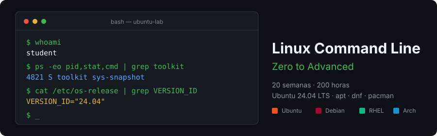

<p align="center">
  
</p>

<p align="center">
  <a href="LICENSE"></a>
  
  
  
  
</p>

<p align="center">
  <a href="README.md"></a>
</p>

---

## 📋 Description

Intensive **20-week (200-hour)** bootcamp to master the Linux command line
from zero to advanced. Not a tutorial of isolated commands: learn to
**operate, diagnose, and automate** a Linux system from the terminal, on
Ubuntu 24.04 LTS, with divergence from other major distro families (Debian,
RHEL/Fedora, Arch) flagged where it matters.

### 🎯 Objectives

By the end you will be able to:

- ✅ Navigate any Linux filesystem without a GUI and explain the FHS
- ✅ Read and write permissions (rwx, octal, ACLs, special bits) without guessing
- ✅ Build a `grep`/`sed`/`awk`/`cut`/`sort`/`find`/`xargs` pipeline to solve
  a real text or log problem
- ✅ Manage processes, signals, jobs, and read a service's state with
  `systemctl`/`journalctl`
- ✅ Install and compare packages across `apt`, `dnf`, and `pacman`
- ✅ Diagnose networking from the terminal: `ip`, `ss`, `curl`, `dig`, SSH
- ✅ Write robust bash scripts (`set -euo pipefail`, `trap`, shellcheck-clean)
- ✅ Schedule tasks with `cron` and systemd timers
- ✅ Inspect containers from the CLI and connect it to processes/namespaces
- ✅ Know where this bootcamp ends and the next one begins

### 🚀 Why an entire bootcamp on the command line?

Because most people learn ten isolated commands and stop right before what
matters: chaining them. A `grep` without an `awk` behind it is a search; a
`grep | awk | sort | uniq -c` is a report. A script without
`set -euo pipefail` "works" until it fails halfway and nobody notices. This
bootcamp closes that gap between "I know the command" and "I operate the
system."

---

## 🗓️ Bootcamp Structure

| Phase | Weeks | Hours | Topics |
|---|:--:|:--:|---|
| **Fundamentals** | 01-04 | 40 h | Shell, navigation, filesystem, permissions |
| **Data Manipulation** | 05-08 | 40 h | grep, sed, cut, sort, awk, pipes and redirection |
| **System & Processes** | 09-12 | 40 h | find/xargs, processes, multi-distro packages, networking |
| **Automation** | 13-16 | 40 h | Bash scripting from basics to robust, cron, systemd timers |
| **Advanced** | 17-19 | 30 h | Customization, logs, systemd, security, CLI containers |
| **Production / Integration** | 20 | 10 h | Final project, documentation, packaging |

---

## 📚 Content by Week

Weekly publication status in [`bootcamp/README.md`](bootcamp/README.md).

| # | Week | Description |
|:--:|---|---|
| 01 | [Terminal, shell and first steps](bootcamp/week-01-terminal_shell_y_primeros_pasos/) | What a terminal/TTY/shell is, the prompt, `man`/`--help`, builtins vs externals |
| 02 | [Navigation and the filesystem](bootcamp/week-02-navegacion_y_sistema_de_archivos/) | `pwd/cd/ls`, paths, FHS, file types, globbing |
| 03 | [File and directory manipulation](bootcamp/week-03-manipulacion_de_archivos_y_directorios/) | `cp/mv/rm/mkdir`, symlinks/hardlinks, `stat` |
| 04 | [Permissions and ownership](bootcamp/week-04-permisos_y_propiedad/) | rwx, octal, `chmod/chown`, umask, SUID/SGID/sticky, ACLs, `sudo` |
| 05 | [Redirection, pipes and data flow](bootcamp/week-05-redireccion_pipes_y_flujo_de_datos/) | stdin/stdout/stderr, pipes, `tee`, `$?`, `&&`/`||` |
| 06 | [Text search with grep and regex](bootcamp/week-06-busqueda_de_texto_con_grep_y_regex/) | `grep`, basic/extended regex, real log cases |
| 07 | [Text processing: sed, cut, sort, uniq, tr](bootcamp/week-07-procesamiento_de_texto_sed_cut_sort_uniq/) | Stream editing, trimming, sorting, deduplication |
| 08 | [awk and data pipelines](bootcamp/week-08-awk_y_pipelines_de_datos/) | `awk` (fields/patterns/actions), full pipelines |
| 09 | [File search and batch execution](bootcamp/week-09-busqueda_de_archivos_find_y_xargs/) | `find` complex predicates, `xargs` |
| 10 | [Process and signal management](bootcamp/week-10-gestion_de_procesos_y_senales/) | `ps/top`, hierarchy, signals, jobs, `nohup`/`disown` |
| 11 | [Users, groups and package management](bootcamp/week-11-usuarios_grupos_y_gestion_de_paquetes/) | Multi-user model, `apt` vs `dnf` vs `pacman` |
| 12 | [Networking from the command line](bootcamp/week-12-redes_desde_la_linea_de_comandos/) | `ip`, `ss`, `curl`/`wget`, `dig`, SSH, `scp`/`rsync` |
| 13 | [Bash scripting fundamentals](bootcamp/week-13-fundamentos_de_bash_scripting/) | Shebang, variables, quoting, conditionals, shellcheck |
| 14 | [Control flow and functions in bash](bootcamp/week-14-control_de_flujo_y_funciones_en_bash/) | Loops, functions, scope, basic arrays |
| 15 | [Robust scripts: error handling](bootcamp/week-15-scripts_robustos_manejo_de_errores/) | `set -euo pipefail`, `trap`, validation, logging |
| 16 | [Automation and scheduled tasks](bootcamp/week-16-automatizacion_y_tareas_programadas/) | `cron`, systemd timers, packaging tools |
| 17 | [Environment customization and productivity](bootcamp/week-17-personalizacion_del_entorno_y_productividad/) | `.bashrc`, PATH, aliases, tmux/screen |
| 18 | [Archiving, compression and system logs](bootcamp/week-18-archivado_compresion_y_registros_del_sistema/) | `tar/gzip`, backups, `journalctl`, `/var/log` |
| 19 | [systemd inspection, security and CLI containers](bootcamp/week-19-systemd_seguridad_y_contenedores_desde_cli/) | `systemctl`, `ufw`/`firewalld`, SSH hardening, `docker` |
| 20 | [Final project: integrated toolkit](bootcamp/week-20-proyecto_final_toolkit_integrado/) | Integration, documentation, packaging, demo |

### 🔑 Components of each week

```
week-XX-topic/
├── README.md                  # Objectives, contents, tips, deliverables
├── rubrica-evaluacion.md      # 30% knowledge / 40% performance / 30% product
├── checks.json                # The week's automated checks
├── 0-assets/                  # SVG diagrams
├── 1-teoria/                  # Theory files, one concept each
├── 2-practicas/               # Hands-on practices against the local lab
├── 3-proyecto/
│   ├── README.md              # The layer this week adds to toolkit
│   └── starter/               # Skeleton with TODOs. Never the solution
├── 4-recursos/
│   ├── ebooks-free/
│   ├── videografia/
│   └── webgrafia/
└── 5-glosario/
```

---

## 🛠️ Tools

| Tool | Version | Use |
|---|---|---|
| bash | 5.x | The bootcamp's interpreter |
| coreutils / findutils / grep / sed / gawk | GNU, Ubuntu 24.04's | The core of every practice |
| shellcheck | any | Audit the project's scripts |
| Docker + Compose v2 | Compose **v2** | Run the multi-distro lab |

### The local lab

Four containers on your machine, ~250 MB RAM, the same exercise run across
several so you see the divergence firsthand, not just read about it:

| Service | Image | Purpose |
|---|---|---|
| `ubuntu-lab` | `ubuntu:24.04` | Canonical environment — every practice and all autograding runs here |
| `debian-lab` | `debian:12` | Exploration: Debian family without `snap` |
| `rhel-lab` | `rockylinux:9` | Exploration: `dnf`/`rpm`, SELinux present |
| `arch-lab` | `archlinux:latest` | Exploration: `pacman`, minimal base |

Only `ubuntu-lab` is graded. The other three are for comparison, not for
submission.

---

## 🚀 Quick Start

### Prerequisites

Linux, macOS, or **WSL2** on Windows terminal. No programming knowledge
required: bash is taught throughout the bootcamp.

### 1. Install the tools

```bash
# Debian / Ubuntu
sudo apt update && sudo apt install -y shellcheck docker.io docker-compose-plugin
```

### 2. Clone and start the lab

```bash
git clone https://github.com/ergrato-dev/bc-linux-commandline.git
cd bc-linux-commandline
./scripts/start.sh
```

### 3. Verify it works

```bash
docker exec -it ubuntu-lab cat /etc/os-release | grep VERSION_ID
# VERSION_ID="24.04"
```

### 4. Get started

The project is one, and it grows across twenty weeks:
[`docs/proyecto-hilo-conductor.md`](docs/proyecto-hilo-conductor.md).

```bash
cd bootcamp/week-01-terminal_shell_y_primeros_pasos/
```

---

## ✅ Automated Verification

```bash
./scripts/verificar-semana.sh --doctor   # your environment
./scripts/verificar-semana.sh 04         # Week 04
```

Each hint names **which practice and which step** fixes it. How it works:
[`docs/autograding.md`](docs/autograding.md).

---

## 📊 Methodology

**Asynchronous self-study**, 10 h/week. Each week: theory (2-3 h), hands-on
practices against the lab (4-5 h), and a new layer of `toolkit` (2-3 h).

### Evaluation

| Evidence | Weight | Instrument |
|---|:--:|---|
| 🧠 Knowledge | 30% | 10 conceptual questions per week |
| 💪 Performance | 40% | The practices, verified by `checks.json` |
| 📦 Product | 30% | Automated points + manual rubric |

**Minimum 70% per evidence**, not on the average.

---

## ⚠️ Disclaimer

This material is educational. Every destructive exercise is practiced inside
the lab containers, never against the host. Before running any command from
this bootcamp against a real system, understand what it does — that is
exactly what this bootcamp teaches.

---

## 📄 License

[CC BY-NC-SA 4.0](LICENSE) — free use for non-commercial educational purposes.

---

## 📚 Additional Documentation

- [Documentation index](docs/README.md)
- [Environment setup](docs/setup-entorno.md)
- [Distro divergence](docs/divergencia-distros.md)
- [The running project](docs/proyecto-hilo-conductor.md)
- [Autograding](docs/autograding.md)
- [Linux tips](docs/trucos-linux.md)
- [Global glossary](docs/glosario-global.md)
- [Week index and status](bootcamp/README.md)
- [Authoring guide](CLAUDE.md)

---

<p align="center">
  <strong>Your terminal. Your system. No GUI, no fear.</strong>
</p>

<p align="center">
  <a href="bootcamp/week-01-terminal_shell_y_primeros_pasos/">Start Week 01</a> ·
  <a href="docs/setup-entorno.md">Set up the environment</a>
</p>
