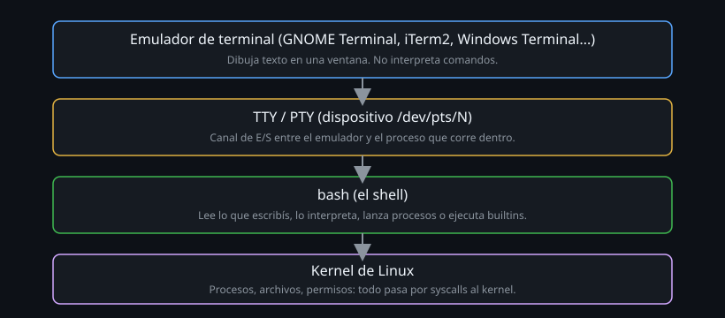

# Terminal, consola y TTY

> Antes de escribir un solo comando, conviene saber qué programa está
> realmente leyendo lo que tecleas — porque no es "la terminal".



## 🎯 Objetivos

- Distinguir el emulador de terminal, el dispositivo TTY/PTY y el shell
- Explicar por qué "abrir una terminal" en realidad abre varios programas
- Usar `tty`, `ps`, y `/dev/pts/` para ver esa pila desde adentro

## 1. Qué problema resuelve

Cuando alguien dice "abre una terminal y escribe `ls`", está comprimiendo
cuatro capas distintas en una sola palabra. Mientras no se separen, cualquier
error raro ("mi terminal no responde", "perdí el cursor", "el color se rompió")
se vuelve imposible de diagnosticar, porque no sabes en cuál de las cuatro
capas está el problema.

Este bootcamp asume que vas a operar máquinas remotas por SSH, dentro de
contenedores, a veces sin ventana gráfica en absoluto. Ahí "mi terminal" deja
de ser una aplicación con ícono y pasa a ser, literalmente, un archivo especial
del sistema. Si no entiendes esa pila, SSH te va a parecer magia en lugar de
una herramienta que puedes razonar.

## 2. Cómo funciona

### 2.1 Las cuatro capas

| Capa | Qué es | Ejemplo |
|---|---|---|
| Emulador de terminal | Programa con ventana que dibuja texto y captura teclado | GNOME Terminal, iTerm2, Windows Terminal, el panel de VS Code |
| TTY / PTY | Dispositivo del kernel que conecta emulador y shell | `/dev/pts/3` |
| Shell | Intérprete que lee lo que escribes y lo ejecuta | `bash` |
| Kernel | Gestiona procesos, archivos, memoria | Linux |

El término "terminal" viene de los **terminales físicos** de los años 70: una
pantalla y un teclado conectados por cable serie a una computadora central, sin
CPU propia. Hoy el emulador de terminal imita ese rol: es una ventana que
*emula* ser uno de esos terminales tontos, hablando con el shell a través de
un **pseudo-terminal** (PTY) en vez de un cable serie real.

### 2.2 TTY vs PTY

Un **TTY** (teletype) es el dispositivo original. Un **PTY** (pseudo-terminal)
es su versión virtual, creada por el kernel en pares: un lado "maestro" que
controla el emulador, un lado "esclavo" (`/dev/pts/N`) que es lo que ve el
shell. Cuando tecleas, el emulador escribe al maestro, el kernel lo pasa al
esclavo, y `bash` lo lee de ahí como si viniera de un teclado físico.

Esto es lo que te deja hacer `echo hola > /dev/pts/2` desde otra terminal y
ver "hola" aparecer en la pantalla de la terminal 2: le estás escribiendo
directo al dispositivo.

### 2.3 Qué pasa cuando "abres una terminal"

1. Haces doble clic en el ícono (o `Ctrl+Alt+T`, o conectas por SSH).
2. El sistema operativo lanza el **emulador de terminal** (un proceso gráfico
   normal, como cualquier ventana).
3. El emulador le pide al kernel un par PTY nuevo.
4. El emulador lanza un **shell** (`bash` por defecto en Ubuntu) conectado al
   lado esclavo del PTY.
5. El shell muestra el prompt. Recién ahí "la terminal está lista".

Cuando te conectas por SSH a un servidor remoto, **no hay emulador de
terminal del lado del servidor**: el cliente SSH de tu máquina actúa como
emulador, y el servidor crea el PTY y lanza el shell. Por eso un servidor sin
pantalla ni mouse puede "tener terminal" perfectamente — el concepto no
necesita hardware gráfico, necesita un PTY y un shell.

### 2.4 El terminal de control y por qué importa ya

Cada PTY tiene un **proceso de control** (normalmente tu shell de login) y un
grupo de procesos asociado. Cuando cierras la ventana del emulador o cortas la
conexión SSH de golpe, el kernel manda la señal `SIGHUP` ("hangup") a ese
proceso de control, que por defecto la propaga y termina todo lo que colgaba
de esa sesión.

Esto explica un problema real que vas a encontrar antes de la Semana 10 (donde
se explican señales a fondo): si lanzas un proceso largo (una descarga, un
`sleep 600`) y cierras la terminal, el proceso muere con la sesión. La
solución completa (`nohup`, `disown`, `tmux`) se ve más adelante — acá alcanza
con saber *por qué* pasa: no es que "se cortó la conexión", es que el kernel
mandó una señal específica a todo lo que dependía de ese TTY.

```bash
# Ver que proceso es el "lider de sesion" de tu PTY actual
ps -o pid,sid,tty,comm | grep "$(tty | sed 's#/dev/##')"
```

## 3. Cómo se usa

Todo esto ocurre dentro de `ubuntu-lab`, el contenedor del laboratorio.

```bash
# Que dispositivo TTY/PTY eres tu, ahora mismo
tty
# /dev/pts/1
```

```bash
# Los PTY activos en el sistema
ls -la /dev/pts/
# crw--w---- 1 root tty 136, 0 ene  1 10:00 0
# crw--w---- 1 root tty 136, 1 ene  1 10:00 1
```

```bash
# Ver la cadena de procesos: tu shell, y de donde cuelga
ps -o pid,ppid,tty,comm
#   PID  PPID TT       COMMAND
#  4821     1 pts/1    bash
#  4902  4821 pts/1    ps
```

La columna `TT` (o `TTY`) confirma que tanto `bash` como el `ps` que acabas de
correr están atados al mismo PTY: todo lo que haces en esa sesión cuelga del
mismo dispositivo.

```bash
# Escribirle directo a otra sesion abierta (si tienes dos terminales)
echo "hola desde otra sesion" > /dev/pts/2
```

Si `/dev/pts/2` tiene un shell interactivo abierto, el mensaje aparece ahí.
Esto no es un comando especial: es un `echo` normal redirigido a un archivo
que, en este caso, resulta ser un dispositivo de terminal.

```bash
# Que tipo de terminal cree tu emulador que es (afecta colores, teclas especiales)
echo "$TERM"
# xterm-256color
```

`$TERM` no es decorativo: programas como `vim`, `htop` o `less` lo consultan
para saber qué secuencias de escape puede interpretar tu emulador (cuántos
colores, si soporta mouse, qué significa la tecla Home). Un `$TERM` mal puesto
es la causa real detrás de "los colores de mi editor se ven raros por SSH".

```bash
# Tamaño en filas x columnas que el kernel cree que tiene tu terminal
stty size
# 24 80
```

Si redimensionas la ventana del emulador y un programa de pantalla completa
(como `htop`) no se adapta, `stty size` es el primer lugar donde mirar: el
kernel actualiza este valor vía una señal (`SIGWINCH`) que no siempre llega
limpia a través de ciertas conexiones SSH con multiplexores de por medio.

## 4. Antipatrones

| Antipatrón | Por qué duele | Qué hacer en su lugar |
|---|---|---|
| Pensar que "la terminal" y "el shell" son lo mismo | Confunde configuración de ventana (fuente, colores) con configuración de shell (`.bashrc`, alias) — terminas editando el archivo equivocado | Separar: colores y fuente van en el emulador; `PATH`, alias y funciones van en `.bashrc` |
| Asumir que un servidor remoto "no tiene terminal" porque no tiene pantalla | Un servidor sin monitor igual crea PTYs para cada sesión SSH — la confusión bloquea entender por qué SSH "funciona como una terminal" | Recordar: el PTY es un concepto del kernel, no de hardware gráfico |
| Matar la ventana del emulador para "cerrar la sesión" en un servidor remoto | Puede dejar procesos huérfanos corriendo si no se cerró la sesión del shell primero (`exit`/`logout`) | Cerrar con `exit` o `Ctrl+D` desde el shell, no cerrando la ventana de golpe |
| Culpar a "la conexión" cuando un proceso largo muere al cerrar la terminal | El verdadero mecanismo es `SIGHUP`, una señal concreta del kernel — sin nombrarla, el problema parece aleatorio | Reconocer el patrón: sesión cerrada → `SIGHUP` → proceso hijo termina, salvo que se haya protegido (visto en la Semana 10) |
| Ignorar `$TERM` al depurar un editor que "se ve mal" por SSH | El problema casi nunca es el editor: es que el emulador remoto y el local no acordaron el mismo valor de `$TERM` | Comprobar `echo $TERM` en ambos lados antes de tocar la configuración del editor |

## 5. Trucos

- `tty` te dice en qué PTY estás parado ahora — útil para distinguir sesiones
  cuando tienes varias pestañas abiertas y te perdiste cuál es cuál.
- `w` o `who` muestran qué usuarios tienen qué TTY abierto en todo el sistema
  — el primer comando que corres cuando entras a un servidor compartido para
  ver quién más está conectado.
- Si una sesión SSH "se congela" sin responder, `Enter ~ .` (enter, luego
  virgulilla, luego punto) la corta desde el lado del cliente sin esperar al
  servidor — funciona porque el cliente SSH, no el shell remoto, interpreta
  esa secuencia.
- `reset` arregla una terminal que quedó en un estado raro (binario volcado
  por accidente, colores invertidos) sin tener que cerrar la ventana.
- `script -q /dev/null` graba todo lo que pasa en tu sesión, literal, a un
  archivo — útil para documentar una práctica sin transcribir a mano.

## 📚 Recursos Adicionales

- [The TTY demystified](http://www.linusakesson.net/programming/tty/) — la
  referencia técnica más citada sobre cómo funciona un TTY/PTY en Linux.
- `man tty_ioctl` — la página de manual que documenta el dispositivo a bajo
  nivel.
- `man 7 pty` — la página que distingue formalmente PTY maestro y esclavo, con
  la nomenclatura exacta que usan las herramientas de diagnóstico.

## Resumen

Una "terminal" moderna es cuatro cosas apiladas, no una: el emulador (dibuja),
el PTY (conecta), el shell (interpreta) y el kernel (ejecuta). Separar estas
capas es lo que te permite razonar sobre SSH, sobre por qué un proceso muere
al cerrar la ventana, y sobre por qué dos terminales pueden "verse" distinto
aunque corran el mismo programa.

## ✅ Checklist de Verificación

- [ ] Corriste `tty` dentro de `ubuntu-lab` y identificaste tu PTY
- [ ] Corriste `ps -o pid,ppid,tty,comm` y ubicaste la columna `TT`
- [ ] Explicaste con tus palabras por qué un servidor sin pantalla igual "tiene terminal" cuando te conectas por SSH
