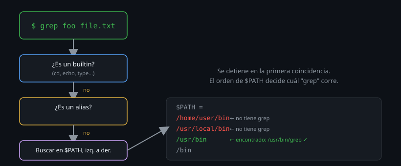

# Builtins, externos y `$PATH`

> "¿Dónde vive `cd`?" es una pregunta con trampa: en ningún archivo. Y eso
> cambia cómo depuras la mitad de los problemas de "comando no encontrado".



## 🎯 Objetivos

- Distinguir un comando builtin de uno externo y explicar por qué importa
- Leer y modificar `$PATH` con criterio, sin romper el sistema
- Usar `type`, `which` y `command` para diagnosticar qué se va a ejecutar

## 1. Qué problema resuelve

"Instalé el programa pero dice `command not found`" y "¿por qué mi alias no
tiene efecto en el script?" son, en el fondo, la misma pregunta mal
formulada: ¿bash está mirando *dónde* tiene que buscar este comando? Sin
entender `$PATH` y la diferencia entre builtin y externo, cada caso se
resuelve "a prueba y error" (reinstalar, reiniciar la terminal, copiar y
pegar comandos de internet) en lugar de diagnosticarse en diez segundos.

## 2. Cómo funciona

### 2.1 Builtin vs externo

| | Builtin | Externo |
|---|---|---|
| Qué es | Código dentro del propio binario `bash` | Un archivo ejecutable aparte en el disco |
| Ejemplos | `cd`, `echo`, `type`, `export`, `read`, `[` | `ls`, `grep`, `cat`, `curl` |
| Dónde "vive" | En ningún archivo — es parte de `bash` | En una carpeta de `$PATH`, ej. `/usr/bin/ls` |
| Por qué existe como builtin | Necesita modificar el estado del shell mismo (ej. `cd` cambia el directorio *de ese proceso*) | No necesita tocar el estado del shell — puede ser cualquier proceso aparte |

`cd` es el ejemplo que mejor explica por qué existen los builtins: si `cd`
fuera un programa externo, correría en un **proceso hijo** con su propia
copia del directorio de trabajo. Cambiaría *su* directorio, terminaría, y tu
shell seguiría exactamente donde estaba. Para que "cambiar de directorio"
tenga efecto en tu sesión, tiene que ejecutarse *dentro* del proceso del
shell — por eso es builtin, no un capricho de diseño.

### 2.2 Qué es `$PATH`

`$PATH` es una variable con una lista de carpetas, separadas por `:`, donde
bash busca comandos externos, en orden, de izquierda a derecha:

```bash
echo "$PATH"
# /home/student/bin:/usr/local/sbin:/usr/local/bin:/usr/sbin:/usr/bin:/sbin:/bin
```

Cuando escribes `grep algo archivo`, y `grep` no es builtin ni alias, bash
recorre cada carpeta de `$PATH` en ese orden hasta encontrar un archivo
ejecutable llamado `grep`. Se detiene en la **primera** coincidencia — si
tienes dos versiones de un mismo programa instaladas en carpetas distintas,
el orden de `$PATH` decide cuál gana, silenciosamente.

### 2.3 El orden de resolución completo

Antes de llegar a `$PATH`, bash revisa, en este orden:

1. **Funciones** definidas en la sesión actual
2. **Builtins**
3. **Alias** (solo en modo interactivo)
4. **`$PATH`**, carpeta por carpeta, en orden

Esto explica por qué un alias puede "tapar" un comando externo con el mismo
nombre (`alias ls='ls --color=auto'` sigue llamando al `ls` real adentro,
pero si defines `alias grep='echo no'`, ese `grep` manual gana siempre que
estés en modo interactivo).

### 2.4 Por qué `./script.sh` necesita el `./`

Por diseño, **el directorio actual no está en `$PATH`** (si lo estuviera,
cualquiera podría dejar un archivo malicioso llamado `ls` en una carpeta
compartida y hacer que lo ejecutes sin darte cuenta). Por eso un script en tu
carpeta actual necesita la ruta explícita:

```bash
./mi_script.sh     # funciona: ruta explicita
mi_script.sh       # "command not found", aunque el archivo este ahi mismo
```

### 2.5 La tabla hash: por qué bash a veces "no ve" lo que acabas de instalar

Recorrer todo `$PATH` cada vez que corres un comando sería lento si lo
repites cientos de veces por sesión. Bash lo evita con una **tabla hash
interna**: la primera vez que encuentra `grep` en `/usr/bin/grep`, memoriza
esa ruta, y las siguientes veces va directo ahí sin volver a buscar.

El problema aparece cuando instalas un programa nuevo *después* de que bash
ya memorizó que ese nombre "no existe", o cuando mueves un binario a una
carpeta distinta: bash sigue usando la ruta vieja de su memoria hasta que se
le indica lo contrario.

```bash
# Ver que tiene memorizado bash ahora mismo
hash
# hits  command
#    3  /usr/bin/grep
#    1  /usr/bin/ls

# Olvidar lo memorizado y recalcular en la proxima busqueda
hash -r
```

Esto explica un síntoma muy específico: instalas algo con `apt install`,
corres el comando y dice `command not found`, pero `which` sí lo encuentra.
La tabla hash quedó desactualizada; `hash -r` (o abrir una terminal nueva,
que empieza con la tabla vacía) lo arregla.

## 3. Cómo se usa

```bash
# Que es exactamente un comando dado: builtin, alias, archivo, o nada
type cd
# cd es una orden interna del shell (shell builtin)

type ls
# ls es un alias para 'ls --color=auto'

type grep
# grep es /usr/bin/grep
```

`type` es la herramienta más completa: distingue los cuatro casos (builtin,
alias, función, archivo) en una sola respuesta legible.

```bash
# Donde esta exactamente un comando externo, sin ambiguedad
which grep
# /usr/bin/grep

# Si hay varias versiones instaladas, todas las coincidencias en PATH
which -a python3
# /usr/bin/python3
# /usr/local/bin/python3
```

```bash
# Ignorar alias y funciones, ejecutar directamente el binario del PATH
command ls
```

`command` es útil dentro de scripts cuando quieres garantizar que corre el
programa real, sin importar qué alias haya definido el usuario que lo corre.

```bash
# Agregar una carpeta propia al PATH (para toolkit.sh de este bootcamp)
export PATH="$HOME/bin:$PATH"
```

Poner `$HOME/bin` **antes** de las carpetas del sistema significa que, si
alguna vez creas un script con el mismo nombre que un comando del sistema, el
tuyo gana — una razón más para no nombrar tus scripts como comandos ya
existentes.

## 4. Antipatrones

| Antipatrón | Por qué duele | Qué hacer en su lugar |
|---|---|---|
| Sobreescribir `$PATH` en vez de extenderlo (`export PATH="/mi/carpeta"`) | Borra todas las carpetas del sistema: de golpe, `ls`, `grep`, casi todo deja de encontrarse | Siempre extender: `export PATH="/mi/carpeta:$PATH"` |
| Asumir que un script en la carpeta actual se ejecuta solo con su nombre | El directorio actual no está en `$PATH` por diseño de seguridad | Usar `./script.sh`, o agregar la carpeta a `$PATH` si es de uso frecuente |
| Diagnosticar "command not found" reinstalando el paquete | Si el paquete instaló el binario en una carpeta fuera de `$PATH`, reinstalar no cambia nada | Primero `type`/`which`; si no aparece, revisar en qué carpeta quedó instalado y si esa carpeta está en `$PATH` |
| Definir un alias con el mismo nombre que un comando crítico sin saberlo | Alias tiene prioridad sobre el binario externo en modo interactivo — un `alias rm='rm -i'` roto puede ocultar comportamiento inesperado | Revisar `alias` sin argumentos para ver qué hay definido antes de asumir el comportamiento por defecto |

## 5. Trucos

- `type -a comando` muestra **todas** las coincidencias, no solo la que
  ganaría — útil para ver que un alias tapa a un binario real sin perder de
  vista que el binario sigue ahí.
- `hash -r` limpia la caché interna que bash mantiene de dónde encontró cada
  comando la última vez — necesario después de instalar algo nuevo si bash
  "no lo encuentra" aunque `which` sí lo vea.
- `echo "$PATH" | tr ':' '\n'` convierte el `$PATH` en una lista, una carpeta
  por línea — mucho más legible que la cadena con `:` cuando tienes que
  revisarlo a ojo.

## Resumen

Un comando se resuelve en un orden fijo — función, builtin, alias, `$PATH` —
y saber en cuál de esos cuatro casilleros cae el tuyo convierte "no sé por
qué esto no anda" en un diagnóstico de diez segundos con `type`. `$PATH` se
extiende, nunca se reemplaza; el directorio actual nunca forma parte de él
por diseño; y la tabla hash interna de bash es la explicación real detrás de
"lo instalé pero no lo encuentra".

## 📚 Recursos Adicionales

- [Bash Reference Manual — Command Search and Execution](https://www.gnu.org/software/bash/manual/bash.html#Command-Search-and-Execution) — el orden exacto de resolución, documentado oficialmente.
- `help type`, `man which` — ayuda offline de ambos comandos.
- `compgen -c` lista todos los comandos que bash puede completar con Tab en
  este momento — builtins, funciones y binarios de `$PATH` juntos — útil para
  ver de un vistazo qué tan poblado está tu `$PATH` actual.

## ✅ Checklist de Verificación

- [ ] Corriste `type` sobre un builtin, un alias, y un comando externo, y distinguiste las tres respuestas
- [ ] Agregaste `$HOME/bin` a tu `$PATH` de forma persistente en `~/.bashrc`
- [ ] Explicaste por qué `./script.sh` necesita el `./` y un comando del sistema no
- [ ] Provocaste y corregiste un fallo de la tabla hash con `hash -r`
