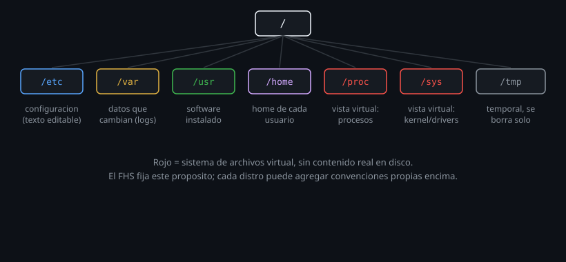

# El estándar FHS: qué vive dónde

> Linux no organiza archivos "como le parece a cada distro". Hay un estándar
> escrito, y conocerlo es lo que te permite operar Ubuntu, Debian o un RHEL
> sin perderte cada vez que cambias de máquina.



## 🎯 Objetivos

- Explicar para qué sirve el FHS y qué problema evita
- Ubicar los directorios de primer nivel más importantes y su propósito
- Saber en qué carpeta buscar configuración, binarios, datos variables y documentación

## 1. Qué problema resuelve

Sin un estándar, cada distribución podría poner los binarios de usuario en
cualquier carpeta inventada, la configuración en otro lado, y los logs en un
tercero — y un script que funciona en una distro rompería en otra sin razón
aparente. El **Filesystem Hierarchy Standard** (FHS) es justamente el
documento que fija dónde va cada tipo de archivo, para que ese caos no pase.
No es una convención de facto: es un estándar publicado, mantenido por la
Linux Foundation, que la inmensa mayoría de distribuciones respeta.

## 2. Cómo funciona

### 2.1 Los directorios de primer nivel

```bash
ls -la /
```

| Directorio | Qué vive ahí |
|---|---|
| `/bin`, `/sbin` | En Ubuntu 24.04, enlaces simbólicos a `/usr/bin`, `/usr/sbin` (ver nota abajo) |
| `/boot` | El kernel y los archivos que necesita el gestor de arranque |
| `/dev` | Archivos de dispositivo (discos, terminales, `/dev/null`) |
| `/etc` | Configuración del sistema, siempre archivos de texto editable |
| `/home` | El home de cada usuario normal |
| `/lib`, `/lib64` | Igual que `/bin`: enlaces a `/usr/lib` en Ubuntu |
| `/media`, `/mnt` | Puntos de montaje: medios extraíbles (`/media`) y montajes manuales temporales (`/mnt`) |
| `/opt` | Software de terceros que no sigue el empaquetado estándar de la distro |
| `/proc` | Sistema de archivos virtual: el estado del kernel y los procesos, no archivos reales en disco |
| `/root` | El home del usuario root — no confundir con `/` |
| `/run` | Datos de aplicaciones en ejecución desde el último arranque (reemplaza al viejo `/var/run`) |
| `/srv` | Datos servidos por este sistema (un servidor web, por ejemplo) |
| `/sys` | Otro sistema de archivos virtual: expone el estado del kernel sobre dispositivos y drivers |
| `/tmp` | Archivos temporales — se borra en cada reinicio, o periódicamente |
| `/usr` | El grueso del sistema: binarios, bibliotecas, documentación no esencial para arrancar |
| `/var` | Datos que cambian durante la operación normal: logs, colas, cachés, bases de datos |

### 2.2 La fusión `/usr` (`usr-merge`)

Hace años, `/bin` y `/usr/bin` eran carpetas separadas con un criterio
(¿este binario hace falta antes de montar `/usr`?) que con discos modernos
dejó de tener sentido. Ubuntu 24.04 (como la mayoría de distros actuales) ya
completó el **usr-merge**: `/bin`, `/sbin`, `/lib` son simples enlaces
simbólicos a sus equivalentes dentro de `/usr`.

```bash
ls -la / | grep -E '^l.*(bin|sbin|lib)'
# lrwxrwxrwx ... bin -> usr/bin
# lrwxrwxrwx ... lib -> usr/lib
# lrwxrwxrwx ... sbin -> usr/sbin
```

En la práctica esto no cambia cómo usas el sistema (`/bin/bash` sigue
"funcionando"), pero explica por qué en sistemas más viejos (o en
`rhel-lab`/`arch-lab`, que pueden mostrar la fusión de otra forma) la
distinción entre `/bin` y `/usr/bin` todavía importaba.

### 2.3 `/etc`: la carpeta que más vas a visitar

Casi toda la configuración del sistema vive en `/etc`, como archivos de
texto plano editables:

```bash
ls /etc | head -10
cat /etc/os-release       # que distro y version es esta
cat /etc/hostname          # el nombre de esta maquina
```

Una regla práctica: si buscas "¿dónde se configura X?", la respuesta casi
siempre empieza con `/etc/`.

### 2.4 `/var`: lo que cambia, versus `/usr`: lo que no

La distinción conceptual más útil del FHS es esta: `/usr` contiene software
instalado, que no cambia solo porque el sistema esté funcionando; `/var`
contiene los datos que ese software genera mientras corre (logs, colas de
impresión, cachés de paquetes, bases de datos). Un sistema con `/usr` en
solo lectura puede seguir funcionando; uno con `/var` en solo lectura se
traba casi de inmediato.

```bash
ls /var/log | head -5
du -sh /var/log 2>/dev/null
```

`/var/log` se retoma a fondo en la Semana 18.

### 2.5 `/proc` y `/sys`: no son archivos reales

A diferencia de todo lo anterior, `/proc` y `/sys` no ocupan espacio en
disco: son **sistemas de archivos virtuales** que el kernel genera al vuelo
para exponer su propio estado como si fueran archivos.

```bash
cat /proc/cpuinfo | head -5
cat /proc/1/comm           # el nombre del proceso con PID 1
ls /proc | grep -E '^[0-9]+$' | head -5   # un directorio por cada proceso vivo
```

Esto no es un detalle anecdótico: es la base de cómo herramientas como `ps`
o `top` obtienen su información (se retoma en la Semana 10) — no consultan
una base de datos, leen archivos de `/proc`.

### 2.6 Divergencia entre familias de distro

El FHS fija el **propósito** de cada directorio, pero dentro de ese marco
cada familia agrega sus propias convenciones adicionales. Ejemplos que vas a
ver si exploras `rhel-lab` y `arch-lab`:

| Convención | Ubuntu/Debian | RHEL/Fedora | Arch |
|---|---|---|---|
| Configuración de red/servicios adicional | Mayormente en `/etc/` directo o `/etc/netplan/` | También usa `/etc/sysconfig/` para variables de arranque de servicios | Mayormente en `/etc/` directo, filosofía minimalista |
| `/opt` | Poco usado por defecto | Poco usado por defecto | Poco usado por defecto |
| Base mínima de `/var` | Puebla varias subcarpetas desde la instalación | Similar a Debian | Imagen base casi vacía — muchas subcarpetas de `/var` se crean recién cuando instalas el paquete que las necesita |

Ninguna de estas diferencias contradice el FHS: todas coinciden en que
`/etc` es configuración y `/var` son datos variables. Lo que cambia es cuánto
contenido *adicional*, específico de la familia, se apila encima de ese
esqueleto común. Por eso el FHS es lo que te permite orientarte en cualquier
distro aunque nunca la hayas usado: el mapa general es el mismo, solo cambian
algunos detalles locales.

## 3. Cómo se usa

```bash
# Encontrar donde vive la configuracion de un servicio
ls /etc | grep ssh

# Ver cuanto espacio ocupa cada directorio de primer nivel
du -sh /* 2>/dev/null | sort -rh | head -10

# Confirmar que /bin es un enlace, no una carpeta real, en Ubuntu 24.04
readlink -f /bin
# /usr/bin
```

## 4. Antipatrones

| Antipatrón | Por qué duele | Qué hacer en su lugar |
|---|---|---|
| Guardar datos propios de una aplicación en `/usr` | `/usr` se considera reemplazable por una reinstalación o actualización del paquete; tus datos pueden perderse | Usar `/var` (datos que cambian) o `/opt` (software de terceros con sus propios datos) |
| Buscar configuración del sistema en cualquier carpeta menos `/etc` | La convención universal es `/etc`; buscar en otro lado es más lento y menos transferible entre distros | Empezar siempre por `/etc/nombre-del-servicio` |
| Tratar `/proc` como si fuera un directorio con archivos reales (copiarlo, respaldarlo) | No tiene contenido real en disco — es una vista generada por el kernel, se regenera sola | Consultarlo para leer estado, nunca para "guardar" nada ahí |
| Asumir que `/bin` y `/usr/bin` son necesariamente carpetas distintas | En sistemas con usr-merge (Ubuntu 24.04 incluido) son el mismo contenido, solo enlazado | Verificar con `readlink -f` antes de asumir cualquier diferencia |

## 5. Trucos

- `cat /etc/os-release` es el comando más rápido para identificar en qué
  distro y versión estás parado, sin depender de ningún comando específico
  de una familia.
- `du -sh /* 2>/dev/null | sort -rh` da un ranking de qué directorio de
  primer nivel ocupa más espacio — útil como primer paso al diagnosticar un
  disco lleno (se retoma a fondo en la Semana 18).
- `man hier` (o `man 7 file-hierarchy` en sistemas con systemd) es la página
  de manual que documenta el FHS completo, offline, sin buscar en internet.
- `readlink -f ruta` resuelve cualquier cadena de enlaces simbólicos hasta el
  destino final real — la forma rápida de confirmar si algo que parece una
  carpeta es en realidad un enlace, sin tener que leer `ls -la` con cuidado.
- `stat -f /` muestra el tipo de sistema de archivos del punto de montaje
  raíz (`ext4`, `overlay` dentro de un contenedor, etc.) — útil para saber
  qué limitaciones aplican antes de asumir un comportamiento.

## Resumen

El FHS es un estándar escrito, no una costumbre: fija qué tipo de contenido
va en cada directorio de primer nivel, y por eso un sistema Linux que nunca
viste se puede explorar con el mismo mapa mental que uno conocido. `/etc`
es configuración, `/var` son datos que cambian, `/usr` es software instalado,
`/proc` y `/sys` son vistas virtuales del kernel. Las familias de distro
agregan convenciones propias encima de ese esqueleto, pero nunca lo
contradicen. Ese es el valor práctico del estándar: te deja transferir el
conocimiento de una distro a otra sin reaprender nada desde cero. Vuelves a
este mapa cada vez que una semana nueva introduce un directorio nuevo.

## 📚 Recursos Adicionales

- [Filesystem Hierarchy Standard 3.0 (texto oficial)](https://refspecs.linuxfoundation.org/FHS_3.0/fhs/index.html) — el documento completo, mantenido por la Linux Foundation.
- `man hier` — la versión resumida y offline del mismo estándar.
- `man file-hierarchy` — la variante que documentan los sistemas con systemd, con detalle adicional sobre `/run` y los puntos de montaje modernos.

## ✅ Checklist de Verificación

- [ ] Ubicaste `/etc`, `/var`, `/usr` y explicaste la diferencia conceptual entre los tres
- [ ] Confirmaste que `/bin` es un enlace a `/usr/bin` en `ubuntu-lab`
- [ ] Exploraste `/proc` y explicaste por qué no es un directorio "real"
- [ ] Comparaste el contenido de `/var` entre `ubuntu-lab` y `arch-lab` y notaste la diferencia de "poblado" inicial

---

[← 01 — Rutas absolutas y relativas](01-rutas-absolutas-y-relativas.md) · [03 — Listar e interpretar ls →](03-listar-e-interpretar-ls.md)
