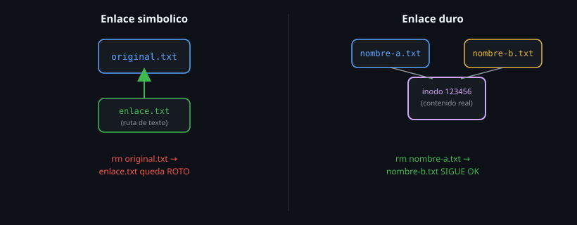

# Tipos de archivo y enlaces

> En Linux, "todo es un archivo" — pero no todos los archivos son iguales.
> Un directorio, un dispositivo y un enlace simbólico son tipos distintos,
> y confundirlos rompe scripts de formas sutiles.



## 🎯 Objetivos

- Reconocer los tipos de archivo de Linux y su letra en `ls -l`
- Distinguir enlace simbólico de enlace duro, y saber cuándo usar cada uno
- Usar `file` y `stat` para inspeccionar cualquier archivo sin adivinar

## 1. Qué problema resuelve

El primer carácter de `ls -l` (que quedó pendiente del archivo anterior) no
es un detalle cosmético: indica el **tipo** de archivo, y cada tipo se
comporta distinto frente a comandos como `cat`, `cd` o `rm`. Tratar un
enlace simbólico roto como un archivo normal, o confundir un enlace duro con
una copia, lleva a sorpresas — borrar "una copia" y descubrir que borraste
el único contenido real que había.

## 2. Cómo funciona

### 2.1 Los tipos de archivo, y su letra en `ls -l`

| Letra | Tipo | Ejemplo |
|---|---|---|
| `-` | Archivo regular | Un `.txt`, un script, un binario |
| `d` | Directorio | `/etc`, `/home` |
| `l` | Enlace simbólico | Un atajo que apunta a otra ruta |
| `c` | Dispositivo de caracteres | `/dev/tty`, `/dev/null` |
| `b` | Dispositivo de bloques | `/dev/sda` |
| `p` | Pipe con nombre (FIFO) | Poco común, para IPC entre procesos |
| `s` | Socket | `/run/docker.sock` |

```bash
ls -l /dev/null /dev/sda /etc/hostname 2>/dev/null
# crw-rw-rw- ... /dev/null
# brw-rw---- ... /dev/sda
# -rw-r--r-- ... /etc/hostname
```

La primera letra de cada línea confirma el tipo sin necesidad de ningún otro
comando.

### 2.2 `file`: cuando el nombre no alcanza

`ls -l` te da la categoría general; `file` inspecciona el **contenido real**
del archivo y te dice qué es, sin confiar en la extensión del nombre (que en
Linux es pura convención, no una garantía):

```bash
file /etc/hostname
# /etc/hostname: ASCII text

file /usr/bin/bash
# /usr/bin/bash: ELF 64-bit LSB pie executable, x86-64...

echo "esto es texto" > falso.pdf
file falso.pdf
# falso.pdf: ASCII text        (no "PDF document", aunque el nombre diga .pdf)
```

Ese último ejemplo es la lección central: la extensión `.pdf` no hace que
algo *sea* un PDF. `file` mira los primeros bytes del contenido (los
"magic numbers") para decidir, no el nombre.

### 2.3 Enlace simbólico (symlink): un atajo con ruta propia

Un enlace simbólico es un archivo pequeño que contiene **una ruta de
texto** hacia otro archivo o carpeta. Se crea con `ln -s`:

```bash
ln -s /etc/hostname /tmp/mi-enlace
ls -l /tmp/mi-enlace
# lrwxrwxrwx 1 root root 13 ene  1 10:00 /tmp/mi-enlace -> /etc/hostname
```

La flecha `->` en la salida de `ls -l` es literal: te muestra adónde apunta.
Características clave:

- Puede apuntar a algo que **no existe** (enlace roto) — `ls -l` lo sigue
  mostrando, pero cualquier intento de leerlo falla.
- Puede cruzar sistemas de archivos y particiones sin problema.
- Si borras el enlace, el archivo original sigue intacto.
- Si borras el **original**, el enlace queda roto (apunta a la nada).

```bash
rm /etc/hostname 2>/dev/null || true   # ejemplo, no lo hagas de verdad
ls -l /tmp/mi-enlace
# lrwxrwxrwx ... /tmp/mi-enlace -> /etc/hostname   (en rojo: roto)
```

### 2.4 Enlace duro (hard link): otro nombre para el mismo contenido

Un enlace duro **no** es un atajo: es otro nombre que apunta directamente al
mismo **inodo** (la estructura real que guarda el contenido del archivo en
disco). Se crea con `ln`, sin `-s`:

```bash
echo "contenido original" > /tmp/original.txt
ln /tmp/original.txt /tmp/duro.txt

ls -li /tmp/original.txt /tmp/duro.txt
# 123456 -rw-r--r-- 2 root root ... /tmp/original.txt
# 123456 -rw-r--r-- 2 root root ... /tmp/duro.txt
```

El mismo número de inodo (`123456`) en ambas líneas confirma que son el
mismo contenido con dos nombres. El contador de enlaces (columna 2, antes
"1", ahora "2") también lo refleja. Si editas uno, ves el cambio reflejado
en el otro — no son copias, son el mismo dato.

```bash
rm /tmp/original.txt
cat /tmp/duro.txt
# contenido original     (sigue ahi: el inodo solo se libera cuando el
#                          contador de enlaces llega a 0)
```

### 2.5 Enlace simbólico vs. enlace duro: cuándo usar cada uno

| | Simbólico (`ln -s`) | Duro (`ln`) |
|---|---|---|
| Qué es | Ruta de texto a otro archivo | Otro nombre para el mismo inodo |
| Cruza particiones/discos | Sí | No — mismo sistema de archivos obligatorio |
| Puede apuntar a un directorio | Sí | No (en la mayoría de los sistemas) |
| Sobrevive si borras el original | No — queda roto | Sí — el contenido persiste mientras quede al menos un nombre |
| Se ve distinto en `ls -l` | Sí, con `->` | No se distingue de un archivo regular a simple vista |

En la práctica, el 95% de los enlaces que vas a crear son simbólicos — son
más flexibles y más fáciles de reconocer. Los duros aparecen en casos
puntuales (deduplicación, algunos sistemas de respaldo).

## 3. Cómo se usa

```bash
# Inspeccionar que es algo sin confiar en su nombre ni extension
file archivo-sin-extension
file *.pdf          # confirmar que todos los "PDF" son PDF de verdad

# Crear y verificar un symlink
ln -s /ruta/real /ruta/enlace
ls -l /ruta/enlace
readlink /ruta/enlace       # imprime solo la ruta destino, sin el resto de ls -l

# Seguir un enlace hasta su destino final (incluso con varios enlaces encadenados)
readlink -f /ruta/enlace
```

```bash
# stat da el detalle completo de un archivo: inodo, enlaces, fechas de
# acceso/modificacion/cambio, todo lo que ls -l resume en una linea
stat /etc/hostname
```

## 4. Antipatrones

| Antipatrón | Por qué duele | Qué hacer en su lugar |
|---|---|---|
| Confiar en la extensión del nombre para saber el tipo de archivo | Un `.pdf` puede ser texto plano; un `.sh` puede no ser un script bash válido | Usar `file` para confirmar el contenido real |
| Borrar lo que parece "el original" de un par de enlaces duros pensando que el otro es una copia independiente | Ambos nombres apuntan al mismo contenido — la distinción "original/copia" no existe para enlaces duros | Usar `ls -li` para ver el inodo compartido antes de asumir cuál es cuál |
| Ignorar un enlace simbólico en rojo/parpadeante en la salida de `ls` | Significa que está roto — cualquier comando que intente leerlo va a fallar | Investigar con `readlink` adónde apunta y por qué ya no existe el destino |
| Crear un enlace duro a un directorio esperando que funcione como uno simbólico | La mayoría de los sistemas lo prohíben directamente | Usar `ln -s` para cualquier enlace a un directorio |

## 5. Trucos

- `readlink -f ruta` resuelve una cadena completa de enlaces simbólicos
  (incluso varios encadenados) hasta el destino final real.
- `find . -xtype l` encuentra enlaces simbólicos rotos en un árbol de
  carpetas — más rápido que revisar visualmente el color de cada uno
  (`find` se profundiza en la Semana 09, pero este uso puntual vale la pena
  antes).
- `file -i archivo` muestra el tipo MIME en vez de la descripción legible —
  útil cuando necesitas el valor exacto para un script, no una frase para
  humanos.

## Resumen

El primer carácter de `ls -l` fija el tipo de archivo; `file` confirma el
contenido real sin fiarse del nombre. Un enlace simbólico es una ruta de
texto que puede romperse; un enlace duro es otro nombre para el mismo
inodo, sin concepto de "original" ni "copia". Confundir ambos modelos es la
causa más común de perder datos que creías respaldados.

## 📚 Recursos Adicionales

- `man ln`, `man stat`, `man file` — referencia completa de los tres comandos centrales de este archivo.
- [GNU Coreutils Manual — Hard Links](https://www.gnu.org/software/coreutils/manual/html_node/Hard-Links.html) — la explicación oficial del modelo de inodos.

## ✅ Checklist de Verificación

- [ ] Identificaste los siete tipos de archivo por su letra en `ls -l`
- [ ] Creaste un enlace simbólico, lo rompiste a propósito, y lo viste marcado como roto
- [ ] Creaste un enlace duro y confirmaste con `ls -li` que comparte inodo con el original
- [ ] Usaste `file` para desenmascarar un archivo con extensión engañosa

---

[← 03 — Listar e interpretar ls](03-listar-e-interpretar-ls.md) · [05 — Globbing y expansión de patrones →](05-globbing-y-expansion-de-patrones.md)
