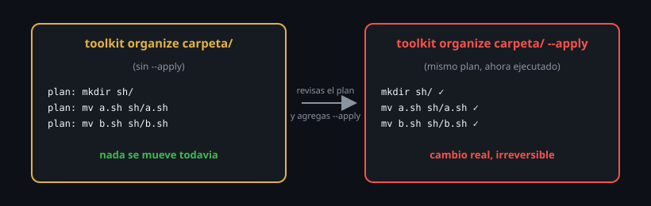

# Patrones seguros para operaciones destructivas

> Cada comando de esta semana (`cp`, `mv`, `rm`) puede operar sobre decenas
> de archivos a la vez. Este archivo cierra la semana con los hábitos que
> convierten "operación masiva" en algo controlado, no en una apuesta.



## 🎯 Objetivos

- Previsualizar una operación destructiva antes de ejecutarla de verdad
- Aplicar un patrón de respaldo rápido antes de cualquier cambio masivo
- Combinar glob, `cp`/`mv`/`rm` y confirmación en un flujo seguro y repetible

## 1. Qué problema resuelve

Los archivos anteriores de esta semana dieron herramientas individuales:
copiar con criterio, mover con cuidado, borrar sabiendo que no hay vuelta
atrás. Este archivo las combina en **hábitos repetibles** para cuando la
operación no es sobre un archivo suelto, sino sobre un lote completo — que
es exactamente donde un error se vuelve caro, porque afecta a muchos
archivos a la vez, no a uno.

## 2. Cómo funciona

### 2.1 El patrón "dry-run": previsualizar antes de ejecutar

La idea central: antes de que un comando *haga* algo, muestra qué *haría*,
sin ejecutarlo todavía. Para operaciones de archivo, el dry-run más simple
es reemplazar el comando real por `echo`:

```bash
for f in *.log; do
  echo mv "$f" "archivados/$f"     # dry-run: solo muestra el comando
done

# una vez que confirmas que la lista es correcta, sacar el echo:
for f in *.log; do
  mv "$f" "archivados/$f"
done
```

Este patrón — probar con `echo` adelante, confirmar visualmente, recién
después sacar el `echo` — es la forma más barata de evitar un error de
glob o de lógica antes de que mueva o borre algo real. Es exactamente lo
que hace `toolkit.sh organize` de esta semana: imprime el plan primero,
ejecuta solo con `--apply`.

### 2.2 Respaldo rápido antes de cualquier operación masiva

```bash
cp -a carpeta/ carpeta.bak-$(date +%Y%m%d)/
# ahora si, operar sobre carpeta/ con confianza
```

Un respaldo de un segundo (visto como patrón ya en el archivo de `cp`) es
barato comparado con el costo de equivocarse en una operación que toca
muchos archivos. La fecha en el nombre (`$(date +%Y%m%d)`) evita pisar un
respaldo anterior si repites el patrón varias veces.

### 2.3 Combinar glob + confirmación en un solo flujo

```bash
ls *.tmp                    # primero, mira que va a matchear
# archivo1.tmp archivo2.tmp archivo3.tmp

rm -I *.tmp                  # una sola confirmacion antes de borrar el lote
```

El orden importa: `ls` primero (o `echo`, viene a ser el mismo rol) para
confirmar qué matchea el patrón, recién después el comando real con `-I`
como última red de seguridad.

### 2.4 `--interactive=once` para `cp`/`mv` en lote

```bash
cp --interactive=once *.conf /etc/respaldo/
```

Similar al `-I` de `rm`: una sola pregunta antes de una operación que
afecta a varios archivos, en vez de preguntar uno por uno (`-i`) o no
preguntar nunca.

### 2.5 El patrón completo, de punta a punta

```bash
# 1. Previsualizar que va a matchear el patron
ls *.old

# 2. Respaldo rapido de la carpeta completa
cp -a . ../respaldo-$(date +%Y%m%d%H%M)/

# 3. Dry-run del plan real
for f in *.old; do
  echo mv "$f" "procesados/${f%.old}"
done

# 4. Ejecutar, ya con confianza
for f in *.old; do
  mv "$f" "procesados/${f%.old}"
done
```

Cuatro pasos, cada uno barato, que en conjunto hacen que una operación en
lote sea tan segura como una operación sobre un solo archivo — sin perder
la velocidad de operar sobre muchos a la vez.

### 2.6 El mismo patrón, adelantado a herramientas que vas a ver después

El patrón "previsualizar antes de ejecutar" no es exclusivo de `rm`/`mv`.
Cuando llegues a `find` en la Semana 09, vas a reconocer el mismo hábito:

```bash
# Adelanto: find siempre te deja ver que encontro antes de actuar sobre eso
find /tmp -name '*.tmp'              # primero, solo listar
find /tmp -name '*.tmp' -delete      # recien despues, actuar
```

No hace falta dominar `find` todavía — alcanza con notar que la misma
disciplina de "listar primero, actuar después" es universal en herramientas
que pueden afectar muchos archivos a la vez, no una particularidad de
`rm`/`mv`/`cp`.

### 2.7 Limpiar temporales incluso si el script falla a mitad

Un script que crea archivos temporales para un proceso intermedio (como el
respaldo de este mismo archivo) debería limpiarlos incluso si algo falla
antes de terminar. El mecanismo correcto (`trap`) se enseña recién en la
Semana 15, pero vale la pena ver el problema ahora:

```bash
# sin proteccion: si el script falla entre estas dos lineas, el temporal queda
temporal=$(mktemp)
procesar_algo > "$temporal"
mv "$temporal" destino-final
```

Guarda en la memoria esta pregunta — "¿qué pasa con mis archivos temporales
si este script se corta a la mitad?" — para cuando llegues a `trap`.

## 3. Cómo se usa

```bash
# El mismo patron aplicado a un caso real: limpiar temporales viejos
ls /tmp/*.tmp 2>/dev/null
rm -I /tmp/*.tmp 2>/dev/null
```

```bash
# toolkit.sh organize ya implementa este patron: dry-run por defecto
toolkit.sh organize ~/descargas
# (solo muestra el plan)
toolkit.sh organize ~/descargas --apply
# (recien ahora mueve algo)
```

## 4. Antipatrones

| Antipatrón | Por qué duele | Qué hacer en su lugar |
|---|---|---|
| Saltar directo a `rm`/`mv` sobre un glob sin verlo antes con `ls`/`echo` | Un glob mal pensado (o un `nullglob` olvidado, visto en la Semana 02) puede matchear de más o quedar literal | Previsualizar siempre antes de ejecutar sobre un patrón, no sobre un archivo suelto |
| Escribir un script que aplica cambios "directo", sin modo dry-run | Cualquier bug en la lógica se ejecuta de inmediato sobre datos reales, sin oportunidad de revisar | Diseñar scripts destructivos con un modo seguro por defecto y un flag explícito (`--apply`, `--force`) para el modo real |
| Pensar que un respaldo "para más adelante" alcanza después de ya haber operado | El respaldo solo protege si existe *antes* del cambio, no después | Hacer el respaldo como primer paso del flujo, no como una idea de último momento |

## 5. Trucos

- `echo` como dry-run universal funciona para casi cualquier comando que
  reciba argumentos de archivo — no hace falta que el comando tenga su
  propio flag de simulación.
- `read -p "Continuar? (s/N) " resp && [[ "$resp" == s ]]` es el patrón de
  confirmación manual más simple para scripts propios, cuando `-I` no es
  una opción del comando que estás usando.
- Nombrar las carpetas de respaldo con fecha y hora (`$(date
  +%Y%m%d%H%M)`) evita tener que elegir un nombre bajo presión, y ordena
  naturalmente los respaldos por antigüedad con `ls`.

## Resumen

Cuatro hábitos baratos convierten cualquier operación masiva en algo
controlado: previsualizar con `ls`/`echo` antes de ejecutar, respaldar con
fecha antes de tocar nada, confirmar una sola vez con `-I`/`--interactive=once`
en vez de preguntar por archivo o no preguntar nunca, y diseñar scripts
propios con un modo seguro por defecto. `toolkit.sh organize` de esta semana
aplica exactamente este patrón: dry-run por defecto, `--apply` explícito
para el cambio real.

## 📚 Recursos Adicionales

- [GNU Coreutils Manual — cp invocation](https://www.gnu.org/software/coreutils/manual/html_node/cp-invocation.html) — documenta `--interactive` junto al resto de flags de `cp`.
- `man date` — todos los formatos de `+%Y%m%d` y similares, para nombrar respaldos de forma consistente.

## ✅ Checklist de Verificación

- [ ] Aplicaste el patrón dry-run con `echo` antes de un `mv`/`rm` en lote real
- [ ] Hiciste un respaldo rápido con fecha en el nombre antes de una operación masiva
- [ ] Combinaste `ls`/glob + `-I` en un flujo de borrado en lote
- [ ] Explicaste por qué `toolkit.sh organize` pide `--apply` en vez de aplicar cambios por defecto
- [ ] Identificaste en qué punto de un script propio haría falta limpiar temporales si algo falla a mitad

---

[← 05 — stat y metadatos](05-stat-y-metadatos.md) · [Práctica 01 →](../2-practicas/01-crear-archivos-y-directorios.md)
