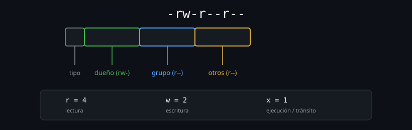

# Modelo de permisos: rwx y los tres ámbitos

> Viste el primer carácter de `ls -l` (el tipo de archivo) en la Semana 02.
> Esta semana es sobre los nueve caracteres que siguen — y por qué están
> organizados en grupos de tres, no como un bloque único.



## 🎯 Objetivos

- Leer los nueve caracteres de permisos de `ls -l` sin contar con los dedos
- Explicar qué significa cada letra (`r`, `w`, `x`) según el tipo de archivo
- Distinguir los tres ámbitos: dueño, grupo, otros

## 1. Qué problema resuelve

"¿Por qué no puedo editar este archivo?" o "¿por qué este script no corre
aunque tenga el shebang correcto?" son, casi siempre, preguntas de permisos
mal diagnosticadas. Sin un modelo claro de qué significa cada letra y a
quién aplica, la respuesta instintiva suele ser `chmod 777` — que "funciona"
en el sentido de que el error desaparece, al costo de abrir el archivo a
cualquiera. Este archivo da el modelo completo para diagnosticar con
precisión, no para silenciar el síntoma.

## 2. Cómo funciona

### 2.1 Los nueve caracteres, en tres grupos de tres

```bash
ls -l /etc/hostname
# -rw-r--r-- 1 root root 12 ene  1 10:00 /etc/hostname
```

Después del carácter de tipo (`-`), quedan nueve caracteres:

```
rw-r--r--
└┬┘└┬┘└┬┘
 │  │  └── otros (cualquier otro usuario del sistema)
 │  └───── grupo (los miembros del grupo dueño del archivo)
 └──────── dueño (el usuario propietario del archivo)
```

Cada grupo de tres repite el mismo patrón `rwx` (lectura, escritura,
ejecución), y un `-` en cualquier posición significa que ese permiso puntual
falta. `rw-r--r--` se lee: el dueño puede leer y escribir pero no ejecutar;
el grupo solo puede leer; cualquier otro usuario solo puede leer.

### 2.2 Qué significa cada letra, en un archivo regular

| Letra | En un archivo | Permite... |
|---|---|---|
| `r` | Lectura | Abrir y leer el contenido (`cat`, un editor, etc.) |
| `w` | Escritura | Modificar el contenido |
| `x` | Ejecución | Correrlo como programa (si además es un binario o un script con shebang) |

```bash
echo 'echo hola' > script.sh
./script.sh
# bash: ./script.sh: Permission denied

chmod +x script.sh
./script.sh
# hola
```

Tener `r` no implica tener `x`, y viceversa: puedes leer un script sin poder
ejecutarlo, o (más raro, pero posible) tener permiso de ejecución sin
permiso de lectura explícito en algunos casos de binarios compilados.

### 2.3 Una advertencia antes de seguir: `root` no respeta estos permisos

El usuario por defecto de `ubuntu-lab` es `root`, y **`root` no está sujeto
a la mayoría de estas comprobaciones de permisos**: puede entrar a
cualquier directorio, escribir en cualquier archivo, y borrar cualquier
cosa, sin importar qué digan `rwx`. Esto no es un capricho del laboratorio:
es el comportamiento real de Linux — `root` existe justamente para poder
saltarse estas reglas cuando hace falta administrar el sistema.

Eso significa que, para ver de verdad un "Permission denied" en el resto de
esta semana, hace falta operar como un usuario normal. Creá uno ahora, una
sola vez, y vas a reutilizarlo en el resto de los archivos:

```bash
useradd -m -s /bin/bash estudiante
su estudiante -c 'whoami'
# estudiante
```

`su usuario -c 'comando'` ejecuta ese comando puntual como `estudiante`, sin
abrir una sesión interactiva aparte — la forma más rápida de probar "esto
funcionaría si no fueras root".

### 2.4 Qué significa cada letra, en un directorio (distinto de un archivo)

Esta es la parte que más gente pasa por alto: en un directorio, `rwx`
significa algo **distinto** a en un archivo:

| Letra | En un directorio | Permite... |
|---|---|---|
| `r` | Lectura | Listar los nombres dentro (`ls`) |
| `w` | Escritura | Crear, borrar o renombrar entradas dentro (no depende de los permisos del archivo individual) |
| `x` | Ejecución ("tránsito") | Entrar al directorio (`cd`) y acceder a archivos dentro por nombre, aunque no los liste |

```bash
mkdir /tmp/carpeta-sin-x
chown estudiante /tmp/carpeta-sin-x
chmod 644 /tmp/carpeta-sin-x    # r y w, sin x

su estudiante -c 'cd /tmp/carpeta-sin-x'
# bash: line 1: cd: /tmp/carpeta-sin-x: Permission denied
```

(Como `root` no está sujeto a esta comprobación, el `cd` tiene que probarse
con `estudiante` — visto en la advertencia de la sección anterior.) Sin `x`
en un directorio, ni siquiera puedes entrar — aunque tengas `r` y
puedas, en teoría, "listar" su contenido con algunas herramientas. Este
`x` como "tránsito" es la causa real detrás de un caso confuso: un
directorio con `r-x` (sin `w`) permite entrar y listar, pero no crear ni
borrar nada adentro, sin importar los permisos de los archivos
individuales que ya existan ahí.

### 2.5 El permiso de **borrar** un archivo no depende del archivo mismo

Un malentendido común: pensar que para borrar un archivo necesitas permiso
de escritura *sobre ese archivo*. En realidad, borrar (o renombrar) depende
del permiso de escritura sobre el **directorio que lo contiene**, no sobre
el archivo:

```bash
mkdir -p /tmp/protegido
chown estudiante /tmp/protegido          # estudiante SI tiene w sobre el directorio
touch /tmp/protegido/archivo.txt
chown estudiante /tmp/protegido/archivo.txt
chmod 444 /tmp/protegido/archivo.txt      # pero el archivo mismo, sin w para nadie

su estudiante -c 'rm /tmp/protegido/archivo.txt'
# rm: remove write-protected regular empty file 'archivo.txt'?
```

`rm` pregunta porque el archivo mismo está protegido contra escritura, pero
si confirmas con `y`, **sí se borra** — porque lo que realmente importa es
que `estudiante` tenga `w` sobre el directorio `/tmp/protegido/`, no sobre
el archivo. (De nuevo, como `root`, este `rm` ni siquiera preguntaría: para
`root` todo archivo es "escribible" a los efectos de esta comprobación.)

### 2.6 A cuál de los tres ámbitos perteneces tú

Los permisos de "dueño" y "grupo" solo tienen sentido si sabes quién eres
para el sistema en ese momento:

```bash
id
# uid=1000(student) gid=1000(student) grupos=1000(student),27(sudo)

groups
# student sudo
```

`id` muestra tu usuario, tu grupo principal, y **todos** los grupos
adicionales a los que perteneces. Esto importa porque el permiso de
"grupo" de un archivo aplica a ti si **cualquiera** de tus grupos coincide
con el grupo dueño del archivo — no hace falta que sea tu grupo principal.

```bash
ls -l /var/log/syslog
# -rw-r----- 1 syslog adm ...

groups
# student sudo adm      <- si "adm" aparece aca, el permiso de grupo aplica
```

## 3. Cómo se usa

```bash
# Leer los permisos de algo sin ninguna ambiguedad
ls -ld archivo.txt carpeta/

# Confirmar el dueño y grupo al mismo tiempo que los permisos
ls -l archivo.txt
# -rw-r--r-- 1 ana  desarrollo  ...
```

```bash
# Ver el efecto de x en un directorio
mkdir prueba && touch prueba/archivo.txt
chmod 600 prueba        # sin x: no se puede entrar
cd prueba 2>&1
chmod 700 prueba        # con x: ahora si
cd prueba && ls
```

## 4. Antipatrones

| Antipatrón | Por qué duele | Qué hacer en su lugar |
|---|---|---|
| Pensar que `rwx` significa lo mismo en un archivo que en un directorio | Lleva a confundir "no puedo listar" con "no puedo entrar", que son permisos distintos (`r` vs `x`) | Recordar la tabla separada: en directorios, `x` es tránsito, `r` es listado, `w` es modificar entradas |
| Asumir que borrar un archivo requiere `w` sobre el archivo mismo | El permiso real que importa es `w` sobre el directorio contenedor | Revisar permisos del directorio, no del archivo, cuando `rm` se comporta distinto a lo esperado |
| Usar `chmod 777` para "que funcione" sin diagnosticar cuál de los tres ámbitos faltaba | Da permiso total a cualquier usuario del sistema, mucho más de lo necesario | Diagnosticar primero con `ls -l` qué ámbito (dueño/grupo/otros) y qué letra falta, corregir solo eso |

## 5. Trucos

- `stat -c '%A'` da los permisos en el mismo formato legible que `ls -l`,
  útil cuando necesitas solo ese dato sin el resto de la línea.
- Si un `cd` falla con "Permission denied" pero `ls -ld` muestra que el
  directorio tiene `r`, el problema casi siempre es que falta `x` — el
  permiso de tránsito, no el de listado.
- `namei -l /ruta/completa/archivo` muestra los permisos de **cada**
  componente de la ruta, uno por uno — útil cuando el problema no está en
  el archivo final sino en algún directorio intermedio del camino.

## Resumen

Los nueve caracteres de permisos se leen en tres grupos de tres (dueño,
grupo, otros), y `rwx` significa algo distinto en un archivo que en un
directorio — `x` en particular es "tránsito", no "listado". Borrar un
archivo depende del directorio contenedor, no del archivo en sí, y a cuál
ámbito perteneces depende de **todos** tus grupos, no solo el
principal. Con este modelo, diagnosticar un "Permission denied" es mirar
tres cosas puntuales, no tirar `chmod 777` a ciegas.

## 📚 Recursos Adicionales

- `man 7 inode` — la página de manual que documenta el modelo de permisos a nivel de inodo, con precisión técnica completa.
- [GNU Coreutils Manual — File permissions](https://www.gnu.org/software/coreutils/manual/html_node/File-permissions.html) — referencia de cómo las herramientas GNU interpretan y muestran permisos.

## ✅ Checklist de Verificación

- [ ] Leíste los nueve caracteres de permisos de tres archivos reales, sin ayuda
- [ ] Reprodujiste que un directorio sin `x` no se puede "entrar", aunque tenga `r`
- [ ] Confirmaste que borrar un archivo depende del permiso del directorio contenedor, no del archivo
- [ ] Usaste `namei -l` para diagnosticar permisos a lo largo de una ruta completa

---

[← Semana 04](../README.md) · [02 — chmod: octal y simbólico →](02-chmod-octal-y-simbolico.md)
