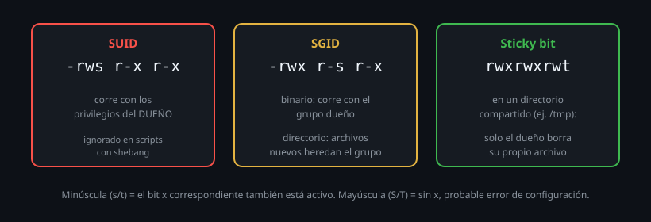

# Bits especiales: SUID, SGID, sticky

> El cuarto dígito octal, mencionado de pasada hasta ahora, es donde viven
> tres bits que cambian radicalmente cómo se ejecuta un programa o cómo se
> comporta un directorio compartido.



## 🎯 Objetivos

- Explicar qué hace SUID en un binario ejecutable, y por qué es riesgoso
- Usar SGID en directorios para herencia de grupo (visto en el archivo anterior, ahora a fondo)
- Usar el sticky bit para proteger directorios compartidos como `/tmp`

## 1. Qué problema resuelve

Los permisos normales (`rwx` × tres ámbitos) no alcanzan para dos problemas
reales: "este programa necesita privilegios de otro usuario mientras
corre" (resuelto con SUID/SGID) y "esta carpeta es compartida por todos,
pero nadie debería poder borrar los archivos de los demás" (resuelto con
el sticky bit). Los tres bits especiales existen exactamente para estos
casos puntuales, no para uso general.

## 2. Cómo funciona

### 2.1 El cuarto dígito octal: dónde viven los tres bits

```
4 = SUID
2 = SGID
1 = sticky
```

Se escriben como un dígito extra, al principio: `4755`, `2770`, `1777`. Se
suman igual que los tres dígitos normales, si necesitas más de uno a la
vez (`6755` = SUID + SGID juntos, poco común pero válido).

### 2.2 SUID: ejecutar con los privilegios del dueño, no de quien lo corre

```bash
ls -l /usr/bin/passwd
# -rwsr-xr-x 1 root root ...
```

La `s` en lugar de `x` en la posición del dueño indica SUID activo. Cuando
un usuario normal ejecuta `passwd`, el proceso corre con los privilegios
del **dueño del archivo** (`root`), no con los privilegios de quien lo
ejecutó — necesario porque cambiar tu propia contraseña implica escribir
en `/etc/shadow`, un archivo que un usuario normal no puede tocar
directamente.

```bash
chmod u+s /tmp/mi-programa      # simbolico
chmod 4755 /tmp/mi-programa      # octal, equivalente
```

### 2.3 Por qué SUID es, con razón, el bit más vigilado del sistema

Un binario con SUID activo y perteneciente a `root` es, potencialmente, una
puerta a privilegios elevados para cualquiera que pueda ejecutarlo. Por
eso:

- Los sistemas auditan periódicamente qué binarios tienen SUID activo.
- Nunca se le pone SUID a un script de shell interpretado (la mayoría de
  los sistemas Linux modernos directamente **ignoran** el bit SUID en
  scripts, por las múltiples formas conocidas de explotarlo).
- Activar SUID en algo propio, "para no tener que usar `sudo`", es
  prácticamente siempre un error de diseño — la alternativa correcta casi
  siempre es `sudo` con una regla específica en `/etc/sudoers` (visto en
  el archivo 06).

```bash
find / -perm -4000 -type f 2>/dev/null
# lista todos los binarios con SUID activo en el sistema -- vale la pena
# conocer esta lista y poder explicar por que cada uno la necesita
```

### 2.4 SGID en un binario: lo mismo que SUID, pero con el grupo

```bash
ls -l /usr/bin/wall
# -rwxr-sr-x 1 root tty ...
```

Igual que SUID pero con el **grupo** dueño: el proceso corre con los
privilegios del grupo del archivo, no del grupo de quien lo ejecuta. Menos
común que SUID, pero el mismo mecanismo.

### 2.5 SGID en un directorio: herencia de grupo (ya visto, ahora completo)

```bash
chmod g+s /srv/equipo      # simbolico
chmod 2775 /srv/equipo      # octal: 2 = SGID, 775 = rwxrwxr-x
```

Ya viste esto en el archivo anterior: en un **directorio**, SGID no
significa "ejecutar con privilegios de grupo" (no tiene sentido ejecutar un
directorio) — significa que **los archivos nuevos creados ahí heredan el
grupo del directorio**, no el grupo principal de quien los crea.

### 2.6 El sticky bit: proteger un directorio compartido

```bash
ls -ld /tmp
# drwxrwxrwt 18 root root ...
```

La `t` final indica el sticky bit activo. En un directorio con permisos
abiertos (como `/tmp`, que necesita ser escribible por todos), el sticky
bit agrega una regla extra: **solo el dueño de un archivo (o root) puede
borrarlo o renombrarlo**, aunque el directorio sea escribible por
cualquiera.

Sin sticky bit, cualquier usuario con permiso de escritura sobre `/tmp`
podría borrar archivos de otros usuarios ahí (recuerda: borrar depende del
permiso del directorio, visto en el archivo 01). Con sticky bit, ese
permiso de escritura sobre el directorio ya no alcanza para borrar lo
ajeno.

```bash
chmod +t /srv/compartido      # simbolico
chmod 1777 /srv/compartido     # octal: 1 = sticky, 777 = rwxrwxrwx
```

### 2.7 Comprobar en carne propia que un script ignora SUID

Para ver el efecto hace falta ejecutar el script como un usuario **sin**
privilegios (en `ubuntu-lab` el usuario por defecto ya es `root`, así que
primero creamos uno de prueba):

```bash
useradd -m testuser

cat > /tmp/prueba-suid.sh << 'EOF'
#!/usr/bin/env bash
echo "UID real: $(id -u)"
echo "UID efectivo: $EUID"
EOF
chmod 4755 /tmp/prueba-suid.sh    # SUID activo, dueño root (el actual)

su testuser -c /tmp/prueba-suid.sh
# UID real: 1001
# UID efectivo: 1001    <- deberia ser 0 si SUID se aplicara, pero no lo hace
```

El kernel de Linux (desde hace décadas, por las vulnerabilidades conocidas
de SUID en scripts interpretados) ignora el bit SUID específicamente
cuando el archivo ejecutable empieza con un shebang (`#!`). Esto no es un
bug ni una configuración particular de este contenedor: es el
comportamiento estándar en prácticamente todas las distros modernas.

## 3. Cómo se usa

```bash
# Encontrar todos los binarios con SUID o SGID en el sistema (auditoria)
find / -perm -4000 -o -perm -2000 2>/dev/null

# Configurar una carpeta de equipo con herencia de grupo y proteccion
sudo mkdir /srv/equipo
sudo chgrp desarrollo /srv/equipo
sudo chmod 2775 /srv/equipo

# Configurar una carpeta compartida tipo /tmp: abierta, pero protegida
sudo mkdir /srv/compartido
sudo chmod 1777 /srv/compartido
```

## 4. Antipatrones

| Antipatrón | Por qué duele | Qué hacer en su lugar |
|---|---|---|
| Activar SUID en un script propio para evitar escribir `sudo` cada vez | La mayoría de los sistemas ignoran SUID en scripts, y si no lo ignoraran, sería un riesgo de seguridad serio | Configurar una regla específica en `sudoers` (archivo 06), nunca SUID en un script |
| Confundir el sticky bit con "proteger contra lectura" | El sticky bit solo restringe quién puede **borrar/renombrar**, no quién puede leer o escribir contenido | Usar permisos normales (`rwx`) para controlar lectura/escritura; sticky solo resuelve el problema puntual de borrado en carpetas compartidas |
| No auditar nunca qué binarios tienen SUID activo en un sistema que administras | Un SUID agregado por error (o maliciosamente) pasa desapercibido indefinidamente | Correr `find / -perm -4000` periódicamente y tener una lista de referencia de qué debería aparecer ahí |
| Pensar que SGID en un directorio afecta los archivos ya existentes | Solo afecta a lo que se crea después de activarlo (ya visto en el archivo anterior) | Alinear lo existente con `chgrp -R` antes de confiar en SGID para el futuro |

## 5. Trucos

- `ls -l` marca SUID/SGID activos con una `s` minúscula si el bit `x`
  correspondiente también estaba activo, o una `S` mayúscula si SUID/SGID
  está activo pero `x` no — esa distinción de mayúscula/minúscula es una
  señal de configuración probablemente incorrecta (SUID sin `x` no sirve
  para nada).
- El sticky bit se muestra como `t` minúscula (con `x` activo) o `T`
  mayúscula (sin `x`) en la posición de "otros" — misma lógica que SUID/SGID.
- `find /ruta -perm -1000` encuentra directorios con sticky bit activo,
  útil para auditar carpetas compartidas de un sistema que no armaste tú.

## Resumen

Tres bits viven en el cuarto dígito octal: SUID (4) ejecuta con los
privilegios del dueño, SGID (2) hace lo mismo con el grupo en binarios o
hereda grupo en directorios, sticky (1) protege contra borrado ajeno en
carpetas compartidas. SUID es, con razón, el más vigilado: casi nunca es la
herramienta correcta para "evitar escribir sudo" — esa necesidad real se
resuelve con una regla de `sudoers`, tema del archivo siguiente.

## 📚 Recursos Adicionales

- [GNU Coreutils Manual — Special file permission bits](https://www.gnu.org/software/coreutils/manual/html_node/File-permissions.html) — SUID/SGID/sticky documentados junto al resto de permisos.
- `man 2 execve`, sección sobre SUID/SGID — el detalle técnico completo de cómo el kernel aplica estos bits al ejecutar un programa.
- [Debian Wiki — SUID / SGID binaries](https://wiki.debian.org/SUID) — una guía práctica sobre cómo auditar y entender binarios con estos bits activos en un sistema real.

## ✅ Checklist de Verificación

- [ ] Encontraste al menos tres binarios con SUID activo en el sistema y explicaste por qué cada uno lo necesita
- [ ] Configuraste una carpeta con SGID y confirmaste la herencia de grupo
- [ ] Configuraste una carpeta con sticky bit y confirmaste que un usuario no puede borrar archivos ajenos ahí
- [ ] Distinguiste `s`/`S` y `t`/`T` en `ls -l`, y explicaste qué significa cada mayúscula
- [ ] Explicaste por qué la mayoría de los sistemas ignoran SUID en scripts de shell interpretados

---

[← 04 — umask](04-umask.md) · [06 — ACLs y el modelo de confianza de sudo →](06-acls-y-el-modelo-de-sudo.md)
