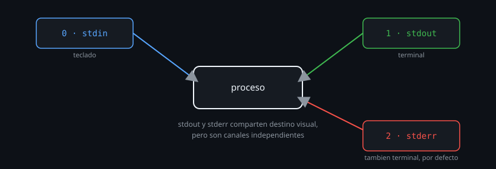

# stdin, stdout y stderr: los tres flujos

> Todo comando de Linux nace con tres canales abiertos, no uno. Confundir
> "lo que ves en pantalla" con "stdout" es el primer malentendido que esta
> semana corrige — y de ahí sale casi todo lo demás.



## 🎯 Objetivos

- Distinguir stdin, stdout y stderr como tres flujos independientes
- Explicar por qué `2>&1` existe y qué resuelve
- Reconocer cuándo un comando mezcla salida normal y de error sin que lo notes
- Inspeccionar los descriptores reales de un proceso vivo en `/proc`

## 1. Qué problema resuelve

"El comando no mostró ningún error" a veces significa que el error se
escribió a un lugar que no estabas mirando. Linux separa, desde el
diseño mismo de cada proceso, la salida normal de la salida de error — y
quien no conoce esa separación termina con scripts que "funcionan" porque
nunca vieron el error que estaba ahí, visible, en el canal equivocado.

## 2. Cómo funciona

### 2.1 Los tres flujos, con número de descriptor

Todo proceso en Linux arranca con tres **descriptores de archivo**
abiertos por convención:

| Descriptor | Nombre | Flujo | Por defecto apunta a |
|:--:|---|---|---|
| `0` | stdin | Entrada estándar | El teclado |
| `1` | stdout | Salida estándar | La terminal |
| `2` | stderr | Error estándar | La terminal |

`stdout` y `stderr` van, por defecto, al **mismo lugar visual** (tu
terminal) — por eso a simple vista parecen una sola salida. No lo son: son
dos canales distintos, que solo coinciden en destino hasta que decides
separarlos.

```bash
ls /etc /no-existe
```

```
/etc:
...archivos listados aqui, por stdout...
ls: cannot access '/no-existe': No such file or directory
```

Ese mensaje de error salió por `stderr` (descriptor `2`), no por `stdout`
(descriptor `1`) — aunque los veas mezclados en la misma pantalla.

### 2.2 Confirmar la separación

```bash
ls /etc /no-existe 1>/dev/null
```

```
ls: cannot access '/no-existe': No such file or directory
```

Al mandar `stdout` a `/dev/null` (un "agujero negro" que descarta
cualquier cosa escrita ahí), el listado de `/etc` desaparece pero el
mensaje de error **sigue apareciendo** — la prueba directa de que viajan
por canales distintos.

```bash
ls /etc /no-existe 2>/dev/null
```

Al revés: el error desaparece, el listado normal se mantiene.

### 2.3 Por qué `stdin` importa incluso cuando no escribes nada

Muchos comandos, si no reciben argumentos de archivo, leen de `stdin` en
vez de fallar:

```bash
cat
hola
hola
chau
chau
```

`cat` sin argumentos lee lo que escribas línea por línea y lo repite —
está leyendo de `stdin`, que por defecto es tu teclado. `Ctrl+D` (fin de
archivo, *EOF*) termina esa lectura.

### 2.4 Redirigir `stdin` desde un archivo

```bash
cat < /etc/hostname
```

Esto difiere de `cat /etc/hostname` en el mecanismo, aunque el resultado
visible sea igual: acá, `cat` lee de `stdin`, y tú redirigiste `stdin`
para que venga del archivo en vez del teclado. Con el archivo como
argumento, `cat` lo abre él mismo. La diferencia importa para comandos que
*solo* saben leer de `stdin` y no aceptan un nombre de archivo como
argumento.

### 2.5 Ver los descriptores de un proceso real

Recordando `/proc` de la Semana 02: cada proceso vivo expone sus
descriptores abiertos como enlaces simbólicos en `/proc/PID/fd/`:

```bash
sleep 100 &
pid=$!
ls -l /proc/$pid/fd/
# 0 -> /dev/pts/0   (stdin)
# 1 -> /dev/pts/0   (stdout)
# 2 -> /dev/pts/0   (stderr)
kill "$pid"
```

Los tres apuntan al mismo dispositivo de terminal en una sesión
interactiva normal — es la confirmación, a nivel de sistema, de que son
tres descriptores distintos que simplemente comparten destino por
defecto. Si rediriges alguno a un archivo, ese enlace en `/proc/PID/fd/`
cambia para apuntar al archivo en lugar de la terminal.

## 3. Cómo se usa

```bash
# Ver solo stdout, descartando cualquier error
comando 1>archivo.log 2>/dev/null

# Ver solo stderr, descartando la salida normal
comando 1>/dev/null

# Comprobar que un comando SI escribe a stderr (no solo a stdout)
comando 2>&1 1>/dev/null | cat
```

```bash
# Diferencia practica: grep que no encuentra nada vs grep con error real
grep "patron" archivo-existente.txt 1>/dev/null
echo "sin coincidencias: $?"

grep "patron" archivo-que-no-existe.txt 1>/dev/null
echo "error real: $?"
```

El primer caso (`grep` sin coincidencias) imprime a `stderr` nada —
simplemente no encontró nada, código `1`. El segundo (`grep` sobre un
archivo que no existe) sí imprime un mensaje de error real a `stderr`, con
otro código de salida. Diferenciar ambos casos es el tema del archivo 05
de esta semana.

## 4. Antipatrones

| Antipatrón | Por qué duele | Qué hacer en su lugar |
|---|---|---|
| Asumir que "no vi ningún error" significa que no hubo ninguno | El error pudo haberse mandado a un archivo de log que no miras, mientras stdout sí aparecía en pantalla | Revisar explícitamente stderr (`2>&1` o un archivo de log de errores aparte) antes de concluir que algo salió bien |
| Mandar stderr a `/dev/null` "porque molesta" sin leerlo primero | Puede estar descartando el único indicio de por qué algo falla | Leer el error al menos una vez antes de decidir silenciarlo |
| Confundir `cat archivo` con `cat < archivo` como si fueran mecanismos idénticos | Funcionan distinto por debajo; algunos comandos solo aceptan uno de los dos mecanismos | Saber que existen ambos caminos, y usar el que el comando específico requiera |

## 5. Trucos

- `comando 2>&1 >/dev/null` (en ese orden) manda stderr adonde iba stdout
  *antes* de descartar stdout — el orden de las redirecciones importa, se
  profundiza en el archivo siguiente.
- `yes | comando` es una forma rápida de alimentar `stdin` con una
  respuesta repetida (`y`, infinitamente) a un comando que pide
  confirmación, sin instalar nada especial.
- Si un comando "se cuelga" sin motivo aparente, puede estar esperando
  `stdin` — `Ctrl+D` (EOF) o `Ctrl+C` (interrumpir) lo desbloquean.
- `</dev/null` como entrada fuerza un EOF inmediato — útil para confirmar
  rápido si un comando que "se cuelga" está esperando stdin o está
  trabado por otra razón.

## Resumen

Todo proceso nace con tres descriptores: stdin (0, entrada), stdout (1,
salida normal), stderr (2, errores) — stdout y stderr solo *parecen* un
único canal porque comparten destino por defecto, no porque sean lo mismo.
Esa separación es la base de todo lo que sigue en la semana: redirigir
cada uno por separado, combinarlos a propósito, y diagnosticar con
precisión cuándo un comando "no dijo nada" versus "dijo algo que no
estabas mirando".

## 📚 Recursos Adicionales

- [Bash Reference Manual — Redirections](https://www.gnu.org/software/bash/manual/bash.html#Redirections) — la referencia oficial completa de los tres flujos y sus redirecciones.
- `man 2 read`, `man 2 write` — las syscalls reales detrás de cómo un proceso lee/escribe en estos descriptores.
- `man 5 proc`, sección `fd` — el formato exacto de `/proc/PID/fd/` documentado.

## ✅ Checklist de Verificación

- [ ] Confirmaste con `/dev/null` que stdout y stderr son canales independientes
- [ ] Usaste `cat <` para leer un archivo a través de stdin, no como argumento
- [ ] Distinguiste el caso de "grep sin coincidencias" del caso de "grep con error real" usando stderr
- [ ] Inspeccionaste `/proc/PID/fd/` de un proceso propio y ubicaste los tres descriptores

---

[← Semana 05](../README.md) · [02 — Redirecciones de entrada y salida →](02-redirecciones-de-entrada-y-salida.md)
