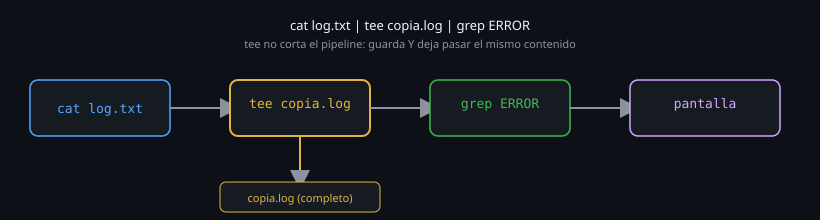

# `tee`: ver y guardar al mismo tiempo

> Redirigir con `>` elige entre ver algo en pantalla o guardarlo en un
> archivo. `tee` existe específicamente para no tener que elegir.



## 🎯 Objetivos

- Usar `tee` para ver y guardar la salida de un comando simultáneamente
- Combinar `tee` dentro de un pipeline más largo, no solo al final
- Usar `tee -a` para agregar en vez de sobrescribir
- Explicar por qué `sudo tee` resuelve un problema que `sudo comando >` no puede

## 1. Qué problema resuelve

`comando > archivo.log` guarda la salida, pero no la ves mientras corre —
tienes que abrir el archivo después. `comando` sin redirección la ves, pero
no queda guardada. `tee` resuelve esta falsa disyuntiva: toma lo que recibe
por `stdin` y lo escribe **tanto** a `stdout` (lo sigues viendo) **como** a
uno o más archivos.

## 2. Cómo funciona

### 2.1 El nombre viene de una "T" de plomería

`tee` se llama así por la pieza de plomería en forma de T que divide un
flujo de agua en dos direcciones sin perder ninguna. Es exactamente lo que
hace con un flujo de datos: lo que entra por un lado sale por **dos**
lugares a la vez.

```bash
echo "hola mundo" | tee saludo.txt
# hola mundo          <- esto se ve en pantalla (stdout)

cat saludo.txt
# hola mundo          <- esto se guardo en el archivo, al mismo tiempo
```

### 2.2 `tee` en medio de un pipeline, no solo al final

```bash
cat /var/log/syslog | tee copia-completa.log | grep "error"
```

Acá `tee` no es el último eslabón: guarda una copia **completa** del log
en `copia-completa.log` *y además* deja pasar el mismo contenido para que
`grep` lo siga filtrando. Sin `tee`, tendrías que elegir entre guardar
todo o filtrar — con `tee` en el medio, haces ambas cosas en el mismo
pipeline.

### 2.3 `tee -a`: agregar en vez de sobrescribir

Igual que `>` trunca y `>>` agrega, `tee` por defecto trunca el archivo
destino, y `-a` ("append") lo hace agregar al final:

```bash
echo "primera linea" | tee archivo.log
echo "segunda linea" | tee archivo.log
cat archivo.log
# segunda linea           <- la primera se perdio, tee sin -a trunca

echo "primera linea" | tee archivo.log
echo "segunda linea" | tee -a archivo.log
cat archivo.log
# primera linea
# segunda linea
```

### 2.4 `tee` a varios archivos a la vez

```bash
comando | tee archivo1.log archivo2.log archivo3.log
```

Un solo `tee` puede escribir a tantos archivos como le pases como
argumentos, todos a la vez, además de seguir mostrando en pantalla.

### 2.5 `tee /dev/null` o descriptores: casos de uso menos obvios

```bash
comando | tee /dev/null | otro-comando
```

Puede parecer inútil (¿por qué "guardar" en `/dev/null`?), pero es un
patrón real cuando lo que importa no es guardar, sino forzar que `tee`
intervenga para, por ejemplo, cambiar el buffering del pipeline (visto en
el archivo anterior) sin alterar el contenido que fluye.

```bash
comando | tee /dev/stderr | otro-comando
```

Esto sí es más común: duplica la salida hacia `stderr` (visible en la
terminal aunque el pipeline principal siga su curso hacia `otro-comando`)
— una forma rápida de "espiar" un pipeline sin romper su flujo principal.

### 2.6 El caso real de `sudo tee`: escribir en un archivo protegido

```bash
echo "nuevo valor" | sudo tee /etc/archivo-del-sistema.conf
```

Esto resuelve un problema concreto: `sudo echo "nuevo valor" >
/etc/archivo-del-sistema.conf` **no funciona**, aunque parezca que
debería. La razón es el orden de operaciones: bash configura la
redirección `>` **antes** de ejecutar `sudo echo` — y esa configuración
(abrir el archivo para escritura) la hace el shell actual, con tus
privilegios normales, no con los de `sudo`. Para cuando `sudo` entra en
juego, el intento de abrir el archivo ya falló.

```bash
# NO funciona: la redirección > la procesa el shell, sin privilegios de sudo
sudo echo "nuevo valor" > /etc/archivo-del-sistema.conf
# bash: /etc/archivo-del-sistema.conf: Permission denied

# SI funciona: tee corre CON privilegios de sudo, y es tee quien escribe
echo "nuevo valor" | sudo tee /etc/archivo-del-sistema.conf
```

Con `sudo tee`, es el comando `tee` mismo el que corre con privilegios
elevados — y es `tee`, no bash, quien abre el archivo para escribir. Por
eso sí funciona.

### 2.7 El código de salida de `tee` no es el del pipeline completo

```bash
comando-que-falla | tee archivo.log
echo $?
```

Como viste en el archivo anterior, sin `pipefail` esto refleja el código
de `tee` (que casi siempre sale con `0`, haya podido escribir o no el
archivo), no el de `comando-que-falla`. `pipefail` sigue siendo necesario
acá también — `tee` no es una excepción a esa regla.

## 3. Cómo se usa

```bash
# Ver y guardar la salida de un comando largo
comando-que-tarda | tee resultado.log

# Guardar una copia completa mientras filtras en vivo
tail -f /var/log/syslog | tee -a historial-completo.log | grep "ERROR"

# Guardar en dos lugares a la vez: un log local y uno compartido
comando | tee local.log /mnt/compartido/remoto.log

# Escribir en un archivo del sistema, con privilegios, desde un echo
echo "nueva-opcion=true" | sudo tee -a /etc/config-del-sistema.conf
```

## 4. Antipatrones

| Antipatrón | Por qué duele | Qué hacer en su lugar |
|---|---|---|
| Usar `tee archivo` sin `-a` esperando que agregue | Trunca el archivo cada vez, perdiendo lo guardado en corridas anteriores | Usar `tee -a` cuando la intención es acumular, no reemplazar |
| Pensar que `tee` "consume" el pipeline, dejándolo sin continuar | `tee` deja pasar el contenido igual que lo recibió — el pipeline sigue después de él | Usar `tee` en cualquier punto intermedio sin miedo a "cortar" el resto de la cadena |
| Ignorar que `tee` necesita permisos de escritura sobre el archivo destino | Falla en silencio parcial: se ve la salida en pantalla pero no se guarda nada | Confirmar permisos de escritura en la carpeta destino antes de depender de `tee` en un script |
| Escribir `sudo comando > archivo-protegido` esperando que el `sudo` alcance para la redirección | Bash procesa `>` antes de ejecutar `sudo`, con tus privilegios normales — falla igual que sin `sudo` | Usar `comando | sudo tee archivo-protegido`, donde `tee` mismo corre con privilegios |

## 5. Trucos

- `comando | tee archivo | otro-comando` es el patrón más común: guardar
  una copia completa mientras sigues procesando el resultado.
- `sudo tee archivo` (en vez de `sudo comando > archivo`) es la forma
  correcta de escribir con privilegios elevados cuando la redirección `>`
  misma necesitaría el privilegio — porque `>` la procesa el shell
  *antes* de que `sudo` tenga efecto, mientras que `tee` sí corre con
  privilegios si se le antepone `sudo` a él.
- `tee -i` ignora señales de interrupción (`Ctrl+C`) mientras escribe,
  útil para no cortar una escritura a mitad en un pipeline crítico.
- `tee archivo >/dev/null` descarta la copia en pantalla pero mantiene el
  archivo — útil dentro de un script donde la salida en vivo no importa
  pero el registro en disco sí.

## Resumen

`tee` divide un flujo en dos direcciones sin perder ninguna: lo que entra
sigue viéndose en pantalla y además queda guardado en uno o más archivos.
`-a` agrega en vez de truncar; colocado en medio de un pipeline, no corta
nada de lo que sigue. El caso de uso más importante en la práctica real es
`sudo tee`, que resuelve un problema de orden de operaciones que `sudo
comando > archivo` no puede resolver por sí solo.

## 📚 Recursos Adicionales

- [GNU Coreutils Manual — tee invocation](https://www.gnu.org/software/coreutils/manual/html_node/tee-invocation.html) — referencia completa de flags.
- `man tee` — la misma referencia, offline.
- `man sudo`, sección sobre redirección de comandos privilegiados — contexto adicional sobre por qué `sudo` no afecta redirecciones del shell.

## ✅ Checklist de Verificación

- [ ] Usaste `tee` para ver y guardar la salida de un comando en el mismo momento
- [ ] Colocaste `tee` en el medio de un pipeline, no solo al final
- [ ] Reprodujiste la diferencia entre `tee` y `tee -a`
- [ ] Explicaste por qué `sudo tee archivo` funciona donde `sudo comando > archivo` no
- [ ] Confirmaste que `tee` tampoco escapa a la regla de `pipefail` para detectar fallos previos en la cadena

---

[← 03 — Pipes: encadenar comandos](03-pipes-encadenar-comandos.md) · [05 — Códigos de salida y $? →](05-codigos-de-salida-y-dolar-interrogacion.md)
