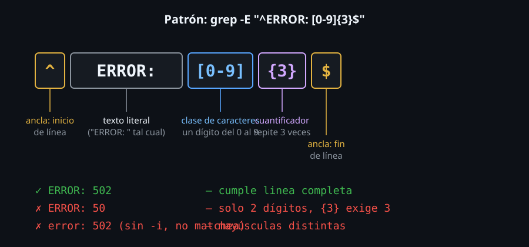

# Anclas, clases de caracteres y clases POSIX

> Un patrón literal busca un texto exacto. Una regex busca una **forma**:
> "una línea que empiece con un número", "cualquier vocal", "todo lo que
> no sea una letra" — y esa diferencia es lo que convierte a `grep` en una
> herramienta para patrones que nunca escribirías uno por uno a mano.



## 🎯 Objetivos

- Anclar un patrón al inicio (`^`) o al final (`$`) de una línea
- Usar `.` para "cualquier carácter" sin confundirlo con un punto literal
- Construir clases de caracteres (`[...]`) y su negación (`[^...]`)
- Usar las clases POSIX (`[:alpha:]`, `[:digit:]`, etc.) sin el error de un solo corchete

## 1. Qué problema resuelve

"Buscar líneas que empiecen con una fecha", "buscar cualquier línea que
tenga un dígito, sea cual sea", "buscar todo lo que no sea una letra" — un
patrón literal no puede expresar ninguna de estas tres búsquedas, porque
no describen un texto fijo: describen una **forma**. Las anclas y las
clases de caracteres son el primer nivel de regex que permite describir
formas en vez de textos exactos.

## 2. Cómo funciona

### 2.1 Anclas: `^` inicio de línea, `$` fin de línea

```bash
grep "^ERROR" app.log
# solo lineas que EMPIEZAN con ERROR, no las que lo tienen en el medio
```

```bash
printf 'ERROR fallo\nfallo ERROR\n' | grep "^ERROR"
# ERROR fallo
```

```bash
grep "cerrado$" app.log
# solo lineas que TERMINAN con la palabra "cerrado"
```

```bash
printf 'puerto cerrado\ncerrado por error\n' | grep "cerrado$"
# puerto cerrado
```

Sin ancla, el patrón coincide con esa secuencia de caracteres en
**cualquier** posición de la línea. `^patron$` (ambas anclas juntas) exige
que la línea completa sea exactamente ese patrón — útil para validar
formato, no solo buscar contenido.

```bash
printf '123\nabc\n12a\n' | grep "^[0-9]*$"
# 123
```

### 2.2 `.` — cualquier carácter (excepto fin de línea)

```bash
grep "10.0.0.1" config.conf
```

Aquí hay un error sutil: `.` en regex significa "cualquier carácter", no
"un punto literal". El patrón anterior coincide con `10.0.0.1`, pero
también con `1030021` o `10x0y0z1` — cualquier carácter en lugar de cada
punto. Para un punto literal, hay que escaparlo: `\.`

```bash
grep "10\.0\.0\.1" config.conf
# ahora SI matchea solo el punto literal
```

Este es uno de los errores más comunes al escribir una regex para una
versión, una IP o cualquier texto con puntos reales: olvidar que `.` sin
escapar es un comodín, no el carácter `.`.

### 2.3 Clases de caracteres: `[...]`

```bash
grep "[aeiou]" palabra.txt      # alguna vocal, una sola posicion
grep "[0-9]" archivo.txt        # algun digito (rango)
grep "[a-zA-Z]" archivo.txt     # alguna letra, mayuscula o minuscula (dos rangos)
```

`[...]` coincide con **uno solo** de los caracteres listados dentro, en
esa posición del patrón. `a-z` es un rango (de la `a` a la `z`); se pueden
combinar varios rangos y caracteres sueltos dentro de los mismos
corchetes: `[a-zA-Z0-9_]` coincide con una letra, un dígito o un guión
bajo.

### 2.4 Negación de clase: `[^...]`

```bash
grep "[^0-9]" archivo.txt
# lineas que tienen al menos UN caracter que NO es un digito
```

El `^` **dentro** de los corchetes, como primer carácter, invierte la
clase: coincide con cualquier carácter que **no** esté en la lista. Es
distinto del `^` de ancla de línea (sección 2.1) — el mismo símbolo
significa algo distinto según el contexto en el que aparece, y confundir
ambos usos es una fuente real de regex que no hacen lo que parecen decir.

```bash
# "lineas que NO empiezan con un digito" (ancla + negacion, combinados)
grep "^[^0-9]" archivo.txt
```

### 2.5 Clases POSIX: `[:alpha:]`, `[:digit:]` y el error del corchete simple

```bash
grep "[[:digit:]]" archivo.txt
```

Las clases POSIX (`[:alpha:]` letras, `[:digit:]` dígitos, `[:space:]`
espacios en blanco, `[:upper:]` mayúsculas, `[:lower:]` minúsculas,
`[:punct:]` puntuación) describen categorías de caracteres sin depender de
una tabla ASCII concreta — `[:alpha:]` incluye letras acentuadas si el
`locale` del sistema lo define, donde `[a-zA-Z]` nunca lo haría.

**El error casi garantizado**: `[:digit:]` **necesita** estar dentro de
otro par de corchetes — `[:digit:]` solo (un par) no es una clase POSIX
válida como patrón completo, es una clase de caracteres común que contiene
los caracteres `:`, `d`, `i`, `g`, `t` sueltos. La sintaxis correcta siempre
lleva corchetes dobles: `[[:digit:]]`.

```bash
printf 'abc123\n' | grep -o "[[:alpha:]]*"
# abc
printf 'abc123\n' | grep -o "[[:digit:]]*"
# 123
```

### 2.6 Caracteres especiales dentro de una clase: `]`, `^` y `-` literales

Dentro de `[...]`, algunos caracteres que son especiales en el resto de la
regex dejan de serlo — pero solo si se los coloca en la posición
correcta:

```bash
printf 'a]b\naxb\n' | grep "[]ab]"
# a]b
# axb
```

`]` como **primer** carácter dentro de la clase (justo después del `[` de
apertura, o del `[^` si la clase está negada) se interpreta como literal,
no como el cierre de la clase — es la única posición donde no hace falta
escaparlo.

```bash
printf 'a-b\naxb\n' | grep "[ab-]"
# a-b
# axb
```

`-` como **último** carácter dentro de la clase (justo antes del `]` de
cierre) se interpreta como literal, no como separador de rango — en
cualquier otra posición dentro de los corchetes, forma un rango (`a-z`) en
vez de representar el guion en sí.

```bash
printf 'a^b\naxb\n' | grep "[ab^]"
# a^b
# axb
```

`^` es literal en **cualquier** posición dentro de la clase, salvo la
primera — solo ahí se interpreta como negación (sección 2.4).

## 3. Cómo se usa

```bash
# Lineas que empiezan con una marca de tiempo tipica (4 digitos de año)
grep "^[0-9][0-9][0-9][0-9]-" app.log

# Lineas que NO son comentarios en un archivo de configuracion
grep -v "^#" /etc/ssh/sshd_config

# Lineas en blanco (ancla de inicio y fin, sin nada en el medio)
grep "^$" archivo.txt

# Cualquier caracter que no sea alfanumerico ni espacio (sospecha de dato corrupto)
grep "[^[:alnum:][:space:]]" datos.csv
```

## 4. Antipatrones

| Antipatrón | Por qué duele | Qué hacer en su lugar |
|---|---|---|
| Usar `.` para buscar un punto literal (IP, versión, extensión) | `.` significa "cualquier carácter" — matchea de más, con falsos positivos silenciosos | Escapar el punto literal: `\.` |
| `[:digit:]` sin el segundo par de corchetes | No es una clase POSIX válida, es una clase de caracteres sueltos (`:`, `d`, `i`, `g`, `t`) | Siempre `[[:digit:]]`, con corchetes dobles |
| Confundir `^` de ancla con `^` de negación de clase | Mismo símbolo, significado distinto según el contexto — un patrón como `grep "^[^0-9]"` combina ambos a propósito, pero escribirlo sin entender cuál es cuál genera errores difíciles de leer | Verificar si el `^` está al inicio del patrón completo (ancla) o como primer carácter dentro de `[...]` (negación) |
| `[a-zA-Z]` cuando el dato puede tener letras acentuadas | El rango ASCII no cubre `á`, `é`, `ñ`, etc. | Usar `[[:alpha:]]`, que respeta el `locale` configurado |

## 5. Trucos

- `grep "^$"` encuentra líneas completamente vacías — útil para contarlas o
  eliminarlas de un archivo con otra herramienta.
- `grep -c "^$" archivo` cuenta cuántas líneas en blanco tiene un archivo,
  sin tener que abrirlo.
- `grep "^." archivo` (ancla de inicio + cualquier carácter) es lo opuesto:
  todas las líneas que **no** están vacías.
- Las clases POSIX respetan el idioma configurado del sistema (`locale`) —
  si un patrón con `[[:alpha:]]` no se comporta como esperas en un sistema
  con `locale` distinto al tuyo, es lo primero a revisar.

## Resumen

`^` y `$` anclan un patrón al inicio o al final de la línea. `.` es
cualquier carácter, no un punto literal — hay que escaparlo (`\.`) para
buscarlo tal cual. `[...]` describe una clase de caracteres aceptables en
una posición, y `[^...]` la invierte. Las clases POSIX (`[[:alpha:]]`,
`[[:digit:]]`, etc.) necesitan el corchete doble: son más robustas que un
rango ASCII cuando el `locale` del sistema importa.

## 📚 Recursos Adicionales

- [GNU Grep Manual — Regular Expressions](https://www.gnu.org/software/grep/manual/grep.html#Regular-Expressions) — anclas, clases y clases POSIX documentadas en detalle.
- `man 7 regex` — la página de manual que documenta la sintaxis de expresiones regulares POSIX a nivel de sistema.
- [POSIX Character Classes — IEEE Std 1003.1](https://pubs.opengroup.org/onlinepubs/9699919799/basedefs/V1_chap09.html) — la referencia formal de las clases POSIX.

## ✅ Checklist de Verificación

- [ ] Usaste `^` y `$` para anclar un patrón al inicio y al final de una línea
- [ ] Reprodujiste por qué `.` sin escapar matchea de más en una IP o versión
- [ ] Construiste una clase de caracteres con rango (`[a-z]`) y con negación (`[^0-9]`)
- [ ] Usaste al menos dos clases POSIX (`[[:alpha:]]`, `[[:digit:]]`) con el corchete doble correcto
- [ ] Encontraste y contaste las líneas vacías de un archivo con `grep -c "^$"`

---

[← 01 — grep básico y patrones literales](01-grep-basico-y-patrones-literales.md) · [03 — Cuantificadores y BRE vs ERE →](03-cuantificadores-y-bre-vs-ere.md)
