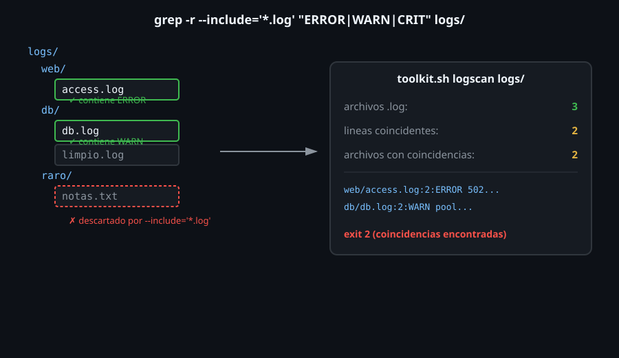

# grep recursivo y por nombre de archivo

> Hasta ahora, cada ejemplo buscó en un archivo que ya conocías de
> antemano. Un sistema real tiene logs repartidos en subdirectorios, con
> nombres y extensiones mezclados — este archivo es el que convierte todo
> lo anterior en una búsqueda que recorre un árbol completo de archivos
> por sí sola, que es exactamente lo que hace `logscan` en el proyecto de
> esta semana.



## 🎯 Objetivos

- Buscar un patrón en todos los archivos de un árbol de directorios con `-r`
- Filtrar qué archivos se buscan por nombre con `--include` y `--exclude`
- Combinar `-r` con `-l`, `-L`, `-c` y `-n` para distintos reportes
- Construir, paso a paso, la lógica central de `logscan`

## 1. Qué problema resuelve

`grep "ERROR" app.log` asume que ya sabes exactamente qué archivo
revisar. Un servidor real tiene logs en varios subdirectorios
(`/var/log/app/2026-10-15/`, `/var/log/app/2026-10-14/`, etc.), mezclados
con archivos que no son logs (`.txt`, `.conf`, `.bak`). Revisar cada
archivo con un comando separado no escala — la búsqueda recursiva filtrada
por nombre resuelve ambos problemas en un solo comando.

## 2. Cómo funciona

### 2.1 `-r`: búsqueda recursiva

```bash
grep -r "ERROR" /var/log/app/
```

```bash
grep -r "ERROR" /tmp/wk06-demo
# /tmp/wk06-demo/notas.txt:ERROR en txt, no deberia contar
# /tmp/wk06-demo/a.log:ERROR fallo
```

`-r` hace que `grep` descienda por todos los subdirectorios de la ruta
dada, revisando cada archivo que encuentra — **sin** filtrar por tipo ni
extensión todavía: el ejemplo anterior encuentra la coincidencia tanto en
el `.log` como en el `.txt`, que no es lo que se quería.

### 2.2 `--include`: filtrar qué archivos se revisan

```bash
grep -r --include="*.log" "ERROR" /tmp/wk06-demo
# /tmp/wk06-demo/a.log:ERROR fallo
```

`--include` acepta un patrón de nombre de archivo (glob, no regex — la
misma sintaxis que usarías con `ls *.log`) y descarta cualquier archivo
que no lo cumpla, **antes** de aplicar el patrón de búsqueda. El archivo
`.txt` del ejemplo anterior ya no aparece: nunca se revisó su contenido.

```bash
# varios --include se combinan (union, no interseccion)
grep -r --include="*.log" --include="*.out" "ERROR" /tmp/wk06-demo
```

### 2.3 `--exclude`: la operación inversa

```bash
grep -r --exclude="*.txt" "ERROR" /tmp/wk06-demo
# /tmp/wk06-demo/a.log:ERROR fallo
```

`--exclude` revisa todos los archivos **excepto** los que cumplan el
patrón — el mismo resultado que `--include="*.log"` en este caso
particular, pero expresado como "todo menos esto" en vez de "solo esto".
Cuál usar depende de si es más fácil describir lo que sí interesa o lo que
no.

### 2.4 `--exclude-dir`: descartar directorios completos

```bash
grep -r --include="*.log" "ERROR" /tmp/excl
# /tmp/excl/.git/config.log:ERROR x
# /tmp/excl/src/app.log:ERROR y

grep -r --include="*.log" --exclude-dir=".git" "ERROR" /tmp/excl
# /tmp/excl/src/app.log:ERROR y
```

`--exclude-dir` descarta un directorio entero antes de entrar en él, sin
importar qué archivos tenga dentro — más eficiente que `--exclude` cuando
lo que se quiere evitar es un subárbol completo (`.git/`, `node_modules/`,
directorios de backups), no un patrón de nombre de archivo puntual.

### 2.5 `-r` vs `-R`: enlaces simbólicos

`-r` no sigue enlaces simbólicos a directorios por defecto; `-R` sí los
sigue. La diferencia importa en árboles de archivos con enlaces hacia
afuera del directorio que se está revisando — seguirlos sin querer puede
hacer que la búsqueda recorra mucho más de lo esperado, o entre en un
ciclo si dos enlaces se referencian mutuamente.

### 2.6 Combinando `-r` con los reportes ya conocidos

```bash
# cuantas lineas coinciden, por archivo
grep -rc --include="*.log" "ERROR" /tmp/wk06-demo
# /tmp/wk06-demo/a.log:1
# /tmp/wk06-demo/sub/b.log:0

# que archivos tienen al menos una coincidencia
grep -rl --include="*.log" "ERROR" /tmp/wk06-demo
# /tmp/wk06-demo/a.log

# cada linea coincidente, con archivo y numero de linea
grep -rn --include="*.log" "ERROR" /tmp/wk06-demo
# /tmp/wk06-demo/a.log:2:ERROR fallo
```

`-rc` (recursivo + contar) reporta **por archivo**, no un total — cada
línea de salida es `archivo:conteo`, incluyendo los archivos con `0`
coincidencias. Para un total general, hay que sumarlos aparte (es
exactamente el problema que resuelve `logscan` más abajo).

### 2.7 Construyendo la lógica de `logscan`

El subcomando `logscan` de `toolkit` necesita tres números, no solo una
lista de líneas: cuántos archivos `.log` hay, cuántas líneas coinciden en
total, y en cuántos archivos distintos aparece al menos una coincidencia.
Cada uno se resuelve con una combinación distinta de lo visto en esta
semana:

```bash
# cuantos archivos .log hay (no necesita grep, solo find)
find "$directorio" -type f -name '*.log' | wc -l

# total de LINEAS coincidentes en todos los .log (no por archivo)
grep -rEh --include='*.log' "$patron" "$directorio" | wc -l

# en cuantos ARCHIVOS distintos aparece al menos una coincidencia
grep -rEl --include='*.log' "$patron" "$directorio" | wc -l
```

`-h` (minúscula) oculta el nombre de archivo en la salida de `-r`, dejando
solo las líneas — necesario para que `wc -l` cuente líneas totales, no
líneas con el prefijo `archivo:` incluido (que de todas formas `wc -l`
contaría igual, pero `-h` deja la salida limpia para cualquier
procesamiento posterior). `-l` (minúscula) lista archivos, no líneas —
contar esa lista con `wc -l` da el número de archivos con coincidencias,
no el número de coincidencias.

## 3. Cómo se usa

```bash
# Buscar una contrasena en texto plano olvidada en el codigo (auditoria)
grep -rn --include="*.py" --include="*.js" "password.*=.*['\"]" ./proyecto

# Contar errores por archivo de log en todo un directorio de logs rotados
grep -rc --include="*.log" "ERROR" /var/log/app/

# Encontrar que archivos de configuracion NO tienen una linea obligatoria
grep -rL "^Port " /etc/ssh/
```

## 4. Antipatrones

| Antipatrón | Por qué duele | Qué hacer en su lugar |
|---|---|---|
| `-r` sin `--include`/`--exclude` cuando el directorio mezcla tipos de archivo | Revisa archivos que no correspondían, con falsos positivos | Filtrar siempre por nombre cuando el directorio no es homogéneo |
| Sumar a mano la salida de `grep -rc` archivo por archivo | Tedioso y propenso a error con muchos archivos | `grep -rh "$patron" "$dir" | wc -l` para el total real de líneas |
| Usar `-R` por costumbre sin necesitar seguir enlaces simbólicos | Puede recorrer mucho más de lo esperado, o entrar en un ciclo con enlaces cruzados | `-r` (sin seguir enlaces) salvo que haya una razón concreta para `-R` |
| Buscar primero con `find` y pasar cada archivo a `grep` uno por uno en un bucle | `grep -r` ya hace exactamente eso, de forma nativa y más rápida | `grep -r --include=...`, reservar `find | xargs grep` (Semana 09) para filtros que `--include` no puede expresar |

## 5. Trucos

- `grep -rl` (listar archivos) combinado con `wc -l` da "en cuántos
  archivos distintos aparece", sin necesitar contar coincidencias
  primero.
- `grep -rLl` no existe como combinación útil (`-l` y `-L` son
  mutuamente excluyentes) — para "qué archivos SÍ y cuáles NO", son dos
  comandos separados, uno con `-l` y otro con `-L`.
- `--include="*.{log,out}"` **no** funciona como "dos extensiones": el
  glob de `--include` no soporta llaves, así que ese patrón busca
  literalmente un archivo llamado `*.{log,out}` y no encuentra nada. Para
  dos extensiones hacen falta dos banderas: `--include="*.log"
  --include="*.out"`.

## Resumen

`-r` busca recursivamente en un árbol de directorios; `--include` y
`--exclude` filtran qué archivos se revisan por nombre, antes de aplicar
el patrón de búsqueda. `-rc` reporta coincidencias por archivo, no un
total — para un total real de líneas hace falta `-rh | wc -l`; para contar
archivos con al menos una coincidencia, `-rl | wc -l`. Estas tres
combinaciones son, literalmente, cómo `logscan` cuenta sus tres números.

## 📚 Recursos Adicionales

- [GNU Grep Manual — Recursive Search](https://www.gnu.org/software/grep/manual/grep.html#Recursive-Search) — documentación completa de `-r`, `-R`, `--include` y `--exclude`.
- `man grep` — sección `FILE AND DIRECTORY SELECTION`.
- [GNU Coreutils Manual — `find`](https://www.gnu.org/software/findutils/manual/html_mono/find.html) — referencia de `find`, retomado en profundidad en la Semana 09.

## ✅ Checklist de Verificación

- [ ] Buscaste un patrón recursivamente en un árbol de directorios con `-r`
- [ ] Filtraste por extensión con `--include`, confirmando que excluye lo que no corresponde
- [ ] Contaste el total de líneas coincidentes de un árbol completo con `-rh | wc -l`
- [ ] Contaste en cuántos archivos distintos aparece el patrón con `-rl | wc -l`
- [ ] Reprodujiste a mano, con los tres comandos de la sección 2.7, lo que hace `logscan`

---

[← 05 — Límites de palabra y grep -P](05-limites-de-palabra-y-grep-perl.md) · [07 — Contexto, color y extracción con grep -o →](07-contexto-color-y-extraccion-con-grep-o.md)
