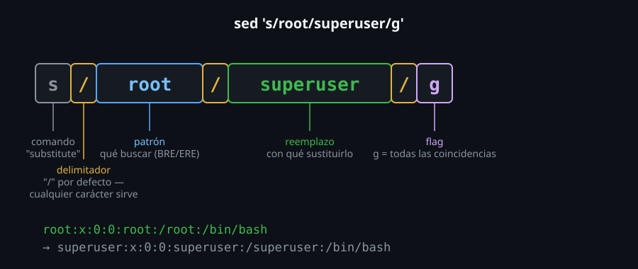

# sed: anatomía de la sustitución

> `grep` encuentra líneas. `sed` las **cambia**, sin abrir ningún editor —
> el comando `s///` es, de lejos, el 90% de todo lo que vas a usar de
> `sed` en la práctica, y entenderlo bien evita la mitad de los "¿por qué
> no cambió nada?" de esta semana.



## 🎯 Objetivos

- Construir una sustitución `s/patrón/reemplazo/` con el delimitador correcto
- Controlar cuántas coincidencias por línea se reemplazan (`g`, número, `Ng`)
- Reutilizar lo que coincidió con grupos de captura (`\1`, `\2`)
- Elegir un delimitador distinto a `/` cuando el patrón ya lo contiene

## 1. Qué problema resuelve

Cambiar una palabra por otra en un archivo entero, sin abrirlo: `sed`
reemplaza texto en una pasada, línea por línea, lo que lo hace apto para
scripts (nada de "abrir, buscar, reemplazar, guardar" a mano) y para
pipelines (transformar la salida de otro comando antes de que llegue al
siguiente).

## 2. Cómo funciona

### 2.1 La anatomía: `s/patrón/reemplazo/flags`

```bash
sed 's/root/superuser/' usuarios.txt
```

Tres partes separadas por el delimitador (`/` por defecto):
- `s` — el comando "substitute"
- `patrón` — qué buscar (acepta regex BRE, igual que `grep` sin `-E`)
- `reemplazo` — con qué sustituirlo
- `flags` (opcional, después del tercer delimitador) — modifican el
  comportamiento

### 2.2 Por defecto, solo la primera coincidencia de cada línea

```bash
printf 'root:x:0:0:root:/root:/bin/bash\n' | sed 's/root/superuser/'
# superuser:x:0:0:root:/root:/bin/bash
```

La palabra `root` aparece tres veces en esa línea; solo la **primera**
cambió. Este es el comportamiento por defecto de `s///`, y la causa más
común de "le pasé `sed` y solo cambió una cosa" cuando se esperaba que
cambiara todas.

### 2.3 El flag `g`: todas las coincidencias de la línea

```bash
printf 'aaa\n' | sed 's/a/X/g'
# XXX
```

`g` (*global*, pero solo dentro de cada línea — no "todo el archivo", ese
es el comportamiento por defecto al procesar línea por línea) cambia
**todas** las coincidencias, no solo la primera.

### 2.4 Flags numéricos: una coincidencia específica, o desde ahí en adelante

```bash
printf 'a a a a\n' | sed 's/a/X/3'
# a a X a

printf 'a a a a\n' | sed 's/a/X/3g'
# a a X X
```

Un número solo reemplaza **esa** coincidencia puntual (la tercera, en
este caso); combinado con `g` (`3g`), reemplaza desde esa coincidencia
**en adelante**, no solo esa una.

### 2.5 El flag `i`: sustitución sin distinguir mayúsculas/minúsculas

```bash
printf 'ROOT root\n' | sed 's/root/x/gi'
# x x
```

Igual que `grep -i`, pero para el patrón de búsqueda de `sed` — sin `i`,
`ROOT` no coincidiría con el patrón `root`.

### 2.6 Grupos de captura: reutilizar lo que coincidió

```bash
printf 'juan perez\n' | sed -E 's/(\w+) (\w+)/\2 \1/'
# perez juan
```

Con `-E` (ERE, igual que `grep -E`), los paréntesis agrupan sin escapar;
`\1` y `\2` en el **reemplazo** se refieren a lo que efectivamente
coincidió con cada grupo del patrón — acá, invierte nombre y apellido sin
saber de antemano cuáles son.

```bash
printf 'juan perez\n' | sed 's/\(\w\+\) \(\w\+\)/\2 \1/'
# perez juan
```

En BRE (sin `-E`), los mismos paréntesis necesitan escape — el mismo
patrón de inversión BRE/ERE que ya viste con `grep` en la Semana 06.

### 2.7 Delimitador alternativo: cuando `/` ya está en el patrón

```bash
sed 's#/usr#/opt#' ruta.txt
```

Si el patrón o el reemplazo contienen `/`, cada una necesitaría escaparse
(`\/`) — en vez de eso, `sed` permite usar **cualquier** carácter como
delimitador. `#` es una elección común para trabajar con rutas de
archivo, pero puede ser casi cualquier carácter que no aparezca en el
patrón.

```bash
printf '/usr/local/bin\n' | sed 's#/usr#/opt#'
# /opt/local/bin
```

### 2.8 `&`: referencia a toda la coincidencia

```bash
printf 'hola\n' | sed 's/hola/[&]/'
# [hola]
```

Dentro del reemplazo, `&` representa el texto completo que coincidió con
el patrón — útil para envolver o decorar una coincidencia sin tener que
repetirla literalmente ni armar un grupo de captura solo para eso.

### 2.9 Escapar el delimitador cuando sí hace falta usarlo en el patrón

```bash
printf '/usr/bin\n' | sed 's/\/usr/\/opt/'
# /opt/bin
```

La alternativa a elegir otro delimitador (sección 2.7) es escapar el
delimitador original con `\` cada vez que aparece dentro del patrón o el
reemplazo — funciona, pero se vuelve difícil de leer rápido si el
patrón tiene varias barras. Para un patrón con pocas barras, puede ser
más simple que cambiar de delimitador; para más de una o dos, el
delimitador alternativo (`sed 's#...#...#'`) suele ganar en legibilidad.

## 3. Cómo se usa

```bash
# Normalizar un separador de CSV de ; a ,
sed 's/;/,/g' datos.csv

# Comentar una linea de configuracion sin borrarla
sed 's/^Port 22/#Port 22/' sshd_config

# Quitar espacios al final de cada linea
sed 's/[[:space:]]*$//' archivo.txt

# Anonimizar el ultimo octeto de una IP (grupo de captura)
echo '192.168.1.42' | sed -E 's/([0-9]+\.[0-9]+\.[0-9]+)\.[0-9]+/\1.xxx/'
```

## 4. Antipatrones

| Antipatrón | Por qué duele | Qué hacer en su lugar |
|---|---|---|
| Esperar que `s///` (sin `g`) cambie todas las coincidencias de una línea | Por defecto solo cambia la primera — el resto queda intacto sin ningún error visible | Agregar `g` cuando la intención es "todas las coincidencias de la línea" |
| Escapar `/` a mano cuando el patrón ya contiene barras (rutas de archivo) | El patrón se vuelve ilegible, con `\/` repetido varias veces | Elegir un delimitador distinto (`sed 's#...#...#'`) cuando el patrón tiene `/` |
| Usar `+`, `?`, `{n,m}`, `(...)` sin `-E` y sin escapar en el patrón de `sed` | Mismo problema que con `grep`: en BRE son literales, no especiales, sin aviso | `sed -E` para ERE, o escaparlos (`\+`, `\?`, `\(...\)`) en BRE |
| Olvidar que `sed` sin `-i` no modifica el archivo original | El resultado va a stdout; el archivo de origen queda intacto, lo que puede parecer "no hizo nada" si se esperaba una edición directa | Revisar la salida primero, y recién usar `-i` (archivo 02 de esta semana) cuando el cambio esté confirmado |

## 5. Trucos

- `sed -n '/patron/p'` (con `-n` para no imprimir por defecto, y `p` para
  imprimir explícitamente) es equivalente a `grep` pero usando solo
  `sed` — útil cuando ya estás en medio de un pipeline de `sed` y no
  quieres agregar otro comando a la cadena.
- `sed 's/\(.\)/\1\1/g'` duplica cada carácter de una línea — un ejemplo
  extremo de cuánto se puede hacer con grupos de captura y poco más.
- Probar siempre el patrón de `sed` contra una sola línea de ejemplo con
  `echo 'linea' | sed '...'` antes de aplicarlo a un archivo completo o
  con `-i` — es mucho más barato corregir un patrón sobre una línea que
  deshacer un cambio masivo.

## Resumen

`s/patrón/reemplazo/flags` es la sustitución central de `sed`: sin `g`
cambia solo la primera coincidencia de cada línea; con `g`, todas; con un
número, una coincidencia puntual; combinando número y `g`, desde esa
coincidencia en adelante. Los grupos de captura (`\1`, `\2`) permiten
reutilizar lo que coincidió en el reemplazo, con el mismo patrón BRE/ERE
de escape que ya conoces de `grep`. Un delimitador distinto a `/`
(`sed 's#...#...#'`) evita escapar barras cuando el patrón ya las tiene.

## 📚 Recursos Adicionales

- [GNU sed Manual — The "s" Command](https://www.gnu.org/software/sed/manual/sed.html#The-_0022s_0022-Command) — referencia completa de flags y sintaxis de `s///`.
- `man sed` — disponible sin conexión en cualquier distro.
- [GNU sed Manual — Regular Expressions](https://www.gnu.org/software/sed/manual/sed.html#Regular-Expressions) — BRE/ERE en `sed`, con las mismas reglas de escape que `grep`.

## ✅ Checklist de Verificación

- [ ] Construiste una sustitución básica `s/patrón/reemplazo/` y confirmaste que solo cambia la primera coincidencia por línea
- [ ] Usaste `g` para cambiar todas las coincidencias de una línea
- [ ] Usaste un flag numérico (`3`) y uno combinado (`3g`) y confirmaste la diferencia
- [ ] Invertiste dos palabras con grupos de captura (`\1`, `\2`), en BRE y en ERE
- [ ] Usaste un delimitador distinto a `/` para evitar escapar barras en una ruta

---

[← Semana 07](../README.md) · [02 — sed: direcciones, múltiples comandos y edición in-place →](02-sed-direcciones-multiples-comandos-y-edicion-in-place.md)
