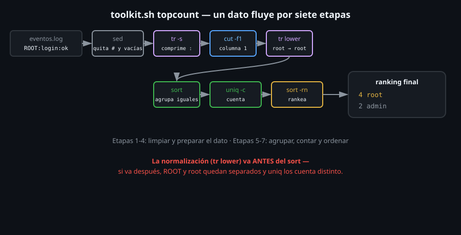

# Combinando el pipeline: cut, tr, sort y uniq

> Ninguna herramienta de esta semana resuelve, sola, "¿cuál es el valor
> más frecuente de esta columna?". Combinadas en pipeline, sí — y ese
> pipeline es, literalmente, el cuerpo de `toolkit.sh topcount`, el
> proyecto de esta semana.



## 🎯 Objetivos

- Construir un pipeline de ranking de frecuencia, un comando a la vez
- Explicar qué rol cumple cada herramienta en la cadena, y por qué ese orden
- Reconocer qué pasaría si se cambiara el orden de dos pasos del pipeline
- Aplicar el mismo patrón a un problema distinto al del proyecto de esta semana

## 1. Qué problema resuelve

"¿Qué usuario aparece más en este log?", "¿cuál es la palabra más común
de este archivo?", "¿qué IP genera más tráfico?" — la misma pregunta de
fondo, tres datasets distintos. Ningún comando individual de esta semana
la responde solo; la respuesta sale de siete pasos encadenados, cada uno
haciendo una sola cosa.

## 2. Cómo funciona

### 2.1 El pipeline completo, con datos reales

```bash
printf '# log de eventos\nroot:login:ok\n\nROOT:logout:ok\nadmin:login:ok\nroot:login:ok\n' > eventos.log

sed '/^#/d; /^$/d' eventos.log \
  | tr -s ':' \
  | cut -d':' -f1 \
  | tr '[:upper:]' '[:lower:]' \
  | sort \
  | uniq -c \
  | sort -rn
```

```
      3 root
      1 admin
```

Siete comandos, cada uno con una sola responsabilidad:

| Paso | Herramienta | Qué hace |
|:--:|---|---|
| 1 | `sed '/^#/d; /^$/d'` | Quita comentarios y líneas vacías — ruido, no datos |
| 2 | `tr -s ':'` | Comprime delimitadores repetidos, por si el formato es irregular |
| 3 | `cut -d':' -f1` | Extrae solo la columna que importa |
| 4 | `tr '[:upper:]' '[:lower:]'` | Normaliza mayúsculas (`ROOT` y `root` deben contar igual) |
| 5 | `sort` | Agrupa valores iguales de forma adyacente — requisito de `uniq` |
| 6 | `uniq -c` | Cuenta cuántas veces se repite cada valor |
| 7 | `sort -rn` | Ordena de mayor a menor frecuencia |

### 2.2 Por qué ese orden, no otro

**`sort` tiene que ir después de extraer y normalizar, no antes.** Si
`sort` corriera sobre las líneas completas (antes de `cut`), ordenaría
por la línea entera, no por el valor que interesa contar — agrupar mal
significa que `uniq` tampoco va a contar bien.

**La normalización (`tr` minúsculas) tiene que ir antes del primer
`sort`.** Si `ROOT` y `root` llegan a `sort` como valores distintos,
quedan en posiciones separadas (no adyacentes), y `uniq` los cuenta como
dos valores diferentes en vez de uno solo repetido.

**El `sort -rn` final es sobre el *conteo*, no sobre el valor.** Es un
`sort` completamente distinto del de la línea 5 — ordena numéricamente
(`-n`) y al revés (`-r`) la salida de `uniq -c`, que empieza cada línea
con el número de ocurrencias.

### 2.3 Qué pasa si cambias el orden (y por qué conviene probarlo)

```bash
# cut antes de normalizar mayusculas: funciona igual, el orden no importa aca
cut -d':' -f1 eventos.log | tr '[:upper:]' '[:lower:]'

# uniq -c antes de sort: resultado incorrecto, uniq ve datos no agrupados
sed '/^#/d; /^$/d' eventos.log | cut -d':' -f1 | tr '[:upper:]' '[:lower:]' | uniq -c
#       2 root
#       1 admin
#       1 root
```

Tres apariciones reales de `root`, pero el conteo quedó partido en dos
grupos (`2` y `1`) — porque las dos primeras eran adyacentes y la
tercera no, y sin `sort` de por medio `uniq` nunca las ve juntas.

No todos los pasos son intercambiables: `cut` y la normalización de
mayúsculas sí lo son entre sí (ninguno depende del otro), pero `uniq`
**depende** de que `sort` ya haya corrido — saltearlo da un resultado que
"funciona" (no hay ningún error) pero es simplemente incorrecto.

### 2.4 Depurar el pipeline con `wc -l` en cada etapa

Cuando un pipeline de siete pasos da un resultado inesperado, no hace
falta sospechar de los siete a la vez — agregar `| wc -l` al final de un
prefijo cada vez más largo del pipeline ubica exactamente en qué paso
cambia la cantidad de líneas de forma inesperada:

```bash
sed '/^#/d; /^$/d' eventos.log | wc -l
# 4
sed '/^#/d; /^$/d' eventos.log | cut -d: -f1 | wc -l
# 4
sed '/^#/d; /^$/d' eventos.log | cut -d: -f1 | tr '[:upper:]' '[:lower:]' | sort | wc -l
# 4
sed '/^#/d; /^$/d' eventos.log | cut -d: -f1 | tr '[:upper:]' '[:lower:]' | sort | uniq | wc -l
# 2
```

El conteo se mantiene en `4` hasta `sort` (ningún paso anterior quita ni
agrega líneas, solo las transforma), y recién cae a `2` después de
`uniq` — exactamente donde se espera que caiga, porque ahí es donde el
pipeline empieza a deduplicar. Si el conteo cambiara en un paso distinto
al esperado, ese es el paso a revisar primero.

## 3. Cómo se usa

```bash
# Palabras mas frecuentes de un archivo de texto
tr -s ' ' '\n' < documento.txt | tr '[:upper:]' '[:lower:]' | sort | uniq -c | sort -rn | head -10
```

```bash
echo 'el perro corre el gato duerme el perro ladra' | tr -s ' ' '\n' | sort | uniq -c | sort -rn
```

```
      3 el
      2 perro
      1 ladra
      1 gato
      1 duerme
      1 corre
```

El mismo pipeline, con una sola diferencia de dataset: en vez de un
campo delimitado por `:`, la "columna" acá es cada palabra separada por
espacios — `tr -s ' ' '\n'` hace el trabajo que antes hacía `cut`,
convirtiendo cada palabra en su propia línea para que `sort | uniq -c`
las cuente igual.

```bash
# Codigos de respuesta HTTP mas comunes en un log de acceso (campo delimitado por espacio)
cut -d' ' -f4 acceso.log | sort | uniq -c | sort -rn

# Extensiones de archivo mas comunes en un directorio
find . -type f | sed 's/.*\.//' | sort | uniq -c | sort -rn

# El mismo patron, aplicado por toolkit.sh topcount, con deteccion de dominancia
toolkit.sh topcount eventos.log
```

## 4. Antipatrones

| Antipatrón | Por qué duele | Qué hacer en su lugar |
|---|---|---|
| `uniq -c` sin `sort` antes | Cuenta solo repeticiones consecutivas — con datos no agrupados, el conteo real queda repartido en varias líneas de "1" | `sort` siempre antes de `uniq`, sin excepción, salvo certeza de que los datos ya vienen agrupados |
| Normalizar mayúsculas/espacios **después** del primer `sort` | Los valores "distintos por formato" (pero iguales en sentido lógico) ya quedaron en posiciones separadas, y `uniq` no los agrupa | Normalizar (con `tr`) antes de cualquier `sort` que alimente a `uniq` |
| Construir el pipeline completo de una sola vez, sin probar cada paso | Si el resultado final está mal, no hay forma rápida de saber en qué eslabón de siete pasos está el problema | Igual que con pipes en general (Semana 05): agregar un comando a la vez, confirmando la salida intermedia en cada paso |
| Olvidar que el segundo `sort` (`-rn`) ordena un número, no texto | Sin `-n`, `"10"` queda antes de `"9"` en el ranking final, aunque `"10"` sea la frecuencia mayor | `sort -rn` específicamente para la salida de `uniq -c`, nunca `sort -r` solo |

## 5. Trucos

- Construí el pipeline de atrás para adelante en tu cabeza: "quiero un
  ranking" → necesita `sort -rn` sobre un conteo → el conteo necesita
  `uniq -c` sobre datos agrupados → agrupar necesita `sort` → y recién
  ahí preguntate qué columna y qué normalización hacen falta antes.
- `column -t` (no visto en profundidad este bootcamp) alinea la salida
  de `uniq -c` en columnas prolijas cuando el conteo tiene distinto
  número de dígitos — útil para inspección visual, no para seguir
  procesando el resultado.
- Si el ranking final tiene más entradas de las que importan, `head -N`
  al final del pipeline es más barato que filtrar antes — dejá que el
  pipeline completo procese todo, y recortá solo al mostrar.

## Resumen

El pipeline de ranking de frecuencia tiene siete roles, no siete pasos
intercambiables: limpiar ruido (`sed`), normalizar formato (`tr -s`,
`tr` minúsculas), extraer la columna (`cut`), agrupar (`sort`), contar
(`uniq -c`), y ordenar el resultado final (`sort -rn`). `uniq` depende
de que `sort` haya corrido antes; la normalización depende de ir antes
de ese `sort`. Este es exactamente el cuerpo de `toolkit.sh topcount`.

## 📚 Recursos Adicionales

- [GNU Coreutils Manual](https://www.gnu.org/software/coreutils/manual/coreutils.html) — referencia conjunta de `cut`, `sort`, `uniq`, `tr` y el resto de coreutils usados esta semana.
- [Missing Semester — Data Wrangling](https://missing.csail.mit.edu/2020/data-wrangling/) — mismo curso citado en semanas anteriores, con más ejemplos de este patrón exacto de pipeline.

## ✅ Checklist de Verificación

- [ ] Construiste el pipeline completo de siete pasos contra un archivo propio, probando paso a paso
- [ ] Explicaste por qué `uniq -c` antes de `sort` da un resultado incorrecto, no un error visible
- [ ] Reprodujiste por qué la normalización de mayúsculas tiene que ir antes del `sort` que alimenta a `uniq`
- [ ] Aplicaste el mismo pipeline a un problema distinto al de `topcount` (palabras, extensiones de archivo, códigos HTTP)
- [ ] Confirmaste que el `sort -rn` final ordena el conteo numérico, no el valor de texto

---

[← 06 — tr: traducir, borrar y comprimir caracteres](06-tr-traducir-borrar-y-comprimir-caracteres.md) · [2-practicas/01 →](../2-practicas/01-sed-sustitucion-y-direcciones.md)
