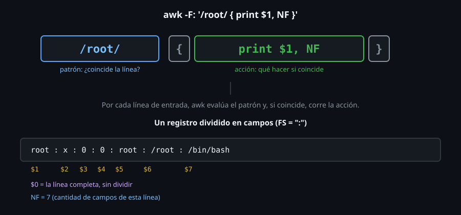

# awk básico: campos, NR y NF

> Todo lo de la semana pasada — `cut` para extraer, `tr` para normalizar,
> `sort`/`uniq` para contar — son herramientas de un solo propósito.
> `awk` es las cinco a la vez, más aritmética, más condicionales: un
> lenguaje de programación pequeño, diseñado específicamente para
> procesar texto por columnas.



## 🎯 Objetivos

- Explicar la estructura `patrón { acción }` de un programa `awk`
- Acceder a campos de una línea con `$1`, `$2`, ..., `$0` y `NF`
- Usar `NR` para numerar o filtrar por posición de línea
- Cambiar el separador de campos con `-F` o `FS`

## 1. Qué problema resuelve

`cut` extrae una columna fija; `sort`/`uniq` ordenan y cuentan, pero no
suman ni comparan valores. Calcular "el total de la columna 3" o "las
líneas donde la columna 2 es mayor que 100" necesita algo más que
extraer y reordenar — necesita evaluar una condición y hacer aritmética,
que es exactamente lo que ningún comando de la semana pasada hace por sí
solo.

## 2. Cómo funciona

### 2.1 La estructura: `patrón { acción }`

```bash
awk '/ERROR/ { print $0 }' app.log
```

Un programa de `awk` es una lista de reglas, cada una con un patrón
(opcional) y una acción entre `{ }` (opcional). Por cada línea de
entrada, `awk` evalúa cada patrón; si coincide (o no hay patrón, que
significa "siempre"), ejecuta la acción correspondiente.

```bash
printf 'ERROR x\nINFO y\n' | awk '/ERROR/'
# ERROR x
```

Sin acción explícita, el comportamiento por defecto es `{ print $0 }` —
imprimir la línea completa, igual que haría `grep` con ese mismo patrón.
Esto es, literalmente, `awk` reemplazando a `grep` para el caso más
simple — la diferencia real empieza cuando se necesita algo más que
filtrar.

### 2.2 Campos: `$1`, `$2`, ..., y `$0` para la línea completa

```bash
printf 'root:x:0:0:root:/root:/bin/bash\n' | awk -F: '{ print $1 }'
# root
```

`awk` divide automáticamente cada línea en campos, numerados desde `$1`.
`$0` siempre representa la línea **completa**, sin dividir — equivalente
a no haber dividido nada. `-F` fija el separador de campos (igual que
`-d` en `cut`), aceptando además una expresión regular, no solo un
carácter literal.

### 2.3 `NF`: cuántos campos tiene la línea actual

```bash
printf 'a:b:c\n#comentario\n\n' | awk -F: '{ print NF, $0 }'
# 3 a:b:c
# 1 #comentario
# 0
```

`NF` (*Number of Fields*) cambia línea por línea. Esto habilita un
filtro que `cut` no puede expresar: `NF==3` selecciona solo las líneas
con exactamente tres campos, descartando comentarios y líneas vacías sin
necesitar un `sed` separado:

```bash
printf 'a:b:c\n#comentario\n\n' | awk -F: 'NF==3 { print }'
# a:b:c
```

### 2.4 `NR`: el número de línea actual

```bash
printf 'uno\ndos\ntres\n' | awk '{ print NR, $0 }'
# 1 uno
# 2 dos
# 3 tres
```

`NR` (*Number of Records*) cuenta líneas procesadas — útil como patrón
(`NR==1` para la primera línea, `NR>1` para saltear una cabecera) o
simplemente para numerar la salida.

```bash
printf 'cabecera\ndato1\ndato2\n' | awk 'NR>1 { print }'
# dato1
# dato2
```

Esto reemplaza el `tail -n +2` de la semana pasada, en la misma
herramienta que ya está procesando el resto de la línea.

### 2.5 El separador de campos por defecto: espacios en blanco, sin importar cuántos

```bash
printf 'a   b  c\n' | awk '{ print NF }'
# 3
```

Sin `-F`, `awk` separa por espacios y tabs, **colapsando automáticamente
repeticiones** — tres espacios entre `a` y `b` cuentan como un solo
separador, no como campos vacíos. Esto es exactamente el problema que la
semana pasada resolvía con `tr -s ' '` antes de `cut`; en `awk`, viene
incluido por defecto.

### 2.6 Varias reglas en un solo programa

```bash
printf 'ERROR x\nINFO y\nWARN z\n' | awk '/ERROR/{print "E:", $0} /WARN/{print "W:", $0}'
```

```
E: ERROR x
W: WARN z
```

Un programa de `awk` puede tener más de una regla `patrón { acción }` —
cada línea de entrada se evalúa contra **todas** las reglas, en orden,
no solo contra la primera que coincide. La línea `INFO y` no coincide
con ninguna, así que no produce salida.

### 2.7 Rango de patrones, igual que en `sed`

```bash
printf 'inicio\na\nb\nfin\nc\n' | awk '/inicio/,/fin/'
```

```
inicio
a
b
fin
```

El mismo mecanismo de rango de dos patrones de `sed` (Semana 07) existe
en `awk`: `/patron1/,/patron2/` selecciona desde la primera línea que
coincide con el primer patrón hasta la primera línea, después de esa,
que coincide con el segundo — inclusive ambos extremos.

### 2.8 Programas largos en un archivo aparte: `-f`

```bash
cat > prog.awk <<'EOF'
{ print NR, $0 }
EOF
awk -f prog.awk archivo.txt
```

Para programas de más de una línea, escribirlos en un archivo `.awk` y
pasarlo con `-f` es más manejable que una sola línea larga entre
comillas — el mismo programa, sin los escapes de comillas que a veces
hacen falta al mezclarlo con la sintaxis de bash.

## 3. Cómo se usa

```bash
# Nombre de cada proceso (columna 11 en adelante de ps aux)
ps aux | awk '{ print $11 }'

# Lineas que no son comentario ni estan vacias, sin sed aparte
awk -F: 'NF==3 { print }' datos.csv

# Saltear la cabecera de un CSV, igual que tail -n +2
awk -F, 'NR>1 { print $1 }' usuarios.csv

# Imprimir numero de linea junto al contenido, como cat -n
awk '{ print NR": "$0 }' archivo.txt
```

## 4. Antipatrones

| Antipatrón | Por qué duele | Qué hacer en su lugar |
|---|---|---|
| Usar `cut`/`tr -s`/`tail -n +2` encadenados cuando `awk` solo ya resuelve los tres | Más procesos, más pasos, para algo que `awk` hace con `NF==N` y `NR>1` en una sola pasada | Preferir `awk` cuando la tarea combina extracción, filtro por posición y limpieza de ruido |
| Olvidar que `-F` acepta una regex, no solo un carácter | Un `-F ', '` (coma y espacio) puede no separar como se espera si el formato real varía | Probar el separador contra una línea real antes de asumir que funciona igual en todo el archivo |
| Confundir `NF` (campos de la línea actual) con un conteo fijo del archivo | `NF` cambia línea por línea — una línea con menos campos que otras no es un error, es información | Usar `NF==N` como filtro explícito cuando se espera un número fijo de campos |

## 5. Trucos

- `awk 'NF'` (sin acción, con `NF` solo como patrón) imprime únicamente
  las líneas que no están vacías — `NF` es `0` en una línea vacía, lo
  cual `awk` interpreta como falso.
- `awk '{ print $NF }'` imprime el **último** campo de cada línea, sin
  saber de antemano cuántos campos tiene — útil cuando el número de
  columnas varía línea por línea.
- `awk -F'\t'` especifica un tab como separador sin ambigüedad, igual
  que `cut -d$'\t'` la semana pasada.

## Resumen

Un programa de `awk` es una lista de reglas `patrón { acción }`; sin
patrón, la acción corre en cada línea; sin acción, el patrón filtra como
`grep`. `$1`...`$N` acceden a campos, `$0` a la línea completa, `NF` al
número de campos de la línea actual, `NR` al número de línea procesada.
El separador de campos por defecto (espacios/tabs) colapsa repeticiones
automáticamente, sin necesitar `tr -s`.

## 📚 Recursos Adicionales

- [GNU Awk User's Guide — How to Run awk](https://www.gnu.org/software/gawk/manual/gawk.html#Getting-Started) — introducción oficial y gratuita.
- `man awk` — disponible sin conexión en cualquier distro (aunque el `awk` del sistema puede ser `mawk` o `gawk` según la distro — ver divergencia en el archivo 06 de esta semana).
- [GNU Awk User's Guide — Fields](https://www.gnu.org/software/gawk/manual/gawk.html#Fields) — referencia completa de `$0`, `NF` y la división de campos.

## ✅ Checklist de Verificación

- [ ] Escribiste un programa `patrón { acción }` y uno solo con patrón (sin acción)
- [ ] Accediste a campos específicos con `$1`, `$2` y a la línea completa con `$0`
- [ ] Filtraste líneas por número de campos con `NF==N`
- [ ] Salteaste una cabecera con `NR>1`, sin usar `tail`
- [ ] Confirmaste que el separador por defecto de `awk` colapsa espacios repetidos, a diferencia de `cut`

---

[← Semana 08](../README.md) · [02 — Arrays asociativos y agrupación →](02-arrays-asociativos-y-agrupacion.md)
