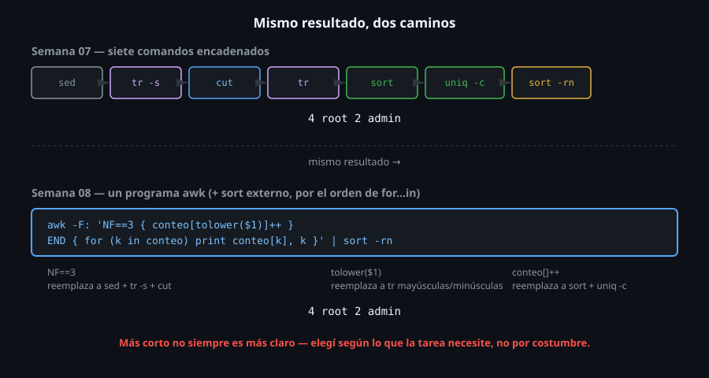

# awk como pipeline completo

> La Semana 07 construyó un ranking de frecuencia con siete comandos
> encadenados: `sed`, `tr -s`, `cut`, `tr`, `sort`, `uniq -c`, `sort -rn`.
> Este archivo cierra la Fase 2 del bootcamp mostrando el mismo
> resultado con **un solo programa de `awk`** — no porque el pipeline de
> la semana pasada estuviera mal, sino para que veas con tus propios
> ojos qué gana y qué pierde cada enfoque.



## 🎯 Objetivos

- Reescribir el pipeline de ranking de frecuencia de la Semana 07 como un solo programa de `awk`
- Identificar qué hace cada parte del pipeline viejo, y con qué de `awk` se reemplaza
- Explicar en qué casos el pipeline de varios comandos sigue siendo la mejor opción
- Decidir con criterio entre "un `awk`" y "una cadena de comandos", no por costumbre

## 1. Qué problema resuelve

Ver la misma tarea resuelta dos formas distintas — con las herramientas
de una semana, y con el lenguaje completo de la siguiente — es la forma
más directa de entender qué aporta realmente cada nivel de poder. No es
que `awk` sea "mejor" en abstracto: es que ahora, después de las dos
semanas, hay criterio real para elegir.

## 2. Cómo funciona

### 2.1 El pipeline de la Semana 07, siete pasos

```bash
sed '/^#/d; /^$/d' eventos.log \
  | tr -s ':' \
  | cut -d':' -f1 \
  | tr '[:upper:]' '[:lower:]' \
  | sort \
  | uniq -c \
  | sort -rn
```

```
      4 root
      2 admin
```

### 2.2 El mismo resultado, un programa de `awk`

```bash
awk -F: 'NF==3 { conteo[tolower($1)]++ } END { for (k in conteo) print conteo[k], k }' eventos.log | sort -rn
```

```
4 root
2 admin
```

### 2.3 Mapeo línea por línea: qué reemplaza a qué

| Paso del pipeline (Semana 07) | Equivalente en `awk` |
|---|---|
| `sed '/^#/d; /^$/d'` (quitar comentarios y vacíos) | `NF==3` como patrón — una línea de comentario o vacía no tiene 3 campos separados por `:` |
| `tr -s ':'` (comprimir delimitador repetido) | El propio `-F` de `awk` ya no necesita esto para este caso — pero si hiciera falta, `-F '[:]+'` (regex) lo resolvería igual |
| `cut -d':' -f1` (extraer columna) | `$1` |
| `tr '[:upper:]' '[:lower:]'` (normalizar mayúsculas) | `tolower($1)` |
| `sort` (agrupar antes de contar) | No hace falta — el array asociativo `conteo[clave]` agrupa sin ordenar |
| `uniq -c` (contar) | `conteo[clave]++` |
| `sort -rn` (ordenar el resultado final) | Sigue haciendo falta afuera, porque el orden de `for (k in conteo)` no está garantizado (Semana 08, archivo 02) |

Seis de los siete pasos quedan dentro de un solo programa de `awk`; el
séptimo (`sort -rn` final) sigue siendo un comando externo, por la misma
razón ya vista: `awk` no garantiza el orden de un array asociativo al
recorrerlo.

### 2.4 Por qué el pipeline de varios comandos sigue siendo válido

El programa de `awk` es más corto y corre en un solo proceso, pero es
**menos legible a simple vista** para alguien que no conoce `awk` bien
— cada paso del pipeline de la Semana 07, en cambio, se entiende leyendo
una herramienta a la vez, incluso sin saber `awk` en absoluto. Ninguno
de los dos enfoques es objetivamente superior: el pipeline de comandos
documenta sus propios pasos con el nombre de cada herramienta; el `awk`
es más eficiente (menos procesos) y más flexible (puede hacer lo que
`cut`/`tr`/`sort`/`uniq` juntos no pueden, como la validación numérica
del archivo 03).

### 2.5 El caso contrario: cuando el pipeline simple sigue ganando

```bash
cut -d' ' -f1 acceso.log | sort -u
```

```
198.51.100.9
203.0.113.5
```

```bash
awk '{ if (!($1 in visto)) { print $1; visto[$1]=1 } }' acceso.log | sort
```

```
198.51.100.9
203.0.113.5
```

Mismo resultado, pero para "lista de valores únicos sin contar nada", el
`awk` no gana nada frente a `cut | sort -u` — es más código para
expresar exactamente la misma idea, con un array que existe solo para
simular lo que `sort -u` ya hace de forma nativa. La lección real de
esta comparación: `awk` gana cuando la tarea necesita aritmética,
condicionales o acumulación por clave con un valor asociado — no
automáticamente por ser "la herramienta más nueva" de las dos semanas.

### 2.6 Donde el pipeline viejo no puede seguir, aunque lo estire

```bash
cut -d: -f1 ventas-mixtas.log | sort | uniq -c
```

```
      1 centro
      2 norte
      2 sur
```

`cut`/`sort`/`uniq` cuentan **apariciones** — nunca van a poder sumar el
segundo campo, porque ninguno de los tres sabe hacer aritmética. Esta
no es una limitación menor: es la frontera exacta donde termina lo que
la Semana 07 puede resolver y empieza lo que necesita `awk`.

```bash
tabla=$(awk -F: '$2 ~ /^[0-9]+$/ { suma[$1]+=$2 } END { for(k in suma) print suma[k], k }' ventas-mixtas.log | sort -rn)
malos=$(awk -F: '$2 !~ /^[0-9]+$/' ventas-mixtas.log | wc -l)
echo "$tabla"
echo "descartados: $malos"
```

```
500 sur
150 norte
90 centro
descartados: 1
```

La suma real por región, **y** cuántas líneas se descartaron por no ser
numéricas — las dos cosas en una sola pasada por el archivo. Separar la
tabla de los descartados en dos variables distintas (en vez de mezclar
todo en un mismo `sort`) evita el error de ordenar por accidente una
línea de resumen junto con los datos reales.

## 3. Cómo se usa

```bash
# Decision practica: pipeline rapido para explorar datos interactivamente
cut -d: -f1 eventos.log | sort | uniq -c | sort -rn

# Decision practica: awk cuando la tarea ya necesita aritmetica o validacion
awk -F: 'NF==3 && $2 ~ /^[0-9]+$/ { suma[$1] += $2 } END { for (k in suma) print suma[k], k }' ventas.log | sort -rn

# El proyecto de esta semana combina ambos: awk para el calculo, sort para el orden final
toolkit.sh sumfield ventas.log --campo 2 --grupo 1
```

## 4. Antipatrones

| Antipatrón | Por qué duele | Qué hacer en su lugar |
|---|---|---|
| Reescribir todo en `awk` "porque se puede", incluso lo que ya era simple con un comando | Un programa de `awk` denso es más difícil de leer para otra persona (o para ti mismo, meses después) que un pipeline con nombres de herramienta explícitos | Usar `awk` cuando la tarea necesita aritmética, condicionales o agrupación — no como reemplazo automático de cualquier pipeline |
| Evitar `awk` por completo y forzar una tarea aritmética dentro de `sed`/`cut`/`sort` | Ninguno de esos comandos hace cuentas — el resultado termina necesitando un paso adicional de todas formas | Reconocer cuándo la tarea ya cruzó la línea de "necesita aritmética" y pasar a `awk` directamente |
| Olvidar el `sort` final después de un array asociativo de `awk`, asumiendo que el orden de salida ya está bien | El orden de `for (k in array)` no está garantizado — puede "verse bien" en una prueba y cambiar en otra ejecución | Ordenar explícitamente con `sort` cuando el orden de salida importa, sin importar cuán prolijo parezca el resultado sin ordenar |

## 5. Trucos

- Si un pipeline de la semana pasada empieza a necesitar una condición
  (`if` disfrazado de `grep` + `cut` + comparación manual), es la señal
  de que es momento de pasar a `awk`, no de agregar un comando más a la
  cadena.
- Construir primero el pipeline de comandos simples (más fácil de
  probar paso a paso) y **después** traducirlo a un solo `awk` es más
  seguro que escribir el `awk` denso desde cero.
- `awk` y los comandos de la Semana 07 no son mutuamente excluyentes
  dentro de un mismo pipeline — `awk '...' archivo | sort -rn | head
  -10` combina lo mejor de ambos cuando corresponde.

## Resumen

El pipeline de ranking de frecuencia de la Semana 07 (siete comandos) y
un programa de `awk` con un array asociativo (una invocación, más un
`sort` final) llegan al mismo resultado por caminos distintos: uno
documenta cada paso con el nombre de una herramienta, el otro es más
compacto y gana la capacidad de hacer aritmética y validación en el
camino. Ninguno reemplaza al otro universalmente — el criterio para
elegir es si la tarea ya necesita algo que `cut`/`sed`/`tr`/`sort`/`uniq`
no pueden hacer solos.

## 📚 Recursos Adicionales

- [GNU Awk User's Guide — A Simple Example](https://www.gnu.org/software/gawk/manual/gawk.html#Very-Simple) — ejemplos comparables con comandos tradicionales.
- [Missing Semester — Data Wrangling](https://missing.csail.mit.edu/2020/data-wrangling/) — mismo curso citado en semanas anteriores, con ejemplos de `awk` reemplazando pipelines más largos.

## ✅ Checklist de Verificación

- [ ] Reescribiste el pipeline de ranking de frecuencia de la Semana 07 como un solo programa de `awk`
- [ ] Mapeaste cada paso del pipeline viejo a su equivalente (o ausencia de equivalente) en `awk`
- [ ] Explicaste con tus palabras un caso donde el pipeline de comandos simples sigue siendo la mejor opción
- [ ] Confirmaste que el `sort -rn` final sigue haciendo falta después del array asociativo de `awk`

---

[← 06 — BEGIN, END y la divergencia mawk/gawk](06-begin-end-y-divergencia-mawk-gawk.md) · [2-practicas/01 →](../2-practicas/01-awk-basico-campos-y-filtros.md)
