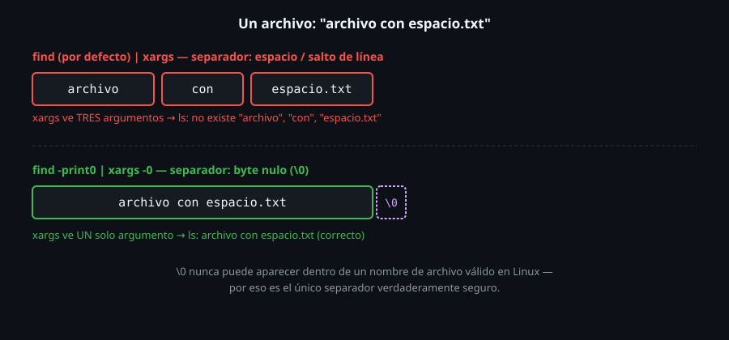

# xargs seguro: -print0, -I y nombres de archivo peligrosos

> `find ... | xargs comando` se rompe en silencio apenas un nombre de
> archivo tiene un espacio. No es un caso raro — es cualquier archivo
> descargado de internet, cualquier documento con un título legible.
> `-print0` y `xargs -0` son la combinación que lo resuelve de raíz, no
> un parche para casos excepcionales.



## 🎯 Objetivos

- Reproducir por qué un pipeline `find | xargs` sin protección rompe con nombres que tienen espacios
- Corregir con `-print0` (de `find`) y `-0` (de `xargs`)
- Reemplazar y reordenar argumentos con `xargs -I`
- Reconocer otros caracteres problemáticos en nombres de archivo (salto de línea, guion inicial)

## 1. Qué problema resuelve

Por defecto, `find` separa cada resultado con un salto de línea, y
`xargs` separa argumentos por espacios y saltos de línea — ambos
asumen, implícitamente, que ningún nombre de archivo contiene esos
caracteres. Es una suposición falsa constantemente: "informe final
.pdf", "foto de vacaciones.jpg" son nombres de archivo completamente
normales que rompen esa suposición.

## 2. Cómo funciona

### 2.1 El problema, en carne propia

```bash
find . -type f | xargs ls -la
```

```
ls: cannot access 'peligro/archivo': No such file or directory
ls: cannot access 'con': No such file or directory
ls: cannot access 'espacio.txt': No such file or directory
```

Un solo archivo llamado `archivo con espacio.txt` se partió en **tres**
argumentos separados para `ls` — cada palabra, tratada como un nombre
de archivo distinto, ninguno de los cuales existe. El pipeline no avisó
con un error claro de "esto está mal" — avisó con tres errores de
"archivo no encontrado" que parecen un problema distinto al real.

### 2.2 La corrección: `-print0` + `xargs -0`

```bash
find . -type f -print0 | xargs -0 ls -la
```

```
-rw-r--r-- 1 root root 0 Oct 16 01:17 peligro/archivo con espacio.txt
```

`-print0` (de `find`) separa cada resultado con un byte nulo (`\0`) en
vez de un salto de línea — un carácter que **nunca** puede aparecer
dentro de un nombre de archivo válido en Linux, a diferencia del
espacio o el salto de línea, que sí pueden. `xargs -0` espera
exactamente ese mismo separador. Juntos, son la única combinación
verdaderamente segura para nombres de archivo arbitrarios.

### 2.3 `xargs -I`: reemplazar y reubicar el argumento

```bash
find . -name "viejo.txt" -print0 | xargs -0 -I{} cp {} {}.respaldo
```

Sin `-I`, `xargs` agrega los argumentos al **final** del comando — no
sirve cuando el nombre de archivo tiene que aparecer en el medio (como
acá, una vez como origen y otra con un sufijo agregado). `-I{}` define
un marcador (`{}`, aunque podría ser cualquier texto) que se reemplaza
por cada argumento, tantas veces como aparezca en el comando.

### 2.4 Otros caracteres problemáticos

Un nombre de archivo en Linux puede contener casi cualquier byte
excepto `/` (el separador de directorios) y el byte nulo — incluyendo
saltos de línea, tabs, y sí, un guion al inicio del nombre. `find`
antepone la ruta de búsqueda (`./archivo`) a cada resultado, lo cual
**de hecho** evita que un nombre empezando con `-` se interprete como
una bandera del siguiente comando — pero solo mientras seas consciente
de que ese prefijo está haciendo ese trabajo por ti. Si alguna vez
manipulas el nombre a mano (quitándole el `./`), ese riesgo vuelve.

### 2.5 El caso extremo: un salto de línea dentro del nombre

```bash
find . -maxdepth 1 -name "linea1*"
```

```
./linea1
linea2.txt
```

Un archivo cuyo nombre **contiene** un salto de línea produce una
salida de `find` indistinguible de **dos archivos separados** — sin
`-print0`, no hay forma de saber, solo mirando la salida, si eso fueron
una línea con un nombre raro o dos nombres normales. Es el caso más
extremo de por qué el espacio y el salto de línea nunca son separadores
confiables para nombres de archivo.

```bash
find . -maxdepth 1 -name "linea1*" -print0 | xargs -0 -I{} echo "encontrado: [{}]"
```

```
encontrado: [./linea1
linea2.txt]
```

Con `-print0`, `xargs -0` recibe el nombre completo como **un solo**
argumento — el salto de línea interno queda preservado como parte del
nombre, no interpretado como un separador. La salida sigue viéndose
"rara" (porque el nombre en sí tiene un salto de línea), pero `{}`
representa correctamente un único archivo, no dos.

### 2.6 La alternativa sin `xargs`: `while read -d ''`

```bash
find . -name "*.txt" -print0 | while IFS= read -r -d '' archivo; do
  echo "proceso: $archivo"
done
```

Cuando la lógica por archivo es más compleja que un solo comando (por
ejemplo, varios pasos condicionales), un bucle `while read` con `-d ''`
(delimitador nulo, el equivalente de bash a `-print0`) procesa cada
resultado uno por uno, con control total del cuerpo del bucle — sin
necesitar `xargs` en absoluto. `IFS=` evita que `read` recorte espacios
al principio o al final del nombre; `-r` evita que interprete barras
invertidas dentro del nombre.

## 3. Cómo se usa

```bash
# Copiar en lote, seguro ante espacios en los nombres
find . -name "*.jpg" -print0 | xargs -0 -I{} cp {} /respaldo-fotos/

# Comprimir cada log individualmente (uno por invocacion, no en lote)
find /var/log -name "*.log" -mtime +30 -print0 | xargs -0 -I{} gzip {}

# Version seria de "cuantos archivos .txt hay" a prueba de nombres raros
find . -name "*.txt" -print0 | xargs -r0 -I{} echo {} | wc -l
```

## 4. Antipatrones

| Antipatrón | Por qué duele | Qué hacer en su lugar |
|---|---|---|
| `find \| xargs comando` sin `-print0`/`-0` | Cualquier nombre con espacio o salto de línea se parte en argumentos falsos, con errores que no apuntan al problema real | `-print0` en `find`, `-0` en `xargs`, como combinación por defecto salvo certeza de que los nombres son "seguros" |
| Asumir que los nombres de archivo "normales" nunca tienen espacios | Descargas, documentos, fotos — el espacio en un nombre de archivo es común, no una rareza | Tratar todo pipeline de `find`/`xargs` como si los nombres pudieran tener espacios, por defecto |
| Usar `xargs` sin `-I` cuando el argumento necesita aparecer más de una vez o en el medio del comando | Sin `-I`, los argumentos solo se agregan al final — un comando que necesita el nombre dos veces no puede expresarse así | `xargs -I{}` (o el marcador que prefieras) cuando el argumento necesita ubicarse en un lugar específico, posiblemente repetido |
| Confiar en que todo nombre de archivo es "razonable" al escribir un script que se va a reusar | Un script que funciona hoy con tus archivos puede recibir, en otro sistema o de otro usuario, un nombre con comillas, saltos de línea o emojis | Protegerse con `-print0`/`-0` siempre que el script pueda correr sobre archivos que no controlas tú |
| Usar `while read archivo` (sin `-d ''`) sobre la salida normal de `find` | Un nombre con salto de línea interno se confunde con dos resultados, igual que con `xargs` sin protección | `while IFS= read -r -d '' archivo` sobre `find -print0`, nunca sobre la salida con saltos de línea normales |

## 5. Trucos

- `find . -print0 | xargs -0 -n1 echo` imprime cada resultado en su
  propia línea, útil para inspeccionar visualmente que una búsqueda con
  nombres raros se está interpretando bien, antes de aplicar una acción
  real.
- Si un comando no tiene una versión `-0`/`--null` para leer su propia
  entrada (algunos no la tienen), `xargs -0 -I{} comando {}` sigue
  siendo la forma segura de invocarlo una vez por archivo.
- `touch -- "-nombre-raro.txt"` (con `--` antes del nombre) es la forma
  de crear, a propósito, un archivo con un nombre que empieza con
  guion — útil para practicar estos casos sin depender de que aparezcan
  solos.

## Resumen

`find -print0` y `xargs -0` usan el byte nulo como separador —el único
carácter garantizado de no aparecer en un nombre de archivo válido— y
son la combinación segura por defecto para cualquier pipeline que no
pueda garantizar nombres "simples". `xargs -I{}` reemplaza un marcador
por cada argumento, permitiendo ubicarlo en cualquier parte del
comando, incluso repetido. Los espacios y saltos de línea en nombres de
archivo no son un caso raro — son razón suficiente para proteger el
pipeline siempre.

## 📚 Recursos Adicionales

- [POSIX — Filename Portability](https://pubs.opengroup.org/onlinepubs/9699919799/basedefs/V1_chap03.html#tag_03_170) — qué caracteres son técnicamente válidos en un nombre de archivo POSIX.
- [GNU Findutils Manual — Safely Handling Names](https://www.gnu.org/software/findutils/manual/html_mono/find.html#Safely-Handling-Names) — la referencia oficial sobre esta combinación.
- [GNU Findutils Manual — xargs](https://www.gnu.org/software/findutils/manual/html_mono/find.html#Invoking-xargs) — `-I`, `-0` y el resto de banderas.
- `man bash` — sección `SHELL BUILTIN COMMANDS`, para los detalles exactos de `read -d`.
- `help read` — la misma referencia, accesible directo desde cualquier shell bash interactiva.

## ✅ Checklist de Verificación

- [ ] Reprodujiste cómo un nombre con espacio rompe un pipeline `find | xargs` sin protección
- [ ] Corregiste el pipeline con `find -print0` y `xargs -0`
- [ ] Usaste `xargs -I{}` para ubicar el argumento en el medio de un comando, no solo al final
- [ ] Creaste un archivo con un nombre que empieza con guion, y confirmaste cómo `find` lo maneja con seguridad
- [ ] Procesaste resultados con `while read -d ''`, sin usar `xargs`, para un caso con lógica más compleja

---

[← 04 — xargs básico y el gotcha de entrada vacía](04-xargs-basico-y-el-gotcha-de-entrada-vacia.md) · [06 — xargs en paralelo y control de lote →](06-xargs-paralelo-y-control-de-lote.md)
