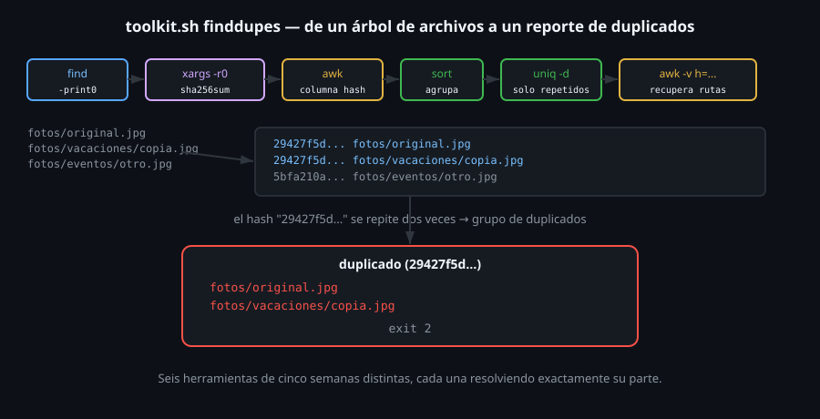

# Construyendo finddupes: find + xargs + hashing

> Este archivo cierra la semana combinando todo lo anterior en un
> problema real: encontrar archivos duplicados por **contenido**, no por
> nombre, en un árbol de directorios — exactamente lo que construye
> `toolkit.sh finddupes`.



## 🎯 Objetivos

- Calcular un hash de contenido para cada archivo de un árbol, de forma segura ante nombres con espacios
- Agrupar archivos por hash para detectar contenido idéntico
- Combinar `find`, `xargs`, `awk` y `sort`/`uniq` (semanas anteriores) en un solo pipeline
- Reconocer qué significa, y qué no significa, que dos archivos tengan el mismo hash

## 1. Qué problema resuelve

Dos archivos con nombres distintos pueden tener **contenido idéntico**
— una foto copiada dos veces con nombres diferentes, un archivo de
configuración duplicado por error. Comparar nombres no lo detecta;
comparar **contenido** sí, y la forma estándar de comparar contenido sin
leer cada archivo byte a byte contra todos los demás es un hash: una
huella digital corta que es (para fines prácticos) única por contenido.

## 2. Cómo funciona

### 2.1 Un hash por archivo, de forma segura

```bash
find . -type f -print0 | xargs -r0 sha256sum
```

```
4106ba9e...  ./a.txt
4106ba9e...  ./sub/b.txt
8b723c38...  ./c.txt
```

`-print0`/`-0` (archivo 05 de esta semana) garantizan que esto funcione
aunque algún archivo tenga espacios en el nombre; `-r` (archivo 04)
evita que `sha256sum` corra con cero argumentos si el árbol está vacío.
Dos archivos con el **mismo hash** tienen el mismo contenido exacto,
aunque sus nombres y ubicaciones sean distintos.

### 2.2 Encontrar qué hashes se repiten

```bash
awk '{print $1}' | sort | uniq -d
```

El mismo patrón de la Semana 07: extraer una columna (`awk '{print
$1}'`, el hash), ordenar para agrupar valores iguales de forma
adyacente, y `uniq -d` para quedarse solo con los que aparecen **más de
una vez** — un hash que se repite significa, por definición, archivos
con contenido idéntico.

### 2.3 Mostrar qué archivos corresponden a cada hash repetido

```bash
while read -r hash; do
  echo "duplicado ($hash):"
  echo "$salida" | awk -v h="$hash" '$1==h { $1=""; sub(/^ /,""); print "  "$0 }'
done < <(echo "$salida" | awk '{print $1}' | sort | uniq -d)
```

Por cada hash duplicado, filtrar la salida completa de `sha256sum`
(guardada en `$salida`) a solo las líneas con ese hash, y quitar la
columna del hash para mostrar únicamente las rutas — el mismo patrón de
"filtrar por clave con awk -v" que armó `sumfield` en la Semana 08,
ahora aplicado a agrupar archivos en vez de sumar números.

### 2.4 El pipeline completo, de punta a punta

| Etapa | Herramienta | Qué hace |
|:--:|---|---|
| 1 | `find -print0` | Recorre el árbol, seguro ante nombres raros |
| 2 | `xargs -r0 sha256sum` | Calcula un hash por archivo, sin ejecutar nada si no hay archivos |
| 3 | `awk '{print $1}'` | Extrae solo la columna del hash |
| 4 | `sort` | Agrupa hashes iguales de forma adyacente |
| 5 | `uniq -d` | Filtra a solo los hashes repetidos |
| 6 | `awk -v h=... ` (por cada hash) | Recupera qué rutas corresponden a ese hash |

Seis herramientas de cinco semanas distintas (`find`/`xargs` de esta
semana, `awk`/`sort`/`uniq` de las dos anteriores), cada una resolviendo
exactamente el problema para el que fue diseñada — ninguna hace el
trabajo de las otras.

### 2.5 Qué significa (y qué no) un hash igual

Un hash idéntico significa que el contenido es **exactamente** igual,
byte por byte — no "parecido", no "la misma idea con un cambio menor".
Dos versiones de un documento con una sola palabra distinta tienen
hashes completamente diferentes. `finddupes` encuentra copias exactas,
no similares — un problema distinto (y considerablemente más difícil)
que está fuera del alcance de esta semana.

### 2.6 Una optimización real: filtrar por tamaño antes de hashear

```bash
find . -type f -printf '%s %p\n' | sort -n | awk '{print $1}' | uniq -d
```

```
2
12
```

Dos archivos con contenido idéntico **necesariamente** tienen el mismo
tamaño — pero dos archivos del mismo tamaño no necesariamente tienen el
mismo contenido. Esto permite una optimización real para árboles
grandes: agrupar primero por tamaño (barato, solo lee metadatos, no el
contenido) y **solo** calcular el hash completo para los archivos que
comparten tamaño con al menos otro — descartando de entrada la
mayoría de archivos que, por tener un tamaño único, no pueden tener
duplicados. `toolkit.sh finddupes` no implementa esta optimización (hashea
todo, por simplicidad) — queda como una mejora real para quien quiera
extenderlo.

### 2.7 Qué hacer con los duplicados, una vez encontrados

`finddupes` **encuentra y reporta** — no borra nada automáticamente, a
propósito. Decidir cuál copia de un archivo duplicado conservar (la más
reciente, la de una ubicación específica, cualquiera) es una decisión
que depende del contexto de cada caso, no algo que un script deba
asumir sin supervisión. El mismo patrón de separar "encontrar" de
"actuar" que ya viste con `-delete` de `find` (archivo 03): primero
confirmar la lista, recién después decidir qué hacer con ella.

## 3. Cómo se usa

```bash
# El comando completo que arma toolkit.sh finddupes
find /home/usuario/fotos -type f -print0 \
  | xargs -r0 sha256sum \
  | awk '{print $1}' \
  | sort \
  | uniq -d

# Lo mismo, pero solo para un tipo de archivo
find . -type f -name "*.pdf" -print0 | xargs -r0 sha256sum

# toolkit.sh finddupes hace todo esto en un solo subcomando
toolkit.sh finddupes ~/descargas
```

## 4. Antipatrones

| Antipatrón | Por qué duele | Qué hacer en su lugar |
|---|---|---|
| Comparar archivos por nombre o por tamaño para detectar duplicados | Dos archivos con el mismo tamaño pueden tener contenido distinto; dos con nombres distintos pueden ser idénticos — ninguno de los dos es una prueba real de duplicado | Comparar por hash de contenido, la única forma confiable sin leer archivo por archivo a mano |
| Asumir que un hash distinto significa "parecido pero no igual" merece la misma acción que "idéntico" | Un hash distinto no da ninguna medida de *cuánto* difieren dos archivos — pueden ser completamente distintos o casi iguales, el hash no lo distingue | Usar herramientas de diferencia de contenido (`diff`, fuera del alcance de esta semana) cuando interesa el grado de similitud, no solo "idéntico o no" |
| Olvidar `-r` en el `xargs` de este pipeline | Un árbol vacío (o filtrado a cero resultados) generaría un hash falso del "archivo" `-`, como se vio en el archivo 04 | `-r` siempre, en cualquier pipeline `find \| xargs` donde la entrada puede quedar vacía |
| Correr este pipeline sobre un árbol enorme sin pensar el costo | Calcular un hash de cada archivo implica leerlo completo — en un árbol con muchos archivos grandes, esto puede tardar considerablemente | Filtrar primero por tamaño o tipo (`-size`, `-name`) cuando sea razonable, antes de hashear todo el árbol |

## 5. Trucos

- `xargs -r0 -P"$(nproc)" sha256sum` (combinando con el archivo 06 de
  esta semana) calcula los hashes en paralelo, considerablemente más
  rápido en árboles grandes con varios núcleos disponibles.
- Si solo interesa saber **si** hay duplicados (no cuáles), basta con
  revisar si `sort | uniq -d` produce alguna línea — no hace falta
  llegar hasta el paso de mostrar las rutas.
- Guardar la salida completa de `sha256sum` en una variable (en vez de
  volver a correr el pipeline varias veces) evita recalcular los hashes
  — exactamente por qué `finddupes` lo hace una sola vez y reutiliza el
  resultado.

## Resumen

Detectar archivos duplicados por contenido combina `find -print0` y
`xargs -r0` (seguridad ante nombres raros y entrada vacía) con
`sha256sum` para generar una huella por archivo, y `awk`/`sort`/`uniq
-d` (semanas anteriores) para agrupar y filtrar hashes repetidos. Un
hash igual significa contenido idéntico byte por byte — ni más, ni
menos. Esto es, literalmente, el cuerpo completo de `toolkit.sh
finddupes`.

## 📚 Recursos Adicionales

- [Missing Semester — Command-line Environment](https://missing.csail.mit.edu/2020/command-line/) — mismo curso citado en semanas anteriores, con ejemplos de combinar `find`/`xargs` con otras herramientas.
- [GNU Coreutils Manual — sha256sum invocation](https://www.gnu.org/software/coreutils/manual/coreutils.html#sha256sum-invocation) — referencia completa del comando de hashing.
- [GNU Findutils Manual](https://www.gnu.org/software/findutils/manual/html_mono/find.html) — referencia conjunta de `find` y `xargs` usados toda esta semana.
- [GNU Coreutils Manual — sort invocation](https://www.gnu.org/software/coreutils/manual/coreutils.html#sort-invocation) — repasado de la Semana 07, reutilizado acá para agrupar hashes.
- [GNU Coreutils Manual — uniq invocation](https://www.gnu.org/software/coreutils/manual/coreutils.html#uniq-invocation) — `-d`, la bandera central de este archivo.
- [GNU Awk User's Guide — Arrays](https://www.gnu.org/software/gawk/manual/gawk.html#Arrays) — repasado de la Semana 08, el filtro `-v h="$hash"` reutilizado acá.

## ✅ Checklist de Verificación

- [ ] Calculaste un hash por archivo de un árbol con `find -print0 | xargs -r0 sha256sum`
- [ ] Encontraste qué hashes se repiten con `awk | sort | uniq -d`
- [ ] Recuperaste qué archivos corresponden a un hash repetido, filtrando con `awk -v`
- [ ] Explicaste con tus palabras qué significa (y qué no) que dos archivos tengan el mismo hash
- [ ] Reprodujiste el pipeline completo de `toolkit.sh finddupes`, de punta a punta, a mano
- [ ] Agrupaste archivos por tamaño antes de hashear, para ver cuántos quedarían descartados de esa optimización
- [ ] Explicaste por qué `finddupes` reporta en vez de borrar automáticamente

---

[← 06 — xargs en paralelo y control de lote](06-xargs-paralelo-y-control-de-lote.md) · [2-practicas/01 →](../2-practicas/01-find-basico-y-criterios.md)
