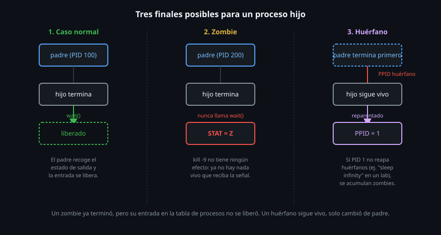

# Estados de proceso: zombies y huérfanos

> Un zombie no es un proceso colgado — es un proceso que **ya
> terminó**, esperando que alguien lea su resultado. `kill -9` sobre un
> zombie no hace nada, porque no hay nada corriendo para matar. Entender
> esta distinción es la diferencia entre diagnosticar bien un sistema y
> perseguir un fantasma.



## 🎯 Objetivos

- Explicar por qué un proceso zombie existe, y qué significa realmente ese estado
- Reproducir que `kill` sobre un zombie no tiene ningún efecto
- Explicar qué es un proceso huérfano y qué le pasa a su PPID
- Entender por qué un zombie solo desaparece cuando su padre lo "recoge" (`wait`)

## 1. Qué problema resuelve

"Hay un proceso que no puedo matar" es, casi siempre, uno de dos casos
completamente distintos: un proceso vivo que ignora la señal, o un
zombie — que ya no es un proceso en ejecución, sino una entrada en la
tabla de procesos esperando que su padre la limpie. Tratarlos igual
lleva a intentar "matar" algo que ya está muerto.

## 2. Cómo funciona

### 2.1 Cómo se crea un zombie

Cuando un proceso termina, el kernel no borra su entrada de inmediato
— la deja como zombie (`Z`) hasta que el proceso padre llama a
`wait()` (o una variante) para leer su código de salida. Ese es el
propósito real del estado zombie: guardar el resultado hasta que
alguien lo reclame.

```bash
perl -e 'my $pid = fork(); if ($pid == 0) { exit 0; } else { sleep 5; }' &
```

```bash
ps -eo pid,ppid,stat,cmd | grep perl
```

```
   2112       1 S    perl -e ...
   2114    2112 Z    [perl] <defunct>
```

El hijo (`2114`) ya terminó (`exit 0`) — pero el padre (`2112`) está
ocupado en `sleep 5`, sin haber llamado `wait()` todavía. Mientras
tanto, el hijo queda como zombie.

### 2.2 `kill` sobre un zombie no hace nada

```bash
kill -9 2114
echo $?
```

```
0
```

```bash
ps -p 2114 -o pid,stat
```

```
   PID STAT
  2114 Z
```

`kill` reporta éxito (código `0`) — el PID existe en la tabla de
procesos, así que `kill` pudo enviarle la señal. Pero un zombie no
tiene código ejecutándose que pueda recibir ni reaccionar a nada: la
señal se envía, y no hay nadie del otro lado. El proceso sigue
apareciendo exactamente igual después.

### 2.3 Cómo desaparece un zombie: el padre lo recoge, específicamente a él

```bash
perl -e '
  my $pid = fork();
  if ($pid == 0) { exit 0; }
  else { sleep 1; waitpid($pid, 0); sleep 3; }
' &
```

```bash
# durante el primer segundo, el hijo YA es zombie (el padre todavia no llamo waitpid)
ps --ppid "$!" -o pid,stat,cmd
#    PID STAT CMD
#   3895 Z    [perl] <defunct>
```

```bash
sleep 1   # esperar a que el padre llame waitpid
ps --ppid "$!" -o pid,stat,cmd
# (sin salida: el hijo ya no existe)
```

El zombie desaparece en el instante exacto en que **su propio padre**
llama a `waitpid()` sobre **él** — no antes, por más que el padre siga
vivo haciendo otra cosa. Importante: esperar a que el padre termine (con
`wait` desde afuera, o matándolo) **no** limpia retroactivamente a un
hijo que el padre nunca recogió — simplemente lo deja huérfano
(sección 2.4), con el mismo problema de limpieza pendiente, ahora bajo
un padre distinto.

### 2.4 Procesos huérfanos: cuando el padre termina primero

Si el padre termina **antes** que el hijo (lo opuesto del caso
anterior), el hijo queda huérfano — el kernel lo reasigna a un nuevo
padre, normalmente el proceso con PID 1:

```bash
ps -eo pid,ppid,stat,cmd | grep defunct
```

```
   2054       1 Z    [bash] <defunct>
```

El PPID `1` en un proceso zombie casi siempre significa esto: su padre
original ya no existe, y quedó huérfano antes de poder terminar y
convertirse en zombie bajo un padre real.

### 2.5 La pieza que falta en un laboratorio sin init real

En un sistema con un init real (`systemd`, `tini`, el propio `init`),
el proceso PID 1 llama a `wait()` en bucle sobre cualquier huérfano
que termine, limpiándolo casi de inmediato. En `ubuntu-lab`, el PID 1
es literalmente el comando `sleep infinity` — que **no** hace eso. Un
zombie huérfano en este laboratorio puede quedarse ahí indefinidamente,
hasta que el contenedor se reinicia. Esto no es el comportamiento
normal de Linux: es una particularidad de este entorno de práctica, que
sirve para ver el problema sin que un init real lo oculte limpiándolo
en milisegundos.

## 3. Cómo se usa

```bash
# Encontrar todos los zombies del sistema
ps -eo pid,ppid,stat,cmd | awk '$3 ~ /^Z/'

# Confirmar si el PPID de un zombie sigue vivo
zombie_ppid=$(ps -o ppid= -p 2114)
ps -p "$zombie_ppid" -o pid,stat,cmd

# Ver cuantos zombies hay en total
ps -eo stat | grep -c '^Z'
```

## 4. Antipatrones

| Antipatrón | Por qué duele | Qué hacer en su lugar |
|---|---|---|
| Intentar `kill -9` sobre un zombie esperando que desaparezca | No hay ningún proceso vivo para matar — la señal no tiene ningún efecto, el zombie sigue igual | Identificar y actuar sobre el **padre** del zombie (hacer que termine, o que llame `wait`), no sobre el zombie mismo |
| Confundir un proceso zombie con uno colgado (`D` o `S` sin avanzar) | Son problemas completamente distintos: uno ya terminó y espera limpieza, el otro sigue corriendo (o esperando E/S) | Confirmar el STAT exacto antes de diagnosticar — `Z` es siempre "ya terminó", nunca "colgado" |
| Asumir que PID 1 siempre limpia huérfanos rápido, en cualquier entorno | Cierto en un sistema con init real; falso en contenedores mínimos sin un proceso que haga ese trabajo | Confirmar qué corre como PID 1 (`ps -p 1 -o cmd`) antes de asumir que los huérfanos se limpian solos |
| Reportar "tengo un proceso que no se puede matar" sin confirmar el STAT primero | La solución es completamente distinta según si está vivo o es un zombie | `ps -p PID -o stat` como primer paso de cualquier diagnóstico de "proceso que no responde" |

## 5. Trucos

- `ps -eo stat,pid,ppid,cmd | awk '$1 ~ /^Z/'` lista todos los zombies
  del sistema junto con el PID de su padre, en un solo comando.
- Si un padre genera zombies por no llamar `wait()`, y no se puede
  modificar su código, terminar el padre (con una señal que sí pueda
  recibir) limpia también a sus zombies huérfanos una vez que algo
  llame `wait()` sobre ellos.
- `ps -p 1 -o cmd` confirma en segundos si el entorno actual tiene un
  init real o no, antes de asumir que los huérfanos se limpian solos.

## Resumen

Un zombie (`STAT Z`) es un proceso que ya terminó, esperando que su
padre lea su código de salida con `wait()` — `kill` no tiene ningún
efecto sobre él, porque no hay nada vivo para señalizar. Un huérfano es
lo opuesto: un proceso cuyo padre terminó primero, reasignado
normalmente a PID 1. En un sistema con init real, PID 1 limpia
huérfanos rápido; en `ubuntu-lab` (PID 1 = `sleep infinity`), un zombie
huérfano puede quedar indefinidamente — una particularidad del
laboratorio, no de Linux en general.

## 📚 Recursos Adicionales

- [man7.org — wait(2)](https://man7.org/linux/man-pages/man2/wait.2.html) — la llamada al sistema que limpia un zombie.
- [man7.org — signal(7)](https://man7.org/linux/man-pages/man7/signal.7.html) — comportamiento de señales sobre distintos estados de proceso.

## ✅ Checklist de Verificación

- [ ] Creaste un proceso zombie real (con el truco de `fork` + `exit` del padre sin `wait`)
- [ ] Confirmaste que `kill -9` sobre ese zombie no cambia su estado
- [ ] Encontraste el PPID de un zombie y confirmaste si su padre sigue vivo
- [ ] Explicaste con tus palabras la diferencia entre huérfano y zombie
- [ ] Confirmaste qué corre como PID 1 en `ubuntu-lab`, y por qué eso cambia el comportamiento esperado

---

[← 01 — ps y el árbol de procesos](01-ps-y-el-arbol-de-procesos.md) · [03 — Trabajos y control de shell →](03-trabajos-y-control-de-shell.md)
