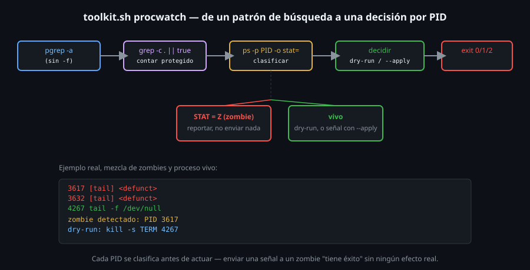

# Construyendo procwatch: detección y señales

> Este archivo cierra la semana combinando todo lo anterior en un
> problema real: encontrar procesos por nombre, distinguir los que ya
> están muertos (zombies) de los que todavía pueden recibir una señal,
> y aplicar esa señal solo cuando corresponde — exactamente lo que
> construye `toolkit.sh procwatch`.



## 🎯 Objetivos

- Combinar `pgrep` y `ps` para clasificar procesos antes de actuar sobre ellos
- Separar "zombie, no se le puede enviar nada" de "vivo, puede recibir una señal"
- Aplicar el patrón dry-run/apply (Semana 03) a una acción sobre procesos, no solo archivos
- Reconocer por qué cada decisión del diseño de `procwatch` evita un gotcha ya visto

## 1. Qué problema resuelve

"Encontrar procesos que coincidan con un nombre, y opcionalmente
señalizarlos" combina tres problemas que esta semana resolvió por
separado: buscar por nombre sin automatchearse (archivo 01), distinguir
un zombie de un proceso vivo antes de intentar nada (archivo 02), y
decidir con criterio cuándo aplicar una acción destructiva de verdad
(archivos 04-06). `procwatch` los junta en un solo subcomando.

## 2. Cómo funciona

### 2.1 Buscar sin automatchearse

```bash
pgrep -a "$patron"
```

`procwatch` usa `pgrep` **sin** `-f` a propósito — comparar contra
`comm` (15 caracteres, archivo 01) evita el gotcha central del archivo
06: un `pgrep -f`/`pkill -f` puede coincidir con la propia invocación
del script que lo está corriendo, porque el patrón de búsqueda
aparece en sus propios argumentos. Comparar contra `comm` (que para
`toolkit.sh` siempre es `bash`, nunca el patrón que el usuario busca)
elimina ese riesgo por completo, al costo de no poder buscar por línea
de comando completa.

### 2.2 Contar protegido contra el gotcha de `set -e`

```bash
total=$(printf '%s\n' "$procesos" | grep -c .) || true
```

El mismo patrón de `grep -c . || true` de las Semanas 07-09: contar
líneas no vacías de una variable que puede estar completamente vacía,
sin que `wc -l` la cuente como "una línea" por error, y sin que `set
-e` corte el script cuando `grep -c` no encuentra nada que contar.

### 2.3 Clasificar cada coincidencia por STAT

```bash
while read -r pid _; do
  stat=$(ps -p "$pid" -o stat= 2>/dev/null) || stat=""
  if [[ "$stat" == Z* ]]; then
    # zombie: no se le puede enviar nada (archivo 02)
  elif [[ -n "$senal" ]]; then
    # vivo: aplicar el patron dry-run/apply (seccion 2.4)
  fi
done < <(printf '%s\n' "$procesos")
```

Antes de considerar enviar cualquier señal, cada PID se consulta
individualmente con `ps -p PID -o stat=` — si el estado empieza con
`Z`, ya se sabe (archivo 02) que ninguna señal va a tener efecto, así
que `procwatch` ni lo intenta: solo lo reporta como zombie detectado.

### 2.4 Dry-run por defecto, igual que `organize` en la Semana 03

```bash
if [[ "$aplicar" == true ]]; then
  kill -s "$senal" "$pid" 2>/dev/null || true
  echo "senal $senal enviada a PID $pid"
else
  echo "dry-run: kill -s $senal $pid (usa --apply para enviarla de verdad)"
fi
```

El mismo patrón de `toolkit.sh organize`: sin `--apply`, `procwatch`
**muestra** qué señal enviaría a cada proceso, sin enviar nada
todavía. Esto es consistente con el patrón "confirmar, pedir, forzar"
del archivo 06 — la previsualización reemplaza el paso de "confirmar"
antes de aplicar algo irreversible.

### 2.5 El código de salida final

```bash
if [[ "$zombies" -gt 0 ]]; then
  exit 2
fi
```

Igual que `audit`, `logreport`, `logscan`, `topcount`, `sumfield` y
`finddupes` de semanas anteriores: `0` si todo está limpio (sin
zombies entre las coincidencias), `1` si falta el patrón de búsqueda,
`2` si se encontró al menos un zombie — un script que llama a
`toolkit.sh procwatch` puede reaccionar a cada caso solo con `$?`, sin
parsear ningún texto.

### 2.6 Un resultado mixto, tal como se ve de verdad

```bash
tail -f /dev/null &
toolkit.sh procwatch tail --senal TERM
```

```
== toolkit procwatch ==
patron: tail
coincidencias: 3
3617 [tail] <defunct>
3632 [tail] <defunct>
4188 tail -f /dev/null
zombie detectado: PID 3617 (no se le puede enviar ninguna senal)
zombie detectado: PID 3632 (no se le puede enviar ninguna senal)
dry-run: kill -s TERM 4188 (usa --apply para enviarla de verdad)
zombies encontrados: 2
```

Un caso real, no armado a propósito: dos zombies `tail` huérfanos de
pruebas anteriores en este mismo laboratorio (el mismo problema del
archivo 02 — `ubuntu-lab` no los limpia solo), más un proceso `tail`
genuinamente vivo. `procwatch` reporta los tres, distingue
correctamente a cuáles no puede enviarles nada, y muestra el dry-run
solo para el que sí está vivo — ningún paso de los seis archivos
anteriores de esta semana está de adorno, cada uno evita exactamente
este tipo de confusión.

## 3. Cómo se usa

```bash
# Ver que procesos coinciden, sin tocar nada
toolkit.sh procwatch nginx

# Ver que senal se enviaria, sin enviarla todavia
toolkit.sh procwatch nginx --senal TERM

# Enviar la senal de verdad
toolkit.sh procwatch nginx --senal TERM --apply

# Usar el codigo de salida en un script de monitoreo
toolkit.sh procwatch mi-servicio
if [[ $? -eq 2 ]]; then
  echo "hay procesos zombie de mi-servicio, revisar el padre" | mail -s alerta admin
fi
```

## 4. Antipatrones

| Antipatrón | Por qué duele | Qué hacer en su lugar |
|---|---|---|
| Enviar una señal a un PID sin confirmar primero si es zombie | `kill` "tiene éxito" (código 0) sobre un zombie sin hacer nada real — perder tiempo pensando que la señal "no funcionó" | Confirmar el STAT con `ps -p PID -o stat=` antes de intentar cualquier señal |
| Omitir el modo dry-run en una herramienta que envía señales | Una señal mal dirigida (patrón equivocado, proceso equivocado) no se puede deshacer | Dry-run por defecto, `--apply` explícito — el mismo criterio que cualquier operación destructiva de este bootcamp |
| Usar `-f` en la búsqueda de un subcomando que después va a actuar sobre sí mismo | El riesgo de autoafectarse (archivo 06) es real cuando el patrón de búsqueda puede coincidir con la propia invocación | Preferir comparar contra `comm` cuando sea suficiente, reservando `-f` para cuando realmente haga falta |
| Reportar solo "se encontraron N procesos" sin distinguir zombies de procesos vivos | Dos números completamente distintos en significado — un total que no distingue ambos no sirve para decidir qué hacer | Reportar zombies y procesos vivos como conteos separados, igual que cualquier reporte de esta semana separa "válido" de "en riesgo" |

## 5. Trucos

- Si `procwatch` necesitara comparar contra la línea de comando
  completa en el futuro, agregar `-f` tendría que venir junto con una
  forma de excluir la propia invocación del script — no es gratis,
  hay que diseñarlo a propósito, no agregarlo sin pensar.
- El mismo patrón de `procwatch` (buscar, clasificar, decidir con
  dry-run/apply) se puede aplicar a casi cualquier acción en lote sobre
  procesos — no es específico de señales.
- Probar `procwatch` primero sin `--senal` en absoluto es la forma más
  rápida de confirmar que el patrón de búsqueda encuentra lo esperado,
  antes de agregar ninguna acción.

## Resumen

`procwatch` combina `pgrep` (sin `-f`, evitando el gotcha de
automatcheo), `ps -o stat=` para clasificar zombies antes de actuar,
el patrón dry-run/apply de la Semana 03 para cualquier señal, y los
mismos tres códigos de salida con significado de todo el proyecto.
Cada pieza del diseño responde directamente a un gotcha real,
verificado, de los seis archivos anteriores de esta semana.

## 📚 Recursos Adicionales

- [man7.org — ps(1)](https://man7.org/linux/man-pages/man1/ps.1.html) — referencia de `-o stat=` usada para clasificar procesos.
- [GNU Bash Manual — Lists of Commands](https://www.gnu.org/software/bash/manual/bash.html#Lists) — el operador `||` usado en los guardias `|| true` de esta semana y las anteriores.
- [GNU Findutils Manual](https://www.gnu.org/software/findutils/manual/html_mono/find.html) — repasado de la Semana 09, el mismo patrón de validar/clasificar antes de actuar.

## ✅ Checklist de Verificación

- [ ] Explicaste por qué `procwatch` usa `pgrep` sin `-f`
- [ ] Clasificaste procesos coincidentes en zombies y vivos antes de considerar cualquier señal
- [ ] Reprodujiste el modo dry-run de `procwatch` y confirmaste que no envía nada sin `--apply`
- [ ] Usaste el código de salida de `procwatch` (0/1/2) en una decisión de script, sin parsear texto
- [ ] Obtuviste un resultado mixto (zombies y procesos vivos juntos) y confirmaste que cada uno se trató distinto

---

[← 06 — Señales comunes y kill con criterio](06-senales-comunes-y-kill-con-criterio.md) · [2-practicas/01 →](../2-practicas/01-ps-y-estados-de-proceso.md)
