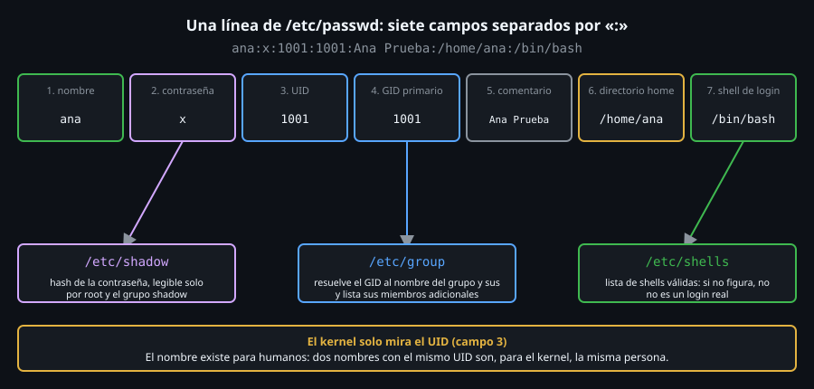

# Usuarios, UID y los archivos de cuentas

> Para el kernel un usuario no es un nombre: es un número. Todo lo demás
> (el nombre, la contraseña, el grupo, la shell) vive en archivos de texto
> que ya sabes leer con `cut` y `awk`.



## 🎯 Objetivos

- Leer los siete campos de una línea de `/etc/passwd` sin mirar la documentación
- Explicar por qué la contraseña no está en `/etc/passwd` y dónde está en realidad
- Distinguir cuenta de sistema, cuenta regular y `root` por su UID
- Consultar usuarios y grupos con `id` y `getent` en lugar de abrir los archivos a mano

## 1. Qué problema resuelve

Cada archivo, cada proceso y cada permiso de la Semana 04 (`rwx` para
dueño, grupo y otros) necesita responder a una pregunta: **¿de quién es
esto?** El kernel no guarda nombres. Guarda un número entero: el **UID**
(*User ID*) del dueño y el **GID** (*Group ID*) del grupo.

Los nombres (`ana`, `www-data`) son una comodidad para humanos que alguien
tiene que traducir. Esa traducción vive en tres archivos de texto plano
dentro de `/etc`. Entenderlos es entender qué hace `useradd` por dentro,
qué puede romper un script mal escrito y qué debe vigilar una auditoría.

## 2. Cómo funciona

### 2.1 `/etc/passwd`: la tabla de usuarios

Siete campos separados por `:`, una cuenta por línea:

```bash
# El usuario "ubuntu" viene de fabrica en la imagen ubuntu:24.04 del laboratorio.
getent passwd ubuntu
# ubuntu:x:1000:1000:Ubuntu:/home/ubuntu:/bin/bash
```

| # | Campo | Valor | Qué significa |
|:--:|---|---|---|
| 1 | nombre | `ubuntu` | El nombre de login |
| 2 | contraseña | `x` | Marcador: el hash real está en `/etc/shadow` |
| 3 | UID | `1000` | El número que el kernel usa de verdad |
| 4 | GID primario | `1000` | El grupo con el que se crean sus archivos nuevos |
| 5 | comentario | `Ubuntu` | Texto libre (nombre real, teléfono…), llamado GECOS |
| 6 | home | `/home/ubuntu` | Directorio de trabajo al entrar |
| 7 | shell | `/bin/bash` | Programa que arranca al iniciar sesión |

Como es texto separado por `:`, las herramientas de las Semanas 07 y 08
sirven directamente:

```bash
# -d: usa ":" como separador; -f1,3,7 pide nombre, UID y shell.
cut -d: -f1,3,7 /etc/passwd | head -4
# root:0:/bin/bash
# daemon:1:/usr/sbin/nologin
# bin:2:/usr/sbin/nologin
# sys:3:/usr/sbin/nologin
```

### 2.2 El rango de UID dice qué tipo de cuenta es

Por convención (y por `/etc/login.defs`), el UID clasifica la cuenta:

| UID | Tipo | Ejemplo |
|---|---|---|
| `0` | `root`: el kernel salta casi todas las comprobaciones de permisos | `root` |
| `1`-`999` | Cuentas de **sistema**: las usan servicios, no personas | `daemon`, `www-data` |
| `1000`-`60000` | Cuentas **regulares**: personas | `ubuntu` |
| `65534` | `nobody`: dueño de "nadie", fuera del rango regular | `nobody` |

```bash
# Los limites regulares de esta distro salen de login.defs, no de una regla universal.
grep -E '^(UID_MIN|UID_MAX)' /etc/login.defs
# UID_MIN			 1000
# UID_MAX			60000

# Cuentas regulares: UID entre UID_MIN y UID_MAX.
awk -F: '$3 >= 1000 && $3 <= 60000 { print $1, $3 }' /etc/passwd
# ubuntu 1000
```

**El nombre `root` no tiene nada de especial: el UID `0` sí.** Una cuenta
llamada `toor` con UID `0` es root a todos los efectos. Por eso esta
semana `toolkit acctaudit` busca **UID 0 con nombre distinto de `root`**.

### 2.3 `/etc/shadow`: donde viven las contraseñas

El `x` del campo 2 significa "mira en `/etc/shadow`". `/etc/passwd` tiene
que poder leerlo cualquier programa (para traducir UID a nombre, como hace
`ls -l`); las contraseñas no, así que se separaron:

```bash
stat -c '%U:%G %a %n' /etc/passwd /etc/shadow
# root:root 644 /etc/passwd
# root:shadow 640 /etc/shadow
```

`/etc/passwd` es legible por todos (`644`); `/etc/shadow` solo por `root` y
el grupo `shadow` (`640`). Un usuario normal ni siquiera puede abrirlo:

```bash
su ubuntu -c 'cat /etc/shadow'
# cat: /etc/shadow: Permission denied
```

Cada línea tiene nueve campos. Los que importan en esta semana son los dos
primeros y los de caducidad:

```bash
# cut -c1-12 recorta la salida: nunca muestres un hash completo en pantalla compartida.
sed -n 1,3p /etc/shadow | cut -d: -f1,2 | cut -c1-12
# root:*
# daemon:*
# bin:*
```

| Valor del campo 2 | Significado |
|---|---|
| `*` | La cuenta no tiene contraseña: nadie puede entrar con ella |
| `!` | La contraseña está **bloqueada** (o nunca se estableció) |
| `$y$...` / `$6$...` | Un hash real; el prefijo indica el algoritmo |
| vacío | **Sin contraseña**: cualquiera entra. Siempre es un hallazgo grave |

Un usuario recién creado con `useradd` y sin `passwd` aparece con `!`:
existe, pero nadie puede entrar como él hasta que se le dé una contraseña
o una clave SSH (Semana 12).

### 2.4 `/etc/group`: la tabla de grupos

Cuatro campos: `nombre:contraseña:GID:miembros`.

```bash
getent group sudo adm shadow
# sudo:x:27:ubuntu
# adm:x:4:ubuntu
# shadow:x:42:
```

El campo 4 lista solo los **miembros adicionales**. El grupo **primario**
de un usuario (campo 4 de `/etc/passwd`) **no** aparece ahí: por eso
`shadow:x:42:` está vacío aunque exista el grupo, y por eso un usuario
cuyo GID primario no existe en `/etc/group` es una inconsistencia que
`acctaudit` también detecta.

### 2.5 `id` y `getent`: consulta sin abrir archivos

```bash
id ubuntu
# uid=1000(ubuntu) gid=1000(ubuntu) groups=1000(ubuntu),4(adm),20(dialout),24(cdrom),25(floppy),27(sudo),29(audio),30(dip),44(video),46(plugdev)

id -u ubuntu      # solo el UID
# 1000
id -Gn ubuntu     # solo los nombres de todos sus grupos
# ubuntu adm dialout cdrom floppy sudo audio dip video plugdev
```

`getent` pregunta a la misma capa que usan los programas (NSS, *Name
Service Switch*), no a un archivo concreto:

```bash
grep -E '^(passwd|group|shadow):' /etc/nsswitch.conf
# passwd:         files
# group:          files
# shadow:         files
```

`files` significa "mira en `/etc`". En una máquina de empresa esa línea
suele decir `files sss` o `files ldap`: los usuarios existen en un
directorio central y **no están en `/etc/passwd`**. `cat /etc/passwd` no
los vería; `getent passwd` sí. Por eso en un script se prefiere `getent`.

### 2.6 La shell de login y `/etc/shells`

El campo 7 no es una frase libre: una cuenta con shell de login es la que
puede abrir una sesión interactiva. `/etc/shells` lista las shells
válidas, y `/usr/sbin/nologin` es la forma estándar de decir "esta cuenta
existe pero nadie entra como ella":

```bash
/usr/sbin/nologin; echo "codigo: $?"
# This account is currently not available.
# codigo: 1

# Cuantas cuentas usan cada shell (Semana 07: sort | uniq -c).
awk -F: '{ print $7 }' /etc/passwd | sort | uniq -c | sort -rn
#      20 /usr/sbin/nologin
#       2 /bin/bash
#       1 /bin/sync
```

Ojo con `/bin/sync`: es la shell de la cuenta `sync`, pero **no figura en
`/etc/shells`**, así que no es una shell de login válida. Una auditoría
que marcara "toda cuenta de sistema que no tenga `nologin`" daría un
falso positivo con `sync`. Por eso `acctaudit` compara contra
`/etc/shells` y no contra la palabra `nologin`.

## 3. Cómo se usa

Un recorrido típico para "¿quién hay en esta máquina?":

```bash
# 1. Quien soy yo y de que grupos.
id

# 2. Cuentas que pueden entrar de verdad: shell valida y no bloqueada.
awk -F: 'NR == FNR { v[$0]; next } $7 in v { print $1 }' /etc/shells /etc/passwd
# root
# ubuntu

# 3. Alguien mas con UID 0?
awk -F: '$3 == 0 { print $1 }' /etc/passwd
# root
```

El segundo comando usa el truco de dos archivos con `NR == FNR` (Semana
08): el primero llena un conjunto y el segundo se filtra contra él.

## 4. Antipatrones

| Antipatrón | Por qué duele | Qué hacer en su lugar |
|---|---|---|
| Editar `/etc/passwd` con un editor | Una línea mal formada deja el sistema sin poder resolver usuarios | `useradd`/`usermod`; si no hay otra, `vipw`, que bloquea el archivo |
| Identificar a alguien por el nombre en un script | Dos nombres pueden compartir UID; el kernel solo ve el número | Comparar UID (`id -u`) |
| `cat /etc/passwd` para listar usuarios | No ve usuarios de LDAP/SSSD | `getent passwd` |
| Asumir que UID ≥ 1000 es una persona | `nobody` es 65534; el rango varía entre distros | Leer `UID_MIN`/`UID_MAX` de `/etc/login.defs` |
| Dejar `chmod 644 /etc/shadow` "para depurar" | Cualquiera puede llevarse los hashes y probarlos fuera de línea | Depurar con `sudo`; `shadow` es `640` |

## 5. Trucos

- `getent passwd | wc -l` cuenta las cuentas **reales** incluidas las de
  directorios remotos; `wc -l < /etc/passwd` solo cuenta las locales.
- `lslogins -u` resume en una tabla UID, bloqueo de contraseña y último
  acceso sin abrir `shadow`.
- `passwd -S usuario` da en una línea el estado de la contraseña: `L`
  bloqueada, `P` con contraseña, `NP` sin contraseña.
- `awk -F: '$2 == ""' /etc/shadow` (como `root`) lista cuentas **sin
  contraseña**; en un sistema sano no imprime nada.

## 📚 Recursos Adicionales

- `man 5 passwd`, `man 5 shadow`, `man 5 group`, `man 5 nsswitch.conf`
- `man 5 login.defs`: todos los límites (`UID_MIN`, `PASS_MAX_DAYS`…)
- [Linux man-pages — passwd(5)](https://man7.org/linux/man-pages/man5/passwd.5.html)

## ✅ Checklist de Verificación

- [ ] `cut -d: -f1,3,7 /etc/passwd | head -4` muestra nombre, UID y shell
- [ ] `stat -c '%a' /etc/shadow` devuelve `640` y `stat -c '%a' /etc/passwd` devuelve `644`
- [ ] `awk -F: '$3 == 0' /etc/passwd` imprime solo `root`
- [ ] `id -Gn ubuntu` lista el grupo `sudo`
- [ ] `grep -E '^UID_(MIN|MAX)' /etc/login.defs` confirma el rango regular

---

[← Semana 11](../README.md) · [Crear y modificar usuarios y grupos →](02-crear-y-modificar-usuarios-y-grupos.md)
