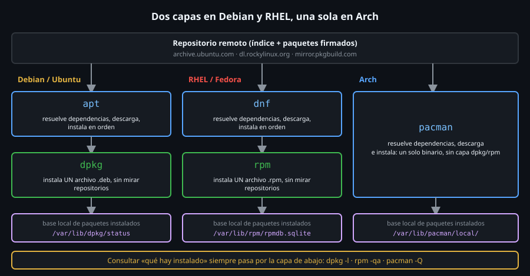

# Qué es un gestor de paquetes

> Un paquete es un archivo comprimido con programas **más la lista de lo
> que necesita para funcionar**. Un gestor de paquetes es quien lee esa
> lista, trae lo que falta y apunta en una base de datos qué quedó puesto
> en cada ruta del sistema.



## 🎯 Objetivos

- Explicar qué contiene un paquete y por qué existen las dependencias
- Distinguir la capa que resuelve dependencias (`apt`, `dnf`) de la que instala (`dpkg`, `rpm`)
- Preguntar a la base local qué paquete es dueño de un archivo y qué archivos trae un paquete
- Saber dónde guarda cada familia su base de datos de paquetes instalados

## 1. Qué problema resuelve

Sin gestor, instalar un programa es descargar un binario, copiarlo a
`/usr/bin`, y descubrir al ejecutarlo que le falta `libevent`. Se instala
`libevent` a mano; ahora falta otra librería. Y cuando quieres desinstalar
nada sabe qué archivos dejó cada cosa, así que quedan restos para siempre.

Un gestor de paquetes resuelve cuatro cosas a la vez:

1. **Dependencias**: instala lo que el programa necesita, en orden.
2. **Registro**: sabe qué archivo pertenece a qué paquete.
3. **Actualización**: cambia todo lo instalado de versión de forma coherente.
4. **Confianza**: verifica que lo descargado lo firmó quien dice firmarlo
   (archivo 06).

## 2. Cómo funciona

### 2.1 Un paquete es un archivo, no una acción

Puedes abrir uno. En Debian/Ubuntu es un `.deb`; `apt-get download` lo
baja **sin instalarlo**:

```bash
cd /tmp
apt-get download tmux            # (tras apt-get update) baja tmux_*.deb a este directorio
dpkg-deb -I tmux_*.deb | grep -E '^ (Package|Version|Depends)'
#  Package: tmux
#  Version: 3.4-1ubuntu0.2
#  Depends: libc6 (>= 2.38), libevent-core-2.1-7t64 (>= 2.1.8-stable), libsystemd0 (>= 221), libtinfo6 (>= 6.4+20230603), libtinfo6 (<< 6.5~), libutempter0 (>= 1.1.5)

dpkg-deb -c tmux_*.deb | sed -n 4p
# -rwxr-xr-x root/root   1102608 2026-10-05 19:45 ./usr/bin/tmux
```

Dentro hay dos cosas: los **archivos** que se copiarán (`./usr/bin/tmux`)
y los **metadatos**, entre ellos `Depends:`, la lista de lo que `tmux`
necesita instalado. Esa lista es la razón de ser del gestor.

| Familia | Formato de paquete | Herramienta de bajo nivel | Frontend que resuelve dependencias |
|---|---|---|---|
| Debian/Ubuntu | `.deb` | `dpkg` | `apt` |
| RHEL/Fedora | `.rpm` | `rpm` | `dnf` |
| Arch | `.pkg.tar.zst` | `pacman` | `pacman` (hace las dos cosas) |

### 2.2 Dos capas: frontend y backend

La herramienta de bajo nivel (`dpkg`, `rpm`) instala **un archivo local**
y no sabe nada de repositorios ni de dependencias ajenas. Si le falta
algo, se rinde:

```bash
dpkg -i tmux_*.deb
# dpkg: error processing package tmux (--install):
#  dependency problems - leaving unconfigured
# Errors were encountered while processing:
#  tmux

dpkg -l tmux | tail -1 | cut -c1-30
# iU  tmux           3.4-1ubuntu
```

`iU` significa *desempaquetado pero sin configurar*: el sistema quedó a
medias. El **frontend** (`apt`) existe para evitar esto: lee los
repositorios, calcula **todo** lo que falta y llama a `dpkg` en el orden
correcto. Aquí sirve incluso para reparar el estropicio:

```bash
apt-get install -f -y     # -f: arregla dependencias rotas trayendo lo que falta
# ...
# Setting up libutempter0:amd64 (1.2.1-3build1) ...
# Setting up libevent-core-2.1-7t64:amd64 (2.1.12-stable-9ubuntu2.2) ...
# Setting up tmux (3.4-1ubuntu0.2) ...
```

Regla: **instala con el frontend** (`apt install tmux`), y usa la capa
baja (`dpkg`) para *consultar*. `dpkg -i` directo es para un `.deb`
suelto que ya sabes que no tiene dependencias sin resolver.

### 2.3 La base de datos local: la única verdad sobre lo instalado

Cada familia guarda en un sitio fijo qué hay instalado, y de qué paquete
es cada archivo:

| Familia | Base de datos | Comprobado |
|---|---|---|
| Debian/Ubuntu | `/var/lib/dpkg/status` (texto plano, un bloque por paquete) | `grep -c '^Package:' /var/lib/dpkg/status` → `92` en `ubuntu-lab` |
| RHEL/Fedora | `/var/lib/rpm/rpmdb.sqlite` (SQLite) | existe en `rhel-lab` (Rocky 9) |
| Arch | `/var/lib/pacman/local/` (un directorio por paquete) | `ls /var/lib/pacman/local` en `arch-lab` |

> 🔀 **Divergencia de distro**: el formato cambia (texto, SQLite,
> directorios) pero el **modelo** es el mismo. Nunca edites estas bases a
> mano; consúltalas con los comandos de la sección siguiente.

## 3. Cómo se usa

Tres preguntas que cubren el 90 % de las consultas, y su equivalente en
cada familia. Se preguntan **a la base local**: no necesitan red.

### 3.1 ¿Está instalado y en qué versión?

```bash
dpkg -l bash coreutils | tail -2 | cut -c1-70
# ii  bash           5.2.21-2ubuntu4 amd64        GNU Bourne Again SHell
# ii  coreutils      9.4-3ubuntu6.3  amd64        GNU core utilities

dpkg-query -W -f='${Package} ${Version}\n' bash
# bash 5.2.21-2ubuntu4
```

La primera columna de `dpkg -l` es el estado: `ii` instalado, `rc`
quitado pero con configuración, `iU` a medias. Esa información es la que
`toolkit pkgcheck` (archivo 07) usa para decidir "instalado".

| Pregunta | Debian/Ubuntu | RHEL/Fedora | Arch |
|---|---|---|---|
| ¿Instalado? versión | `dpkg -s bash` / `dpkg-query -W bash` | `rpm -q bash` | `pacman -Q bash` |
| Listar todo | `dpkg -l` | `rpm -qa` | `pacman -Q` |
| Detalles | `dpkg -s bash` | `rpm -qi bash` | `pacman -Qi bash` |

### 3.2 ¿De qué paquete es este archivo?

La pregunta de oro cuando un archivo "aparece" y no sabes quién lo puso:

```bash
dpkg -S /usr/bin/bash
# bash: /usr/bin/bash
```

```bash
# En rhel-lab:
rpm -qf /usr/bin/bash
# bash-5.1.8-6.el9_1.x86_64

# En arch-lab:
pacman -Qo /usr/bin/bash
# /usr/bin/bash is owned by bash 5.3.20-1
```

> ⚠️ En `ubuntu-lab` (con `/usr` unificado) `dpkg -S /bin/ls` **no
> encuentra nada** aunque `/bin/ls` exista: `/bin` es un enlace a
> `/usr/bin` y `dpkg` registra la ruta real. Usa la ruta que devuelve
> `readlink -f`: `dpkg -S "$(readlink -f /bin/ls)"` → `coreutils: /usr/bin/ls`.

### 3.3 ¿Qué archivos trajo este paquete?

```bash
dpkg -L coreutils | grep -m1 '/usr/bin/ls$'
# /usr/bin/ls
```

| Pregunta | Debian/Ubuntu | RHEL/Fedora | Arch |
|---|---|---|---|
| ¿De quién es este archivo? | `dpkg -S RUTA` | `rpm -qf RUTA` | `pacman -Qo RUTA` |
| ¿Qué archivos trae? | `dpkg -L PAQ` | `rpm -ql PAQ` | `pacman -Ql PAQ` |
| ¿Qué necesita? | `apt-cache depends PAQ` | `rpm -qR PAQ` | `pacman -Qi PAQ` (campo *Depends On*) |

### 3.4 Dependencias en las dos direcciones

```bash
apt-cache depends tmux | head -3
# tmux
#   Depends: libc6
#   Depends: libevent-core-2.1-7t64
```

La dirección inversa importa al **quitar**: si desinstalas una librería,
¿qué se rompe? `apt-cache rdepends --installed libevent-core-2.1-7t64`
lo responde; en Arch, el campo *Required By* de `pacman -Qi`. Los
frontends lo comprueban por ti y se niegan (o arrastran los dependientes)
antes de dejarte romper algo; `dpkg --remove --force-depends` y
equivalentes desactivan esa protección: no son para uso diario.

## 4. Antipatrones

| Antipatrón | Por qué duele | Qué hacer en su lugar |
|---|---|---|
| `dpkg -i paquete.deb` para instalar | No resuelve dependencias: deja el paquete a medias (`iU`) | `apt install ./paquete.deb` (el `./` obliga a leer un archivo local y resuelve dependencias) |
| Copiar un binario a `/usr/local/bin` "porque es más rápido" | La base de datos no lo conoce: nunca se actualiza ni se puede quitar limpio | Paquete del repositorio; si no existe, `/usr/local` es el sitio **aceptado** para lo que gestionas tú |
| `ldd` + instalar librerías a mano | Reconstruyes a mano lo que el gestor ya sabe | Que el frontend traiga las dependencias |
| Editar `/var/lib/dpkg/status` | Una línea mal puesta corrompe la base de todo el sistema | Los comandos de consulta; `dpkg --configure -a` para reparar |
| Mezclar `dpkg -i` y `apt` sin mirar el estado | Paquetes en `iU`/`rc` que luego bloquean actualizaciones | `dpkg -l \| tail -n +6 \| grep -v '^ii'` para ver lo que no está limpio |

## 5. Trucos

- `dpkg -l | tail -n +6 | grep -v '^ii'` (`tail` salta las 5 líneas de
  cabecera) lista paquetes **fuera de estado normal**: restos `rc`, a medias `iU`. Primer sitio donde mirar
  cuando `apt` protesta de forma rara.
- `dpkg-query -W -f='${Package}\t${Version}\n'` (y `-f` con otros campos)
  da una lista **lista para `awk`/`cut`**, sin parsear la tabla de `dpkg -l`.
- `dpkg -S` acepta también un patrón: `dpkg -S '*/bin/ba*'` encuentra los
  paquetes dueños de todo lo que empiece por `ba` en un `bin`.
- `rpm -qa --last | head` (RHEL) lista los paquetes **instalados más
  recientemente**: ideal tras "algo se rompió ayer".

## 📚 Recursos Adicionales

- `man dpkg`, `man dpkg-query`, `man rpm`, `man pacman`
- [Debian — The Debian Administrator's Handbook, cap. 5](https://debian-handbook.info/browse/stable/sect.package-meta-information.html)

## ✅ Checklist de Verificación

- [ ] `dpkg-deb -I` sobre un `.deb` descargado muestra su campo `Depends:`
- [ ] `dpkg -S /usr/bin/bash` responde `bash: /usr/bin/bash`
- [ ] `dpkg -l bash` muestra `ii` en la primera columna
- [ ] `grep -c '^Package:' /var/lib/dpkg/status` coincide con `dpkg -l | grep -c '^ii'` en una imagen limpia (`92` los dos)
- [ ] En `rhel-lab`, `rpm -qf /usr/bin/bash` devuelve `bash-` seguido de la versión

---

[← 03 — sudo, su y mínimo privilegio](03-sudo-su-y-minimo-privilegio.md) · [apt, dnf y pacman lado a lado →](05-apt-dnf-y-pacman-lado-a-lado.md)
