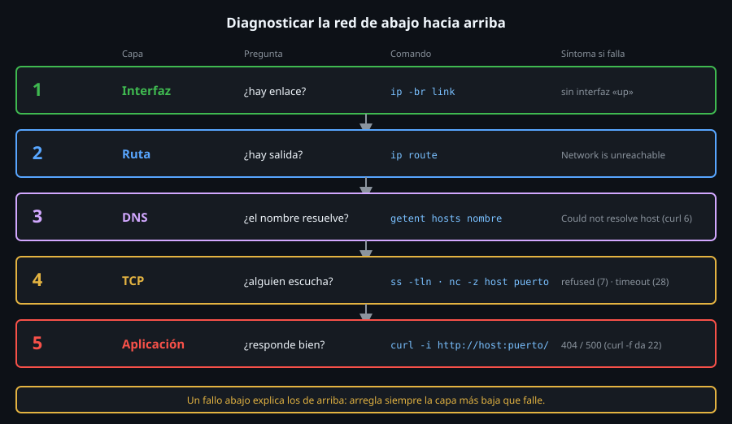

# Interfaces y direcciones IP

> Antes de preguntar "¿por qué no llego a ese servidor?" hay que saber qué
> tiene **tu** máquina: qué interfaces, en qué estado y con qué dirección.
> `ip` lo contesta en una línea.



## 🎯 Objetivos

- Instalar las herramientas de red que la imagen mínima de `ubuntu-lab` no trae
- Listar interfaces y direcciones con `ip -br addr` y leer una salida completa de `ip addr`
- Traducir un prefijo CIDR (`/16`) a máscara y a tamaño de red
- Leer el estado de una interfaz sin `ip`, directamente desde `/sys`

## 1. Qué problema resuelve

Todo diagnóstico de red empieza por la **capa de abajo**: si la máquina no
tiene una interfaz activa con una dirección, nada de lo que venga después
(rutas, DNS, un servidor web) puede funcionar, y buscar el fallo arriba
es perder el tiempo. El dibujo de arriba es el mapa de la semana: cinco
capas, de abajo hacia arriba, y esta es la primera.

Hay un segundo problema, más práctico: la imagen mínima de `ubuntu-lab`
**no trae ninguna herramienta de red**. Compruébalo antes de empezar:

```bash
# command -v imprime la ruta del programa o nada; el || echo hace visible la ausencia.
for b in ip ss ping curl dig nc ssh; do command -v "$b" >/dev/null || echo "falta: $b"; done
# falta: ip
# falta: ss
# falta: ping
# falta: curl
# falta: dig
# falta: nc
# falta: ssh
```

Es normal: las imágenes de contenedor se recortan al mínimo. En una máquina
real casi siempre vienen instaladas, pero tú necesitas saber **qué paquete
trae cada herramienta**, porque el nombre cambia entre familias.

## 2. Cómo funciona

### 2.1 Qué paquete trae qué (divergencia de distro)

| Herramienta | Debian / Ubuntu | RHEL / Fedora | Arch |
|---|---|---|---|
| `ip`, `ss` | `iproute2` | `iproute` | `iproute2` |
| `ping` | `iputils-ping` | `iputils` | `iputils` |
| `tracepath` | `iputils-tracepath` | `iputils` | `iputils` |
| `dig`, `host`, `nslookup` | `bind9-dnsutils` (alias `dnsutils`) | `bind-utils` | `bind` |
| `nc` (netcat) | `netcat-openbsd` | `nmap-ncat` | `openbsd-netcat` |
| cliente SSH (`ssh`, `scp`) | `openssh-client` | `openssh-clients` | `openssh` |
| servidor SSH (`sshd`) | `openssh-server` | `openssh-server` | `openssh` |
| `curl` | `curl` | `curl` | `curl` |

> ⚠️ **Divergencia real**: en RHEL, `nc` es **Ncat** (del proyecto Nmap), no
> el netcat de OpenBSD. Las opciones básicas de este bootcamp (`-z`, `-v`)
> funcionan igual en ambos, pero el resto de opciones difiere: no copies un
> `nc -l -p 8080` de un tutorial sin comprobarlo en tu familia.

Instala lo que usarás esta semana en `ubuntu-lab` (ejecútalo desde tu máquina):

```bash
docker exec ubuntu-lab bash -c 'apt-get update >/dev/null && apt-get install -y iproute2 iputils-ping iputils-tracepath curl dnsutils netcat-openbsd openssh-client >/dev/null'
docker exec ubuntu-lab ip -V
# ip utility, iproute2-6.1.0, libbpf 1.3.0
```

### 2.2 Interfaz, dirección y prefijo

Una **interfaz** es el punto por donde la máquina habla con una red. En una
máquina real se llama `enp0s3`, `eth0` o `wlan0`; siempre existe además `lo`,
la interfaz de **loopback**, que solo conecta la máquina consigo misma.

```bash
ip addr show eth0
# 2: eth0@if911: <BROADCAST,MULTICAST,UP,LOWER_UP> mtu 1500 qdisc noqueue state UP group default
#     link/ether 92:15:98:f3:73:ea brd ff:ff:ff:ff:ff:ff link-netnsid 0
#     inet 172.27.0.5/16 brd 172.27.255.255 scope global eth0
#        valid_lft forever preferred_lft forever
```

Línea a línea (tu IP y tu MAC serán otras; el formato es el mismo):

| Fragmento | Significado |
|---|---|
| `2: eth0@if911` | Índice 2, nombre `eth0`. El `@if911` indica que es un extremo de un par virtual (veth): así conecta Docker cada contenedor |
| `UP` entre `<...>` | El administrador (o el sistema) activó la interfaz |
| `LOWER_UP` | La capa física responde: hay enlace (en una máquina real, el cable está conectado) |
| `state UP` | Resumen del estado operativo |
| `mtu 1500` | Tamaño máximo de un paquete, en bytes |
| `link/ether 92:15:...` | Dirección MAC (capa de enlace) |
| `inet 172.27.0.5/16` | Dirección IPv4 `172.27.0.5` con prefijo de 16 bits |
| `brd 172.27.255.255` | Dirección de difusión (*broadcast*) de esa red |
| `scope global` | Alcanzable desde fuera de esta máquina (`host` = solo local) |

`UP` y `LOWER_UP` son cosas distintas: una interfaz puede estar `UP`
(activada) y sin `LOWER_UP` (cable desconectado). Cuando veas
`NO-CARRIER`, el problema está debajo de IP.

### 2.3 El prefijo CIDR: `/16` es una máscara

`172.27.0.5/16` significa "los **16 primeros bits** de la dirección
identifican la red; los otros 16, la máquina dentro de ella".

| Prefijo | Máscara | Máquinas direccionables |
|:--:|---|--:|
| `/8` | `255.0.0.0` | 16 777 214 |
| `/16` | `255.255.0.0` | 65 534 |
| `/24` | `255.255.255.0` | 254 |
| `/32` | `255.255.255.255` | 1 (una sola dirección) |

Dos direcciones están en la **misma red** si coinciden en los bits del
prefijo. Con `/16`, `172.27.0.5` y `172.27.0.4` comparten `172.27`: se
hablan directamente. `8.8.8.8` no: para llegar a ella hace falta una
**puerta de enlace**, el tema del archivo 02.

### 2.4 Direcciones privadas y loopback

Las redes privadas (RFC 1918) no se enrutan por internet: `10.0.0.0/8`,
`172.16.0.0/12` y `192.168.0.0/16`. Docker usa rangos de estos; por eso
las IP del laboratorio empiezan por `172.`. `127.0.0.0/8` (normalmente
`127.0.0.1`) es el loopback: un servidor que escucha **solo** ahí no es
visible desde otras máquinas. El archivo 04 lo demuestra.

## 3. Cómo se usa

```bash
# -br (brief): una línea por interfaz; el formato que usarás el 90 % del tiempo.
ip -br addr
# lo               UNKNOWN        127.0.0.1/8 ::1/128
# eth0@if911       UP             172.27.0.5/16

# Solo el enlace (estado y MAC), sin direcciones IP.
ip -br link
# lo               UNKNOWN        00:00:00:00:00:00 <LOOPBACK,UP,LOWER_UP>
# eth0@if911       UP             92:15:98:f3:73:ea <BROADCAST,MULTICAST,UP,LOWER_UP>
```

`lo` aparece como `UNKNOWN` y es normal: una interfaz virtual no tiene
"estado físico" que informar.

Para **scripts**, `-o` (*one-line*) da un registro por línea, y `-4` limita a
IPv4:

```bash
# Extrae solo la dirección con prefijo, lista para usar en otro comando.
ip -4 -o addr show eth0 | awk '{print $4}'
# 172.27.0.5/16
```

Contadores de tráfico y errores, útiles para saber si una interfaz pierde
paquetes:

```bash
ip -s link show eth0
#     RX:  bytes packets errors dropped  missed   mcast
#       82890209   40075      0       0       0       0
#     TX:  bytes packets errors dropped carrier collsns
#        1501523   21007      0       0       0       0
```

`errors` o `dropped` distintos de cero y creciendo indican cable, driver o
saturación. En el laboratorio siempre serán cero.

### 3.1 Sin `ip`: lo que dice el kernel

`ip` es un cliente de la interfaz de red del kernel, y el kernel expone lo
mismo como archivos. Es lo que usará `toolkit netcheck` esta semana, porque
funciona aunque no haya **ningún** paquete de red instalado:

```bash
cat /sys/class/net/eth0/operstate /sys/class/net/eth0/mtu /sys/class/net/eth0/address
# up
# 1500
# 92:15:98:f3:73:ea
ls /sys/class/net
# eth0
# lo
```

`operstate` vale `up`, `down` o `unknown`. La IP sola (sin prefijo, sin
`ip`) la da `hostname -I`:

```bash
hostname -I
# 172.27.0.5
```

### 3.2 Configurar no es lo mismo que mirar

`ip addr add`, `ip link set` y `ip route add` **cambian** la red, pero solo
hasta el siguiente reinicio: la configuración persistente la guarda otra
capa, y esa **cambia de familia** (se menciona aquí; no se ejecuta en el
laboratorio):

| Familia | Quién guarda la configuración |
|---|---|
| Ubuntu 24.04 | `netplan` (`/etc/netplan/*.yaml`) sobre `systemd-networkd` o NetworkManager |
| Debian 12 | `ifupdown` (`/etc/network/interfaces`) o `systemd-networkd` |
| RHEL / Fedora | NetworkManager (`nmcli`) |
| Arch | `systemd-networkd` o NetworkManager, a elegir al instalar |

Los contenedores del laboratorio **no tienen** la capacidad `NET_ADMIN`:
intentar cambiar una ruta da `RTNETLINK answers: Operation not permitted`.
Es deliberado: aquí solo se **lee** la red.

## 4. Antipatrones

| Antipatrón | Por qué duele | Qué hacer en su lugar |
|---|---|---|
| Usar `ifconfig` y `netstat` | Vienen del paquete `net-tools`, abandonado y ausente en instalaciones nuevas de las cuatro familias | `ip` y `ss`, siempre presentes con `iproute2`/`iproute` |
| Escribir la IP a mano en un script | Cambia con DHCP, con otra red o al recrear el contenedor | Extraerla con `ip -4 -o addr` o, mejor, usar nombres (archivo 03) |
| Parsear la salida larga de `ip addr` con `grep`/`awk` | El formato cambia entre versiones y se rompe en silencio | `ip -o`, `ip -j` (JSON) o los archivos de `/sys` |
| Fiarse de `UP` sin mirar `LOWER_UP` | Una interfaz activa sin enlace físico tampoco lleva tráfico | Leer `operstate` (`up` exige enlace) |
| Cambiar IP o rutas con `ip` y creer que es permanente | Se pierde en el siguiente reinicio | Editar la configuración persistente de tu familia |

## 5. Trucos

- `ip -j -4 addr show eth0` devuelve **JSON**; con `jq` (que se instala
  aparte) se extrae cualquier campo sin `awk`: la forma robusta de leer `ip`
  desde un script.
- `ip -br -c addr` colorea la salida (`-c` la fuerza incluso en una
  tubería; `-c=auto` solo en terminal). Recuerda quitarlo en scripts.
- `ip neigh` muestra la tabla ARP: las máquinas con las que hubo tráfico
  reciente en tu red y su MAC. Una máquina con la que no has hablado no
  aparece.

## 📚 Recursos Adicionales

- `man ip-address`, `man ip-link`: referencia completa de cada subcomando
- [Documentación de `iproute2` en kernel.org](https://wiki.linuxfoundation.org/networking/iproute2)

## ✅ Checklist de Verificación

- [ ] `docker exec ubuntu-lab ip -br addr` muestra `lo` y `eth0` con su IP
- [ ] Sabes decir cuántas máquinas caben en un `/24` y por qué `/32` es una sola
- [ ] `docker exec ubuntu-lab cat /sys/class/net/eth0/operstate` imprime `up`
- [ ] Sabes qué paquete instala `dig` en Ubuntu, RHEL y Arch

---

[← Semana 12 — Redes desde la línea de comandos](../README.md) · [Rutas y puerta de enlace →](02-rutas-y-puerta-de-enlace.md)
