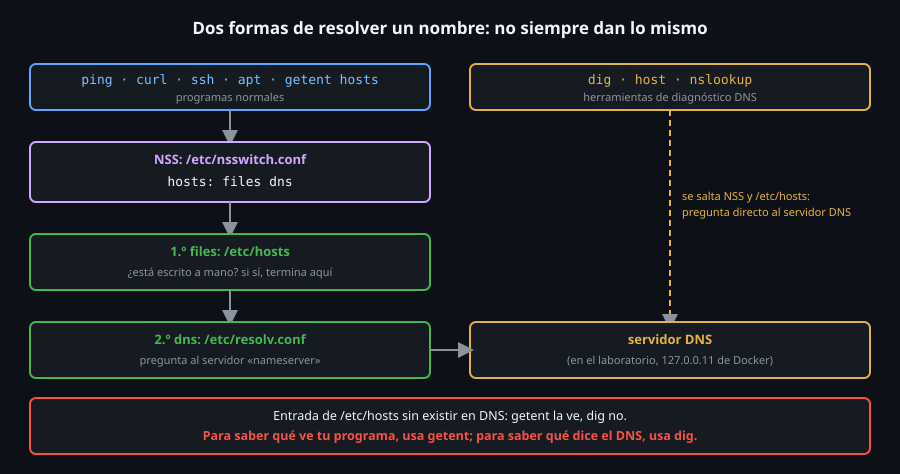

# DNS desde la línea de comandos

> Las máquinas se hablan con números; las personas, con nombres. DNS es la
> traducción, y hay **dos** formas de pedirla que no siempre dan la misma
> respuesta: saber cuál usa tu programa evita horas de confusión.



## 🎯 Objetivos

- Explicar por qué `ping`, `curl` y `ssh` resuelven un nombre que `dig` no ve
- Leer `/etc/hosts`, `/etc/nsswitch.conf` y `/etc/resolv.conf`
- Resolver un nombre como lo haría un programa (`getent`) y consultar el servidor DNS (`dig`)
- Leer una respuesta de `dig`: estado, sección de respuesta, TTL y servidor

## 1. Qué problema resuelve

Tecleas `ssh debian-lab`, no `ssh 172.27.0.3`. Alguien tiene que traducir
el nombre a una dirección, y esa traducción puede fallar de maneras muy
distintas: el nombre no existe, el servidor DNS no responde, hay una entrada
vieja escrita a mano en `/etc/hosts`, o el programa y tu herramienta de
diagnóstico **no están preguntando lo mismo**. Es la tercera capa del
diagnóstico: si el nombre no resuelve, no hay IP a la que llegar.

## 2. Cómo funciona

### 2.1 Los tres archivos

```bash
grep ^hosts /etc/nsswitch.conf
# hosts:          files dns

grep -v '^#' /etc/resolv.conf
# nameserver 127.0.0.11
# options ndots:0

tail -3 /etc/hosts
# ff02::1	ip6-allnodes
# ff02::2	ip6-allrouters
# 172.27.0.5	ubuntu-lab
```

| Archivo | Para qué sirve |
|---|---|
| `/etc/nsswitch.conf` | Dice **en qué orden** se consultan las fuentes de nombres. `hosts: files dns` = primero el archivo local, luego DNS |
| `/etc/hosts` | La fuente `files`: pares IP-nombre escritos a mano. Gana a DNS porque se consulta antes |
| `/etc/resolv.conf` | La fuente `dns`: qué servidor (`nameserver`) preguntar. Aquí `127.0.0.11` es el DNS interno de Docker, que conoce los nombres de los contenedores del laboratorio |

El mecanismo que lee `nsswitch.conf` se llama **NSS** (*Name Service
Switch*) y vive en la librería `libc`: todo programa normal pasa por él.

> ⚠️ **Divergencia real**: en una máquina Ubuntu con systemd,
> `/etc/resolv.conf` suele apuntar a `127.0.0.53`, un resolvedor local
> (`systemd-resolved`) que a su vez reenvía a los servidores reales; allí
> `resolvectl status` muestra cuáles son. No existe en los contenedores del
> laboratorio, que no ejecutan systemd. Debian 12, RHEL y Arch configuran el
> resolvedor de formas distintas según el gestor de red que uses.

### 2.2 Dos herramientas, dos preguntas

- **`getent hosts nombre`** usa NSS: hace **exactamente** lo que haría
  `ping`, `curl`, `ssh` o `apt`. Responde "¿a qué IP llegaría mi programa?".
- **`dig nombre`** salta NSS y **no mira `/etc/hosts`**: pregunta directo al
  servidor DNS. Responde "¿qué dice el DNS?".

Se diferencian cuando hay una entrada local. Prueba (como `root` en el
laboratorio; se limpia al terminar):

```bash
cp /etc/hosts /tmp/hosts.bak
echo '10.99.99.99 miservicio.test' >> /etc/hosts

getent hosts miservicio.test
# 10.99.99.99     miservicio.test
dig +short miservicio.test
#                                       <- vacío: el DNS no sabe nada de ese nombre

cp /tmp/hosts.bak /etc/hosts
getent hosts miservicio.test; echo "codigo: $?"
# codigo: 2
```

> En un contenedor, `/etc/hosts` lo monta Docker: `sed -i` sobre él falla
> con `Device or resource busy`. Se escribe **dentro** con `>>` y se
> restaura con `cp`, como arriba.

`ping miservicio.test` y `curl miservicio.test` habrían **usado** la
entrada (intentarían la `10.99.99.99`), igual que `getent`. Quien diagnostica
con `dig` creería "el nombre no existe" mientras el programa sí lo resuelve.
Para saber qué ve tu programa, usa `getent`; para saber qué dice el DNS,
usa `dig`.

## 3. Cómo se usa

### 3.1 `getent`: la vista del programa

```bash
getent hosts rhel-lab
# 172.27.0.4      rhel-lab
getent ahostsv4 example.com | head -2
# 104.20.23.154   STREAM example.com
# 104.20.23.154   DGRAM
getent hosts 172.27.0.4
# 172.27.0.4      rhel-lab.bc-linux-commandline_lab
getent hosts no-existe.invalid; echo "codigo: $?"
# codigo: 2
```

- `getent hosts nombre` da una línea; `getent ahosts` (y `ahostsv4` /
  `ahostsv6`) da **todas** las direcciones, repetidas por tipo de socket
  (`STREAM`, `DGRAM`, `RAW`): se queda con la primera columna.
- Pasarle una IP hace la resolución **inversa**: devuelve el nombre.
- Si no resuelve, sale con código `2` y no imprime nada: perfecto para
  `if getent hosts "$h" >/dev/null; then ...`.

### 3.2 `dig`: la vista del DNS

`dig rhel-lab` muestra más de lo que parece:

```bash
dig rhel-lab
# ;; ->>HEADER<<- opcode: QUERY, status: NOERROR, id: 4852
# ;; flags: qr rd ra; QUERY: 1, ANSWER: 1, AUTHORITY: 0, ADDITIONAL: 0
#
# ;; QUESTION SECTION:
# ;rhel-lab.			IN	A
#
# ;; ANSWER SECTION:
# rhel-lab.		600	IN	A	172.27.0.4
#
# ;; Query time: 0 msec
# ;; SERVER: 127.0.0.11#53(127.0.0.11) (UDP)
```

| Pieza | Qué dice |
|---|---|
| `status: NOERROR` | La consulta fue bien. `NXDOMAIN` = "ese nombre no existe" |
| `ANSWER: 1` | Número de registros en la respuesta (0 = no hay) |
| `A` | El **tipo** de registro pedido: `A` es IPv4 |
| `600` | **TTL**: segundos que se puede guardar la respuesta en caché |
| `SERVER: 127.0.0.11#53` | Quién respondió. Es lo primero que hay que mirar si dos máquinas dan respuestas distintas |

`dig` imprime siempre `NOERROR`/`NXDOMAIN` y **sale con código 0** aunque el
nombre no exista (el fallo está en la respuesta, no en el programa). No uses
su código de salida para decidir si resolvió.

```bash
dig no-existe.invalid | grep status
# ;; ->>HEADER<<- opcode: QUERY, status: NXDOMAIN, id: 25830
```

Casi siempre querrás la versión corta:

```bash
dig +short A example.com             # IPv4 (tus direcciones pueden variar)
# 104.20.23.154
# 172.66.147.243
dig +short AAAA example.com          # IPv6
dig +short NS example.com            # servidores de nombres
# hera.ns.cloudflare.com.
# elliott.ns.cloudflare.com.
dig +short MX gmail.com              # servidores de correo (prioridad primero)
# 5 gmail-smtp-in.l.google.com.
dig +short -x 172.27.0.4             # resolución inversa
# rhel-lab.bc-linux-commandline_lab.
```

| Opción | Para qué |
|---|---|
| `+short` | Solo el dato, sin cabeceras: ideal para scripts |
| `+noall +answer` | Solo la sección de respuesta, **con** TTL y tipo |
| `@8.8.8.8` | Pregunta a **ese** servidor en lugar de al de `resolv.conf` |
| `-x IP` | Resolución inversa (IP a nombre) |
| `A`, `AAAA`, `NS`, `MX`, `TXT` | Tipo de registro a pedir |

`@servidor` es la herramienta para decidir si el fallo es **tu** resolvedor
o el DNS en general:

```bash
dig @8.8.8.8 +short example.com
# 104.20.23.154
# 172.66.147.243
```

Si con tu servidor sale vacío y con `@8.8.8.8` sale la IP, el problema es el
servidor configurado en `resolv.conf`, no el nombre.

### 3.3 Cuándo un destino ya es una IP

Si el destino es una IP (`172.27.0.4`), **no hay resolución**: el programa
la usa tal cual. Un `ping 172.27.0.4` que funciona y un `ping rhel-lab` que
falla señalan el DNS y no la ruta. `toolkit netcheck` aplica esa idea: si
recibe una IP, imprime `dns: no aplica (IP literal)` y no consulta nada.

## 4. Antipatrones

| Antipatrón | Por qué duele | Qué hacer en su lugar |
|---|---|---|
| Diagnosticar con `dig` por qué falla `curl` | `dig` ignora `/etc/hosts` y NSS; no ve lo mismo que `curl` | Empezar por `getent hosts`; usar `dig` para ver qué responde el servidor |
| Editar a mano `/etc/resolv.conf` en una máquina real | Lo regenera el gestor de red (o `systemd-resolved`) y tu cambio desaparece | Configurar el DNS en el gestor de red de tu familia |
| Dejar entradas viejas en `/etc/hosts` | Un nombre apunta al servidor que ya no existe, y `dig` dice que todo está bien | `grep -v '^#' /etc/hosts` es lo primero que se mira |
| Usar el código de salida de `dig` para saber si resolvió | Sale `0` incluso con `NXDOMAIN` | `getent` (sale `2`) o `dig +short` y comprobar que no está vacío |
| Probar solo con `ping nombre` | `ping` junta DNS, ruta e ICMP; un fallo no dice cuál | Separar: `getent`, luego `ip route get`, luego `ping` |

## 5. Trucos

- `getent ahostsv4 "$h" | awk 'NR == 1 { print $1 }'` devuelve **una**
  IPv4 limpia, la que usaría un programa. Es la línea que usará `netcheck`.
- `dig +noall +answer +ttlunits example.com` imprime el TTL en forma legible
  (`11s`, `5m`): para saber cuánto tardará un cambio en propagarse.
- `curl --resolve host:puerto:IP` fuerza una resolución **solo para esa
  llamada**, sin tocar `/etc/hosts` (archivo 05): ideal para probar un
  servidor nuevo antes de cambiar el DNS.
- `host` y `nslookup` vienen en el mismo paquete que `dig` y también hablan
  DNS directo; `dig` es el más completo y el más fácil de procesar.

## 📚 Recursos Adicionales

- `man nsswitch.conf`, `man hosts`, `man resolv.conf`: los tres archivos
- `man dig`: todas las opciones (`+trace`, `+dnssec`) que aquí no se ven

## ✅ Checklist de Verificación

- [ ] `docker exec ubuntu-lab getent hosts rhel-lab` devuelve `172.27.0.4`
- [ ] Reprodujiste el caso de `miservicio.test`: `getent` lo ve y `dig +short` no
- [ ] `docker exec ubuntu-lab getent hosts no-existe.invalid; echo $?` imprime `2`
- [ ] Sabes explicar por qué `dig` sale con `0` en un `NXDOMAIN`

---

[← Rutas y puerta de enlace](02-rutas-y-puerta-de-enlace.md) · [Puertos, sockets y ss →](04-puertos-sockets-y-ss.md)
