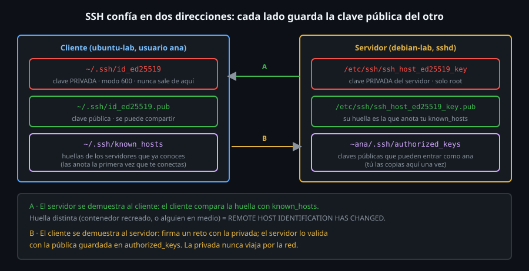

# SSH: claves, config y scp

> SSH es la puerta por la que entras a casi cualquier servidor Linux sin
> GUI. Con una contraseña funciona; con un par de claves es más seguro y se
> puede automatizar. Aquí aprendes la mecánica de confianza, no solo el
> comando.



## 🎯 Objetivos

- Generar un par de claves `ed25519` y explicar qué archivo es público y cuál privado
- Autorizar una clave en un servidor y entrar sin contraseña
- Leer un aviso de `REMOTE HOST IDENTIFICATION HAS CHANGED` sin silenciarlo a ciegas
- Usar `~/.ssh/config`, `scp` y un túnel `-L`

## 1. Qué problema resuelve

Hay que ejecutar comandos en otra máquina, y que **nadie por el camino** lea
lo que escribes ni se haga pasar por ella. SSH cifra todo el tráfico y
resuelve dos problemas de confianza, uno en cada dirección (el dibujo):

- **A**: ¿estoy hablando con el servidor correcto? El cliente lo comprueba
  con la **huella** del servidor guardada en `known_hosts`.
- **B**: ¿es este usuario quien dice ser? El servidor lo comprueba con una
  **clave pública** guardada en `authorized_keys`.

Las contraseñas sirven para B, pero se pueden adivinar, repetir y robar. Una
clave se **demuestra sin enviarla**: la privada no viaja nunca.

## 2. Cómo funciona

### 2.1 El par de claves

Todo esto ocurre dentro del laboratorio, con un usuario de prueba `ana` en
`ubuntu-lab` (cliente) y el servidor en `debian-lab`:

```bash
# En ubuntu-lab, como root: un usuario de prueba.
useradd -m -s /bin/bash ana

# Como ana: genera el par. ed25519 es el tipo recomendado hoy (claves cortas y rápidas).
su - ana -c 'ssh-keygen -t ed25519 -N "" -f ~/.ssh/id_ed25519 -C ana@ubuntu-lab'
```

> ⚠️ **`-N ""` (sin contraseña de clave) solo vale en un laboratorio
> desechable.** Una clave real lleva **passphrase** (`ssh-keygen` te la
> pide si omites `-N`) y se carga una vez en `ssh-agent` para no teclearla
> cada vez. Una clave privada sin passphrase que se copia o se sube por
> error es acceso total para quien la tenga.

```bash
su - ana -c 'stat -c "%a %n" ~/.ssh ~/.ssh/id_ed25519 ~/.ssh/id_ed25519.pub'
# 700 /home/ana/.ssh
# 600 /home/ana/.ssh/id_ed25519
# 644 /home/ana/.ssh/id_ed25519.pub
```

| Archivo | Qué es | Modo | ¿Se comparte? |
|---|---|:--:|---|
| `~/.ssh/id_ed25519` | Clave **privada** | `600` | **Nunca**: ni correo, ni chat, ni repositorio |
| `~/.ssh/id_ed25519.pub` | Clave pública | `644` | Sí: es lo que se instala en los servidores |

Si la privada tiene permisos de más, `ssh` **se niega a usarla**:

```bash
chmod 644 ~/.ssh/id_ed25519; ssh deb true
# @         WARNING: UNPROTECTED PRIVATE KEY FILE!          @
# Permissions 0644 for '/home/ana/.ssh/id_ed25519' are too open.
```

La **huella** (*fingerprint*) es el resumen corto de una clave, para
compararla de un vistazo:

```bash
ssh-keygen -lf ~/.ssh/id_ed25519.pub
# 256 SHA256:<huella> ana@ubuntu-lab (ED25519)
```

(El valor real de `<huella>` cambia con cada clave; no se copia a ningún
documento.)

### 2.2 Un servidor que escucha

`debian-lab` no ejecuta systemd, así que `sshd` se lanza a mano:

```bash
docker exec debian-lab bash -c 'apt-get update >/dev/null && apt-get install -y openssh-server >/dev/null && mkdir -p /run/sshd && useradd -m -s /bin/bash ana && /usr/sbin/sshd'
```

`mkdir -p /run/sshd` es necesario: `sshd` exige ese directorio para su
separación de privilegios y se niega a arrancar sin él. En una máquina real
esto lo hace el servicio (`systemctl enable --now ssh`; en RHEL y Arch el
servicio se llama `sshd`, no `ssh`).

### 2.3 Autorizar la clave pública

La clave pública del cliente va a `~/.ssh/authorized_keys` del usuario destino,
con permisos estrictos:

```bash
# Desde tu máquina: lee la pública de ubuntu-lab y la añade en debian-lab.
docker exec ubuntu-lab cat /home/ana/.ssh/id_ed25519.pub | docker exec -i debian-lab bash -c \
  'install -d -m 700 -o ana -g ana /home/ana/.ssh && cat >> /home/ana/.ssh/authorized_keys && chown ana:ana /home/ana/.ssh/authorized_keys && chmod 600 /home/ana/.ssh/authorized_keys'
```

> En una máquina real se usa `ssh-copy-id usuario@servidor`: se conecta
> **una vez con contraseña** y hace exactamente esto. En el laboratorio no
> es posible porque `ana` no tiene contraseña; por eso se hace a mano.

`sshd` **comprueba los permisos** (opción `StrictModes`, activa por
defecto): si `authorized_keys` o los directorios que lo contienen son
escribibles por otros, ignora la clave y cae a la contraseña, con un
silencioso `Permission denied (publickey,password)`. Es el motivo de que la
receta fije `700` y `600`.

### 2.4 La primera conexión y `known_hosts`

```bash
su - ana -c 'ssh -o BatchMode=yes -o StrictHostKeyChecking=accept-new ana@debian-lab true'
# Warning: Permanently added 'debian-lab' (ED25519) to the list of known hosts.
```

La primera vez, `ssh` no conoce al servidor y por defecto **pregunta** si
confías en su huella. `StrictHostKeyChecking` decide qué hace:

| Valor | Comportamiento |
|---|---|
| `ask` (defecto) | Pregunta en cada servidor nuevo |
| `accept-new` | Acepta los **nuevos** sin preguntar, pero **rechaza** los que cambian: el compromiso razonable para automatizar |
| `yes` | Rechaza todo lo que no esté ya en `known_hosts` |
| `no` | Acepta **todo**, incluso una huella cambiada: desactiva la protección A |

`BatchMode=yes` hace que `ssh` **nunca pregunte** (ni contraseña ni
confirmación) y falle en su lugar: imprescindible en scripts, donde nadie
puede responder.

Si la huella de un servidor **cambia**, `ssh` se niega, y lo hace a propósito:

```bash
ssh -o BatchMode=yes deb true
# @    WARNING: REMOTE HOST IDENTIFICATION HAS CHANGED!     @
# IT IS POSSIBLE THAT SOMEONE IS DOING SOMETHING NASTY!
# ...
# Host key verification failed.
```

Las causas honestas son habituales: reinstalaste el servidor, recreaste el
contenedor o cambió la IP. La causa grave, que alguien se interpone en
medio, es la que el aviso quiere descartar. **Averigua cuál es antes** de
tocar nada; si es la honesta, quitas la entrada vieja y vuelves a aceptar:

```bash
ssh-keygen -R debian-lab
# # Host debian-lab found: line 1
ssh -o StrictHostKeyChecking=accept-new deb true
# Warning: Permanently added 'debian-lab' (ED25519) to the list of known hosts.
```

`known_hosts` guarda los nombres **cifrados** (`|1|...`): `ssh-keygen -F
debian-lab` busca uno concreto.

## 3. Cómo se usa

### 3.1 `~/.ssh/config`: alias y valores por defecto

```bash
# ~/.ssh/config del usuario ana (modo 600)
Host deb
    HostName debian-lab
    User ana
    IdentityFile ~/.ssh/id_ed25519
```

```bash
ssh deb hostname
# debian-lab
ssh -G deb | grep -E '^(hostname|user|port|identityfile) '
# user ana
# hostname debian-lab
# port 22
# identityfile ~/.ssh/id_ed25519
```

`ssh -G alias` imprime la configuración **efectiva** tras aplicar todos los
archivos: la forma de ver qué va a hacer `ssh` antes de hacerlo.

### 3.2 Ejecutar órdenes y propagar el código de salida

```bash
ssh deb 'uname -n; id -un'
# debian-lab
# ana
echo hola | ssh deb 'tr a-z A-Z'
# HOLA
```

`ssh` **devuelve el código de salida del comando remoto**, y `255` si falló
la propia conexión:

```bash
ssh -o BatchMode=yes deb true;   echo $?    # 0
ssh -o BatchMode=yes deb false;  echo $?    # 1
ssh -o BatchMode=yes deb 'exit 7'; echo $?  # 7
ssh -o BatchMode=yes -p 2222 ana@debian-lab true; echo $?   # 255 (refused)
```

El `255` es lo que distingue "el comando falló" de "no pude conectar".

### 3.3 `scp` y túneles

```bash
scp -q /tmp/f.txt deb:/tmp/f2.txt            # local -> remoto
scp -q deb:/tmp/f2.txt /tmp/f3.txt           # remoto -> local
```

Un **túnel** (`-L`) reenvía un puerto local a otro destino **a través** del
servidor SSH. Aquí, el puerto `18900` de `ubuntu-lab` llega al servidor web
de `rhel-lab`, con `debian-lab` de intermediario. `-M -S` crea un socket de
control para cerrarlo limpiamente después:

```bash
ssh -f -N -M -S /tmp/cm.sock -L 18900:rhel-lab:8000 deb
curl -s http://127.0.0.1:18900/
# hola desde rhel-lab
ssh -S /tmp/cm.sock -O exit deb
# Exit request sent.
```

`-f` pasa a segundo plano, `-N` no ejecuta ningún comando (solo el túnel).

> 🔐 **Seguridad en el servidor** (se mira, no se cambia aquí): en
> `/etc/ssh/sshd_config`, `PasswordAuthentication no` obliga a usar claves y
> cierra la puerta al adivinado de contraseñas; `PermitRootLogin
> prohibit-password` impide la contraseña de `root` por SSH. `sshd -T`
> (como `root`) muestra la configuración **efectiva**; en `debian-lab`
> `passwordauthentication` vale `yes` por defecto.

## 4. Antipatrones

| Antipatrón | Por qué duele | Qué hacer en su lugar |
|---|---|---|
| `StrictHostKeyChecking=no` como valor permanente | Desactiva la protección contra el que se interpone en medio | `accept-new` para automatizar; revisar la huella si cambia |
| Clave privada sin passphrase en una máquina real | Quien copie el archivo tiene acceso total | Passphrase + `ssh-agent` |
| Compartir o subir `id_ed25519` (sin `.pub`) | Es la identidad completa del usuario | Solo la `.pub`; añade `id_*` a `.gitignore` y a las listas de exclusión |
| Contraseñas por SSH en scripts (`sshpass`) | La contraseña queda en el historial y en `ps` | Claves y `BatchMode=yes` |
| Ignorar `REMOTE HOST IDENTIFICATION HAS CHANGED` borrando `known_hosts` entero | Se pierde la protección de **todos** los servidores | `ssh-keygen -R host`, solo el afectado, tras averiguar la causa |
| `chmod 777 ~/.ssh` "para que funcione" | `StrictModes` hace que `sshd` ignore la clave | Directorio `700`, privada `600`, `authorized_keys` `600` |

## 5. Trucos

- `ssh -v host` imprime cada paso de la conexión: `Offering public key`,
  `Server accepts key`, `Authenticated ... using "publickey"`. Es la primera
  herramienta cuando una clave "no funciona".
- `ssh -O check -S socket host` pregunta si un túnel o conexión maestra
  sigue vivo (`Master running (pid=...)`).
- `ssh host 'cmd'` **no** abre un terminal: `-t` fuerza uno, necesario para
  programas interactivos (`ssh -t host sudo -l`).
- `ssh-keygen -y -f ~/.ssh/id_ed25519` regenera la pública a partir de la
  privada: útil si perdiste el `.pub`.

## 📚 Recursos Adicionales

- `man ssh`, `man ssh_config`, `man sshd_config`: la referencia, extensa pero precisa
- `man ssh-keygen`: todas las opciones, incluidos los formatos de clave

## ✅ Checklist de Verificación

- [ ] `ana` tiene un par `ed25519` con modos `700`/`600`/`644`
- [ ] `ssh -o BatchMode=yes deb hostname` imprime `debian-lab` sin pedir nada
- [ ] Reprodujiste el aviso de huella cambiada y lo resolviste con `ssh-keygen -R`
- [ ] El túnel `-L` te dio la página de `rhel-lab` desde `127.0.0.1:18900`
- [ ] Sabes por qué una clave privada con modo `644` no se usa

---

[← Diagnóstico por capas](06-diagnostico-por-capas.md) · [Construyendo netcheck →](08-construyendo-netcheck.md)
