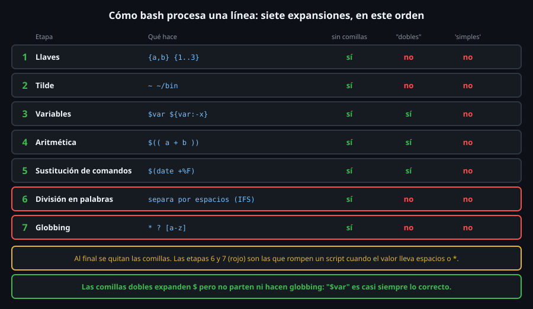

# Quoting: comillas y expansiones

> El fallo número uno de los scripts de bash no es un comando mal escrito: es
> una variable sin comillas que, un día, contiene un espacio. Entender **en qué
> orden** bash procesa una línea convierte las comillas en una regla y no en
> superstición.



## 🎯 Objetivos

- Enumerar el orden en que bash expande una línea y dónde actúan las comillas
- Predecir qué pasa con `$var` y con `"$var"` cuando el valor lleva espacios o `*`
- Elegir entre comillas simples, dobles y sin comillas sin dudar
- Pasar argumentos con espacios a otro comando sin que se partan
- Explicar la diferencia entre `"$@"` y `"$*"`

## 1. Qué problema resuelve

Bash recibe una línea de **texto** y antes de ejecutar nada la transforma:
sustituye variables, expande comodines, parte en palabras. Eso es lo que hace
tan cómoda la terminal, y lo que rompe los scripts: un nombre de archivo con
espacio se convierte en **dos** argumentos. Las comillas son la forma de decir
"esto es **una** palabra, no lo toques" (o "tócalo solo hasta aquí").

## 2. Cómo funciona

### 2.1 El orden de las expansiones

El diagrama de arriba lo resume. Importa el orden porque cada etapa trabaja
sobre el resultado de la anterior: primero llaves (`{a,b}`), tilde (`~`),
variables (`$v`), aritmética (`$(( ))`) y sustitución de comandos (`$( )`);
**después**, sobre el texto ya resultante, la **división en palabras** (por
espacios, tabuladores y saltos de línea: el separador se llama `IFS`) y el
**globbing** (`*`, `?`, `[a-z]`). Al final se quitan las comillas.

Esas dos últimas etapas son las peligrosas, porque actúan sobre el **valor**
de la variable, no sobre lo que tú escribiste:

```bash
mkdir -p /tmp/q13 && cd /tmp/q13
touch "informe final.txt" otro.txt
f="informe final.txt"
ls -l $f
# ls: cannot access 'informe': No such file or directory
# ls: cannot access 'final.txt': No such file or directory
ls -l "$f" | cut -c1-12,30-
# -rw-r--r-- 125 03:10 informe final.txt
```

Sin comillas, `$f` se parte en dos palabras: `ls` recibió **dos**
argumentos. Contar argumentos lo demuestra:

```bash
set -- $f;   echo "$# args"
# 2 args
set -- "$f"; echo "$# args"
# 1 args
```

(`set -- ...` reasigna los argumentos posicionales; aquí sirve para contar.)

### 2.2 Los tres tipos de comillas

| Forma | Qué impide | Qué sigue expandiendo |
|---|---|---|
| sin comillas | nada | todo |
| `"dobles"` | división en palabras y globbing | `$var`, `$( )`, `$(( ))`, `\` ante `$ " \` y `` ` `` |
| `'simples'` | **todo** | nada: el texto es literal |

```bash
v="a  b"
echo $v
# a b
echo "$v"
# a  b
echo '$v'
# $v
```

`echo $v` perdió un espacio: partió en `a` y `b` y `echo` los volvió a unir
con **uno**. Es el mismo mecanismo, y por eso "funciona" en pruebas con un
solo espacio y falla con dos o con un `*`.

El globbing sin comillas también actúa sobre el valor de una variable:

```bash
mkdir -p vacio && cd vacio
echo *.zip
# *.zip
touch a.zip; v='*.zip'; echo $v; echo "$v"
# a.zip
# *.zip
cd ..
```

Y cuando un patrón **no coincide con nada**, bash deja el patrón tal cual
(`*.zip` literal, como ves arriba). Con `shopt -s nullglob` se convertiría en
nada. Un `for f in *.zip` sobre una carpeta sin zips ejecutaría el cuerpo una
vez con el texto `*.zip`: hay que comprobarlo (`[[ -e $f ]] || continue`).

### 2.3 Otras formas de entrecomillar

- `\` protege **un** carácter: `echo a\ b` imprime `a b`.
- `$'...'` interpreta escapes: `$'a\tb\nc'` es `a`, un tabulador, `b`, salto,
  `c`.
- `printf '%q\n' "a b;c\$d"` imprime `a\ b\;c\$d`: **el valor escapado para
  que se pueda volver a pegar** en una línea de comandos.
- **Comillas dentro de `$( )`**: se reinician, así que se pueden anidar sin
  escapar: `"$(dirname "$salida")"` es correcto y legible.
- Un here-doc con el delimitador entrecomillado (`<<"EOF"`) no expande nada; sin
  comillas (`<<EOF`) expande variables y comandos. Más en el archivo 06.

### 2.4 `"$@"` frente a `"$*"`

Con los argumentos `"uno dos" tres "*"` (script `args.sh`):

```bash
cat > args.sh <<'EOS'
for a in $@;   do echo "1<$a>"; done
for a in "$@"; do echo "2<$a>"; done
for a in "$*"; do echo "3<$a>"; done
EOS
bash args.sh "uno dos" tres "*"
# 1<uno>
# 1<dos>
# 1<tres>
# 1<args.sh>
# 1<informe final.txt>
# 1<otro.txt>
# 1<vacio>
# 2<uno dos>
# 2<tres>
# 2<*>
# 3<uno dos tres *>
```

| Forma | Resultado |
|---|---|
| `$@` sin comillas | parte los argumentos **y expande el `*`** a los cuatro elementos de la carpeta (las últimas cuatro líneas `1<...>`) |
| `"$@"` | **un argumento por argumento original**, intactos: la correcta |
| `"$*"` | **un solo** argumento con todos unidos por el primer carácter de `IFS` |

`"$@"` es la forma de pasar los argumentos tal cual a otro comando
(`rsync "$@"`). Es una excepción: la única en la que unas comillas
producen **varias** palabras.

## 3. Cómo se usa

Reglas, de más a menos importante:

1. **Entrecomilla con dobles toda expansión**: `"$var"`, `"${var}"`, `"$(cmd)"`,
   `"$@"`. Es lo que `shellcheck` (archivo 07) exige con SC2086.
2. **Comillas simples** para texto literal con `$` (`awk '{print $2}'`, una
   regex, un patrón): así bash no lo toca.
3. **Sin comillas, a propósito**, solo en tres casos: el lado derecho de `[[ x
   == patron ]]` (para que sea un patrón), `$(( ))` y un patrón de glob que
   quieras que se expanda (`for f in *.txt`).

```bash
a=hola; b="h*"
[[ $a == $b ]]   && echo "patron: coincide"
# patron: coincide
[[ $a == "$b" ]] && echo "literal: coincide" || echo "literal: no coincide"
# literal: no coincide
```

Con las comillas del lado derecho, `h*` es texto; sin ellas, un patrón.

## 4. Antipatrones

| Antipatrón | Por qué duele | Qué hacer en su lugar |
|---|---|---|
| `rm $archivo` | Con `a b` borra `a` y `b`, que quizá no son lo que querías | `rm -- "$archivo"` (el `--` corta las opciones) |
| `for f in $(ls)` | Parte por espacios; falla con nombres con espacio | `for f in *` |
| `cd $dir` | Con `dir` vacío vuelve a `$HOME`; con espacios, error | `cd "$dir" \|\| exit 1` |
| `[ $x = a ]` | Con `x` vacío: `[: =: unary operator expected` | `[[ "$x" = a ]]` o `[ "$x" = a ]` |
| `eval "$entrada"` o `bash -c "$entrada"` con datos de fuera | Es inyección de comandos | Pasar el dato como **argumento**, nunca como código |
| Comillas simples donde querías expandir (`'$HOME'`) | Imprime `$HOME` literal | Dobles: `"$HOME"` |
| Comillas dobles en regex con `=~` (`[[ $s =~ "^a" ]]`) | Se toma como texto literal | Regex en variable sin comillas: `[[ $s =~ $re ]]` |

La prueba de "unos espacios":

```bash
touch "a b" a b
f="a b"
echo rm $f
# rm a b
echo rm "$f"
# rm a b
```

Con `echo` **se ven igual**: `echo` une sus argumentos con espacios. Para ver
cuántos recibe un comando, usa `printf '<%s>\n' $f` frente a
`printf '<%s>\n' "$f"` (dos líneas frente a una).

## 5. Trucos

- **`printf '<%s>\n' ...`** es el microscopio del quoting: imprime **un
  argumento por línea, rodeado de `<>`**, y deja ver espacios finales, vacíos
  y partes que `echo` oculta.
- **`set -x`** (o `bash -x script`) muestra la línea **ya expandida**: si
  después de expandir ves `+ rm a b` sin comillas, la variable partió.
- **`read -r -a partes <<< "$linea"` con `IFS=,`** parte por un separador
  sin `cut`:

  ```bash
  IFS=, read -ra parts <<< "a,b,c"; echo "${#parts[@]} ${parts[1]}"
  # 3 b
  IFS=: read -r u p _ <<< "root:x:0"; echo "$u $p"
  # root x
  ```

  (`IFS=...` delante de `read` solo vale para ese comando, como en 02.)
- **Tilde**: `~` se expande solo **sin comillas**: `echo ~ "~"` imprime `/root ~`.
  Si guardas una ruta en una variable con `"~/bin"`, no se expande.

## 📚 Recursos Adicionales

- `man bash`, secciones *QUOTING* y *EXPANSION*
- [ShellCheck SC2086](https://www.shellcheck.net/wiki/SC2086): el aviso de este archivo, con ejemplos

## ✅ Checklist de Verificación

- [ ] Reproduces `ls -l $f` y `ls -l "$f"` con un archivo con espacio
- [ ] `set -- $f; echo $#` imprime `2`, y con `"$f"` imprime `1`
- [ ] Explicas la diferencia entre `"$@"`, `$@` y `"$*"` con los argumentos `"uno dos" tres "*"`
- [ ] Sabes por qué `[ $x = a ]` falla con `x` vacío y `[[ $x = a ]]` no
- [ ] Usas `printf '<%s>\n'` para contar los argumentos que recibe un comando

---

[← Variables y expansión de parámetros](02-variables-y-expansion-de-parametros.md) · [Argumentos y códigos de salida →](04-argumentos-y-codigos-de-salida.md)
