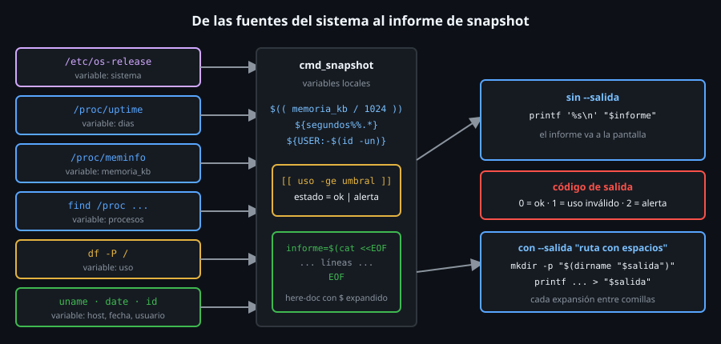

# Construyendo `snapshot`

> `snapshot` es la primera capa del toolkit que **no llama a otra
> herramienta del proyecto**: lee el sistema directamente (`/proc`, `df`,
> `uname`) y aplica, línea a línea, todo lo de la semana. Es el ejercicio de
> integración: cada pieza del archivo 01 al 07 aparece aquí una vez.



## 🎯 Objetivos

- Explicar qué lee `snapshot` y de dónde sale cada línea del informe
- Reconocer, dentro de `cmd_snapshot`, los siete conceptos de la semana
- Construir la función por trozos y probar cada uno antes de unirlos
- Entender por qué sale con `0`, `1` o `2`, y por qué `snapshot` es la base del
  `sys-snapshot` que automatizarás en la Semana 16

## 1. Qué problema resuelve

Llegas a una máquina que no conoces y necesitas, de una mirada: ¿qué sistema
es?, ¿cuánto lleva encendida?, ¿cuánta memoria tiene?, ¿qué carga hay?, ¿el
disco está lleno? Las Semanas 10 a 12 respondían a cada pregunta con un
subcomando (`procwatch`, `acctaudit`, `pkgcheck`, `netcheck`). `snapshot` es
la **foto de cabecera**: un informe corto, siempre igual, que se puede
guardar con fecha y comparar con el de ayer (la razón por la que la Semana 16
lo programará con `cron`).

## 2. Cómo funciona

### 2.1 El informe

```bash
~/bin/toolkit.sh snapshot
# == toolkit snapshot ==
# fecha: 2026-10-25
# host: ubuntu-lab
# usuario: root
# sistema: Ubuntu 24.04.5 LTS
# kernel: 6.18.33.2-microsoft-standard-WSL2
# uptime: 1 dias
# memoria: 9945 MiB
# procesos: 6
# disco /: 25%
# estado: ok
```

(Los valores cambiarán en tu máquina; el formato, no.) Con un umbral
imposible, el informe se vuelve alerta y el código de salida cambia:

```bash
~/bin/toolkit.sh snapshot --umbral 0; echo "codigo: $?"
# ...
# disco /: 25%
# alerta: disco / al 25% (umbral 0%)
# estado: alerta
# codigo: 2
```

Contrato completo:

| Elemento | Valor |
|---|---|
| Opciones | `--umbral N` (entero 0-100, por defecto `90`) y `--salida ARCHIVO` |
| Salida | `0` disco bajo el umbral · `1` opción o umbral inválido · `2` disco en o sobre el umbral |
| Errores | a `stderr`, con el prefijo `toolkit snapshot:` |
| `--salida` | Escribe el informe en el archivo (creando la carpeta) y solo imprime `informe guardado en: RUTA` |

### 2.2 De dónde sale cada dato

| Línea | Fuente | Variable | Conceptos |
|---|---|---|---|
| `fecha` | `date +%F` | (en el here-doc) | sustitución de comandos (06) |
| `host` | `uname -n` | (en el here-doc) | |
| `usuario` | `${USER:-$(id -un)}` | `usuario` | valor por defecto (02) |
| `sistema` | `/etc/os-release` | `sistema` | subshell, `.` (01) |
| `kernel` | `uname -r` | (en el here-doc) | |
| `uptime` | `/proc/uptime` | `segundos` → `dias` | `read`, `${v%%.*}`, `$(( ))` (02) |
| `memoria` | `/proc/meminfo` | `memoria_kb` | `awk`, `$(( ))` |
| `procesos` | `/proc/[0-9]*` | `procesos` | `find` + `wc -l` |
| `disco /` | `df -P /` | `uso` | `awk`, `gsub` |
| `estado` | comparación | `estado`, `alerta` | `[[ -ge ]]` (05) |

> ⚠️ **Divergencia real**: la fuente es el kernel, no un programa. `/proc/uptime`,
> `/proc/meminfo` y `/etc/os-release` existen en las cuatro familias (comprobado
> en los cuatro contenedores). `hostname`, en cambio, **no** viene en la imagen
> mínima de Arch (`hostname: command not found`): por eso el informe usa
> `uname -n`, que es de `coreutils` y está en todas. Y recuerda que `procesos`
> cuenta los de **tu espacio de PIDs**: en un contenedor son unos pocos; en
> el host, todos.

### 2.3 Construcción por trozos

**Trozo 1: las opciones** (el `while` + `case` de 04):

```bash
  local salida="" umbral=90
  while [[ $# -gt 0 ]]; do
    case "$1" in
      --salida | --umbral)
        if [[ $# -lt 2 ]]; then
          echo "toolkit snapshot: $1 necesita un valor" >&2
          exit 1
        fi
        if [[ "$1" == --salida ]]; then salida="$2"; else umbral="$2"; fi
        shift 2
        ;;
      *)
        echo "toolkit snapshot: opcion desconocida: $1" >&2
        exit 1
        ;;
    esac
  done
```

Dos opciones que comparten el mismo control "¿hay un valor detrás?", por eso
comparten rama. La rama `*)` **rechaza** lo desconocido: `--umbrall 80`
(mal tecleado) da error y no se ignora.

**Trozo 2: validar el umbral** (05):

```bash
  if ! [[ "$umbral" =~ ^[0-9]+$ && "$umbral" -le 100 ]]; then
    echo "toolkit snapshot: umbral invalido: '$umbral'" >&2
    exit 1
  fi
```

La regex va **primero** porque `-le` evalúa su operando como aritmética
(Semana 12): `&&` impide llegar a `-le` si no son solo dígitos.

**Trozo 3: los datos** (02 y 06):

```bash
  local usuario="${USER:-$(id -un)}"
  local sistema
  # shellcheck source=/dev/null  # /etc/os-release lo lee bash en ejecucion, no shellcheck
  sistema=$( . /etc/os-release && echo "$PRETTY_NAME" )

  local segundos _resto dias memoria_kb procesos uso estado="ok"
  read -r segundos _resto < /proc/uptime
  dias=$(( ${segundos%%.*} / 86400 ))
  memoria_kb=$(awk '/^MemTotal:/ { print $2 }' /proc/meminfo)
  procesos=$(find /proc -mindepth 1 -maxdepth 1 -name '[0-9]*' | wc -l)
  uso=$(df -P / | awk 'NR == 2 { gsub("%", "", $5); print $5 }')
```

Puntos de atención:

- `sistema=$( . /etc/os-release && ... )` carga `os-release` en un **subshell**:
  sus variables (`NAME`, `ID`, `VERSION`...) no ensucian el script. `local
  sistema` y la asignación van **separadas** (SC2155, archivo 06).
- `read -r segundos _resto < /proc/uptime` lee dos campos: los segundos desde
  el arranque (`91234.56`) y los segundos de inactividad (`_resto`, que no
  usamos: el `_` inicial avisa de ello a quien lea).
- `${segundos%%.*}` quita desde el primer punto: `91234.56` pasa a `91234`.
  Con eso `$(( 91234 / 86400 ))` da `1`.
- `df -P /` usa el formato POSIX (una línea por sistema de archivos, siempre
  las mismas columnas); `awk` toma la segunda línea y quita el `%` de la
  columna 5 con `gsub`.
- `procesos` cuenta los directorios `/proc/<PID>`. Se usa `find` y no `ls`
  porque `shellcheck` avisa de `ls | wc` (SC2012).

**Trozo 4: el estado** (05):

```bash
  local alerta=""
  if [[ "$uso" -ge "$umbral" ]]; then
    estado="alerta"
    alerta="alerta: disco / al ${uso}% (umbral ${umbral}%)"
  fi
```

Comparación **numérica** (`-ge`), no de texto (archivo 05). `${uso}%`
lleva llaves porque a continuación va un `%` pegado.

**Trozo 5: el informe** (06):

```bash
  local informe
  informe=$(cat <<EOF
== toolkit snapshot ==
fecha: $(date +%F)
host: $(uname -n)
usuario: $usuario
sistema: $sistema
kernel: $(uname -r)
uptime: $dias dias
memoria: $(( memoria_kb / 1024 )) MiB
procesos: $procesos
disco /: ${uso}%
${alerta:+$alerta
}estado: $estado
EOF
)
```

El here-doc **sin comillas** expande las variables y los `$( )`. La línea
`${alerta:+$alerta<salto>}` solo existe si hay alerta (apartado 2.4 del
archivo 06). Se guarda en `informe` en lugar de imprimirlo directamente
porque debe ir **o** a la pantalla **o** a un archivo.

**Trozo 6: la salida y el código** (03, 04):

```bash
  if [[ -n "$salida" ]]; then
    mkdir -p "$(dirname "$salida")"
    printf '%s\n' "$informe" > "$salida"
    echo "informe guardado en: $salida"
  else
    printf '%s\n' "$informe"
  fi

  if [[ "$estado" == alerta ]]; then
    exit 2
  fi
```

Las comillas de `"$(dirname "$salida")"` y de `"$salida"` son lo que permite
una ruta como `/tmp/mis informes/rep final.txt` (comprobación
`snapshot-salida-con-espacios`). Sin ellas, la ruta se parte en dos.

### 2.4 Cómo se conecta con `toolkit.sh`

`main` solo reparte: `snapshot) cmd_snapshot "$@" ;;`. El `"$@"` sin el
nombre del subcomando (ya consumido por un `shift`) llega a `cmd_snapshot`,
donde el `while`/`case` lo interpreta. Y el mensaje de uso (el de `toolkit.sh`
sin argumentos) lista `snapshot` entre los subcomandos.

## 3. Cómo se usa

```bash
# Informe en pantalla con el umbral por defecto (90%).
~/bin/toolkit.sh snapshot

# Guardar el informe con fecha, y mirar el código para decidir qué hacer.
~/bin/toolkit.sh snapshot --umbral 80 --salida ~/informes/snapshot-$(date +%F).txt
echo "codigo: $?"
# informe guardado en: /root/informes/snapshot-2026-10-25.txt
# codigo: 0
```

Un `if` lo convierte en una alarma (la forma en que la Semana 16 lo dejará
programado):

```bash
if ! ~/bin/toolkit.sh snapshot --umbral 80 >/dev/null; then
  echo "revisa el disco" >&2
fi
```

(`!` también atrapa el `1` de uso inválido; para distinguir los códigos hará
falta guardar `$?` y usar un `case`, como se vio en el archivo 04.)

## 4. Antipatrones

| Antipatrón | Por qué duele | Qué hacer en su lugar |
|---|---|---|
| `df /` sin `-P` | No está garantizado el formato POSIX (columnas fijas, una línea por sistema de archivos) | `df -P /` |
| `hostname` en un script portable | No está en la imagen mínima de Arch | `uname -n` |
| `$USER` sin respaldo | Vacío bajo `docker exec`, `cron` y `sudo -i`... | `${USER:-$(id -un)}` |
| Imprimir el informe línea a línea con `echo` | Mezcla variables y comillas; se escapa un salto | Un here-doc y `printf '%s\n'` |
| `. /etc/os-release` en el cuerpo del script | Deja `NAME`, `ID`, `VERSION` flotando | Subshell `$( . ... )` |
| Comparar `$uso > $umbral` | Texto: `9 > 90` | `[[ -ge ]]` |
| `exit` con el código de la última orden | Un `echo` final enmascara la alerta | `exit 2` explícito |

## 5. Trucos

- **Probar sin disco lleno**: `--umbral 0` fuerza la alerta (el uso siempre es
  `>= 0`) y verifica la rama `exit 2` sin llenar nada. Es el truco del
  checks.json.
- **`env -u USER ~/bin/toolkit.sh snapshot`** ejecuta con la variable `USER`
  **borrada**: así pruebas la rama del valor por defecto.
- **`bash -x ~/bin/toolkit.sh snapshot`** muestra cada comando ya expandido:
  verás el here-doc convertido en líneas y las `$(( ))` resueltas.
- **Una función, un trabajo**: `cmd_snapshot` hace opciones, datos, informe
  y salida. En la Semana 14 la partirás en funciones pequeñas; así de
  compacta, es una buena **línea base** para ver el efecto.

## 📚 Recursos Adicionales

- `man proc`, secciones `/proc/uptime` y `/proc/meminfo`
- `man os-release`: el formato de `/etc/os-release`

## ✅ Checklist de Verificación

- [ ] `toolkit.sh snapshot` imprime las once líneas con tus valores
- [ ] `toolkit.sh snapshot --umbral 0; echo $?` imprime una línea `alerta: ...` y `2`
- [ ] `toolkit.sh snapshot --umbral abc; echo $?` imprime un error en `stderr` y `1`
- [ ] `toolkit.sh snapshot --salida "/tmp/mis informes/rep.txt"` crea el archivo con la carpeta
- [ ] Localizas en el código dónde aparece cada concepto: shebang, variable, comillas, argumentos, condicional, `$( )` y here-doc

---

[← ShellCheck](07-shellcheck.md) · [Práctica 01: primer script y shellcheck →](../2-practicas/01-primer-script-y-shellcheck.md)
