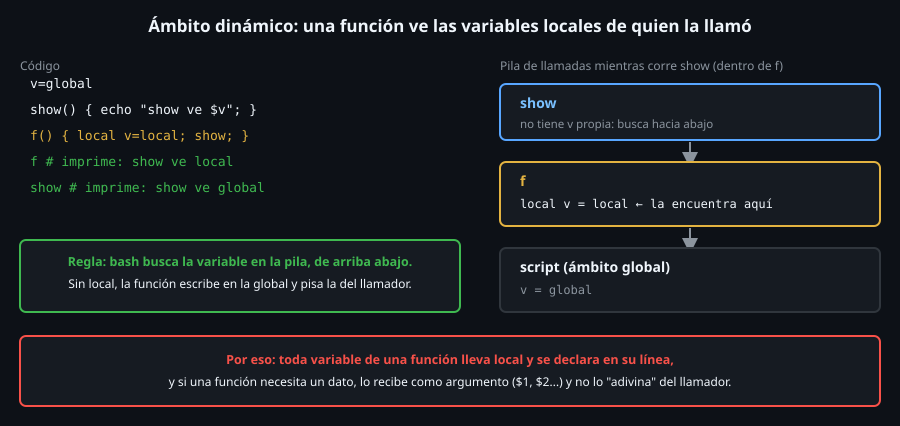

# Ámbito y valores de retorno de las funciones

> Una función bash no "devuelve un valor": **sale con un código** y escribe
> en `stdout`. Y sus variables, si no lo remedias con `local`, son de **todo
> el script**. Estas dos rarezas explican casi todos los bugs de funciones.

## 🎯 Objetivos

- Usar `local` y explicar el ámbito **dinámico** de bash
- Devolver un código con `return`, y un dato con `stdout` capturado por `$( )`
- Elegir entre código de retorno, `stdout`, variable global y *nameref*
- Saber qué ocurre con `set -e` dentro de una función y de un `if`
- Evitar la pérdida de variables al llamar a una función desde un subshell

## 1. Qué problema resuelve

`sys_disk_usage` calcula un número y `cmd_snapshot` lo necesita para
comparar con el umbral. ¿Cómo viaja ese número de una función a otra?
Bash no tiene `return valor`. Y si ambas funciones usan una variable llamada
`uso`, ¿se pisan? Las respuestas a esas dos preguntas son este archivo.



## 2. Cómo funciona

### 2.1 Variables globales y `local`

Por defecto, una variable asignada dentro de una función **es global**:

```bash
cnt=0; inc() { cnt=$((cnt+1)); }; inc; inc; echo "$cnt"
# 2
f() { y=creada; }; f; echo "y=$y"
# y=creada
```

`local` la limita a la función (y a lo que esta llame):

```bash
v=global; f() { local v=local; echo "dentro $v"; }; f; echo "fuera $v"
# dentro local
# fuera global
f() { local z=1; }; f; echo "z=${z:-vacia}"
# z=vacia
```

**Toda variable de una función lleva `local`**, y se declara **en su línea**
(`local uso`, y luego `uso=$(...)`): ya lo viste con `local v=$(cmd)` y
SC2155. Los argumentos con nombre (`local limite=$1`) van igual.

### 2.2 El ámbito es dinámico

En casi todos los lenguajes una función solo ve **sus** variables y las
globales. En bash ve también las `local` de **quien la llamó**:

```bash
v=global
show() { echo "show ve $v"; }
f() { local v=local; show; }
f
# show ve local
show
# show ve global
```

Mira el diagrama de arriba: bash busca `v` en la **pila de llamadas**, de
arriba abajo. `show` no tiene `v`, la encuentra en `f`. Consecuencia
práctica: una función que lee una variable que "alguien" debería haber
definido funciona **por casualidad**, y deja de hacerlo cuando la llaman desde
otro sitio. **Pasa los datos como argumentos.**

### 2.3 Devolver un código: `return`

```bash
f() { return 3; }; f; echo "$?"
# 3
g() { return 300; }; g; echo "$?"
# 44
k() { return; }; false; k; echo "$?"
# 1
```

`return N` sale de la función con el código `N` (de 0 a 255, truncado como
en `exit`, Semana 13). Sin número devuelve el del último comando. **`return`
fuera de una función** (o de un script con `source`) es un error:

```bash
bash -c 'return 1'
# bash: line 1: return: can only `return' from a function or sourced script
```

Un código sirve para **decir si algo salió bien**: es lo que usan `if` y
`&&`. Por eso las funciones que comprueban algo devuelven `0`/`1` y se llaman
dentro de un `if`:

```bash
is_uint() { [[ "$1" =~ ^[0-9]+$ ]]; }
is_uint 12 && echo si
# si
is_uint a1 || echo no
# no
```

(Sin `return`, el código es el del `[[ ]]`, que es justo lo que quieres.)

### 2.3.1 La función cuyo último comando falla

El código de una función es el de su **último comando**, aunque ese comando
no fuera una comprobación:

```bash
f() { [[ 1 -eq 2 ]]; }; f; echo "$?"
# 1
bash -c 'set -e; f() { [[ 1 -eq 2 ]] && echo x; }; f; echo seguia'; echo "codigo: $?"
# codigo: 1
```

En la segunda, el `&&` falso es el último comando, la función sale con `1`,
y `set -e` aborta **al llamarla**. Si no quieres devolver un fallo, termina
con un `return 0` explícito o con un `if`.

### 2.4 Devolver un dato: `stdout` y `$( )`

Para sacar un **valor** (un número, un texto) se escribe en `stdout` y el
llamador lo captura:

```bash
suma() { echo $(( $1 + $2 )); }
t=$(suma 2 3); echo "$t"
# 5
```

Es el patrón de todas las `sys_*` del toolkit. Dos consecuencias que
conviene conocer:

- `$( )` corre la función en un **subshell**: si la función **modifica una
  variable global**, el cambio se pierde:

  ```bash
  cnt=0; inc() { cnt=$((cnt+1)); }
  r=$(inc); echo "cnt=$cnt r=[$r]"
  # cnt=0 r=[]
  inc | cat; echo "cnt=$cnt"
  # cnt=0
  ```

  Una función que se llama con `$( )` o detrás de una tubería **no puede
  cambiar el estado del script**.
- Cualquier cosa que la función escriba a `stdout` **forma parte** del
  valor. Los mensajes de error y de depuración van a `stderr` (`>&2`).

### 2.5 Otras dos formas: *nameref* y `printf -v`

Cuando una función debe **asignar una variable del llamador** sin subshell:

```bash
get() { local -n ref=$1; ref="valor-via-nameref"; }
get res; echo "$res"
# valor-via-nameref
get2() { printf -v "$1" '%s' "via-printf-v"; }
get2 res2; echo "$res2"
# via-printf-v
```

`local -n ref=$1` hace que `ref` sea un **alias** de la variable cuyo nombre
llega en `$1`. Es potente y se lee peor: úsalo cuando haga falta devolver
varios datos o un array; para un valor, `stdout`.

| Forma | Sirve para | Coste |
|---|---|---|
| `return N` | Un **estado** (bien/mal) | Solo 0-255 |
| `stdout` + `$( )` | Un **dato** (texto/número) | Subshell; no cambia variables |
| Variable global | Evitarlo | Acopla funciones y se pisa |
| *nameref* / `printf -v` | Devolver varios datos o arrays | Más difícil de leer |

### 2.6 `set -e` dentro de funciones

```bash
bash -c 'set -e; f() { false; echo seguia; }; f; echo fin'; echo "codigo: $?"
# codigo: 1
bash -c 'set -e; f() { false; echo seguia; }; if f; then echo si; fi'
# seguia
# si
bash -c 'set -e; f() { false; }; f || echo manejado; echo fin'
# manejado
# fin
```

Con `set -e`, `false` dentro de `f` aborta. Pero **en cuanto llamas a `f`
dentro de un `if`, un `||` o un `&&`**, `set -e` se **desactiva dentro de
ella** y `echo seguia` se ejecuta (y `f` sale `0`, el código del `echo`).
Es una de las trampas más documentadas de bash. Consecuencia: **no escribas
funciones que dependan de `set -e` para parar a mitad**: comprueba y devuelve
`1` con un `return 1` explícito, como hacen las `hc_check_*`.

### 2.7 Recursión

```bash
fact() { local n=$1; if (( n <= 1 )); then echo 1; else echo $(( n * $(fact $((n-1))) )); fi; }
fact 5
# 120
```

Funciona porque cada llamada tiene su propio `local n`. En scripts de
sistema casi nunca se necesita: recorrer directorios es trabajo de `find`.

## 3. Cómo se usa

El esquema de una función de este bootcamp:

```bash
hc_check_disk() {
  local limite=$1 uso            # argumentos con nombre; locales declarados
  uso=$(sys_disk_usage)          # dato: stdout capturado
  if [[ "$uso" -lt "$limite" ]]; then
    hc_line ok disk "${uso}% (umbral ${limite}%)"   # informa por stdout
  else
    hc_line fallo disk "${uso}% (umbral ${limite}%)"
    return 1                     # estado: fallo, explícito
  fi
}
```

Entrada por **argumentos**, datos por **stdout**, estado por **return**.

## 4. Antipatrones

| Antipatrón | Por qué duele | Qué hacer en su lugar |
|---|---|---|
| Variables sin `local` en funciones | Pisan las globales y las de otras funciones | `local` en la primera línea |
| `local v=$(cmd)` | Oculta el código de `cmd` | `local v` y luego `v=$(cmd)` |
| Leer variables "que ya estarán definidas" | Funciona por ámbito dinámico y se rompe al cambiar el llamador | Pasarlas como argumentos |
| Cambiar globales dentro de una función llamada con `$( )` | El cambio se pierde en el subshell | Devolver por `stdout` y asignar fuera |
| Mensajes de depuración a `stdout` en una función que devuelve datos | Se mezclan con el valor | `echo ... >&2` |
| Contar con una función en una tubería | Corre en subshell | Alimentar el bucle con `< <(cmd)` |
| Depender de `set -e` dentro de una función | Se desactiva si la llamas en un `if`/`\|\|` | `return 1` explícito |
| `return` con un texto (`return "ok"`) | Solo admite enteros | `echo ok` y capturar |

## 5. Trucos

- **`local -r K=3`** crea una constante local; **`local -i n=3`** fuerza
  aritmética (`n+=2` suma). Útil, sin abusar.
- **`return` dentro de un `source`** sale del archivo cargado, no de tu
  shell: sirve para "si ya se cargó, salgo".
- **`declare -p nombre`** muestra el tipo y el valor de una variable: lo
  mejor para ver si algo es global, local o array.

## 📚 Recursos Adicionales

- `man bash`, secciones *FUNCTIONS* y *Shell Variables* (`local`)
- [Bash FAQ 084 — cómo devolver una cadena desde una función](https://mywiki.wooledge.org/BashFAQ/084)

## ✅ Checklist de Verificación

- [ ] Sin `local`, `y=creada` dentro de `f` sobrevive fuera; con `local`, no
- [ ] Reproduces `show ve local` y `show ve global` y lo explicas con la pila
- [ ] `return 300` sale con `44`
- [ ] `r=$(inc)` deja `cnt=0`: explicas por qué
- [ ] Con `set -e`, `f` aborta suelta y **no** aborta dentro de `if f; then`

---

[← Funciones: definición y uso](02-funciones-definicion-y-uso.md) · [Arrays indexados →](04-arrays-indexados.md)
