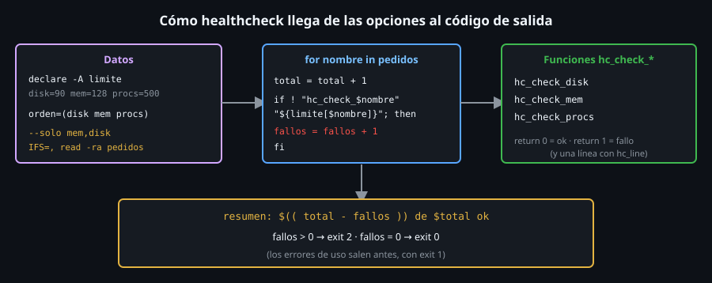

# Construyendo `healthcheck` (y refactorizando `snapshot`)

> Esta semana el toolkit cambia de forma: `snapshot` pasa de un bloque de
> sesenta líneas a funciones pequeñas, y la nueva capa, `healthcheck`, nace
> ya con funciones, un array asociativo, un array indexado y un bucle que
> despacha por nombre. Es el ejercicio de integración de la semana.



## 🎯 Objetivos

- Reconocer en `toolkit.sh` los conceptos de la semana: bucles, funciones, `local`, arrays y despacho
- Explicar cómo se refactoriza `cmd_snapshot` sin cambiar **nada** de lo que imprime
- Leer `cmd_healthcheck` por trozos y razonar cada decisión
- Construir las tres `hc_check_*` y el bucle que las llama
- Entender por qué `healthcheck` continúa tras un fallo y sale con `2` al final

## 1. Qué problema resuelve

`snapshot` te da una foto; `healthcheck` te da un **veredicto**: ¿esta
máquina está en condiciones? Comprueba tres cosas (disco, memoria, procesos)
contra límites que puedes cambiar, dice cuáles pasan y sale con `2` si alguna
falla. Es lo que un `cron` (Semana 16) puede lanzar cada hora para avisarte.

## 2. Cómo funciona

### 2.1 Primero, el refactor de `snapshot`

`snapshot` **no cambia de comportamiento**: sus comprobaciones de la Semana 13
(11 líneas, `0`/`1`/`2`, ruta con espacios) siguen pasando. Cambia **cómo está
escrito**:

| Antes (Semana 13) | Ahora (Semana 14) |
|---|---|
| Un `cmd_snapshot` de ~60 líneas | `cmd_snapshot` reparte; cada pieza es una función |
| Variables `local` calculadas en línea | `sys_os_name`, `sys_uptime_days`, `sys_mem_mib`, `sys_proc_count`, `sys_disk_usage` |
| Informe armado dentro de `cmd_snapshot` | `snapshot_report` arma el texto, `snapshot_emit` lo muestra o guarda |
| Validación con regex inline | `is_uint "$umbral" \|\| ...` |

```bash
sys_mem_mib() {
  local memoria_kb
  memoria_kb=$(awk '/^MemTotal:/ { print $2 }' /proc/meminfo)
  echo $(( memoria_kb / 1024 ))
}
```

Cada `sys_*` **imprime un dato** y no toca variables globales: se prueba
sola y se captura con `$( )`. `snapshot` y `healthcheck` las comparten: eso
es reutilizar. `snapshot_report` recibe lo calculado como **argumentos**
(`uso`, `estado`, `alerta`) y los lee con nombre:

```bash
snapshot_report() {
  local uso=$1 estado=$2 alerta=$3
  ...
}
```

No hereda variables de `cmd_snapshot` por el ámbito dinámico (archivo 03):
**todo lo que necesita, se lo pasan**.

### 2.2 Las comprobaciones: `hc_check_*`

```bash
hc_line() { printf '%-5s %s: %s\n' "$1" "$2" "$3"; }

hc_check_disk() {
  local limite=$1 uso
  uso=$(sys_disk_usage)
  if [[ "$uso" -lt "$limite" ]]; then
    hc_line ok disk "${uso}% (umbral ${limite}%)"
  else
    hc_line fallo disk "${uso}% (umbral ${limite}%)"
    return 1
  fi
}
```

- **Contrato**: recibe su límite en `$1`, imprime **una línea** y devuelve
  `0` (ok) o `1` (fallo).
- `local limite=$1 uso`: argumento con nombre y la variable de trabajo,
  declaradas juntas; la asignación de `uso` va aparte, para no ocultar el
  código de `sys_disk_usage` (SC2155).
- `hc_line` formatea (`%-5s` ancho 5 a la izquierda): así `ok` y `fallo`
  alinean las columnas.
- **`return 1` explícito**: la rama del fallo no depende de `set -e` (que se
  apagaría dentro del `if` de quien la llama, archivo 03).
- `hc_check_mem` (`>=` con el mínimo) y `hc_check_procs` (`<=` con el máximo)
  siguen el mismo molde. Las comparaciones son **numéricas** (`-lt`, `-ge`,
  `-le`).

### 2.3 `cmd_healthcheck` por trozos

**Datos** (archivos 04 y 05):

```bash
local solo="" solo_dado=0
local -A limite=([disk]=90 [mem]=128 [procs]=500)
local -a orden=(disk mem procs)
```

`limite` es el **asociativo** (nombre → límite) y `orden` el **indexado**
(el orden de ejecución por defecto). `solo_dado` distingue "no pasaron
`--solo`" de "pasaron `--solo ''`" (una cadena vacía **es** un valor).

**Opciones** (el `while` + `case` de la Semana 13):

```bash
--solo | --umbral-disco | --min-mem | --max-procesos)
  if [[ $# -lt 2 ]]; then
    echo "toolkit healthcheck: $1 necesita un valor" >&2
    exit 1
  fi
  case "$1" in
    --solo) solo="$2"; solo_dado=1 ;;
    --umbral-disco) limite[disk]="$2" ;;
    --min-mem) limite[mem]="$2" ;;
    --max-procesos) limite[procs]="$2" ;;
  esac
  shift 2
  ;;
```

Cuatro opciones que comparten el control "¿hay un valor?" y se reparten en
un segundo `case`. Cada una escribe en el **asociativo** con la clave que le
toca: `limite[disk]="$2"`.

**Validación** (un bucle sobre `orden`):

```bash
for nombre in "${orden[@]}"; do
  if ! is_uint "${limite[$nombre]}"; then
    echo "toolkit healthcheck: limite invalido para $nombre: '${limite[$nombre]}'" >&2
    exit 1
  fi
done
if [[ "${limite[disk]}" -gt 100 ]]; then ...
```

Un bucle valida **los tres** límites a la vez, y `is_uint` va **antes** de
cualquier comparación con `-gt` (Semana 12: `-gt` evalúa aritmética).

**La lista a ejecutar**:

```bash
local -a pedidos=("${orden[@]}")
if [[ "$solo_dado" -eq 1 ]]; then
  IFS=, read -ra pedidos <<< "$solo"
fi
```

Por defecto, una **copia** de `orden`; con `--solo mem,disk`, la lista
partida por comas, **en ese orden**. Después: un error si queda vacía y un
`case` con `disk | mem | procs)` como lista blanca de nombres.

**El bucle** (el corazón):

```bash
local total=0 fallos=0
for nombre in "${pedidos[@]}"; do
  total=$(( total + 1 ))
  if ! "hc_check_${nombre}" "${limite[$nombre]}"; then
    fallos=$(( fallos + 1 ))
  fi
done
```

Tres ideas juntas: `"hc_check_${nombre}"` es el **despacho por nombre**
(archivo 06); `"${limite[$nombre]}"` elige el límite con el mismo nombre
(archivo 05); y `if !` **captura el fallo**: la función devuelve `1`, el
contador sube y el bucle **sigue**. Así `healthcheck` cuenta todos los
fallos y no se detiene en el primero (que es lo que quieres de un informe de
salud).

**El cierre**:

```bash
echo "resumen: $(( total - fallos )) de $total ok"
if [[ "$fallos" -gt 0 ]]; then exit 2; fi
```

### 2.4 Códigos de salida

| Código | Cuándo |
|:--:|---|
| `0` | Todas las comprobaciones pasan |
| `1` | Uso inválido: opción desconocida, valor ausente, límite que no es un entero, disco > 100, `--solo` vacío o con un nombre desconocido |
| `2` | Al menos una comprobación falla |

## 3. Cómo se usa

```bash
~/bin/toolkit.sh healthcheck
# ok    disk: 25% (umbral 90%)
# ok    mem: 9945 MiB (minimo 128 MiB)
# ok    procs: 22 (maximo 500)
# resumen: 3 de 3 ok
~/bin/toolkit.sh healthcheck --solo mem,disk
# ok    mem: 9945 MiB (minimo 128 MiB)
# ok    disk: 25% (umbral 90%)
# resumen: 2 de 2 ok
~/bin/toolkit.sh healthcheck --umbral-disco 0; echo "codigo: $?"
# fallo disk: 25% (umbral 0%)
# ok    mem: 9945 MiB (minimo 128 MiB)
# ok    procs: 22 (maximo 500)
# resumen: 2 de 3 ok
# codigo: 2
```

(Tus cifras serán otras.) Un fallo **se fuerza** con un límite imposible
(`--umbral-disco 0`: el uso siempre es `>= 0`), igual que `--umbral 0` en
`snapshot`.

## 4. Antipatrones

| Antipatrón | Por qué duele | Qué hacer en su lugar |
|---|---|---|
| Parar en el primer fallo | Un informe de salud debe decir **todo** lo que falla | `if !` + contador y seguir |
| Un `case` por cada comprobación en tres sitios | Añadir una exige tocar tres sitios | Despacho por prefijo + asociativo |
| `hc_check_*` que lee `$limite_disk` global | Funciona por ámbito dinámico y se rompe al cambiar el llamador | Recibir el límite como `$1` |
| Que `hc_check_*` haga `exit` | Mata el script entero en vez de devolver un estado | `return 1` |
| `((fallos++))` | Aborta con `set -e` la primera vez | `fallos=$(( fallos + 1 ))` |
| Validar los límites **después** de compararlos | `-gt` evalúa aritmética con datos sin validar | `is_uint` primero |
| Orden de ejecución sacado de `${!limite[@]}` | Orden arbitrario | Un array indexado `orden` |
| Mensajes de error a `stdout` | Se mezclan con las líneas del informe | `>&2` |

## 5. Trucos

- **`bash -x ~/bin/toolkit.sh healthcheck --solo mem`** muestra el despacho:
  verás `+ hc_check_mem 128` con el nombre ya **expandido**.
- **Probar una función suelta**: `bash -c 'source ~/bin/toolkit.sh;
  hc_check_mem 100000000 || echo "codigo: $?"'` imprime una línea de
  `fallo` y `codigo: 1`, sin ejecutar el resto (gracias a la guarda del
  archivo 06). El `||` es necesario: el `set -e` del toolkit abortaría el
  `bash -c` al devolver `1`.
- **Forzar cada fallo**: `--min-mem 99999999`, `--max-procesos 1` y
  `--umbral-disco 0` fallan una cada una, y `healthcheck` las cuenta.
- **Duplicados**: `--solo disk,disk` ejecuta dos veces la comprobación; no
  se deduplica a propósito (es un dato que pidió el usuario).

## 📚 Recursos Adicionales

- `man bash`, secciones *Arrays* y *FUNCTIONS*
- El propio `toolkit.sh`: lee `cmd_healthcheck` de principio a fin

## ✅ Checklist de Verificación

- [ ] `toolkit.sh healthcheck` imprime tres líneas `ok` y `resumen: 3 de 3 ok`
- [ ] `--solo mem,disk` ejecuta primero `mem` y luego `disk`
- [ ] `--umbral-disco 0` imprime `fallo disk`, sigue con `mem` y `procs`, y sale con `2`
- [ ] `--min-mem x` y `--solo nada` salen con `1`
- [ ] Localizas en el código: un bucle, una función con `local`, un array indexado, uno asociativo y el despacho por nombre

---

[← Despacho dinámico y estructura de un script](06-despacho-dinamico-y-estructura-de-un-script.md) · [Práctica 01: bucles y control de flujo →](../2-practicas/01-bucles-y-control-de-flujo.md)
