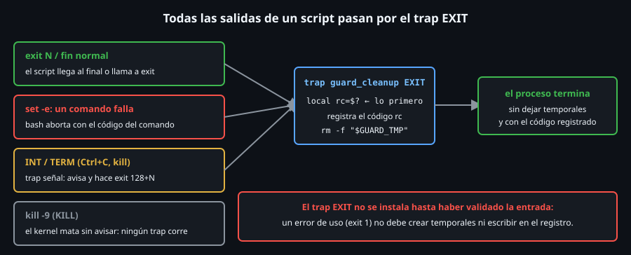

# `trap`: señales y limpieza

> Un script puede acabar de cinco formas distintas: llegando al final, con
> `exit`, por un error de `set -e`, por `Ctrl+C` o por un `kill`. `trap` es el
> mecanismo para ejecutar **tu código de limpieza en todas ellas**.

## 🎯 Objetivos

- Instalar un `trap` para `EXIT`, `INT`, `TERM` y `ERR`, y listar o quitar los activos
- Explicar por qué el `trap EXIT` es el sitio de la limpieza y qué `trap` no sobrevive (`kill -9`)
- Leer `$?` dentro de un `trap EXIT` y conservar el código de salida
- Entender cuándo bash **retrasa** un `trap` (comando en primer plano) y cómo evitarlo con `wait`
- Usar `set -E` para que `ERR` funcione también dentro de funciones



## 1. Qué problema resuelve

Un script que crea un archivo temporal, abre un bloqueo o lanza un proceso
hijo deja **basura** si muere a mitad: el temporal sigue ahí, el hijo sigue
corriendo. Poner el `rm` al final del script no basta: no se ejecuta si el
script falla antes, o si alguien pulsa `Ctrl+C`. `trap` registra un comando
que bash ejecuta **cuando ocurre algo**: al salir, al recibir una señal o al
fallar un comando.

## 2. Cómo funciona

### 2.1 `trap` sobre `EXIT`

```bash
bash -c 'trap "echo adios" EXIT; echo hola'
# hola
# adios
bash -c 'trap "echo adios" EXIT; exit 3'; echo "codigo: $?"
# adios
# codigo: 3
bash -c 'trap "echo EXIT-codigo=\$?" EXIT; set -e; false; echo no-llega'
# EXIT-codigo=1
```

`EXIT` (también escrito `0`) es una **pseudo-señal**: bash la ejecuta al
terminar el script **por cualquier camino controlado**: final normal,
`exit`, o aborto por `set -e`. Dentro del trap, `$?` vale el **código con el
que se va a salir**: es lo primero que debes leer (`local rc=$?`), porque
cualquier comando lo pisa.

### 2.2 `trap` sobre señales

```bash
bash -c 'trap "echo limpio" EXIT; trap "echo term; exit 143" TERM; kill -TERM $$; echo no-llega'; echo "codigo: $?"
# term
# limpio
# codigo: 143
```

El manejador de `TERM` imprime, sale con `143` (`128 + 15`) y esa salida
dispara el `trap EXIT`. Es el patrón de `guard`: **un manejador por señal que
solo avisa y sale; la limpieza vive en `EXIT`**. Así la limpieza se escribe
una vez.

| Señal | Número | Cuándo llega | ¿Se puede atrapar? |
|---|:--:|---|:--:|
| `HUP` | 1 | Se cierra la terminal | Sí |
| `INT` | 2 | `Ctrl+C` | Sí |
| `TERM` | 15 | `kill PID` (la señal por defecto) | Sí |
| `KILL` | 9 | `kill -9 PID` | **No** |

`kill -9` mata al proceso sin avisarle: ningún `trap` corre.

```bash
bash -c 'trap "echo CHAU" EXIT; kill -9 $$'; echo "codigo: $?"
# codigo: 137
```

Por eso se usa `TERM` primero, para dar la oportunidad de limpiar, y `KILL`
solo como último recurso.

### 2.3 Ver, reemplazar y quitar traps

```bash
bash -c 'trap "echo uno" EXIT; trap "echo dos" EXIT; true'
# dos
bash -c 'trap "echo x" EXIT; trap -p EXIT'
# trap -- 'echo x' EXIT
bash -c 'trap "echo x" EXIT; trap - EXIT; echo sin-trap'
# sin-trap
bash -c 'trap "" TERM; kill -TERM $$; echo "ignoro TERM"'
# ignoro TERM
```

- Un segundo `trap` sobre la misma señal **reemplaza** al primero: no se
  acumulan. Si necesitas varias acciones, ponlas en **una función**
  (`trap cleanup EXIT`).
- `trap -p` imprime los traps activos; `trap - SEÑAL` restaura el
  comportamiento por defecto.
- `trap "" SEÑAL` hace que la señal se **ignore**.

### 2.4 Cuándo se ejecuta el trap: el comando en primer plano

Si bash está esperando a un comando **en primer plano**, el `trap` de una
señal se ejecuta **cuando ese comando termina**, no al recibirla:

```bash
cat > /tmp/defer.sh <<'EOS'
trap 'echo "trap a los ${SECONDS}s"' TERM
(sleep 1; kill -TERM $$) &
sleep 3
echo "fin a los ${SECONDS}s"
EOS
bash /tmp/defer.sh
# trap a los 3s
# fin a los 3s
```

La señal llegó a **1 s**, pero el trap esperó a que acabara `sleep 3`. Con
el comando en **segundo plano** y un `wait`, el trap se ejecuta **al
instante**, porque `wait` es interrumpible:

```bash
cat > /tmp/defer2.sh <<'EOS'
trap 'echo "trap a los ${SECONDS}s"' TERM
(sleep 1; kill -TERM $$) &
sleep 3 &
wait $!
echo "fin a los ${SECONDS}s"
EOS
bash /tmp/defer2.sh
# trap a los 1s
# fin a los 1s
```

Es la razón de que `guard_run` lance el comando con `&` y haga `wait
"$GUARD_PID"`: un `TERM` mientras el comando corre ejecuta el manejador
**ya**, que mata al hijo y sale.

### 2.5 `ERR` y `set -E`

```bash
bash -c 'set -eE; f() { false; }; trap "echo ERR en linea \$LINENO: \$BASH_COMMAND" ERR; f; echo no-llega'; echo "codigo: $?"
# ERR en linea 1: false
# codigo: 1
bash -c 'set -e; f() { false; }; trap "echo ERR-sin-E" ERR; f; echo no-llega'; echo "codigo: $?"
# codigo: 1
```

`trap ... ERR` se ejecuta cuando un comando **falla** (con las mismas
excepciones que `set -e`: no en `if`, `||`, `&&`...). Sin `set -E` (`errtrace`),
el trap **no se hereda** dentro de funciones y subshells: la segunda línea no
imprimió nada. `$LINENO` y `$BASH_COMMAND` dicen **dónde** y **qué** falló.

### 2.6 `RETURN` y los subshells

```bash
bash -c 'f() { trap "echo en-return" RETURN; echo dentro; }; f; echo fuera'
# dentro
# en-return
# fuera
bash -c 'trap "echo EXIT-padre" EXIT; (echo hijo; exit 0); echo fin'
# hijo
# fin
# EXIT-padre
```

`RETURN` se ejecuta cuando termina una función (útil para limpiar lo que
la función creó). Los traps **no se heredan** en un subshell `( )`: el
`EXIT` solo corre en el proceso que lo instaló.

## 3. Cómo se usa

El esqueleto estándar de limpieza, el mismo que `guard`:

```bash
tmp=$(mktemp)

cleanup() {
  local rc=$?                 # 1. guardar el codigo ANTES que nada
  echo "saliendo con codigo ${rc}" >&2
  rm -f -- "$tmp"             # 2. limpiar
}
trap cleanup EXIT                       # limpieza: siempre
trap 'exit 130' INT                     # Ctrl+C: salir (dispara EXIT)
trap 'exit 143' TERM                    # kill: salir (dispara EXIT)
```

Tres cosas a vigilar:

1. **`local rc=$?` primero**, si vas a usar el código: cualquier comando
   antes lo pierde.
2. **Instálalo después de crear el recurso**, o con el recurso vacío
   protegido (`[[ -n "$tmp" ]] && rm -f -- "$tmp"`).
3. **El código de salida del script no cambia** aunque el `cleanup` falle
   (`trap false EXIT; exit 2` sale con `2`), **salvo** que el trap llame a
   `exit`: `trap 'exit 9' EXIT; exit 2` sale con `9`.

## 4. Antipatrones

| Antipatrón | Por qué duele | Qué hacer en su lugar |
|---|---|---|
| Limpiar solo al final del script | No corre si el script falla o recibe una señal | `trap cleanup EXIT` |
| Un `trap` distinto por señal repitiendo la limpieza | Se duplica y se desincroniza | Manejadores que hacen `exit N` y limpieza solo en `EXIT` |
| Dos `trap ... EXIT` esperando que se sumen | El segundo **reemplaza** al primero | Una función `cleanup` con todo |
| Leer `$?` después de otro comando | Ya no es el código de salida | `local rc=$?` en la primera línea |
| Comando largo en primer plano con un trap de `TERM` | El trap espera a que el comando acabe | `cmd & wait $!` |
| Contar con `trap` ante `kill -9` | `KILL` no se puede atrapar | Diseñar para que un resto huérfano no haga daño (archivos temporales con `mktemp`) |
| `trap ... ERR` sin `set -E` | No salta dentro de funciones | `set -eE` |
| Comillas dobles en el comando del trap con variables | Se expanden **al instalar**, no al ejecutarse | Comillas simples: `trap 'echo $x' EXIT` |

## 5. Trucos

- **Comillas simples en `trap '...'`**: con dobles, `$x` se expande al
  **instalar** el trap (con el valor de ese momento); con simples, al
  **ejecutarse**. Lo normal es querer lo segundo.
- **`trap -p`** sin argumentos lista **todos** los traps activos: útil para
  depurar "¿quién está instalando esto?".
- **`kill -l`** lista las señales; `kill -l 15` da `TERM` y `kill -l 143`
  también (acepta `128+N`).
- **`${BASH_COMMAND}`** dentro de un `ERR` es el comando que falló, tal
  como se ejecutó, con las variables ya expandidas.

## 📚 Recursos Adicionales

- `man bash`, sección *SIGNALS* y el builtin `trap` (`help trap`)
- `man 7 signal` para la lista completa de señales y cuáles no se atrapan

## ✅ Checklist de Verificación

- [ ] `trap "echo adios" EXIT; exit 3` imprime `adios` y sale con `3`
- [ ] Dentro de un `trap EXIT`, `$?` es el código de salida pendiente
- [ ] `kill -9 $$` con un `trap EXIT` **no** imprime nada y da `137`
- [ ] Reproduces el retraso (`3s`) y el trap inmediato (`1s`) con y sin `wait`
- [ ] Con `set -eE`, el `ERR` salta dentro de una función; sin `-E`, no
- [ ] Un segundo `trap ... EXIT` reemplaza al primero

---

[← Códigos de salida y manejo explícito de errores](02-codigos-de-salida-y-errores-explicitos.md) · [Archivos temporales y escritura atómica →](04-archivos-temporales-y-escritura-atomica.md)
