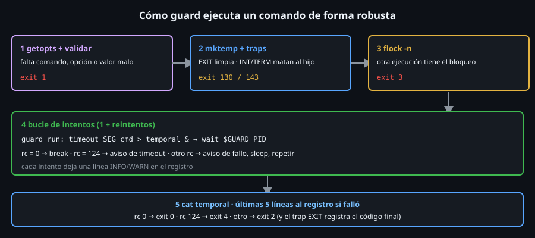

# Construyendo `guard`

> `guard` ejecuta **cualquier comando** con las defensas de la semana: no
> se solapa, no se cuelga, deja registro, reintenta, limpia lo que crea y
> sale con un código que dice qué pasó. Es la envoltura que usarás en la
> Semana 16 para programar tus scripts con `cron`.



## 🎯 Objetivos

- Reconocer en `cmd_guard` cada idea de la semana: `getopts`, `trap`, `mktemp`, `flock`, `timeout` y reintentos
- Explicar por qué los manejadores usan **variables globales** y por qué el comando corre en segundo plano
- Leer el código de salida de `guard` y deducir qué ocurrió
- Interpretar el registro que deja (`-l`)
- Construir `guard` por piezas, comprobando cada una

## 1. Qué problema resuelve

`cron` lanza un comando y se olvida. Si tarda más que el intervalo, se
**solapan**; si se cuelga, se **acumulan**; si falla, nadie se entera; y si
muere a mitad, deja **basura**. `guard` convierte cualquier comando en uno
robusto sin tocar su código:

```bash
~/bin/toolkit.sh guard -k /tmp/inf.lock -t 60 -r 1 -l /tmp/inf.log -- ~/bin/toolkit.sh healthcheck
```

## 2. Cómo funciona

### 2.1 Uso y códigos de salida

```
toolkit.sh guard [-l LOG] [-k LOCK] [-t SEG] [-r N] [-w SEG] -- COMANDO [ARGS...]
```

| Opción | Significa | Por defecto |
|:--:|---|---|
| `-l LOG` | Archivo de registro (si no, el registro va a `stderr`) | `stderr` |
| `-k LOCK` | Archivo de bloqueo: solo una ejecución a la vez | sin bloqueo |
| `-t SEG` | Límite de tiempo por intento (`0` = sin límite) | `0` |
| `-r N` | Reintentos **extra** tras un fallo | `0` |
| `-w SEG` | Espera entre intentos | `1` |

| Código | Cuándo |
|:--:|---|
| `0` | El comando acabó bien |
| `1` | Uso inválido (sin comando, opción o valor malo, comando que no existe, registro no escribible) |
| `2` | El comando **falló** (el código original queda en el registro) |
| `3` | Otro `guard` tiene el bloqueo |
| `4` | El comando agotó el límite de tiempo |
| `130` / `143` | `guard` recibió `INT` o `TERM` |

### 2.2 Las piezas de apoyo

```bash
GUARD_LOG=""
GUARD_TMP=""
GUARD_PID=""
```

Tres variables **globales**: un `trap` se ejecuta fuera del contexto de la
función que lo instaló, así que lo que necesita ver (el temporal a borrar,
el PID del hijo, el archivo de registro) vive a nivel de script.

```bash
guard_log() {
  local nivel=$1 mensaje=$2 linea
  linea="$(date +%FT%T) ${nivel} ${mensaje}"
  if [[ -n "$GUARD_LOG" ]]; then
    echo "$linea" >> "$GUARD_LOG"
  else
    echo "$linea" >&2
  fi
}
```

El registro del archivo 05: fecha, nivel y mensaje; a un archivo si hay `-l`,
a `stderr` si no.

```bash
guard_cleanup() {
  local rc=$?
  guard_log INFO "fin: codigo de salida ${rc}"
  if [[ -n "$GUARD_TMP" ]]; then
    rm -f -- "$GUARD_TMP"
  fi
}
```

El `trap EXIT` (archivo 03): guarda el código **primero**, lo registra y borra
el temporal. Se ejecuta **siempre**: final normal, `exit 2`, `exit 3`,
señales atrapadas.

```bash
guard_interrupt() {
  local senal=$1 codigo=$2
  guard_log WARN "interrumpido (${senal})"
  if [[ -n "$GUARD_PID" ]]; then
    kill "$GUARD_PID" 2> /dev/null || true
    wait "$GUARD_PID" 2> /dev/null || true
  fi
  exit "$codigo"
}
```

El manejador de `INT` y `TERM`: avisa, **mata al hijo** (si no, seguiría
corriendo huérfano), lo recoge con `wait` (si no, quedaría **zombi**:
Semana 10) y sale con `128 + N`. Ese `exit` dispara el `trap EXIT`, que hace
la limpieza.

```bash
guard_run() {
  local segundos=$1
  shift
  if [[ "$segundos" -gt 0 ]]; then
    timeout "$segundos" "$@" > "$GUARD_TMP" 2>&1 &
  else
    "$@" > "$GUARD_TMP" 2>&1 &
  fi
  GUARD_PID=$!
  wait "$GUARD_PID"
}
```

Una ejecución del comando: salida y errores al **temporal**, `timeout`
si hay límite y **en segundo plano** con `wait` (archivo 03: así un `TERM`
mientras tanto ejecuta el trap al instante). `wait` devuelve el código del
comando.

### 2.3 `cmd_guard` por trozos

**Opciones y validación** (archivos 02 y 07): un `getopts ':l:k:t:r:w:'`
con `local OPTIND=1` antes, un `case` que guarda cada valor (`l)` en
`GUARD_LOG`, `k)` en `lock`...) y los casos `:` y `*` con `exit 1`; después,
`shift $(( OPTIND - 1 ))`.

Después: falta el comando, los tres números con `is_uint` (un bucle sobre
sus **nombres** con `${!nombre}`), `command -v "$1"` y que el registro se
pueda abrir (`{ : >> "$GUARD_LOG"; } 2> /dev/null`). Todo con `exit 1`,
**antes** de crear nada.

**Temporal y traps** (archivos 03 y 04):

```bash
GUARD_TMP=$(mktemp "${TMPDIR:-/tmp}/toolkit-guard.XXXXXX")
trap guard_cleanup EXIT
trap 'guard_interrupt INT 130' INT
trap 'guard_interrupt TERM 143' TERM
```

En ese orden y **tras** validar: un error de uso (`exit 1`) no deja un
temporal ni escribe `fin:` en el registro.

**Bloqueo** (archivo 06):

```bash
if [[ -n "$lock" ]]; then
  local lock_fd
  exec {lock_fd}> "$lock"
  if ! flock -n "$lock_fd"; then
    guard_log ERROR "bloqueado: otra ejecucion tiene ${lock}"
    exit 3
  fi
fi
```

`flock -n`: sin esperar. El bloqueo dura lo que el descriptor abierto, es
decir, lo que `guard`; el kernel lo libera aunque `guard` muera.

**El bucle de intentos**:

```bash
local intento=0 maximo=$(( reintentos + 1 )) rc=0
while [[ "$intento" -lt "$maximo" ]]; do
  intento=$(( intento + 1 ))
  guard_log INFO "intento ${intento}/${maximo}: $*"
  rc=0
  guard_run "$segundos" "$@" || rc=$?
  if [[ "$rc" -eq 0 ]]; then
    break
  fi
  if [[ "$rc" -eq 124 ]]; then
    guard_log WARN "timeout tras ${segundos}s"
  else
    guard_log WARN "fallo con codigo ${rc}"
  fi
  if [[ "$intento" -lt "$maximo" ]]; then
    sleep "$espera"
  fi
done
```

`guard_run ... || rc=$?` es el idiom de la Semana 14/15: el `||` "comprueba"
el fallo para que `set -e` **no aborte** y `rc` conserva el código. Los
reintentos son `maximo - 1`; la espera va **entre** intentos, no tras el
último. `124` es el código de `timeout`.

**El cierre**:

```bash
cat "$GUARD_TMP"
if [[ "$rc" -eq 0 ]]; then
  guard_log INFO "ok"
  return 0
fi
tail -n 5 "$GUARD_TMP" | while IFS= read -r linea; do
  guard_log INFO "salida: ${linea}"
done
if [[ "$rc" -eq 124 ]]; then
  exit 4
fi
exit 2
```

Se muestra la salida del comando; si falló, sus **últimas cinco líneas** van
al registro (el motivo del fallo, para quien lo lea después); y el código es
`0`, `4` o `2`.

## 3. Cómo se usa

```bash
~/bin/toolkit.sh guard -- echo hola; echo "codigo: $?"
# 2026-10-25T10:15:02 INFO intento 1/1: echo hola
# hola
# 2026-10-25T10:15:02 INFO ok
# 2026-10-25T10:15:02 INFO fin: codigo de salida 0
# codigo: 0
```

(Las líneas con fecha son el **registro**, que sin `-l` va a `stderr`; `hola`
es la salida del comando, en `stdout`.)

```bash
~/bin/toolkit.sh guard -l /tmp/g.log -r 2 -w 0 -- false; echo "codigo: $?"
# codigo: 2
cat /tmp/g.log
# 2026-10-25T10:15:03 INFO intento 1/3: false
# 2026-10-25T10:15:03 WARN fallo con codigo 1
# ... (lo mismo con intento 2/3 y 3/3)
# 2026-10-25T10:15:03 INFO fin: codigo de salida 2
```

```bash
~/bin/toolkit.sh guard -t 1 -- sleep 5 2>/dev/null; echo "codigo: $?"
# codigo: 4
```

Y el bloqueo (el segundo `guard` sale con `3` mientras el primero corre):

```bash
~/bin/toolkit.sh guard -k /tmp/g.lock -- sleep 2 2>/dev/null &
sleep 0.5; ~/bin/toolkit.sh guard -k /tmp/g.lock -- true 2>/dev/null; echo "codigo: $?"; wait
# codigo: 3
```

## 4. Antipatrones

| Antipatrón | Por qué duele | Qué hacer en su lugar |
|---|---|---|
| Que `guard_cleanup` lea variables `local` de `cmd_guard` | Un trap corre fuera de esa función | Variables **globales** (`GUARD_TMP`, `GUARD_PID`) |
| Instalar los traps **antes** de validar | Un error de uso deja registro y temporal | Traps después de la validación |
| Ejecutar el comando en primer plano con un trap de `TERM` | El trap espera a que el hijo acabe | `&` + `wait` |
| Matar al hijo sin `wait` | Queda un zombi | `kill` y `wait` en el manejador |
| Llamar a `guard_run` sin `\|\| rc=$?` | `set -e` aborta con el primer fallo y no hay reintentos | `guard_run ... \|\| rc=$?` |
| `guard -- mi_funcion` | `guard` corre en otro proceso y no ve las funciones de tu shell: sale con `1` (`comando no encontrado`) | Pasarle un programa o `bash -c '...'` |

## 5. Trucos

- **`ls /tmp/toolkit-guard.*`** tras cualquier prueba debe decir
  `No such file or directory`: es el chequeo de que la limpieza funciona.
- **`kill -TERM` a un `guard` en marcha** (mientras ejecuta `sleep 30`)
  termina con `143` y deja `interrumpido (TERM)` en el registro; `pgrep -a
  sleep` confirma que el hijo ya no está.

## 📚 Recursos Adicionales

- `man flock`, `man timeout`, `help trap`
- El propio `toolkit.sh`: lee `cmd_guard` y sus cuatro funciones de apoyo

## ✅ Checklist de Verificación

- [ ] `guard -- echo hola` imprime el registro, `hola` y sale con `0`
- [ ] `guard -- false` sale con `2` y `guard` sin comando, con `1`
- [ ] `guard -t 1 -- sleep 5` sale con `4`
- [ ] Dos `guard -k` seguidos: el segundo sale con `3`
- [ ] `guard -l LOG -r 2 -w 0 -- false` deja `intento 3/3` en el registro
- [ ] Tras cualquiera de ellos, `ls /tmp/toolkit-guard.*` no encuentra nada
- [ ] Localizas en el código: `getopts`, `mktemp`, tres `trap`, `flock`, `timeout` y `wait`

---

[← `getopts` y validación de entradas](07-getopts-y-validacion-de-entradas.md) · [Práctica 01: el modo estricto y sus agujeros →](../2-practicas/01-modo-estricto-y-sus-agujeros.md)
