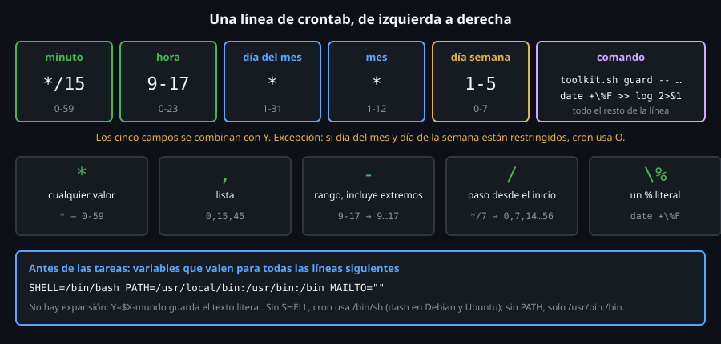

# `cron` y `crontab`: ejecutar cosas sin estar delante

> Un script que solo corre cuando tú lo lanzas es una herramienta; uno que
> corre solo, a las 3:00, es un servicio. `cron` es el demonio de Unix más
> antiguo que sigues usando: una tabla de horarios y un reloj.



## 🎯 Objetivos

- Explicar qué hace el demonio `cron` y dónde guarda las tablas de cada usuario
- Leer una línea de `crontab` campo por campo
- Instalar, listar, respaldar y borrar un `crontab` con `crontab -l`, `-` y `-r`
- Instalar un `crontab` sin abrir un editor, y saber qué pasa si tiene un error
- Nombrar el paquete y el servicio de `cron` en Debian/Ubuntu, RHEL y Arch

## 1. Qué problema resuelve

Hasta la Semana 15 todo lo que has hecho empezaba con un Enter tuyo. Pero la
mayoría del trabajo útil de un sistema es **periódico**: rotar logs cada
noche, comprobar el disco cada cinco minutos, hacer una copia los lunes. Nadie
quiere estar delante a las 3:00.

`cron` resuelve exactamente eso, y nada más: **a la hora indicada, lanza este
comando**. No sabe si el comando funcionó, no lo reintenta, no avisa si se
solapa consigo mismo. Todo eso es trabajo tuyo (por eso existe `guard`), y es
el motivo de que buena parte de esta semana trate de cómo **no** fallar en
silencio.

## 2. Cómo funciona

### 2.1 El demonio y sus tablas

`cron` es un proceso que vive en segundo plano. **Una vez por minuto** se
despierta, lee sus tablas y lanza lo que toque en ese minuto. Las tablas
están en tres sitios:

| Tabla | Quién la escribe | Tiene campo de usuario |
|---|---|:--:|
| `crontab` de cada usuario (`/var/spool/cron/crontabs/<usuario>` en Debian/Ubuntu) | cada usuario, con `crontab -e` | no |
| `/etc/crontab` | el administrador, a mano | **sí** |
| `/etc/cron.d/*` | paquetes y administrador, un archivo por tarea | **sí** |

En este archivo solo usas la primera. Las otras dos las verás en el
[archivo 04](04-cron-en-el-sistema-y-at.md).

Comprueba que el demonio está corriendo en `ubuntu-lab`:

```bash
# pgrep -x busca un proceso por nombre exacto; sale con 0 si lo encuentra.
pgrep -x cron >/dev/null && echo "cron corre"
# cron corre
```

> **Aviso del laboratorio**: un contenedor no tiene `init`, así que nadie
> arranca `cron` por ti. En `ubuntu-lab` lo lanzas tú **una vez** con
> `cron` (sin argumentos: se pone solo en segundo plano). En una máquina de
> verdad lo arranca el sistema: `systemctl enable --now cron`.

### 2.2 `crontab`: la única forma correcta de tocar tu tabla

No edites nunca el archivo de `/var/spool/cron/crontabs/`. Pertenece a
`root:crontab` con permisos `600` y `cron` solo se entera de los cambios si
pasan por el comando `crontab`, que además **valida la sintaxis**:

```bash
echo "* * * * * date +\%T >> /tmp/tic.log" | crontab -
# '-' significa "lee la tabla de la entrada estandar".
crontab -l
# * * * * * date +\%T >> /tmp/tic.log
ls -l /var/spool/cron/crontabs/
# -rw------- 1 root crontab 211 Oct 25 04:34 root
```

| Orden | Qué hace |
|---|---|
| `crontab -l` | **L**ista tu tabla (`no crontab for root` si no tienes) |
| `crontab -e` | **E**dita tu tabla con `$EDITOR` y la valida al guardar |
| `crontab ARCHIVO` | Instala `ARCHIVO` **sustituyendo** la tabla entera |
| `crontab -` | Igual, leyendo de la entrada estándar |
| `crontab -r` | **R**emueve tu tabla entera, **sin pedir confirmación** |

### 2.3 Las cinco columnas

| # | Campo | Valores | `*` significa |
|:--:|---|---|---|
| 1 | minuto | 0-59 | cada minuto |
| 2 | hora | 0-23 | cada hora |
| 3 | día del mes | 1-31 | cualquier día |
| 4 | mes | 1-12 | cualquier mes |
| 5 | día de la semana | 0-7 (0 y 7 son domingo) | cualquier día de la semana |

Después de los cinco campos, separado por espacios, va el **comando**: todo el
resto de la línea.

Una línea se lee como una frase: «**en** el minuto 30, **a**
la hora 2, **cualquier** día del mes, **cualquier** mes, de **lunes a
viernes**, ejecuta…». Un `*` significa «cualquiera». Cada campo se
**combina con Y** con los demás (con una excepción famosa: el
[archivo 02](02-expresiones-de-cron-y-sus-trampas.md) explica la del día del
mes y el día de la semana).

```bash
# 30 2 * * 1-5  -> 02:30, de lunes (1) a viernes (5), todos los meses.
/root/bin/toolkit.sh schedule check '30 2 * * 1-5'
# expresion: 30 2 * * 1-5
# minutos: 1
# horas: 1
# dias del mes: 31
# meses: 12
# dias de la semana: 5
# ejecuciones por dia: 1
```

(`schedule check` lo escribes tú esta semana; esa es la salida que tendrá
terminado.)

### 2.4 Divergencia de distribución

| | Debian / Ubuntu | RHEL / Fedora | Arch |
|---|---|---|---|
| Paquete | `cron` | `cronie` | `cronie` |
| Binario del demonio | `/usr/sbin/cron` | `/usr/sbin/crond` | `/usr/sbin/crond` |
| Servicio (host real) | `cron.service` | `crond.service` | `cronie.service` |
| En la imagen Docker del laboratorio | no (`apt install cron`) | no (`dnf install cronie`) | no (`pacman -S cronie`) |

En Arch, instalar `cronie` **no** lo activa: hay que hacer
`systemctl enable --now cronie`. El `crontab -l`, `-e` y `-r` y la sintaxis de cinco campos son **iguales**
en las tres: es el estándar de facto. Lo que cambia es el nombre del
paquete, el del servicio y algunos detalles que verás en el
[archivo 03](03-el-entorno-minimo-de-cron.md).

## 3. Cómo se usa

### 3.1 Instalar sin abrir un editor

`crontab -e` abre un editor, y un editor no sirve en un script ni en este
archivo. Dos formas equivalentes:

```bash
# Desde un archivo (sustituye TODA la tabla):
printf '17 3 * * 1 /usr/bin/true\n' > /tmp/tabla.cron
crontab /tmp/tabla.cron
crontab -l
# 17 3 * * 1 /usr/bin/true

# Añadiendo una linea a la tabla existente:
(crontab -l 2>/dev/null; echo "0 3 * * * /usr/bin/true") | crontab -
crontab -l
# 17 3 * * 1 /usr/bin/true
# 0 3 * * * /usr/bin/true
```

El `2>/dev/null` silencia el `no crontab for root` cuando aún no hay tabla.

### 3.2 Si la tabla tiene un error, no se instala nada

```bash
echo "99 * * * * /usr/bin/true" | crontab -
# "-":0: bad minute
# errors in crontab file, can't install.
echo "codigo: $?"
# codigo: 1
crontab -l | wc -l
# 2
```

`99` no es un minuto. `crontab` lo rechaza **y conserva la tabla anterior**
(las dos líneas del ejemplo anterior siguen ahí). Es la ventaja de `crontab -e`
frente a editar un archivo a mano.

### 3.3 Respaldar antes de tocar

```bash
# Una copia de la tabla, para poder volver atras.
crontab -l > /tmp/crontab.bak
wc -l < /tmp/crontab.bak
# 2
crontab -r                       # sin confirmacion: borra la tabla entera
crontab -l
# no crontab for root
crontab /tmp/crontab.bak         # la restauras
crontab -l | wc -l
# 2
```

> **Aviso**: `crontab -r` está a una tecla de `crontab -e` en el teclado.
> En Ubuntu, `crontab -ri` pregunta antes de borrar (`really delete root's
> crontab?`), pero es una opción que tienes que acordarte de escribir. Lo seguro
> es **guardar siempre una copia** (`crontab -l > respaldo`) y, mejor, tener
> las tablas en un repositorio.

## 4. Antipatrones

| Antipatrón | Por qué duele | Qué hacer en su lugar |
|---|---|---|
| Que el único registro de tus tareas sea lo que hay dentro de `crontab -e` | Un `crontab -r` o una reinstalación y las tareas desaparecen sin rastro | Tener el archivo `.cron` en un repositorio e instalarlo con `crontab archivo` |
| `crontab -r` sin copia | No hay papelera ni confirmación | `crontab -l > respaldo` antes de nada |
| Editar `/var/spool/cron/crontabs/<usuario>` a mano | `cron` no se entera y se salta la validación | Siempre `crontab -e` o `crontab archivo` |
| Dejar `* * * * *` de prueba | Se ejecuta 1440 veces al día para siempre | Quitar la línea al terminar, o programarla con `at` ([archivo 04](04-cron-en-el-sistema-y-at.md)) |
| Suponer que `cron` está corriendo | En un contenedor o en Arch recién instalado nadie lo arrancó y las tareas **nunca** se ejecutan, sin ningún error | Comprobar `pgrep -x cron` (o `systemctl status cron` en un host) |
| Instalar con `crontab archivo` sin saber que **reemplaza** la tabla | Se pierden las tareas anteriores | `crontab -l` antes, o la forma de añadir de la sección 3.1 |

## 5. Trucos

- **`crontab -l | grep -v '^#'`** enseña solo las líneas activas, sin
  comentarios ni variables de cabecera.
- **`crontab -u otrousuario -l`** (como `root`) lee la tabla de otro usuario
  sin abrir su archivo. `-e` y `-r` aceptan `-u` también.
- **`crontab -l | wc -l`** antes y después de instalar un archivo te dice, de
  un vistazo, si has sustituido una tabla de ocho líneas por una de una.

## 📚 Recursos Adicionales

- `man 5 crontab` (el formato) y `man 1 crontab` (el comando); en RHEL y Arch,
  `man 5 crontab` y `man 8 crond`
- [Debian wiki — Cron](https://wiki.debian.org/cron)

## ✅ Checklist de Verificación

- [ ] `pgrep -x cron` encuentra el demonio en `ubuntu-lab` (lo arrancaste con `cron`)
- [ ] Lees `30 2 * * 1-5` en voz alta como una frase
- [ ] Instalas una tabla con `crontab -` y la listas con `crontab -l`
- [ ] Una línea con `99` en el minuto se rechaza y la tabla anterior se conserva
- [ ] Recuperas una tabla borrada con `crontab respaldo`
- [ ] Nombras el paquete de `cron` en Debian, RHEL y Arch

---

[← Semana 16: Automatización y tareas programadas](../README.md) · [Expresiones de cron y sus trampas →](02-expresiones-de-cron-y-sus-trampas.md)
