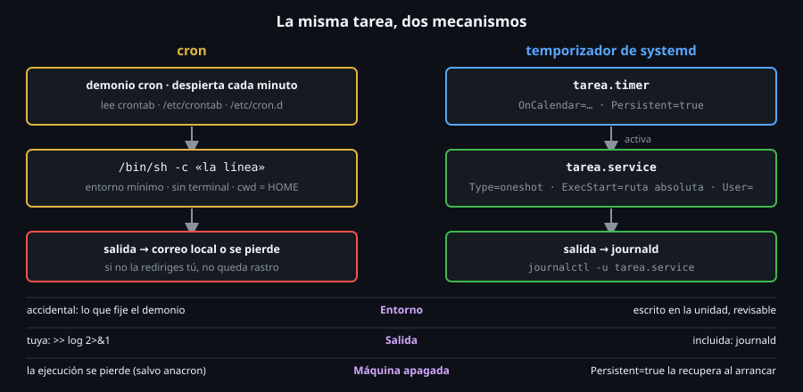

# Temporizadores de systemd

> En systemd, programar es separar dos cosas: **qué** se ejecuta (una unidad
> `.service`) y **cuándo** (una unidad `.timer`). Cuesta dos archivos en vez
> de una línea, y a cambio ganas registro, recuperación de ejecuciones
> perdidas y reglas de calendario que `cron` no tiene.



## 🎯 Objetivos

- Explicar la pareja `.timer` + `.service` y quién activa a quién
- Escribir un `OnCalendar=` y comprobarlo con `systemd-analyze calendar`
- Distinguir un temporizador de **calendario** de uno **monotónico**
- Usar `Persistent=`, `RandomizedDelaySec=` y `AccuracySec=` y saber qué resuelven
- Enumerar qué te da un temporizador que `cron` no te da, y cuándo `cron` sigue siendo suficiente
- Traducir una expresión de `cron` a `OnCalendar` y saber dónde la traducción no es fiel

## 1. Qué problema resuelve

Los archivos 01-05 muestran lo que `cron` **no** te da: registro, aviso de
fallos, recuperación de lo perdido por una máquina apagada, límite de
recursos. Lo arreglabas a mano (`guard`, redirecciones, `anacron`). Los
temporizadores de systemd traen buena parte de eso de serie, porque la tarea
es una **unidad** más del sistema, con las mismas herramientas (`systemctl`,
`journalctl`) que cualquier servicio.

> **Aviso del laboratorio**: los contenedores de `ubuntu-lab` no tienen
> systemd como proceso 1. Lo que sí puedes hacer aquí es **escribir las
> unidades y comprobarlas** con `systemd-analyze` (`calendar`, `timespan`,
> `verify`; instala `systemd` con `apt-get install -y systemd`). Lo que
> requiere un systemd en marcha (`systemctl enable`, `list-timers`,
> `journalctl`) está marcado como **«solo en un host»**: en un portátil,
> una máquina virtual o un servidor con Linux de verdad.

## 2. Cómo funciona

### 2.1 Dos unidades, una pareja

```ini
# tarea.service  — QUE se ejecuta
[Unit]
Description=Mi tarea

[Service]
Type=oneshot
ExecStart=/usr/local/bin/mi-tarea

# tarea.timer    — CUANDO
[Unit]
Description=Temporizador de mi tarea

[Timer]
OnCalendar=*-*-* 03:30:00
Persistent=true

[Install]
WantedBy=timers.target
```

El temporizador **no sabe qué hace** la tarea: cuando le toca, **activa la
unidad del mismo nombre** (`tarea.timer` → `tarea.service`; se puede cambiar
con `Unit=`). El servicio no sabe cuándo se ejecuta: puedes lanzarlo a mano,
`systemctl start tarea.service`, sin esperar al temporizador. Esa separación
es la ventaja: pruebas la tarea sin tocar el horario.

Qué se hace en un host (**solo en un host**, ver aviso arriba):

```bash
sudo cp tarea.service tarea.timer /etc/systemd/system/
sudo systemctl daemon-reload                 # releer las unidades
sudo systemctl enable --now tarea.timer      # activar EL TEMPORIZADOR, no el servicio
systemctl list-timers                        # NEXT, LEFT, LAST, PASSED, UNIT, ACTIVATES
journalctl -u tarea.service                  # lo que imprimio la tarea
```

Se habilita el **`.timer`**, no el `.service`: el servicio no tiene
`[Install]` y no debe arrancar al inicio, solo cuando el temporizador lo pida.

### 2.2 `OnCalendar=`: el calendario

La sintaxis es `DÍAS AÑO-MES-DÍA HORA:MINUTO:SEGUNDO`, y **todas las partes
son opcionales**. `systemd-analyze calendar` te dice cómo la entiende
systemd (forma «normalizada») y cuándo será la próxima vez:

```bash
systemd-analyze calendar "Mon..Fri 09:00" | grep -E 'Normalized|Next'
# Normalized form: Mon..Fri *-*-* 09:00:00
#     Next elapse: Mon 2026-10-26 09:00:00 UTC
systemd-analyze calendar --iterations=3 "*-*-01,15 06:00" | grep -E 'Next|Iteration'
#     Next elapse: Sun 2026-11-01 06:00:00 UTC
#    Iteration #2: Sun 2026-11-15 06:00:00 UTC
#    Iteration #3: Tue 2026-12-01 06:00:00 UTC
```

(Las fechas dependen del día en que lo ejecutes.) Atajos y su forma
normalizada:

| Escribes | Normalizado |
|---|---|
| `minutely` | `*-*-* *:*:00` |
| `hourly` | `*-*-* *:00:00` |
| `daily` | `*-*-* 00:00:00` |
| `weekly` | `Mon *-*-* 00:00:00` |
| `monthly` | `*-*-01 00:00:00` |
| `quarterly` | `*-01,04,07,10-01 00:00:00` |
| `semiannually` | `*-01,07-01 00:00:00` |
| `yearly` | `*-01-01 00:00:00` |
| `02:30` | `*-*-* 02:30:00` |
| `Mon,Wed 8:00..10:00` | `Mon,Wed *-*-* 08:00..10:00` |
| `*:0/15` | `*-*-* *:00/15:00` (cada 15 minutos, desde el 0) |

Se parece a `cron`, con tres diferencias de fondo: los **días de la semana
se escriben con nombre** (`Mon..Fri`), los rangos usan **dos puntos**
(`..`), y las partes que omites **no son** «cualquiera» sino lo que tenga
sentido (`02:30` significa `*-*-* 02:30:00`, **todos los días**).

### 2.3 Calendario frente a monotónico

Hay dos familias de temporizador:

| Tipo | Directivas | Cuenta desde… | Ejemplo |
|---|---|---|---|
| **Calendario** | `OnCalendar=` | El reloj de pared | «a las 03:30» |
| **Monotónico** | `OnBootSec=`, `OnStartupSec=`, `OnActiveSec=`, `OnUnitActiveSec=`, `OnUnitInactiveSec=` | Un evento (arranque, última vez que corrió la unidad) | «15 min tras arrancar, y luego cada hora» |

```ini
[Timer]
OnBootSec=15min          # 15 minutos despues de arrancar la maquina
OnUnitActiveSec=1h       # y luego, 1 hora despues de la ULTIMA ejecucion
```

Resuelve lo que `cron` no puede: «cada 7 minutos» **reales** (`OnUnitActiveSec=7min`),
sin el hueco del `*/7` del [archivo 02](02-expresiones-de-cron-y-sus-trampas.md).
Los valores de tiempo se comprueban con `systemd-analyze timespan`:

```bash
systemd-analyze timespan "1h 30min" 90 | grep -E 'Original|Human'
# Original: 1h 30min
#    Human: 1h 30min
# Original: 90
#    Human: 1min 30s
```

Sin unidad, un número son **segundos** (`90` → 1 min 30 s).

### 2.4 `Persistent=`, `RandomizedDelaySec=` y `AccuracySec=`

| Directiva | Qué hace |
|---|---|
| `Persistent=true` | Guarda en disco cuándo se ejecutó por última vez. Si la máquina estaba **apagada** a la hora, la ejecuta **al arrancar**. Solo vale con `OnCalendar=`. Es el `anacron` de systemd |
| `RandomizedDelaySec=5min` | Añade un retraso aleatorio de 0 a 5 min a cada ejecución. Reparte la carga cuando hay muchas máquinas con la misma hora |
| `AccuracySec=` | Margen de tolerancia en el que systemd puede agrupar ejecuciones para ahorrar energía. Por defecto, **1 minuto**: un temporizador puede ejecutarse hasta un minuto tarde. Para segundos exactos, `AccuracySec=1s` |

### 2.5 Dónde difiere la traducción desde `cron`

`toolkit.sh schedule gen` traduce los cinco campos a `OnCalendar` expandiendo
cada campo a una lista. Para `*/15 9-17 * * 1-5` el resultado es:

```bash
# Unidad .timer generada (extracto):
# OnCalendar=Mon,Tue,Wed,Thu,Fri *-*-* 9,10,11,12,13,14,15,16,17:0,15,30,45:00
systemd-analyze calendar "Mon,Tue,Wed,Thu,Fri *-*-* 9,10,11,12,13,14,15,16,17:0,15,30,45:00" | grep Normalized
# Normalized form: Mon..Fri *-*-* 09,10,11,12,13,14,15,16,17:00,15,30,45:00
```

systemd la normaliza a `Mon..Fri` y a dos dígitos: la misma expresión, más
corta. Pero hay un caso en el que **no existe traducción fiel**:
`0 0 13 * 5` (día 13 **y** viernes). `cron` corre los 13 **o** los viernes;
systemd, los viernes 13:

```bash
systemd-analyze calendar --iterations=3 "Fri *-*-13" | grep -E 'Next|Iteration'
#     Next elapse: Fri 2026-11-13 00:00:00 UTC
#    Iteration #2: Fri 2027-08-13 00:00:00 UTC
#    Iteration #3: Fri 2028-10-13 00:00:00 UTC
```

Tres viernes 13 en dos años, frente a decenas de ejecuciones en `cron`. Por
eso `schedule gen` **se niega** (código `2`) en lugar de generar dos archivos
que hacen cosas distintas.

## 3. Cómo se usa

Cuándo elegir cada uno:

| Prefiere… | Cuando… |
|---|---|
| `cron` | Una tarea simple, personal o en una máquina vieja o mínima (contenedor, BusyBox, un `crontab` de usuario sin permisos de administrador) |
| Temporizador de systemd | Necesitas **registro** sin redirigir (`journalctl -u`), recuperar lo perdido (`Persistent=`), dependencias (`After=network-online.target`), límite de recursos, o un intervalo exacto (`OnUnitActiveSec=`) |
| Ambos, con la tarea envuelta en `guard` | Quieres el mismo comportamiento en ambos mundos: así funciona `schedule gen` |

Comprobar sin un systemd en marcha lo que sí se puede:

```bash
systemd-analyze calendar "*-*-* 03:30:00" | grep Next
#     Next elapse: Mon 2026-10-26 03:30:00 UTC
printf '[Timer]\nOnCalendar=cada-dia\n' > /tmp/a.timer
systemd-analyze verify /tmp/a.timer
# /tmp/a.timer:2: Failed to parse calendar specification, ignoring: cada-dia
# a.timer: Timer unit lacks value setting. Refusing.
# Unit a.timer has a bad unit file setting.
echo "codigo: $?"
# codigo: 1
```

`verify` hizo su trabajo: encontró la expresión inválida **antes** de
instalar nada. El `echo` imprime el código del último comando.

## 4. Antipatrones

| Antipatrón | Por qué duele | Qué hacer en su lugar |
|---|---|---|
| `systemctl enable tarea.service` | El servicio arrancaría en cada inicio, sin horario | `enable --now tarea.timer` |
| Editar la unidad y no hacer `daemon-reload` | systemd sigue con la versión vieja | `systemctl daemon-reload` tras cada cambio |
| `OnCalendar=daily` esperando «a las 3:00» | `daily` es medianoche | `OnCalendar=*-*-* 03:00:00` |
| `Persistent=true` con `OnBootSec=` | `Persistent=` solo tiene efecto con `OnCalendar=` | Un monotónico ya cuenta desde el arranque |
| Esperar precisión al segundo con el valor por defecto | `AccuracySec` es 1 min | `AccuracySec=1s` |
| Un temporizador de calendario para «cada 7 minutos» | El calendario no encadena desde la última ejecución | `OnUnitActiveSec=7min` |
| Copiar la línea de `cron` y creer que «ya está» | `%`, `PATH` y el entorno se tratan distinto | Revisa [el archivo 07](07-unidades-service-para-tareas.md) |

## 5. Trucos

- **`systemd-analyze calendar "..." --iterations=5`** es la herramienta de
  depuración de horarios más útil que existe: te enseña las **próximas cinco
  ejecuciones reales**. Úsala también para contrastar una expresión de `cron`
  traducida.
- **`systemd-analyze verify unidad.service unidad.timer`** avisa de claves
  desconocidas (`Unknown key name 'Foo' in section 'Timer', ignoring`) y de
  rutas que no existen, antes de que fallen a las 3:00.
- **`Persistent=true` + `RandomizedDelaySec`** es la combinación estándar de
  un temporizador de mantenimiento: recupera lo perdido y no martillea.

## 📚 Recursos Adicionales

- `man systemd.timer`, `man systemd.time` (sintaxis de calendario y de duración), `man systemd-analyze`
- [systemd.timer — documentación oficial](https://www.freedesktop.org/software/systemd/man/latest/systemd.timer.html)

## ✅ Checklist de Verificación

- [ ] `systemd-analyze calendar "Mon..Fri 09:00"` enseña la próxima ejecución
- [ ] Explicas quién activa a quién en la pareja `.timer`/`.service`
- [ ] Sabes por qué se habilita el `.timer` y no el `.service`
- [ ] Distingues `OnCalendar=` de `OnUnitActiveSec=` con un ejemplo de cada
- [ ] Dices qué resuelve `Persistent=true` y con qué directiva solo vale
- [ ] Explicas por qué `0 0 13 * 5` no tiene traducción fiel a `OnCalendar`
- [ ] `systemd-analyze verify` rechaza un `OnCalendar=cada-dia`

---

[← Tareas programadas que no fallan en silencio](05-tareas-programadas-que-no-fallan-en-silencio.md) · [Unidades `service` para tareas →](07-unidades-service-para-tareas.md)
