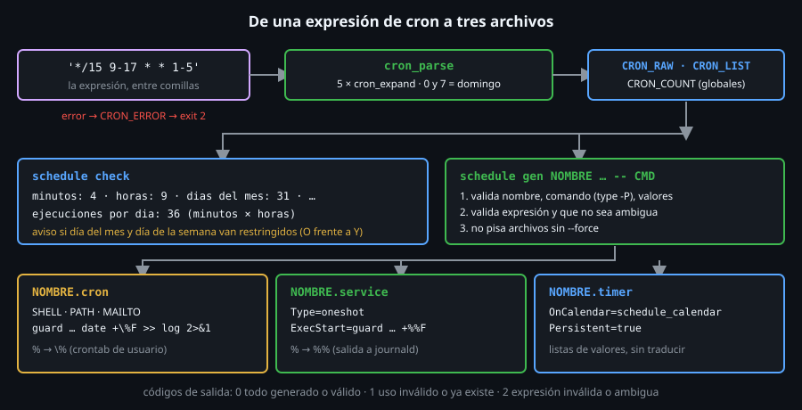

# Construyendo `schedule`

> `schedule` hace de puente entre las dos formas de programar: valida una
> expresión de `cron`, la cuenta, y genera a partir de ella el `.cron`, el
> `.service` y el `.timer` que ejecutan **un comando envuelto en `guard`**.
> Es el punto donde las Semanas 13 a 15 se juntan con la 16.



## 🎯 Objetivos

- Explicar por qué `schedule` expande cada campo a **una lista de valores** y no traduce operadores
- Reconocer en el código los patrones de las semanas anteriores: arrays, `local -A`, `read -ra`, `10#`, `BASH_REMATCH`, here-documents
- Leer los códigos de salida de `schedule` (`0`, `1`, `2`) y deducir qué pasó
- Justificar cada restricción de seguridad (lista blanca de caracteres, nombre sin `/`, rutas absolutas, `--force`)
- Construir `schedule` por piezas, comprobando cada una

## 1. Qué problema resuelve

Escribir a mano el `.cron`, el `.service` y el `.timer` de una tarea es
repetitivo y, sobre todo, **desigual**: es fácil que el horario de uno y de
otro no coincida, que se olvide el `\%` o el `%%`, o que el `PATH` sea el que
no es. `schedule` hace las dos cosas que no deben hacerse a ojo:

1. **Validar y contar** una expresión de `cron` (`schedule check`).
2. **Generar** los tres archivos desde **una única fuente de verdad**, con las
   mismas defensas en todos (`schedule gen`).

```bash
~/bin/toolkit.sh schedule gen respaldo --cron '30 2 * * 1-5' --salida ~/horarios -- ~/bin/toolkit.sh snapshot
```

## 2. Cómo funciona

### 2.1 Uso y códigos de salida

```
toolkit.sh schedule check 'M H DOM MES DOW'
toolkit.sh schedule gen NOMBRE --cron 'EXPR' [--salida DIR] [--log ARCHIVO] [--timeout SEG] [--force] -- COMANDO [ARGS...]
```

| Código | Significa | Ejemplo |
|:--:|---|---|
| `0` | Expresión válida (`check`) o archivos generados (`gen`) | `check '30 2 * * 1-5'` |
| `1` | **Uso** inválido: falta algo, opción desconocida, nombre o valor no soportado, el archivo ya existe | `gen ../x ...`, `gen` sin `--cron` |
| `2` | La **expresión** es inválida o no tiene traducción fiel | `check '60 * * * *'`, `gen --cron '0 3 13 * 5'` |

La separación del `1` y el `2` es la de siempre en este bootcamp: `1` es un
error de quien **llama**, `2` es un hallazgo sobre lo que se le pasó.

### 2.2 Idea central: expandir cada campo a una lista

Para saber a qué hora corre `*/15 9-17 * * 1-5` hay dos caminos. Uno es
**traducir** operadores (`*/15` → `0/15`, `9-17` → `9..17`, `1-5` →
`Mon..Fri`), con una regla por cada caso y sus excepciones. El otro, el que
usa `schedule`, es **expandir**: convertir cada campo en la lista de
números que cubre y trabajar solo con listas.

```bash
source ~/bin/toolkit.sh      # carga las funciones (la guarda BASH_SOURCE evita ejecutar main)
cron_expand "1,15,30-32/2" 0 59; echo "${CRON_VALUES[*]}"
# 1 15 30 32
cron_expand "*/15" 0 59; echo "${CRON_VALUES[*]}"
# 0 15 30 45
cron_expand "5-3" 0 59 || echo "error: $CRON_ERROR"
# error: rango invertido: '5-3'
```

Con listas, **contar** es `${#array[@]}` y **traducir** a `OnCalendar` es
unir con comas: el mismo dato sirve a `check` y a `gen`. `cron_expand` es
una función pequeña con tres decisiones:

```bash
# 1. Un array asociativo de "valores vistos": ordena y elimina repetidos gratis.
local -A visto=()
for (( n = inicio; n <= fin; n += paso )); do
  visto[$n]=1
done
# 2. Se recorre MIN..MAX en orden y se anotan los marcados.
for (( n = min; n <= max; n++ )); do
  if [[ -n "${visto[$n]:-}" ]]; then CRON_VALUES+=("$n"); fi
done
```

Y una trampa nueva: **`10#`**. Los números con cero a la izquierda (`08`) son
*octales* para la aritmética de bash, y `08` no es un octal válido (`8` no
existe en base 8). `10#$x` fuerza base 10:

```bash
cron_expand "08" 0 59; echo "${CRON_VALUES[*]}"
# 8
```

(Sin `10#`, `(( x < 1 ))` con `x=08` falla con `value too great for base (error
token is "08")`.)

Los **resultados** se dejan en variables globales (`CRON_VALUES`,
`CRON_ERROR`, `CRON_RAW`, `CRON_LIST`, `CRON_COUNT`): una función de bash no
devuelve un array. Es la misma decisión que `GUARD_TMP` en la Semana 15, y
con la misma contrapartida: hay que *vaciarlas* al principio de cada llamada.

### 2.3 `cron_parse`: cinco campos, un caso especial

```bash
cron_parse "30 2 * * 1-5"; echo "raw=${CRON_RAW[*]}"; echo "count=${CRON_COUNT[*]}"
# raw=30 2 * * 1-5
# count=1 1 31 12 5
cron_parse "0 0 * * 0-7"; echo "count=${CRON_COUNT[*]}"; echo "list4=${CRON_LIST[4]}"
# count=1 1 31 12 7
# list4=0,1,2,3,4,5,6
```

`cron_parse` trocea con `read -ra campos <<< "$expr"` (que **no** expande los
`*`: la sustitución de comodines la hace el shell antes, sobre palabras sin
comillas), exige exactamente cinco, y para cada una llama a `cron_expand` con
los mínimos `0 0 1 1 0` y los máximos `59 23 31 12 7`. En el día de la semana
reduce cada valor con `v % 7`, para que el domingo, `0` o `7`, cuente **una**
vez: por eso `0-7` son `7` y no `8`.

### 2.4 `schedule_calendar`: de listas a `OnCalendar`

```bash
cron_parse "*/15 9-17 * * 1-5"; schedule_calendar
# Mon,Tue,Wed,Thu,Fri *-*-* 9,10,11,12,13,14,15,16,17:0,15,30,45:00
cron_parse "0 3 * * 0,6"; schedule_calendar
# Sun,Sat *-*-* 3:0:00
cron_parse "* * * * *"; schedule_calendar
# *-*-* *:*:00
```

Para cada campo, `cal_field` devuelve `*` si cubre **todo su rango** (la
cuenta es igual al total: 12 meses, 31 días, 24 horas, 60 minutos), o la lista.
Los siete días se omiten; si no, se convierten a nombres con un array
`(Sun Mon Tue Wed Thu Fri Sat)` indexado por el número. Es el resultado que
`systemd-analyze calendar` te normaliza a `Mon..Fri *-*-* 09,...:00,15,30,45:00`.

### 2.5 `schedule_gen`: validar primero, escribir después

El orden de las comprobaciones importa: **no se escribe nada hasta que todo
es válido**.

```bash
if [[ ! "$nombre" =~ ^[a-z][a-z0-9-]{0,39}$ ]]; then ... exit 1; fi   # 1. nombre
...
cmd0=$(type -P -- "$1")                                                # 2. ruta absoluta
for arg in "$self" "$log" "$cmd0" "$@"; do schedule_safe "$arg" ...    # 3. lista blanca
cron_parse "$cron" ...                                                 # 4. expresion
cron_dom_dow_restringidos ...                                          # 5. no ambigua
[[ -e "${base}.${ext}" ]] ...                                          # 6. no pisar
# 7. solo ahora: cat > "${base}.cron" << ...
```

Cada defensa tiene su razón:

| Defensa | Qué evita |
|---|---|
| Nombre `^[a-z][a-z0-9-]{0,39}$` | `../../etc/cron.d/x`: **escapar del directorio** (el nombre forma la ruta de los tres archivos) |
| `type -P` | Depender del `PATH` de `cron` o de un alias; guarda la ruta **absoluta** del ejecutable |
| `schedule_safe` (lista blanca `A-Za-z0-9_@%+=:,./-`) | Comillas, `;`, `$`, `` ` ``, espacios: nada que `cron` o systemd interpreten. Sin esos caracteres **no hace falta ningún entrecomillado**, y no se puede colar un segundo comando |
| `--log` absoluto | Una ruta relativa dependería del `HOME` de `cron` |
| Rechazar día del mes **y** día de la semana a la vez | Dos archivos que hacen cosas distintas (ver [archivo 06](06-temporizadores-de-systemd.md)) |
| No pisar sin `--force` | Un `gen` repetido sobreescribiría un archivo que ya editaste |

La lista blanca es una decisión de **diseño con límite conocido**: no puedes
pasar un argumento con espacios (`echo "hola mundo"`). Es el compromiso
honrado de no escribir un entrecomillador para dos formatos distintos; si
lo necesitas, escribe un script y programa **el script**.

### 2.6 Los tres archivos

Lo que escribe `gen` para `gen tarea --cron '*/15 9-17 * * 1-5' -- /usr/bin/date +%F`:

```
# tarea.cron
# generado por toolkit.sh schedule: tarea
# instalar: crontab tarea.cron  (REEMPLAZA todo tu crontab: guarda antes "crontab -l")
SHELL=/bin/bash
PATH=/usr/local/bin:/usr/bin:/bin
MAILTO=""
*/15 9-17 * * 1-5 /root/bin/toolkit.sh guard -k /var/tmp/toolkit-tarea.lock -t 300 -- /usr/bin/date +\%F >> /var/tmp/toolkit-tarea.log 2>&1

# tarea.service
[Unit]
Description=toolkit schedule: tarea

[Service]
Type=oneshot
ExecStart=/root/bin/toolkit.sh guard -k /var/tmp/toolkit-tarea.lock -t 300 -- /usr/bin/date +%%F

# tarea.timer
[Unit]
Description=Temporizador de toolkit schedule: tarea

[Timer]
OnCalendar=Mon,Tue,Wed,Thu,Fri *-*-* 9,10,11,12,13,14,15,16,17:0,15,30,45:00
Persistent=true

[Install]
WantedBy=timers.target
```

Cada parte aplica lo que has aprendido:

- `.cron`: **`SHELL`, `PATH`, `MAILTO`** fijados ([archivo 03](03-el-entorno-minimo-de-cron.md)); `\%`;
  `>> registro 2>&1` ([archivo 05](05-tareas-programadas-que-no-fallan-en-silencio.md)).
- `.service`: **`oneshot`**, ruta absoluta, `%%`; la salida va a `journald`.
- `.timer`: **`Persistent=true`**, que `cron` no tiene.
- Los tres: **`guard`** con bloqueo y límite de tiempo (por defecto 300 s).

El `.cron` está en formato de **usuario** (se instala con `crontab
tarea.cron`). Para `/etc/cron.d/` tendrías que añadir el campo de usuario
entre la expresión y el comando y quitar las líneas de variables que no
quieras (los archivos de `cron.d` también las aceptan).

## 3. Cómo se usa

```bash
~/bin/toolkit.sh schedule check '*/15 9-17 * * 1-5' | tail -1
# ejecuciones por dia: 36
mkdir -p /tmp/horarios
~/bin/toolkit.sh schedule gen tarea --cron '*/15 9-17 * * 1-5' --salida /tmp/horarios -- /usr/bin/date +%F
# generado: /tmp/horarios/tarea.cron
# generado: /tmp/horarios/tarea.service
# generado: /tmp/horarios/tarea.timer
# calendario: Mon,Tue,Wed,Thu,Fri *-*-* 9,10,11,12,13,14,15,16,17:0,15,30,45:00
# archivos creados: 3
~/bin/toolkit.sh schedule gen tarea --cron '0 3 * * *' --salida /tmp/horarios -- /usr/bin/true
# toolkit schedule gen: ya existe /tmp/horarios/tarea.cron (usa --force para reemplazarlo)
echo "codigo: $?"
# codigo: 1
```

(Ese último `echo` imprime el código de `gen`, no el de `mkdir`.)

## 4. Antipatrones

| Antipatrón | Por qué duele | Qué hacer en su lugar |
|---|---|---|
| Construir la ruta de salida con un nombre sin validar | `../../etc/cron.d/x` escribe fuera del directorio | Validar el nombre con una expresión estricta |
| `eval "$cron"` o `bash -c "$comando"` para construir la línea | Ejecuta lo que el usuario escriba | Lista blanca y `"$@"` |
| Escribir los tres archivos y luego validar | Un fallo a la mitad deja archivos a medias | Validar **todo** y luego escribir |
| Traducir operadores de cron uno a uno | Una regla por caso y por excepción: siempre se escapa uno | Expandir a listas |
| `cat > archivo` sobre uno existente sin avisar | Se pierde lo que habías editado | `-e` y `--force` |
| Variables globales que no se vacían | La segunda llamada hereda los valores de la primera | Vaciar al principio de cada función |
| Aceptar `[[ $min -ge 0 ]]` con `08` | Error aritmético por octal | `10#` |

## 5. Trucos

- **`source ~/bin/toolkit.sh`** carga todas las funciones sin ejecutar `main`
  (la guarda de la Semana 14). Así pruebas `cron_expand` a mano, como en 2.2.
- **`diff <(~/bin/toolkit.sh schedule check A) <(~/bin/toolkit.sh schedule check B)`** compara dos expresiones
  de un vistazo.
- **`systemd-analyze calendar "$(sed -n 's/^OnCalendar=//p' tarea.timer)" --iterations=3`**
  extrae el calendario del `.timer` generado y te enseña las tres próximas
  ejecuciones: un contraste independiente de tu propio código.

## 📚 Recursos Adicionales

- `man 5 crontab`, `man systemd.time`, `help type` (opción `-P`)
- [ShellCheck](https://www.shellcheck.net/)

## ✅ Checklist de Verificación

- [ ] `cron_expand "1,15,30-32/2" 0 59` da `1 15 30 32`
- [ ] `schedule check '0 0 * * 0-7'` informa de `7` días de la semana
- [ ] `schedule gen` crea los tres archivos y `systemd-analyze verify` los acepta
- [ ] `gen` repetido sin `--force` sale con `1`; con una expresión de día del mes y de la semana, con `2`
- [ ] Explicas por qué `echo "hola mundo"` no se puede programar con `schedule gen`
- [ ] El `.cron` generado lleva `\%` y el `.service`, `%%`

---

[← Unidades `service` para tareas](07-unidades-service-para-tareas.md) · [Práctica 01: `cron` en vivo y su entorno →](../2-practicas/01-cron-en-vivo-y-su-entorno.md)
