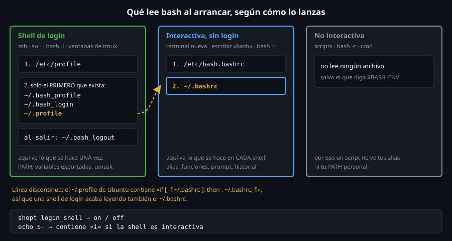

# Cómo arranca bash: shells de login e interactivas

> Todo lo que personalizas esta semana vive en un archivo que bash **a veces** lee y a veces no.
> Saber cuál lee en cada caso es la diferencia entre un `PATH` que funciona y uno que «solo va a veces».



## 🎯 Objetivos

- Decidir si una shell es **de login** y si es **interactiva**, con dos comandos
- Predecir qué archivos de arranque lee cada combinación
- Explicar por qué `~/.profile` carga `~/.bashrc` y qué pasa si añades un `~/.bash_profile`
- Decidir **dónde** va cada tipo de configuración
- Reconocer la divergencia de arranque entre Ubuntu/Debian, RHEL y Arch

## 1. Qué problema resuelve

Escribes `export PATH="$HOME/bin:$PATH"` en `~/.bashrc`, abres otra terminal y
funciona. Entras por SSH y no. Programas el script en `cron` y tampoco. Ejecutas
`ssh servidor comando` y el `PATH` es otro. Cada caso es una **forma distinta
de arrancar bash**, y cada forma lee unos archivos distintos.

Dos preguntas bastan para saber cuáles:

1. ¿Es una shell **de login**? Es la primera shell de una sesión: la que te da
   `ssh`, `su -`, `bash -l` o una consola de texto.
2. ¿Es **interactiva**? Lee comandos de un terminal en el que escribes tú, no de
   un archivo ni de `-c`.

## 2. Cómo funciona

### 2.1 Las dos preguntas, en la shell

```bash
shopt login_shell
# login_shell    	off
echo $-
# himBHs
```

`shopt login_shell` dice si es de login (`on`/`off`). `$-` son las opciones de
la shell: **si contiene `i`, es interactiva**. Un script (`bash script.sh`) o
`bash -c` no la tienen:

```bash
bash -c 'echo $-'
# hBc
```

> El valor exacto de `$-` varía según cómo lances la shell (`himBHs` en una
> sesión, `himBHc` con `docker exec -t bash -ic`). Fíjate solo en la `i`.

### 2.2 Un experimento: cada archivo avisa de que se leyó

Prepara un `HOME` de juguete en `ubuntu-lab` donde cada archivo de arranque
solo dice su nombre. No toca tu `~`:

```bash
rm -rf /tmp/h17 && mkdir /tmp/h17
for f in .bash_profile .bash_login .profile .bashrc .bash_logout; do
  printf 'echo "  [leido %s]"\n' "$f" > "/tmp/h17/$f"
done
```

Ahora arranca bash de tres formas y mira qué lee. `2>/dev/null` calla el aviso
`cannot set terminal process group`, que sale porque no hay terminal:

```bash
# Login, no interactiva (la shell de «ssh servidor comando» con -l):
HOME=/tmp/h17 bash -lc 'echo cmd'
#   [leido .bash_profile]
# cmd

# Interactiva, sin login (una terminal nueva):
HOME=/tmp/h17 bash -ic 'echo cmd' 2>/dev/null
#   [leido .bashrc]
# cmd

# Ni login ni interactiva (un script, cron):
HOME=/tmp/h17 bash -c 'echo cmd'
# cmd
```

Tres resultados, tres reglas:

| Cómo la lanzas | Lee |
|---|---|
| `bash -l` (login) | `/etc/profile` y **uno** de `~/.bash_profile`, `~/.bash_login`, `~/.profile` |
| `bash -i` (interactiva, sin login) | `/etc/bash.bashrc` y `~/.bashrc` |
| `bash -c`, un script | **nada** (salvo `$BASH_ENV`) |

Y una combinación más: login **e** interactiva (`bash -lic`, lo que obtienes al
entrar por SSH a una terminal) lee el archivo de login, **no** el `.bashrc`:

```bash
HOME=/tmp/h17 bash -lic 'echo cmd' 2>/dev/null
#   [leido .bash_profile]
# cmd
```

### 2.3 «Solo el primero que exista»

Un login lee **un** archivo, el primero que encuentre en este orden. Bórralos
de uno en uno y míralo:

```bash
rm /tmp/h17/.bash_profile
HOME=/tmp/h17 bash -lc 'echo cmd'
#   [leido .bash_login]
# cmd
rm /tmp/h17/.bash_login
HOME=/tmp/h17 bash -lc 'echo cmd'
#   [leido .profile]
# cmd
```

De ahí viene una trampa clásica: **creas un `~/.bash_profile` y tu `~/.profile`
deja de leerse** en bash. Si lo tenías para el `PATH`, desaparece sin avisar.

### 2.4 Al salir: `.bash_logout`

Una shell de login lee `~/.bash_logout` **al terminar**, incluso con `exit` en
un `-c`:

```bash
HOME=/tmp/h17 bash -lc 'exit'
#   [leido .profile]
#   [leido .bash_logout]
```

Sirve para limpiar (borrar un temporal, vaciar la pantalla). Casi nadie lo usa.

### 2.5 Por qué `.profile` carga `.bashrc`

Si un login solo lee `.profile` y los alias están en `.bashrc`, entrando por SSH
no tendrías alias. Por eso el `~/.profile` que Ubuntu copia de `/etc/skel` lleva:

```bash
grep -n -A4 'if running bash' /etc/skel/.profile
# 11:# if running bash
# 12-if [ -n "$BASH_VERSION" ]; then
# 13-    # include .bashrc if it exists
# 14-    if [ -f "$HOME/.bashrc" ]; then
# 15-	. "$HOME/.bashrc"
```

Es la línea discontinua del diagrama: login → `.profile` → `.bashrc`. El efecto
práctico, en Ubuntu: **lo que pongas en `.bashrc` lo ven las dos**, siempre que
no hayas creado un `.bash_profile` que lo impida.

Y a la inversa: `.bashrc` empieza con una guarda que corta si no es interactiva,
para que un script que lo cargue no imprima ni cambie nada:

```bash
sed -n 5,9p /etc/skel/.bashrc
# # If not running interactively, don't do anything
# case $- in
#     *i*) ;;
#       *) return;;
# esac
```

### 2.6 Dónde va cada cosa

La regla sale de la tabla: lo que se hace **una vez por sesión** va donde lee el
login; lo que se necesita en **cada** shell nueva va donde lee la interactiva.

| Va en `~/.profile` (login) | Va en `~/.bashrc` (interactiva) |
|---|---|
| `export PATH=...` | `alias`, funciones |
| `export EDITOR=...`, `LANG` | `PS1`, `PROMPT_COMMAND` |
| `umask` | `shopt`, `HISTSIZE`, `bind` |
| Variables que **heredan** los procesos hijos | Lo que solo tiene sentido escribiendo |

Las variables exportadas se heredan, así que basta con fijarlas en el login: las
shells hijas las reciben solas. Los alias **no** se heredan, por eso van en cada
shell.

### 2.7 Otras puertas de entrada

- **`$BASH_ENV`**: si está definida, una shell **no interactiva** lee ese archivo.
  Es la única forma de que un script herede algo, y por eso se evita.

```bash
printf 'echo "  [BASH_ENV]"\n' > /tmp/h17/be
HOME=/tmp/h17 BASH_ENV=/tmp/h17/be bash -c 'echo cmd'
#   [BASH_ENV]
# cmd
```

- **`sh` no es `bash`**: `sh` (dash en Ubuntu) lee `$ENV` en lugar de `.bashrc`, y
  solo si es interactiva. Un `#!/bin/sh` jamás lee tu `.bashrc`.
- **`bash --norc`** arranca interactiva sin leer `.bashrc` y **`bash --noprofile`**
  sin leer el login. Son la herramienta de depuración: si el problema desaparece
  con `--norc`, el culpable está en tu `.bashrc`.
- **`ssh servidor comando`**: bash detecta que lo lanza el servidor SSH y, aunque no
  sea interactiva, lee `~/.bashrc`. Por eso la guarda de arriba importa: sin ella,
  un `echo` en tu `.bashrc` rompe `scp` y `rsync` (ver 4).

> **tmux**: cada ventana nueva de tmux arranca una **shell de login**. Lo
> comprobamos en el [archivo 07](07-sesiones-persistentes-tmux.md).

## 3. Cómo se usa

### 3.1 Depurar «¿qué archivo se lee?»

El método es el del experimento de 2.2: pon un `echo "leido X" >&2` temporal
al principio del archivo sospechoso y arranca la shell de la forma que falla.
Para biselar sin editar nada, arranca con `bash --norc` o `bash --noprofile`: si
el problema desaparece, el culpable está en el archivo que te has saltado.

### 3.2 Recargar sin salir

Cambiaste `~/.bashrc` y quieres verlo ahora, sin abrir otra terminal:

```bash
source ~/.bashrc    # o su forma corta: . ~/.bashrc
```

`source` ejecuta el archivo **en la shell actual**; por eso los cambios de alias y
variables se quedan. Ejecutarlo como `bash ~/.bashrc` crea un hijo que desaparece
con todo lo que definió. Y recargar **no** deshace lo anterior: un alias que
borraste del archivo sigue vivo hasta que lo `unalias`es o abres otra shell.

### 3.3 Divergencia de distro

Las tres familias leen lo mismo, pero **vienen preparadas distinto**:

| | Ubuntu/Debian | RHEL/Fedora | Arch |
|---|---|---|---|
| Archivo de login por defecto | `~/.profile` | `~/.bash_profile` | `~/.bash_profile` |
| ¿Carga `~/.bashrc` desde ahí? | sí, en `.profile` | sí, en `.bash_profile` | sí, en `.bash_profile` |
| Archivo global interactivo | `/etc/bash.bashrc` | `/etc/bashrc` | `/etc/bash.bashrc` |
| `/etc/skel` trae | `.profile`, `.bashrc`, `.bash_logout` | `.bash_profile`, `.bashrc`, `.bash_logout` | `.bash_profile`, `.bashrc`, `.bash_logout` |

Dato de Ubuntu/Debian: `/etc/profile` carga `/etc/bash.bashrc` para las shells de
login interactivas de bash, así que el global también se lee entrando por SSH.
Consecuencia práctica: en RHEL, el `~/.bash_profile` **ya existe**, así que
añadir `PATH` ahí es lo normal; en Ubuntu, usa `~/.profile` y **no crees un
`.bash_profile`** salvo que sepas lo que haces.

Ver [`docs/divergencia-distros.md`](../../../docs/divergencia-distros.md).

## 4. Antipatrones

| Antipatrón | Por qué duele | Qué hacer en su lugar |
|---|---|---|
| Crear `~/.bash_profile` en Ubuntu «para el PATH» | Tapa a `~/.profile`, que deja de leerse | Editar `~/.profile`, o que `.bash_profile` haga `. ~/.profile` |
| `export PATH=...` solo en `.bashrc` | Los scripts, `cron` y los comandos remotos no la ven | En `~/.profile`, y asumir que `cron` tiene su propio `PATH` |
| `echo` o `read` incondicional en `.bashrc` | Rompe `scp`, `rsync` y `ssh servidor comando` | Mantener la guarda `case $- in *i*)` al principio |
| Alias en `.profile` | No llegan a las shells sin login | Alias en `.bashrc` |
| Un `#!/bin/sh` que espera alias o `shopt` de bash | `sh` no lee `.bashrc` y no conoce `shopt` | `#!/usr/bin/env bash` y no depender de tu entorno |
| Cargar `.bashrc` desde un script con `source` | Trae alias y `PS1` que no pintan nada en un script | El script define lo que necesita |
| Editar `/etc/profile` o `/etc/bash.bashrc` | Un `apt upgrade` puede pisarlos | `/etc/profile.d/mi-cosa.sh`, o mejor, tu `~/.profile` |

## 5. Trucos

- **`bash -lic 'echo $PATH' 2>/dev/null`** te dice qué `PATH` tiene de verdad una
  sesión nueva de login, sin abrir una. Si difiere del de tu terminal, ya sabes
  cuál es la que te falla.
- **`env -i HOME=$HOME bash -l`** arranca un login con un entorno **vacío**:
  si algo funciona ahí, funciona en cualquier sitio.
- **`type -a nombre`** te enseña todas las apariencias de un nombre (alias,
  función, ejecutables en el `PATH`) en el orden en que bash las prueba. Lo
  usamos de verdad en el [archivo 03](03-alias-y-funciones.md).

## 📚 Recursos Adicionales

- `man bash`, sección **INVOCATION**: la tabla oficial de qué lee cada caso
- [Bash Reference Manual: Bash Startup Files](https://www.gnu.org/software/bash/manual/bash.html#Bash-Startup-Files)
- [`docs/divergencia-distros.md`](../../../docs/divergencia-distros.md)

## ✅ Checklist de Verificación

- [ ] `shopt login_shell` y `echo $-` te dicen qué tipo de shell tienes ahora
- [ ] Reproduces con el `HOME` de juguete los tres arranques y su resultado
- [ ] Demuestras que un login lee **solo uno** de los tres archivos
- [ ] Explicas por qué el `.profile` de Ubuntu carga `.bashrc` y para qué sirve la guarda de `.bashrc`
- [ ] Sabes si una variable va a `~/.profile` o a `~/.bashrc` y por qué
- [ ] Citas una diferencia de arranque entre Ubuntu y RHEL

---

[← README de la semana](../README.md) · [Variables de entorno y `PATH` →](02-variables-de-entorno-y-path.md)
