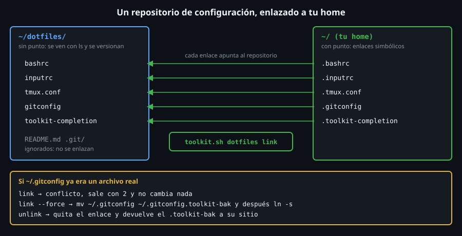

# Dotfiles y `toolkit dotfiles`

> Tu entorno (alias, prompt, atajos, `tmux`) son unos pocos archivos de texto.
> Si no los versionas, los pierdes con la máquina; si los versionas a mano, nunca coinciden.



## 🎯 Objetivos

- Explicar qué es un *dotfile* y por qué se guardan en un repositorio, sin el punto
- Elegir entre copiar, enlace duro, enlace simbólico, GNU `stow` y un repositorio `git` desnudo
- Crear y leer enlaces simbólicos con `ln -s`, `readlink` y `find -type l`
- Leer el diseño de `toolkit.sh dotfiles` (`status`, `link`, `unlink`) y sus códigos de salida
- Reconocer por qué **valida antes de cambiar nada** y respalda en lugar de pisar

## 1. Qué problema resuelve

Dedicas una tarde a dejar tu `~/.bashrc`, tu `~/.tmux.conf` y tu `~/.gitconfig`
como los quieres. Seis meses después, un servidor nuevo: «¿cómo lo tenía?». O
pierdes el portátil. O los editas en dos máquinas y ahora **difieren**.

La solución: los archivos viven en **un repositorio** (con `git` ya tienes
historial, copia remota y diff) y tu home solo contiene **enlaces** a él. Editas
en un sitio, y la máquina nueva se prepara con tres órdenes.

## 2. Cómo funciona

### 2.1 La convención: sin punto en el repositorio

Un archivo con punto es **oculto**: `ls` no lo enseña. En el repositorio se
guardan **sin el punto** (`bashrc`, no `.bashrc`) para verlos y editarlos con
normalidad, y el punto se añade **al enlazar**: `~/dotfiles/bashrc` →
`~/.bashrc`. Es la regla que sigue `toolkit dotfiles`.

### 2.2 Cinco formas de llevar la configuración

| Método | Cómo | Pega |
|---|---|---|
| **Copiar** | `cp bashrc ~/.bashrc` | Dos copias que **divergen**; hay que acordarse de copiar |
| **Enlace duro** | `ln bashrc ~/.bashrc` | Mismo *inode*, pero un editor que guarda **reemplazando** el archivo rompe el vínculo; no cruza sistemas de archivos |
| **Enlace simbólico** | `ln -s ~/dotfiles/bashrc ~/.bashrc` | Funciona; hay que crear cada enlace (aquí `toolkit`) |
| **GNU `stow`** | `stow -t ~ bash tmux` | Crea los enlaces desde carpetas; un programa más que instalar |
| **`git` desnudo** | `git --git-dir=~/.dotfiles.git --work-tree=~` | Sin enlaces, pero cuesta dominarlo y es fácil subir de más |

Las pruebas reales, en `ubuntu-lab`:

```bash
rm -rf /tmp/s17 && mkdir -p /tmp/s17/home /tmp/s17/dotfiles/bash /tmp/s17/dotfiles/tmux
cd /tmp/s17/dotfiles
echo "# bashrc" > bash/.bashrc; echo "set -g mouse on" > tmux/.tmux.conf
stow -t /tmp/s17/home bash tmux
ls -la /tmp/s17/home | tail -2
# lrwxrwxrwx 1 root root   24 Oct 25 05:34 .bashrc -> ../dotfiles/bash/.bashrc
# lrwxrwxrwx 1 root root   27 Oct 25 05:34 .tmux.conf -> ../dotfiles/tmux/.tmux.conf
```

`stow` crea **enlaces relativos**, una carpeta por «paquete» (con el punto
**incluido** en el nombre). Escribir a través del enlace modifica el original:

```bash
echo "alias x=1" >> /tmp/s17/home/.tmux.conf
cat /tmp/s17/dotfiles/tmux/.tmux.conf
# set -g mouse on
# alias x=1
```

Y el *inode* de un enlace duro es **el mismo** que el del original, que es lo que
lo hace frágil:

```bash
ls -li /tmp/s17/dotfiles/bash/.bashrc | awk '{print $1}'
# 7042809
ln /tmp/s17/dotfiles/bash/.bashrc /tmp/s17/hard.link
ls -li /tmp/s17/hard.link | awk '{print $1}'
# 7042809
```

`toolkit dotfiles` hace lo mismo que `stow` para **un solo nivel**, sin instalar
nada, con respaldo de lo que ya había y con `status` para ver el estado. Es un
buen ejercicio: para un uso serio, `stow` es perfectamente válido.

### 2.3 Enlaces simbólicos: `ln -s` y `readlink`

El orden de `ln -s` es **destino, nombre del enlace** (el contrario que `cp`):

```bash
cd /tmp/s17
ln -s dotfiles/bash/.bashrc rel.link
readlink rel.link
# dotfiles/bash/.bashrc
readlink -f rel.link
# /tmp/s17/dotfiles/bash/.bashrc
```

`readlink` enseña **a qué apunta**; `readlink -f` lo resuelve a una ruta
absoluta. Un enlace **relativo** se interpreta desde el directorio **del enlace**,
no desde donde estés, y por eso `rel.link` solo funciona si vive junto a
`dotfiles/`. `toolkit` escribe enlaces **absolutos** (más fáciles de comprobar y
no dependen de dónde vivan).

Para ver los enlaces de tu home:

```bash
find /tmp/d17/home -maxdepth 1 -type l -printf '%f -> %l\n' | sort
```

### 2.4 El diseño de `toolkit dotfiles`

```
toolkit.sh dotfiles status [--repo DIR] [--home DIR]
toolkit.sh dotfiles link   [--repo DIR] [--home DIR] [--force] [--dry-run]
toolkit.sh dotfiles unlink [--repo DIR] [--home DIR]
```

`--repo` por defecto es `$DOTFILES_REPO` o `~/dotfiles`; `--home` es `$HOME`. El
segundo existe **para poder probar** sin tocar tu home real, igual que `--salida`
en `schedule gen`.

Cada archivo del repositorio está, respecto a su destino `~/.NOMBRE`, en **uno de
cinco estados**:

| Estado | Significa |
|---|---|
| `ok` | es un enlace simbólico y apunta **a este repositorio** |
| `falta` | no existe nada |
| `conflicto-archivo` | hay un archivo real |
| `conflicto-enlace` | hay un enlace, pero a otro sitio |
| `conflicto-directorio` | hay un directorio |

Y los códigos de salida:

| Código | Cuándo |
|---|---|
| `0` | todo en orden (`status`: todo enlazado; `link`/`unlink`: hecho) |
| `1` | uso inválido: opción desconocida, repositorio o home inexistente, repositorio vacío |
| `2` | `status`: algo falta o choca; `link`: hay conflictos y **no se cambió nada** |

Una sesión real, con un `~/.gitconfig` que **ya existía** como archivo real:

```bash
toolkit.sh dotfiles status --repo repo --home home
# falta      .bashrc
# conflicto  .gitconfig (archivo real)
# falta      .tmux.conf
# resumen: ok=0 falta=2 conflicto=1
echo "codigo: $?"
# codigo: 2
toolkit.sh dotfiles link --repo repo --home home
# conflicto  .gitconfig (archivo real)
# toolkit dotfiles link: 1 conflictos; no se ha cambiado nada (--force respalda y reemplaza; anade --dry-run para ver antes el plan)
```

`link` **no hace nada** ante un conflicto: ni siquiera enlaza los dos que sí podría.
Con `--force` respalda el original y enlaza todo:

```bash
toolkit.sh dotfiles link --repo repo --home home --force
# enlazado .bashrc -> /tmp/d17/repo/bashrc
# respaldado .gitconfig -> .gitconfig.toolkit-bak
# enlazado .gitconfig -> /tmp/d17/repo/gitconfig
# enlazado .tmux.conf -> /tmp/d17/repo/tmux.conf
# enlazados: 3, ya estaban: 0, respaldados: 1
```

Ejecutarlo otra vez no cambia nada (**idempotente**), y `unlink` deshace, con el
original devuelto a su sitio:

```bash
toolkit.sh dotfiles link --repo repo --home home
# ya enlazado .bashrc
# ya enlazado .gitconfig
# ya enlazado .tmux.conf
# enlazados: 0, ya estaban: 3, respaldados: 0
toolkit.sh dotfiles unlink --repo repo --home home
# quitado    .bashrc
# restaurado .gitconfig
# quitado    .tmux.conf
# quitados: 2, restaurados: 1, omitidos: 0
```

### 2.5 Las decisiones de diseño

| Decisión | Por qué |
|---|---|
| **Validar todo antes de tocar nada** (`dotfiles_link_check`) | Un `link` a medias deja el home medio enlazado y sin saber cómo volver |
| Un directorio **nunca** se reemplaza, ni con `--force` | Podría contener años de datos |
| Respaldo `.toolkit-bak`, no borrado | Un `--force` equivocado se deshace con `unlink` |
| **No pisar un respaldo existente** | Un segundo `--force` perdería el original de verdad |
| `unlink` solo quita **enlaces a este repositorio** | Un archivo real que no es tuyo no se borra |
| `pwd -P` sobre repo y home | El enlace y la comparación usan la ruta física; `.` y los enlaces no confunden |
| Ignorar `README*`, `LICENSE*`, ocultos y no regulares | El repositorio puede tener documentación y `.git/` sin que se enlacen |
| Nombres con regex (`^[A-Za-z0-9][A-Za-z0-9._-]*$`) | Un archivo con un nombre raro nunca acaba como `~/.` algo inesperado |

Las funciones, de la que consulta a la que modifica:

| Función | Hace | Cambia el disco |
|---|---|:--:|
| `dotfiles_list` | Qué archivos del repositorio se enlazan | no |
| `dotfiles_state` | Estado de un destino | no |
| `dotfiles_parse` / `dotfiles_prepare` | Opciones y validación de rutas | no |
| `dotfiles_status` | Informe y código `2` | no |
| `dotfiles_link_check` | Detecta conflictos y sale con `2` | no |
| `dotfiles_link` | Respalda y enlaza (o enseña el plan con `--dry-run`) | **sí** |
| `dotfiles_unlink` | Quita enlaces y restaura respaldos | **sí** |

## 3. Cómo se usa

### 3.1 Montar tu repositorio

```bash
mkdir ~/dotfiles && cd ~/dotfiles && git init
cp ~/.bashrc bashrc         # sin punto
cp ~/.tmux.conf tmux.conf
git add . && git commit -m "feat: first dotfiles"
toolkit.sh dotfiles link --dry-run --force
toolkit.sh dotfiles link --force
```

Primero siempre `--dry-run`: enseña el plan **sin ejecutarlo**. Ojo: con
conflictos y **sin** `--force`, el dry-run también se niega (sale con `2`); para
ver qué haría `--force`, combina los dos.

### 3.2 En una máquina nueva

```bash
git clone <URL-de-tu-repositorio> ~/dotfiles
toolkit.sh dotfiles status
toolkit.sh dotfiles link --force
```

### 3.3 Lo que **no** debe entrar

Un repositorio de dotfiles suele acabar en un servicio público. **No** metas
tokens, claves ni contraseñas. El patrón para lo que es privado: un archivo
aparte que **no se versiona** y que el principal incluye si existe. En
`.gitconfig`, `[include] path = ~/.gitconfig.local`; en `.bashrc`,
`[ -f ~/.bashrc.local ] && . ~/.bashrc.local`. Y añade `*.local` al `.gitignore`.

### 3.4 Divergencia de distro

`stow` está en los repositorios de las tres familias: `apt install stow` y
`pacman -S stow`; en RHEL está en **EPEL**. `toolkit dotfiles` no necesita nada:
es bash y coreutils, igual en todas.

## 4. Antipatrones

| Antipatrón | Por qué duele | Qué hacer en su lugar |
|---|---|---|
| Copiar los archivos «de vez en cuando» | Divergen y no sabes cuál manda | Enlaces a un repositorio |
| Subir tokens o claves a un repositorio público | Quedan en el historial para siempre | `*.local` y un `.gitignore` |
| `ln -sf` sobre un archivo que tenías | Pierdes el original | Respaldo, como hace `link --force` |
| Un solo `.bashrc` enorme sin cuidar las máquinas | Cosas de Linux rompen en macOS o en servidores | Una sola base y `.local` por máquina |
| Enlazar el directorio entero `~/.config` | Mezclas configuración con caché y secretos | Enlazar archivos o subcarpetas concretas |
| Probar `link --force` directo en tu home | Un fallo te deja sin `.bashrc` | `--dry-run` y `--home` de prueba primero |
| Instalar dotfiles ajenos sin leerlos | Ejecutan código al abrir tu terminal | Leerlos y copiar solo lo que entiendes |
| Olvidar el `.toolkit-bak` | Se acumulan respaldos y un `--force` posterior se niega | Revísalos y bórralos cuando todo esté bien |

## 5. Trucos

- **`find ~ -maxdepth 1 -type l -printf '%f -> %l\n'`**: los enlaces de tu home y
  a dónde van; el «`ls -l` filtrado» que enseña quién apunta a tu repositorio.
- **`git -C ~/dotfiles status`** sin entrar en la carpeta: ver si tu configuración
  tiene cambios sin guardar.
- **`diff <(toolkit.sh dotfiles status --repo A) <(... --repo B)`** compara el
  estado de dos repositorios de un vistazo.

## 📚 Recursos Adicionales

- `man ln`, `man readlink` y `info stow` (o `man stow`)
- [dotfiles.github.io](https://dotfiles.github.io/): un directorio de ejemplos y herramientas

## ✅ Checklist de Verificación

- [ ] Explicas por qué los archivos del repositorio van sin punto
- [ ] Creas un enlace con `ln -s` y lo lees con `readlink` y `readlink -f`
- [ ] Citas dos ventajas y dos pegas de `stow` frente a `toolkit dotfiles`
- [ ] Enumeras los cinco estados y los tres códigos de salida
- [ ] Explicas por qué `link` no cambia **nada** si hay un conflicto
- [ ] Haces `link --force`, miras el `.toolkit-bak` y lo recuperas con `unlink`

---

[← Sesiones persistentes con `tmux`](07-sesiones-persistentes-tmux.md) · [Práctica 01: el arranque de la shell y el `PATH` →](../2-practicas/01-arranque-de-la-shell-y-path.md)
