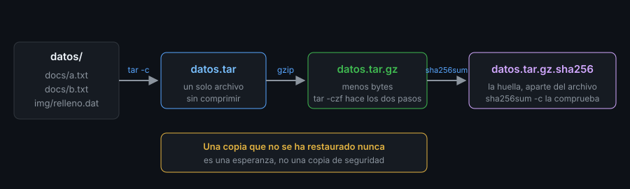

# `tar`: archivar sin comprimir

> `tar` mete muchos archivos en uno, **conservando permisos, fechas y enlaces**.
> Casi toda copia de seguridad en Linux empieza —y se estropea— por no entender sus tres letras.



## 🎯 Objetivos

- Crear, listar y extraer un archivo `tar` con `-c`, `-t` y `-x`
- Explicar por qué `tar` quita la `/` inicial y qué hace `-C`
- Excluir archivos, extraer solo una parte y comprobar un `tar` contra el disco
- Reconocer los dos fallos clásicos: rutas absolutas y extraer sobre algo existente
- Distinguir `tar` de la compresión y saber que son dos pasos

## 1. Qué problema resuelve

Copiar una carpeta con `cp -r` pierde cosas que importan en una copia: no guarda
el propietario, trata distinto los enlaces simbólicos según las opciones, y deja
miles de archivos sueltos que hay que mover uno a uno. Un **archivo `tar`**
(*tape archive*, de cuando se escribía en cinta) los empaqueta en **un solo
archivo** con los metadatos de cada uno. Ese archivo se mueve, se comprueba y se
guarda como una sola cosa.

`tar` **no comprime**: agrupa. Comprimir es un segundo paso (archivo 02) que
`tar` sabe encadenar por ti con una letra más.

## 2. Cómo funciona

### 2.1 Las tres operaciones

Una invocación de `tar` lleva **una** operación y después opciones:

| Letra | Operación | Quiere decir |
|---|---|---|
| `-c` | *create* | crear un archivo nuevo |
| `-t` | *list* | listar el contenido, sin extraer |
| `-x` | *extract* | extraer |
| `-f ARCHIVO` | *file* | el archivo con el que trabajas |
| `-v` | *verbose* | mostrar cada archivo que procesa |

`-f` va **la última** en un grupo de letras, porque lo siguiente es su valor:
`tar -cvf datos.tar datos`, no `tar -cfv datos.tar datos` (eso crea un archivo
llamado `v` y falla al buscar `v.tar`). Prepara un directorio de pruebas en `ubuntu-lab`:

```bash
rm -rf /tmp/t18 && mkdir -p /tmp/t18/datos/docs /tmp/t18/datos/img && cd /tmp/t18
echo hola > datos/docs/a.txt; echo mundo > datos/docs/b.txt
head -c 20000 /dev/zero | tr '\0' 'A' > datos/img/relleno.dat
ln -s docs/a.txt datos/enlace; chmod 600 datos/docs/b.txt
tar -cf datos.tar datos
tar -tf datos.tar
# datos/
# datos/docs/
# datos/docs/a.txt
# datos/docs/b.txt
# datos/enlace
# datos/img/
# datos/img/relleno.dat
```

`-t` con `-v` añade permisos, propietario, tamaño, fecha y, para el enlace, a
dónde apunta:

```bash
tar -tvf datos.tar | sed 's/ [0-9-]* [0-9:]* / FECHA /'
# drwxr-xr-x root/root FECHA       0 2026-10-25 05:59 datos/
# -rw------- root/root FECHA       6 2026-10-25 05:59 datos/docs/b.txt
# lrwxrwxrwx root/root FECHA       0 2026-10-25 05:59 datos/enlace -> docs/a.txt
```

(Salida recortada.) Observa que `b.txt` conserva su `-rw-------` y que el enlace
se guarda **como enlace**, no como copia del archivo al que apunta.

### 2.2 Dónde se extrae: `-C`

Sin más, `tar -x` extrae **en el directorio actual**. `-C DIR` cambia de
directorio antes de actuar, y sirve en las dos direcciones:

```bash
mkdir out && tar -xf datos.tar -C out && ls out
# datos
tar -cf c.tar -C datos docs && tar -tf c.tar
# docs/
# docs/a.txt
# docs/b.txt
```

En el segundo caso `-C datos` hace que el archivo guarde `docs/...` y no
`datos/docs/...`. Es la forma de controlar **qué ruta queda dentro** del archivo,
que es lo que decide dónde aparecerán los archivos al restaurar.

### 2.3 La barra inicial: por qué `tar` la quita

Si le das una ruta absoluta, `tar` te avisa y la guarda sin la `/`:

```bash
tar -cf abs.tar /tmp/t18/datos/docs
# tar: Removing leading `/' from member names
tar -tf abs.tar
# tmp/t18/datos/docs/
# tmp/t18/datos/docs/a.txt
# tmp/t18/datos/docs/b.txt
```

No es un error: es una **protección**. Un archivo con rutas absolutas, al
extraerse, sobrescribiría los originales en `/etc` o `/home` sin preguntar.
`-P` (`--absolute-names`) lo desactiva; úsalo solo si sabes por qué:

```bash
tar -cPf absP.tar /tmp/t18/datos/docs && tar -tf absP.tar | head -1
# /tmp/t18/datos/docs/
```

Ese archivo, al extraerse con `-P`, **escribiría en `/tmp/t18/datos/docs` y no
junto a ti**. Si alguna vez restauras un archivo que no hiciste tú, mira antes
cómo son sus rutas (archivo 03).

## 3. Cómo se usa

### 3.1 Extraer solo una parte

Se nombran los miembros al final, con la ruta **tal como sale en `-t`**:

```bash
mkdir o2 && tar -xf datos.tar -C o2 datos/docs/a.txt && find o2 -type f
# o2/datos/docs/a.txt
mkdir o3 && tar -xf datos.tar -C o3 --wildcards '*.txt' && find o3 -type f | sort
# o3/datos/docs/a.txt
# o3/datos/docs/b.txt
```

`--wildcards` hace que `*` sea un comodín de `tar` (con las comillas, para que
no lo expanda la shell). `--strip-components=1` quita el primer nivel al
extraer, y es lo que quita el `datos/` de más:

```bash
mkdir o4 && tar -xf datos.tar -C o4 --strip-components=1 && ls o4
# docs
# enlace
# img
```

### 3.2 Excluir y listas de archivos

```bash
tar -cf ex.tar --exclude='*.dat' datos && tar -tf ex.tar | grep -c relleno
# 0
printf 'datos/docs/a.txt\ndatos/docs/b.txt\n' > lista
tar -cf l.tar -T lista && tar -tf l.tar
# datos/docs/a.txt
# datos/docs/b.txt
```

`--exclude` lleva el patrón entre comillas, **antes** de los archivos que se
añaden. `-T lista` lee los nombres de un archivo (uno por línea): lo que
produce `find ... > lista` o un `git ls-files`.

### 3.3 Comprobar contra el disco y extraer sin pisar

`-d` (*diff*) compara el archivo con lo que hay ahora en el disco:

```bash
echo cambio >> datos/docs/a.txt
tar -df datos.tar
# datos/docs/a.txt: Size differs
```

Si extraes sobre archivos que ya existen, **`tar` los sobrescribe sin avisar**.
`-k` (`--keep-old-files`) lo evita, y es la opción prudente al restaurar:

```bash
tar -xkf datos.tar -C out
# tar: datos/docs/a.txt: Cannot open: File exists
# tar: datos/docs/b.txt: Cannot open: File exists
```

### 3.4 Por la entrada y salida estándar

`-f -` es la entrada o salida estándar: permite encadenar `tar` con otras
órdenes, sin archivo en medio. Es la base de `tar | ssh` en un copiado de
carpetas por red:

```bash
tar -cf - datos | tar -tf - | head -2
# datos/
# datos/docs/
```

### 3.5 Copias incrementales: `--listed-incremental`

Una copia completa cada noche gasta espacio. `tar` puede guardar **solo lo que
cambió** desde la última vez, apoyándose en un archivo de estado (`snar`):

```bash
rm -f snar
tar --listed-incremental=snar -czf full.tgz datos
echo nuevo > datos/nuevo.txt
tar --listed-incremental=snar -czf inc1.tgz datos
tar -tzf inc1.tgz | grep -v '/$'
# datos/nuevo.txt
```

La segunda copia solo contiene `nuevo.txt`. El precio: para restaurar necesitas
la completa **y todas las incrementales, en orden**; si pierdes una, pierdes lo
posterior. Para un volumen pequeño, la copia completa más simple suele ganar.

### 3.6 Divergencia de distro

`tar` es GNU `tar` en las cuatro: 1.35 en Ubuntu 24.04 y Arch, 1.34 en Debian 12
y Rocky 9. Todo lo de este archivo funciona igual. En macOS y BSD `tar` es otra
implementación (`bsdtar`), con opciones diferentes: aquí no se usa.

## 4. Antipatrones

| Antipatrón | Por qué duele | Qué hacer en su lugar |
|---|---|---|
| `tar -cfv archivo.tar ...` | La `f` consume la `v`: crea un archivo llamado `v` y falla con `Cannot stat: v.tar` | `-cvf archivo.tar` (la `f` la última) |
| Archivar con rutas absolutas y `-P` | Al extraer sobrescribe el original, no tu destino | Rutas relativas y `-C` |
| `tar -xf` sin mirar antes con `-t` | Descubres un directorio raíz distinto o miles de archivos sueltos | `tar -tf` primero |
| Extraer sobre un directorio con datos | `tar` sobrescribe sin avisar | Directorio vacío, o `-k` |
| Cambiar de directorio con `cd` antes de `tar` y olvidarlo | La ruta del archivo depende de dónde estabas | `-C` explícito |
| Confiar en que el `.tar` está bien porque se creó | Nadie ha comprobado que se pueda leer | `tar -tf` y extraer en pruebas (archivo 03) |
| Incrementales sin guardar el `snar` | Sin el estado, la siguiente es completa de nuevo | Guardar el `snar` junto a las copias |
| `tar` sin comillas con `*` en `--exclude` | La shell lo expande antes | `--exclude='*.log'` |

## 5. Trucos

- **`tar -tf archivo | head`** para ver la estructura antes de extraer; si el
  primer nombre no es un directorio único, extrae en uno vacío.
- **`tar -xf archivo --one-top-level`** extrae dentro de un directorio con el
  nombre del archivo, por si lo hizo alguien sin directorio raíz.
- **`tar -cf - dir | wc -c`** da el tamaño que ocuparía el archivo sin crearlo.

## 📚 Recursos Adicionales

- `man tar` y `info tar`: el manual GNU de `tar` es largo y excelente
- [GNU tar manual](https://www.gnu.org/software/tar/manual/tar.html)

## ✅ Checklist de Verificación

- [ ] Creas, listas y extraes un `tar` con `-cvf`, `-tvf` y `-xf`
- [ ] Explicas por qué `-f` va la última de las letras
- [ ] Ves el aviso de la `/` inicial y sabes qué protege
- [ ] Extraes un solo archivo y un comodín, y quitas un nivel con `--strip-components`
- [ ] Excluyes con `--exclude` y listas con `-T`
- [ ] Comparas con el disco con `-d` y evitas sobrescribir con `-k`
- [ ] Haces una copia incremental con `--listed-incremental` y sabes el coste al restaurar

---

[← Semana 17: Glosario](../../week-17-personalizacion_del_entorno_y_productividad/5-glosario/README.md) · [Compresión: `gzip`, `bzip2`, `xz` y `zstd` →](02-compresion-gzip-bzip2-xz-zstd.md)
