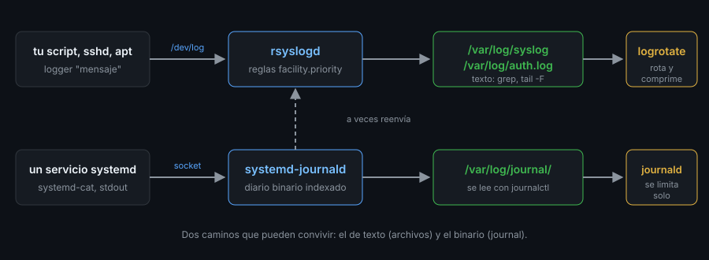

# `/var/log` y los registros clásicos

> Cuando algo falla, el sistema casi siempre **ya te lo ha contado**: está en `/var/log`.
> Aprende dónde mirar, quién escribe cada archivo y qué significa `facility.priority`.



## 🎯 Objetivos

- Recorrer `/var/log` y saber qué contiene cada archivo habitual
- Explicar `facility.priority` y leer una regla de `rsyslog`
- Escribir un mensaje de prueba con `logger` y encontrarlo en su archivo
- Leer inicios de sesión con `last`, `lastb` y `lastlog`
- Seguir un registro en vivo con `tail -F` y `less +F`, también tras una rotación
- Reconocer qué cambia entre Ubuntu, Debian, RHEL y Arch

## 1. Qué problema resuelve

«No arranca», «no puedo entrar por SSH», «el disco se llena»: la respuesta está
en un registro. El problema es saber **cuál**, y que según la distribución el
mismo hecho se apunta en archivos distintos, o en ninguno (si usa el diario
binario del archivo 05). Este archivo es el mapa del mundo **de texto**.

## 2. Cómo funciona

### 2.1 Quién escribe qué

Hay tres escritores. Cada uno deja un tipo de archivo:

| Escritor | Qué apunta | Ejemplos |
|---|---|---|
| **El demonio de syslog** (`rsyslogd`) | Lo que las aplicaciones le mandan por `/dev/log` | `syslog`, `auth.log`, `kern.log`, `mail.log` |
| **Cada programa**, directamente | Su propio registro, a su manera | `dpkg.log`, `apt/history.log`, `nginx/access.log` |
| **El sistema de acceso** (`login`, `sshd`) | Quién entró y cuándo, en formato **binario** | `wtmp`, `btmp`, `lastlog` |

En `ubuntu-lab`, tras una instalación mínima, `/var/log` es esto:

```bash
ls -l /var/log | awk '{print $1,$3,$4,$9}'
# -rw-r--r-- root root alternatives.log
# drwxr-xr-x root root apt
# -rw-r--r-- root root bootstrap.log
# -rw-rw---- root utmp btmp
# -rw-r--r-- root root dpkg.log
# -rw-rw-r-- root utmp lastlog
# -rw-rw-r-- root utmp wtmp
```

(Salida recortada.) No hay `syslog` ni `auth.log`: **nadie los escribe**,
porque en la imagen no hay `rsyslog`. Es la divergencia más importante de esta
semana (apartado 3.5).

### 2.2 `facility.priority`: la regla de `rsyslog`

Cada mensaje lleva dos etiquetas: de **dónde** viene (la *facility*:
`auth`, `kern`, `mail`, `user`, `local0`…`local7`) y **cuánta importancia**
tiene (la *priority*). Las prioridades, de más a menos grave:

| Nivel | Nombre | Sentido |
|:--:|---|---|
| 0 | `emerg` | el sistema no se puede usar |
| 1 | `alert` | actuar ya |
| 2 | `crit` | condición crítica |
| 3 | `err` | error |
| 4 | `warning` | aviso |
| 5 | `notice` | normal pero significativo |
| 6 | `info` | informativo |
| 7 | `debug` | depuración |

`rsyslog` decide a qué archivo va cada mensaje con reglas
`selector  destino`. Estas son las de Ubuntu (`/etc/rsyslog.d/50-default.conf`):

```
auth,authpriv.*              /var/log/auth.log
*.*;auth,authpriv.none       -/var/log/syslog
kern.*                       -/var/log/kern.log
mail.*                       /var/log/mail.log
*.emerg                      :omusrmsg:*
```

`auth,authpriv.*` es «todo lo de esas facilities, de cualquier prioridad».
`*.*;auth,authpriv.none` es «todo **menos** lo de `auth`» (que ya va a su archivo,
por privacidad). El `-` delante del destino le dice que no vacíe a disco en cada
línea (más rápido). `*.emerg` avisa a **todos los usuarios conectados**.

### 2.3 Probarlo con `logger`

`logger` escribe un mensaje al registro del sistema. Con `rsyslogd` en marcha (en
el laboratorio lo arrancas a mano; en una máquina real ya lo hace systemd):

```bash
apt-get install -y -qq rsyslog >/dev/null
rsyslogd 2>/dev/null; sleep 1
logger -t mitag "mensaje de prueba"
tail -2 /var/log/syslog
# 2026-10-25T06:03:36.833914+00:00 ubuntu-lab rsyslogd: [origin software="rsyslogd" ...] start
# 2026-10-25T06:03:37.344575+00:00 ubuntu-lab mitag: mensaje de prueba
```

Una línea es: fecha, máquina, **etiqueta** (`mitag`) y mensaje. Con `-p` eliges
facility y prioridad y con ella, el destino:

```bash
logger -p auth.info -t sshtest "Accepted publickey for ana"
logger -p local0.warning -t app "aviso de app"
tail -1 /var/log/auth.log
# 2026-10-25T06:03:45.335297+00:00 ubuntu-lab sshtest: Accepted publickey for ana
grep -c "aviso de app" /var/log/syslog /var/log/auth.log
# /var/log/syslog:1
# /var/log/auth.log:0
```

El mensaje `auth` fue a `auth.log` y **no** a `syslog`; el de `local0`, a
`syslog`. Otras opciones: `-i` añade el PID, `-s` también escribe en `stderr`,
`-f archivo` envía el contenido de un archivo.

### 2.4 Los permisos de los registros

Un registro contiene nombres de usuario, direcciones y a veces errores con datos.
No es para todo el mundo:

```bash
ls -l /var/log/syslog /var/log/auth.log
# -rw-r----- 1 syslog adm 726 Oct 25 06:03 /var/log/syslog
# -rw-r----- 1 syslog adm  80 Oct 25 06:03 /var/log/auth.log
```

`640`, propietario `syslog` y grupo **`adm`**: quien está en `adm` lee los
registros sin ser `root`. Es el motivo de añadir a un administrador a `adm`
(`getent group adm`), y la razón de que `tail /var/log/syslog` te dé
`Permission denied` siendo un usuario normal.

### 2.5 Los registros binarios: `last`, `lastb` y `lastlog`

`wtmp` (entradas y salidas), `btmp` (intentos **fallidos**) y `lastlog` (último
acceso de cada usuario) no se leen con `cat`: son binarios, y tienen su propia
herramienta (del paquete `util-linux` en las cuatro distribuciones):

```bash
last -n 3          # últimas sesiones; en el contenedor no hay ninguna
# wtmp begins Fri Sep 25 20:26:01 2026
lastb -n 3         # intentos fallidos (necesita root)
lastlog | head -3
# Username         Port     From                                       Latest
# root                                                                **Never logged in**
# daemon                                                              **Never logged in**
```

Si alguien prueba contraseñas por SSH, `lastb` lo muestra; si un usuario
**nunca** entró, `lastlog` lo dice (útil en la auditoría de cuentas de la
Semana 11).

## 3. Cómo se usa

### 3.1 Seguir un registro en vivo: `-f` y `-F`

```bash
tail -n 20 /var/log/syslog      # últimas 20 líneas
tail -F /var/log/syslog         # sigue; reabre el archivo si se rota
less +F /var/log/syslog         # igual, pero con Ctrl-C vuelves a navegar y F para seguir
```

`tail -f` sigue el archivo **abierto**; cuando `logrotate` lo renombra, sigue
mirando el viejo y no ve nada nuevo. `tail -F` (`--follow=name --retry`) sigue
el **nombre**, y lo reabre. Para una vigilancia larga, siempre `-F`.

### 3.2 Buscar con orden

```bash
grep -i 'failed' /var/log/auth.log | tail
zgrep -i 'failed' /var/log/auth.log.*.gz       # los ya rotados y comprimidos
grep -c ' error ' /var/log/syslog              # cuántas
```

Los registros rotados acaban en `.1`, `.2.gz`…: por eso conoces ya `zgrep` del
archivo 02. Para cruzar varios, `zcat -f` los lee todos igual, estén o no
comprimidos.

### 3.3 Los registros de los programas

Cada programa decide el suyo. Los de instalación de paquetes en Debian y Ubuntu:

```bash
tail -2 /var/log/dpkg.log
# 2026-10-25 05:56:41 status installed libc-bin:amd64 2.39-0ubuntu8.9
head -4 /var/log/apt/history.log
# Start-Date: 2026-09-11  02:03:42
# Commandline: apt-get install --reinstall apt
# Reinstall: apt:amd64 (2.7.14build2)
# End-Date: 2026-09-11  02:03:44
```

`dpkg.log` dice **qué paquete cambió y cuándo**; `apt/history.log` dice **qué
orden** lo provocó. Es la primera parada para «¿quién instaló esto?».

### 3.4 Cuánto ocupan

```bash
du -sh /var/log
# 8.5M	/var/log
du -s /var/log/* | sort -rn | head -3
```

Un `/var/log` que crece sin parar es el motivo de la mitad de los «el disco está
lleno» (Semana 13: `snapshot`). La respuesta es rotarlos (archivo 06), no
borrarlos a mano.

### 3.5 Divergencia de distro

| | Ubuntu | Debian | RHEL/Rocky | Arch |
|---|---|---|---|---|
| Demonio de syslog | `rsyslog` (instalación completa) | `rsyslog` no viene en la instalación estándar de Debian 12 | `rsyslog` (repositorio AppStream) | **ninguno**: solo el journal |
| Registro general | `/var/log/syslog` | solo con `rsyslog` | `/var/log/messages` | `journalctl` |
| Registro de autenticación | `/var/log/auth.log` | `/var/log/auth.log` | `/var/log/secure` | `journalctl _COMM=sshd` |
| Registro del gestor de paquetes | `dpkg.log`, `apt/history.log` | igual | `dnf.log`, `dnf.rpm.log` | `pacman.log` |
| `last`, `lastlog` | `util-linux` | `util-linux` | `util-linux` | `util-linux` |

En los contenedores del laboratorio, **ninguna** de las cuatro tiene `rsyslog`:
`ubuntu-lab` solo tiene `dpkg.log` y compañía; `rhel-lab` tiene `dnf.log`;
`arch-lab`, solo `pacman.log` y `journal`. Por eso, para esta práctica, instalas
`rsyslog` en `ubuntu-lab` y lo arrancas a mano (es lo que haría systemd).

## 4. Antipatrones

| Antipatrón | Por qué duele | Qué hacer en su lugar |
|---|---|---|
| `tail -f` sobre un registro que rota | Se queda mirando el archivo renombrado | `tail -F` |
| `cat /var/log/wtmp` | Es binario: ensucia el terminal | `last` |
| `rm /var/log/syslog` con el demonio en marcha | `rsyslogd` sigue escribiendo en el archivo borrado y el disco no se libera | `logrotate` o `truncate -s 0` |
| `chmod 644 /var/log/auth.log` «para leerlo» | Expone quién entró y desde dónde | Añadirte al grupo `adm` |
| Buscar siempre en `syslog` | Lo de `auth` no está ahí (`auth,authpriv.none`) | Mirar `auth.log` o `secure` |
| Suponer que el archivo existe | En Arch y en contenedores no hay `rsyslog` | `journalctl` (archivo 05) |
| Un script que escribe sus propios mensajes en `/var/log` | Necesita permisos y rotación | `logger -t nombre` |
| Dejar `debug` activado «por si acaso» | Llena el disco y esconde lo importante | Subir el nivel al terminar |

## 5. Trucos

- **`logger -s -t nombre "mensaje"`** escribe a la vez en `stderr` y en el
  registro: perfecto para un script que se ejecuta a mano y por `cron`.
- **`grep -hE 'Failed|Invalid' /var/log/auth.log* 2>/dev/null`** junta todos los
  rotados sin comprimir; con `zgrep -h` lees también los `.gz`.
- **`ls -lt /var/log | head`** ordena por fecha de modificación: el archivo que
  se acaba de escribir es el primero.

## 📚 Recursos Adicionales

- `man 3 syslog` (facilities y prioridades) y `man rsyslog.conf`
- [Filesystem Hierarchy Standard: `/var/log`](https://refspecs.linuxfoundation.org/FHS_3.0/fhs/ch05s10.html)

## ✅ Checklist de Verificación

- [ ] Describes qué escribe cada archivo de `/var/log` de tu máquina
- [ ] Lees una regla de `rsyslog` y dices a qué archivo irá un mensaje `auth.info`
- [ ] Escribes un mensaje con `logger -t` y lo localizas
- [ ] Compruebas que `auth.log` y `syslog` reciben cosas distintas
- [ ] Usas `last`, `lastb` y `lastlog` y sabes qué significa cada uno
- [ ] Sigues un registro con `tail -F` y explicas la diferencia con `-f`
- [ ] Sabes en qué archivo mirar en Ubuntu, RHEL y Arch

---

[← Integridad y restauración](03-integridad-y-restauracion.md) · [`journalctl`: el diario de systemd →](05-journalctl.md)
