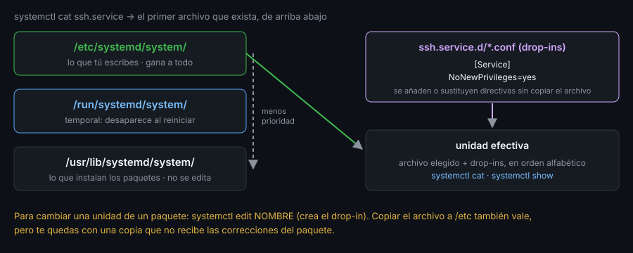

# systemd: unidades, rutas y precedencia

> Casi todo lo que arranca, vigila o programa una máquina Linux moderna es una **unidad** de systemd.
> Antes de usar `systemctl` conviene saber qué es una unidad y dónde vive el archivo que la define.



## 🎯 Objetivos

- Explicar qué es systemd y qué papel juega como proceso número 1
- Distinguir los tipos de unidad que usarás (`service`, `timer`, `socket`, `target`)
- Predecir qué archivo gana cuando una unidad existe en varios directorios
- Cambiar una unidad de un paquete con un *drop-in* sin tocar el original
- Practicar `enable`, `is-enabled` y `list-unit-files` **sin** una máquina arrancada, con `--root`

## 1. Qué problema resuelve

Antes de systemd cada servicio traía un script de arranque en `/etc/init.d/`.
Cada script reinventaba cómo esperar a la red, cómo saber si el servicio seguía
vivo y cómo apagarlo. systemd sustituye esos scripts por **archivos de
declaración**: dices *qué* quieres (qué ejecutar, tras qué, con qué usuario) y
él se encarga del *cómo*. Como además es el proceso con PID 1, ve nacer y morir
a todos los demás y puede reiniciar, aislar y registrar cada servicio.

Esta semana es de **lectura e inspección**: ya programaste temporizadores en la
Semana 16 y leíste su diario en la 18. Ahora aprendes a ver qué hay detrás.

> ⚠️ **`ubuntu-lab` no ejecuta systemd.** El contenedor arranca con `sleep infinity`
> como PID 1, así que `systemctl status` responde `System has not been booted with
> systemd as init system (PID 1)`. En este archivo y en el 03 usarás las
> herramientas que **sí** funcionan sin él (`--root`, `systemd-analyze verify`).
> Los comandos que preguntan por servicios en marcha (archivos 02 y 04) están
> marcados y se ejecutan en **tu propia máquina**: una VM, un servidor, o WSL2 con
> `systemd=true`.

## 2. Cómo funciona

### 2.1 Tipos de unidad

El tipo lo da la extensión del archivo:

| Extensión | Qué describe | Ejemplo |
|---|---|---|
| `.service` | Un proceso que systemd arranca y vigila | `ssh.service`, `cron.service` |
| `.timer` | Un disparador por tiempo que activa otra unidad | `logrotate.timer` |
| `.socket` | Un socket que arranca un servicio al recibir tráfico | `ssh.socket` |
| `.target` | Un punto de sincronización: agrupa unidades | `multi-user.target` |
| `.mount`, `.path` | Un punto de montaje; un archivo vigilado | `tmp.mount` |

Un `.timer` no hace nada por sí solo: activa un `.service` del mismo nombre
(`job.timer` → `job.service`), que es lo que genera `toolkit schedule gen`.

### 2.2 Los targets: el «nivel de ejecución»

Un *target* es una unidad sin proceso: sirve para decir «arranca todo esto antes
de considerar listo el sistema». El que se alcanza por defecto se lee con:

```bash
# En ubuntu-lab (funciona sin systemd: lee el enlace /etc/systemd/system/default.target).
docker exec ubuntu-lab systemctl --root=/ get-default
# graphical.target
```

`multi-user.target` es el equivalente a un servidor sin entorno gráfico;
`graphical.target` lo incluye y añade la pantalla de inicio de sesión.

### 2.3 Dónde vive el archivo de una unidad

systemd busca el archivo `NOMBRE.service` en una lista **ordenada** de
directorios y usa el primero que exista. Los tres que importan:

| Directorio | Quién escribe aquí | Prioridad |
|---|---|:--:|
| `/etc/systemd/system/` | tú, el administrador | alta |
| `/run/systemd/system/` | generadores y cosas temporales (se pierde al reiniciar) | media |
| `/usr/lib/systemd/system/` | los paquetes (`apt`, `dnf`, `pacman`) | baja |

La lista completa (hay más, para unidades de sesión y transitorias) la da el
propio systemd:

```bash
docker exec ubuntu-lab systemd-analyze unit-paths | head -6
# /etc/systemd/system.control
# /run/systemd/system.control
# /run/systemd/transient
# /run/systemd/generator.early
# /etc/systemd/system
# /etc/systemd/system.attached
```

Sirve la regla: **lo que está más arriba gana**. Una copia de `ssh.service` en
`/etc/systemd/system/` tapa por completo la del paquete.

> **Divergencia de distro**: los paquetes de Debian, Ubuntu, RHEL y Arch instalan sus
> unidades en `/usr/lib/systemd/system/`. En Debian y Ubuntu, `/lib` es un enlace a
> `/usr/lib` (*usr-merge*, Semana 02), así que según la versión `systemctl` te enseña
> la ruta como `/lib/systemd/system/...` o como `/usr/lib/systemd/system/...`: es el
> mismo directorio. Para no depender de ello, pregúntaselo a systemd con `systemctl cat`
> o `systemctl show -p FragmentPath` (archivo 02).

### 2.4 Drop-ins: cambiar una unidad sin copiarla

Copiar el archivo entero a `/etc` tiene un coste: te quedas con una **foto** que
no recibe las correcciones del paquete. Un *drop-in* añade solo lo que cambia. Es
un directorio `NOMBRE.service.d/` junto a la unidad, con archivos `*.conf` que
se leen en orden alfabético y se fusionan encima del original:

```bash
docker exec ubuntu-lab bash -c '
rm -rf /tmp/sd && mkdir -p /tmp/sd/etc/systemd/system/job.service.d && cd /tmp/sd
printf "[Service]\nType=oneshot\nExecStart=/usr/bin/true\n" > etc/systemd/system/job.service
printf "[Service]\nNoNewPrivileges=yes\n" > etc/systemd/system/job.service.d/10-hard.conf
systemd-analyze --root=$PWD cat-config systemd/system/job.service'
# # /tmp/sd/etc/systemd/system/job.service
# [Service]
# Type=oneshot
# ExecStart=/usr/bin/true
#
# # /tmp/sd/etc/systemd/system/job.service.d/10-hard.conf
# [Service]
# NoNewPrivileges=yes
```

Esta es la vista que ofrece `systemctl cat NOMBRE` en una máquina arrancada:
cada fragmento con un comentario que dice **de qué archivo viene**. En una máquina
real el atajo es `sudo systemctl edit NOMBRE`, que crea el drop-in
(`/etc/systemd/system/NOMBRE.d/override.conf`) y recarga por ti.

### 2.5 Habilitar es crear un enlace

`systemctl enable` no arranca nada: crea un **enlace simbólico** desde el target
indicado en la sección `[Install]` de la unidad. Con `--root` puedes verlo sin
tocar el sistema ni tener systemd en marcha:

```bash
docker exec ubuntu-lab bash -c '
cd /tmp/sd
printf "[Install]\nWantedBy=multi-user.target\n" >> etc/systemd/system/job.service
systemctl --root=$PWD enable job.service 2>&1 | head -1
systemctl --root=$PWD is-enabled job.service
systemctl --root=$PWD list-unit-files "job*" --no-pager'
# Created symlink /tmp/sd/etc/systemd/system/multi-user.target.wants/job.service → /etc/systemd/system/job.service.
# enabled
# UNIT FILE   STATE   PRESET
# job.service enabled enabled
```

Y `disable` borra ese enlace. Entiende bien la diferencia, porque confunde a todo
el mundo:

| Orden | Qué cambia | Cuándo |
|---|---|---|
| `enable` / `disable` | Si arranca **en el próximo arranque** | persiste |
| `start` / `stop` | Si está en marcha **ahora** | se pierde al reiniciar |
| `enable --now` | Las dos cosas | |

(El aviso `is added as a dependency to a non-existent unit` que acompaña al
`enable` con `--root` es normal: la carpeta de pruebas no tiene `multi-user.target`.)

## 3. Cómo se usa

### 3.1 Los estados de una unidad instalada

`list-unit-files` enseña el **estado de instalación**, no si corre:

| Estado | Significa |
|---|---|
| `enabled` | Tiene enlace en un `.wants/`: arrancará |
| `disabled` | Está instalada pero sin enlace |
| `static` | No tiene `[Install]`: solo se activa si otra unidad la pide |
| `masked` | Enlazada a `/dev/null`: ni a mano se puede arrancar |

```bash
docker exec ubuntu-lab systemctl --root=/ list-unit-files --no-pager | head -4
# UNIT FILE                                    STATE    PRESET
# proc-sys-fs-binfmt_misc.automount            static   -
# dev-hugepages.mount                          static   -
# dev-mqueue.mount                             static   -
```

### 3.2 Recargar

systemd lee los archivos al arrancar y cuando se lo pides. Tras **editar una
unidad a mano** hay que ejecutar `sudo systemctl daemon-reload`; sin eso sigue
usando la versión vieja y avisa con un `Warning` que menciona `daemon-reload`.
`systemctl edit` ya lo hace por ti.

## 4. Antipatrones

| Antipatrón | Por qué duele | Qué hacer en su lugar |
|---|---|---|
| Editar `/usr/lib/systemd/system/x.service` | El paquete lo sobrescribe en la próxima actualización | Un drop-in con `systemctl edit` |
| Copiar la unidad entera a `/etc` para cambiar una línea | No recibe las correcciones del paquete | Drop-in con solo esa línea |
| Editar y olvidar `daemon-reload` | systemd sigue con la versión en memoria | `systemctl daemon-reload` o `systemctl edit` |
| Confundir `enable` con `start` | Un servicio «habilitado» puede estar parado | Mira los dos: `is-enabled` e `is-active` |
| `masked` para «deshabilitar» algo que molesta | Es un bloqueo duro; quien lo busque tarda en encontrarlo | `disable`, y `mask` solo si hay que impedirlo |

## 5. Trucos

- **`systemctl cat NOMBRE`** enseña la unidad **efectiva**: archivo principal y
  todos los drop-ins, cada uno con su ruta. Es lo primero que se mira.
- **`systemctl show -p FragmentPath,DropInPaths NOMBRE`** devuelve las rutas
  exactas, útil para scripts.
- **`systemd-analyze cat-config RUTA`** hace lo mismo para configuración de
  demonios (`systemd/journald.conf`): junta el archivo y sus `.conf.d/`.

## 📚 Recursos Adicionales

- `man systemd.unit` (rutas de búsqueda y drop-ins) y `man systemctl`
- [systemd documentation](https://www.freedesktop.org/software/systemd/man/)

## ✅ Checklist de Verificación

- [ ] Nombras cuatro tipos de unidad y sabes cuál activa a un `.timer`
- [ ] Explicas por qué `ubuntu-lab` no responde a `systemctl status`
- [ ] Ordenas `/etc`, `/run` y `/usr/lib` por prioridad
- [ ] Creas un drop-in y lo ves fusionado con `systemd-analyze cat-config`
- [ ] Habilitas una unidad con `--root` y localizas el enlace creado
- [ ] Distingues `enable` de `start` y `static` de `disabled`

---

[← Semana 18: Glosario](../../week-18-archivado_compresion_y_registros_del_sistema/5-glosario/README.md) · [Inspeccionar servicios con `systemctl` →](02-systemctl-inspeccionar-servicios.md)
