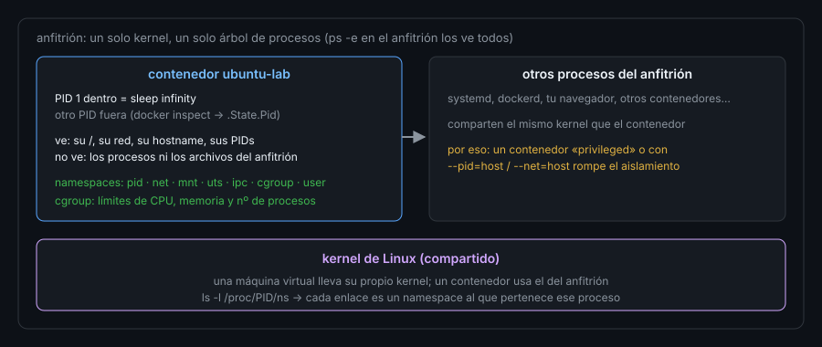

# Contenedores desde la CLI

> Un contenedor no es una mini-máquina virtual: es **un proceso de Linux** con una vista recortada del sistema.
> Todo lo que aprendiste de procesos, señales, permisos y diario sirve para leerlo desde fuera.

## 🎯 Objetivos

- Listar, inspeccionar y leer los registros de un contenedor con `docker ps/top/stats/logs/inspect`
- Entrar en un contenedor con `docker exec` (y como otro usuario)
- Extraer un dato concreto de `docker inspect` con `--format`
- Explicar qué es un contenedor en términos de procesos, *namespaces* y *cgroups*
- Reconocer por qué un PID 1 que no recoge hijos deja procesos zombi

> Estos comandos se ejecutan **desde el anfitrión** contra los contenedores del
> laboratorio (`ubuntu-lab`…). Dentro de `ubuntu-lab` no hay `docker`: es la CLI
> de tu máquina la que habla con el demonio. Son de **solo lectura**, salvo
> `docker exec`, que ejecuta lo que le pidas dentro.

## 1. Qué problema resuelve

Te piden mirar «el contenedor que va raro» y no sabes si está parado, si se
reinicia en bucle, si corre como root o qué escribe en el disco. `docker` reúne
esas respuestas, pero sus nombres no te dicen que detrás hay **procesos
normales**. Entender esa correspondencia te permite razonar con lo que ya
sabes en vez de memorizar otro conjunto de comandos.



## 2. Cómo funciona

### 2.1 Leer el estado: `ps`, `top`, `stats`

```bash
docker ps --filter name=-lab --format 'table {{.Names}}\t{{.Status}}\t{{.Image}}'
# NAMES        STATUS       IMAGE
# ubuntu-lab   Up 3 hours   ubuntu:24.04
# rhel-lab     Up 4 hours   rockylinux:9
# debian-lab   Up 4 hours   debian:12
# arch-lab     Up 4 hours   archlinux:base
```

`--format` usa plantillas de Go; `table` añade cabeceras. `docker ps -a` incluye
los parados (un contenedor que sale con error aparece ahí, no en `ps`).

```bash
docker top ubuntu-lab -eo pid,ppid,user,comm | head -3
# PID       PPID      USER   COMMAND
# 1379617   1379593   root   sleep
# 1485030   1379617   root   cron
docker stats --no-stream --format '{{.Name}} {{.CPUPerc}} {{.MemUsage}} {{.PIDs}}' ubuntu-lab
# ubuntu-lab 0.00% 189.6MiB / 9.713GiB 206
```

Fíjate en `docker top`: los PID son los **del anfitrión** (millones), no los de
dentro. Es el mismo proceso visto desde fuera. `stats --no-stream` da una sola
muestra; sin él se queda refrescando. `PIDs` cuenta los procesos del contenedor
(206, de los que la mayoría son zombis, ver 2.5).

### 2.2 Registros: `docker logs`

`docker logs` muestra lo que el **PID 1** del contenedor escribió en su salida
estándar y de error. No es un archivo de `/var/log`:

```bash
docker exec ubuntu-lab sh -c 'echo hola-desde-pid1 > /proc/1/fd/1'
docker logs --tail 2 ubuntu-lab
# hola-desde-pid1
```

Escribir en el descriptor 1 del PID 1 hace aparecer el texto en `logs`. Moraleja:
una aplicación en contenedor debe escribir a **stdout/stderr**, no a un archivo
interno que nadie ve. Flags útiles: `--tail N`, `--since 10m`, `-f` (seguir).

### 2.3 Entrar y ejecutar: `docker exec`

```bash
docker exec -u 1000 ubuntu-lab id
# uid=1000(ubuntu) gid=1000(ubuntu) groups=1000(ubuntu),4(adm),...,27(sudo),...
```

`exec` lanza un proceso **nuevo** dentro de los *namespaces* del contenedor. `-u`
cambia el usuario; sin él entras como el usuario del contenedor, que por defecto
es **root**. `-it` da una shell interactiva (`docker exec -it ubuntu-lab bash`).
Salir de esa shell no detiene el contenedor: el PID 1 es otro.

### 2.4 `inspect --format`: un dato exacto

`docker inspect` devuelve un JSON enorme. Con `--format` extraes lo que quieres:

```bash
docker inspect --format '{{.HostConfig.Privileged}} {{printf "%q" .Config.User}} {{.HostConfig.ReadonlyRootfs}} {{.HostConfig.NetworkMode}} {{.HostConfig.CapAdd}}' ubuntu-lab
# false "" false bc-linux-commandline_lab [CAP_SYS_PTRACE]
```

Se lee: no privilegiado, usuario vacío (**root**), sistema de archivos
escribible, en la red `bc-linux-commandline_lab`, con una capacidad extra
(`CAP_SYS_PTRACE`, para poder usar `strace` en el laboratorio). Esos son los
campos que mira `toolkit harden container`. `printf "%q"` pone comillas para ver
que el valor está **vacío**, no ausente.

Otras consultas del día a día:

```bash
docker inspect --format '{{.State.Pid}}' ubuntu-lab      # PID en el anfitrión
# 1379617
docker port ubuntu-lab; echo "rc=$?"                    # puertos publicados
# rc=0   (vacío: ninguno publicado)
docker diff ubuntu-lab | head -3                         # qué cambió respecto a la imagen
# C /run
# C /run/lock
# A /run/lock/subsys
```

`diff` marca `A` añadido, `C` cambiado, `D` borrado. Útil para descubrir dónde
escribe una aplicación. Y `docker cp ubuntu-lab:/ruta ./local` copia archivos
en ambos sentidos.

> ⚠️ La plantilla de Go **no tiene `!=`**: `{{.State.Pid != 0}}` da un error de
> sintaxis. Se escribe `{{ne .State.Pid 0}}`.

### 2.5 Qué es un contenedor: *namespaces*, *cgroups* y PID 1

Un contenedor se construye con dos mecanismos del kernel que ya conoces de lejos:

| Mecanismo | Qué limita | Dónde lo ves |
|---|---|---|
| *Namespaces* | Qué **ve** el proceso: PIDs, red, montajes, usuarios, hostname | `ls /proc/self/ns` |
| *cgroups* | Cuánto **usa**: CPU, memoria, nº de procesos | `docker stats` |

```bash
docker exec ubuntu-lab ls /proc/self/ns
# cgroup  ipc  mnt  net  pid  pid_for_children  time  time_for_children  user  uts
```

Cada entrada es un espacio de nombres. Dos procesos con el mismo identificador
en `/proc/PID/ns/pid` comparten la vista de procesos; el contenedor tiene la
suya, en la que su primer proceso es el **PID 1**.

Y ahí está el detalle: el PID 1 **tiene la responsabilidad de recoger a los
hijos huérfanos** (`wait`, Semana 10). `ubuntu-lab` usa `sleep infinity` como
PID 1, que no sabe hacerlo, así que los procesos terminados quedan como zombis:

```bash
docker exec ubuntu-lab ps -eo pid,ppid,stat,user,cmd | awk 'NR==1||$3!~/Z/' | head -4
#     PID    PPID STAT USER     CMD
#       1       0 Ss+  root     sleep infinity
#   17304       1 Ss   root     cron
#   29406       0 Ss+  root     /bin/bash
```

(Filtramos los `Z` con `awk`; sin filtro la lista sería larga. Tus PIDs serán otros.) La solución en
un contenedor real es `docker run --init`, que pone `tini` como PID 1:

```bash
docker run --rm --init ubuntu:24.04 sh -c 'cat /proc/1/cmdline | tr "\0" " "'
# /sbin/docker-init -- sh -c cat /proc/1/cmdline | tr "\0" " "
```

## 3. Cómo se usa

### 3.1 Un recorrido de diagnóstico

1. `docker ps -a` — ¿está arriba? ¿salió? ¿con qué código (`Exited (1)`)?
2. `docker logs --tail 50 NOMBRE` — qué dijo antes de caer.
3. `docker inspect --format '{{.State.ExitCode}} {{.State.OOMKilled}}' NOMBRE` — ¿lo mató el kernel por memoria?
4. `docker top NOMBRE` y `docker stats --no-stream NOMBRE` — qué procesos y cuánto consumen.
5. `docker exec -it NOMBRE bash` — mirar dentro con las herramientas de siempre.
6. `docker diff NOMBRE` — qué ha escrito.

### 3.2 Divergencia de distro

Los comandos `docker` son los mismos en todas partes. En RHEL/Fedora el motor
«oficial» es **Podman**, con la misma sintaxis (`podman ps`, `podman logs`…) y
sin demonio. Dentro de `rhel-lab` (Rocky 9) no hay `docker` ni `podman`: igual
que en `ubuntu-lab`, la CLI vive en el anfitrión. En Arch, `docker` se instala
desde el repositorio `extra`.

## 4. Antipatrones

| Antipatrón | Por qué duele | Qué hacer en su lugar |
|---|---|---|
| Entrar con `exec` y editar configuración dentro | Se pierde al recrear el contenedor | Cambiar la imagen o montar un volumen |
| Escribir logs a un archivo dentro | `docker logs` no los ve y crecen sin límite | Escribir a stdout/stderr |
| Asumir que los PID de `top` son los de dentro | Son los del anfitrión | `docker exec NOMBRE ps` para los internos |
| PID 1 que no recoge hijos | Zombis acumulados, `PIDs` crece | `docker run --init` |
| `docker stats` sin `--no-stream` en un script | Nunca termina | `--no-stream` |
| Mirar solo `docker ps` | Los que salieron con error no aparecen | `docker ps -a` |
| Dar por hecho que un contenedor aísla como una VM | Comparte el kernel con el anfitrión | Endurecerlo (archivo 08) |

## 5. Trucos

- **`docker inspect --format '{{json .HostConfig}}' NOMBRE | python3 -m json.tool`**
  imprime solo la sección que te interesa, con sangría.
- **`docker exec NOMBRE cat /proc/1/cmdline | tr '\0' ' '`** muestra con qué
  comando arrancó el PID 1, sin saber la imagen.
- **`docker ps --format '{{.Names}}: {{.Ports}}'`** da en una línea qué puertos
  publica cada contenedor: el primer vistazo a la superficie expuesta.

## 📚 Recursos Adicionales

- `docker inspect --help`, `docker logs --help`
- [Referencia de `docker container`](https://docs.docker.com/reference/cli/docker/container/)

## ✅ Checklist de Verificación

- [ ] Listas los contenedores del laboratorio con una plantilla `--format`
- [ ] Obtienes el PID del anfitrión de `ubuntu-lab` con `inspect`
- [ ] Escribes en el PID 1 y lo ves con `docker logs`
- [ ] Ejecutas un comando como el usuario 1000 con `exec -u`
- [ ] Extraes `Privileged`, `User` y `ReadonlyRootfs` con `--format`
- [ ] Explicas la diferencia entre *namespaces* y *cgroups*
- [ ] Explicas por qué `--init` evita zombis

---

[← Endurecer unidades y SSH](06-endurecer-unidades-y-ssh.md) · [Seguridad de contenedores y `harden` →](08-seguridad-de-contenedores-y-harden.md)
