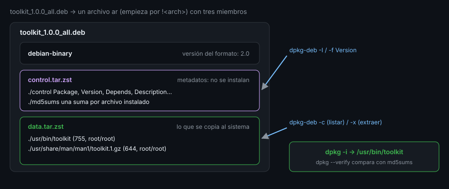

# Empaquetar una herramienta

> Un script que vive en tu carpeta es tuyo; un paquete se instala, se actualiza, se verifica y se quita sin dejar rastro.
> Aquí ves por dentro un `.deb` y decides cuándo merece la pena construir uno.



## 🎯 Objetivos

- Explicar qué problema resuelve empaquetar frente a copiar un script
- Describir las tres partes de un `.deb` y qué guarda cada una
- Inspeccionar un paquete sin instalarlo (`dpkg-deb -I`, `-f`, `-c`, `-x`)
- Construir un paquete mínimo a mano con `dpkg-deb --build`
- Elegir entre paquete nativo, archivo `.tar.gz` con instalador, o ninguno

## 1. Qué problema resuelve

Durante diecinueve semanas `toolkit.sh` ha vivido en `~/bin`. Funciona, pero
tiene límites que solo notas cuando lo quieres usar en **otra** máquina:

- No sabes **qué versión** tienes copiada en cada sitio.
- Nadie puede comprobar que el archivo **no se ha modificado** desde que lo copiaste.
- Para quitarlo hay que acordarse de dónde lo dejaste.
- Un `cp` no registra nada: `dpkg -S /ruta` no sabe a quién pertenece el archivo.

Un **paquete** convierte la herramienta en una unidad con nombre, versión,
dependencias y lista de archivos. El gestor de paquetes se encarga de instalarlo,
actualizarlo, verificarlo y borrarlo exactamente como hace con `coreutils`.

Esto no es siempre necesario. Una herramienta de uso personal en una sola máquina
no lo pide. Lo pide en cuanto la usan **varias máquinas o varias personas**.

## 2. Cómo funciona

### 2.1 Un `.deb` es un archivo con tres miembros

Un `.deb` es un archivo en formato `ar`, el mismo formato antiguo de las
bibliotecas estáticas. Se reconoce por su primera línea:

```bash
head -c 8 toolkit_1.0.0_all.deb; echo
# !<arch>
```

Dentro hay tres miembros, siempre en este orden:

| Miembro | Contiene | Para qué |
|---|---|---|
| `debian-binary` | El texto `2.0` | La versión del formato del paquete |
| `control.tar.zst` | `control`, `md5sums` y, si existen, scripts de instalación | Los **metadatos**: nada de esto se copia al sistema |
| `data.tar.zst` | El árbol de archivos (`./usr/bin/toolkit`…) | Lo que se **instala** |

(La compresión es `zst` en `dpkg` 1.22; en paquetes más antiguos verás `.xz` o
`.gz`. `dpkg-deb -Z xz` fuerza la que quieras si necesitas compatibilidad.)

No necesitas `ar` para abrirlo: `dpkg-deb` ofrece cada parte como un `tar`.

```bash
dpkg-deb --ctrl-tarfile toolkit_1.0.0_all.deb | tar -t
# ./
# ./control
# ./md5sums
dpkg-deb --fsys-tarfile toolkit_1.0.0_all.deb | tar -t
# ./
# ./usr/
# ./usr/bin/
# ./usr/bin/toolkit
# ./usr/share/
# ./usr/share/man/
# ./usr/share/man/man1/
# ./usr/share/man/man1/toolkit.1.gz
```

(En `ubuntu-lab` no existe la orden `ar`: viene en el paquete `binutils`. Con
`dpkg-deb` no hace falta.)

### 2.2 Inspeccionar sin instalar

Cuatro opciones de `dpkg-deb` responden casi todo:

| Opción | Qué hace |
|---|---|
| `-I` (`--info`) | Muestra los metadatos |
| `-f` (`--field`) | Un campo concreto, ideal para scripts |
| `-c` (`--contents`) | Lista los archivos con permisos, propietario y tamaño |
| `-x` (`--extract`) | Extrae los archivos a un directorio, **sin instalar nada** |

```bash
dpkg-deb -f toolkit_1.0.0_all.deb Package Version Depends
# Package: toolkit
# Version: 1.0.0
# Depends: bash (>= 5.0)
dpkg-deb -c toolkit_1.0.0_all.deb | tail -3
# drwxr-xr-x root/root         0 2026-10-25 07:13 ./usr/share/man/
# drwxr-xr-x root/root         0 2026-10-25 07:13 ./usr/share/man/man1/
# -rw-r--r-- root/root       667 2026-10-25 07:13 ./usr/share/man/man1/toolkit.1.gz
```

`-x` es la forma segura de **probar** un paquete ajeno: lo extraes a un
directorio temporal y miras qué trae antes de dejarlo tocar `/usr`.

```bash
dpkg-deb -x toolkit_1.0.0_all.deb /tmp/probe && /tmp/probe/usr/bin/toolkit version
# toolkit 1.0.0
```

### 2.3 Construir uno a mano

`dpkg-deb --build` convierte un directorio en un paquete. El directorio tiene la
forma del sistema de destino, más una carpeta `DEBIAN/` con los metadatos:

```
staging/
├── DEBIAN/
│   └── control            ← obligatorio
└── usr/
    └── bin/
        └── toolkit        ← aparecerá en /usr/bin/toolkit
```

```bash
mkdir -p staging/DEBIAN staging/usr/bin
install -m 0755 toolkit.sh staging/usr/bin/toolkit
cat > staging/DEBIAN/control <<'EOF'
Package: toolkit
Version: 1.0.0
Architecture: all
Maintainer: Toolkit <toolkit@example.invalid>
Description: caja de herramientas personal de sysadmin
EOF
dpkg-deb --build --root-owner-group staging toolkit_1.0.0_all.deb
# dpkg-deb: building package 'toolkit' in 'toolkit_1.0.0_all.deb'.
```

`--root-owner-group` guarda **todos** los archivos como `root:root` aunque los
hayas creado tú. Sin esa opción el paquete llevaría tu usuario, que no existe en
la máquina de destino.

### 2.4 Los dos errores que ves siempre

Primero, los permisos del directorio. `dpkg-deb` exige que la raíz y `DEBIAN/`
sean `0755`; un directorio creado con `mktemp -d` es `0700`:

```bash
chmod 700 staging/DEBIAN
dpkg-deb --build staging x.deb
# dpkg-deb: error: control directory has bad permissions 700 (must be >=0755 and <=0775)
```

Segundo, un `control` incompleto. Un campo obligatorio ausente no detiene la
construcción, **avisa**, y el paquete sale mal formado:

```
dpkg-deb: warning: parsing file 'staging/DEBIAN/control' near line 5 package 'toolkit':
 missing 'Description' field
dpkg-deb: warning: ignoring 1 warning about the control file(s)
```

Un aviso de `dpkg-deb` es un error que todavía no ha dado la cara: trátalo como tal.

## 3. Cómo se usa

### 3.1 Cuándo empaquetar y cuándo no

| Situación | Qué elegir |
|---|---|
| Un script para ti, en una máquina | Nada: `~/bin` basta |
| Tu equipo lo instala en varias máquinas Debian/Ubuntu | **Paquete `.deb`** |
| Mezcla de distribuciones | Un `.tar.gz` con su `.sha256` y un `install.sh` que acepte `--prefix` |
| Lo mantienes de forma continua | Un repositorio de paquetes propio (fuera de este bootcamp) |

El paquete **no sustituye** a las comprobaciones: un `.deb` mal construido se
instala igual de bien que uno correcto. Por eso la semana incluye `release verify`.

### 3.2 Divergencia de distro

El `.deb` es solo de la familia Debian/Ubuntu. En las otras:

| Familia | Formato | Herramienta de construcción |
|---|---|---|
| Debian/Ubuntu | `.deb` | `dpkg-deb --build` (o `debuild`) |
| RHEL/Fedora | `.rpm` | `rpmbuild` con un archivo `.spec` |
| Arch | `.pkg.tar.zst` | `makepkg` con un `PKGBUILD` |

El modelo mental es el mismo (metadatos + árbol de archivos + sumas), pero cada
uno tiene su sintaxis. Por eso `release build` construye **solo** el `.deb`:
`rpmbuild` y `makepkg` no están en `ubuntu-lab` y su práctica sería otro curso.

## 4. Antipatrones

| Antipatrón | Por qué duele | Qué hacer en su lugar |
|---|---|---|
| Construir sin `--root-owner-group` | Los archivos quedan a nombre de tu usuario | Siempre la opción, o `fakeroot` |
| Poner archivos en `/home` o `~` dentro del paquete | Un paquete instala para todo el sistema | `/usr/bin`, `/usr/share`, `/etc` |
| Instalar con `dpkg -i` un `.deb` descargado sin comprobarlo | Ejecutas su script de instalación como root | `dpkg-deb -I`, `-c` y `-x` primero |
| Editar el `.deb` a mano | Las sumas dejan de coincidir | Reconstruirlo desde el árbol |
| Ignorar los avisos de `dpkg-deb --build` | El paquete sale mal formado | Corregir hasta que no salga ninguno |
| Un directorio de trabajo con permisos `0700` | `dpkg-deb` lo rechaza | `chmod 0755` en la raíz y en `DEBIAN/` |
| Dejar el paquete junto a su suma por casualidad | Nadie sabe a cuál pertenece | `SHA256SUMS` en el mismo directorio, con el nombre sin ruta |

## 5. Trucos

- **`dpkg-deb -W --showformat='${Package} ${Version} ${Architecture}\n' x.deb`**
  imprime una línea con lo esencial; sirve para listar muchos paquetes con un bucle.
- **`dpkg-deb -e x.deb carpeta`** extrae solo la parte de control (`control`,
  `md5sums`, scripts), sin mirar los archivos instalables.
- **`dpkg-deb -x` más `diff -r`** compara lo que trae un paquete con lo que ya
  tienes instalado, antes de actualizar.

## 📚 Recursos Adicionales

- `man dpkg-deb`, `man deb`, `man deb-control`
- [Guía del mantenedor de Debian](https://www.debian.org/doc/manuals/maint-guide/)

## ✅ Checklist de Verificación

- [ ] Reconoces un `.deb` por su cabecera `!<arch>`
- [ ] Listas los miembros de control y de datos con `--ctrl-tarfile` y `--fsys-tarfile`
- [ ] Extraes un paquete a un directorio temporal con `dpkg-deb -x`
- [ ] Construyes uno mínimo con `dpkg-deb --build --root-owner-group`
- [ ] Provocas el error de permisos `700` y entiendes por qué falla
- [ ] Explicas cuándo un `.deb` no es la respuesta

---

[← Semana 19: Glosario](../../week-19-systemd_seguridad_y_contenedores_desde_cli/5-glosario/README.md) · [Control, versión y numeración →](02-control-version-y-numeracion.md)
