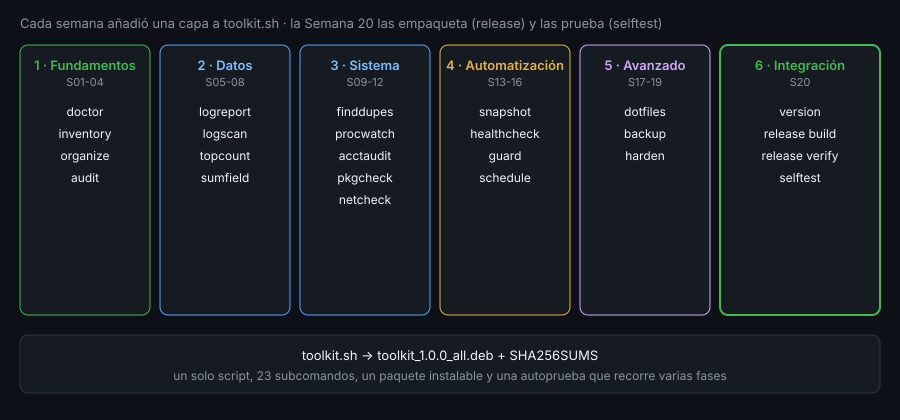

# Repaso y siguientes pasos

> Veinte semanas después, lo que has construido no es un script: es una forma de trabajar.
> Este archivo recorre las capas, nombra los hábitos que se repiten y señala dónde termina este bootcamp.

## 🎯 Objetivos

- Reconocer los patrones que se repiten en las veinte capas de `toolkit`
- Revisar el conjunto con una lista de comprobación antes de entregarlo
- Saber qué **no** cubre este bootcamp y adónde ir para cada hueco
- Elegir un próximo proyecto propio que ejercite lo aprendido

## 1. Qué problema resuelve

Al final de un curso largo es fácil quedarse con la sensación de «he visto muchas
órdenes» sin poder decir **qué sé hacer**. El repaso convierte lo visto en capacidades
y marca el borde del terreno: saber dónde acaba lo que dominas es parte de dominarlo.

## 2. Cómo funciona

### 2.1 Los patrones que se repiten

Cada capa de `toolkit` es distinta, pero todas se construyen con las mismas piezas.
Si las ves, ya no estás copiando recetas:

| Patrón | Dónde lo has usado | Por qué importa |
|---|---|---|
| `set -euo pipefail` al inicio | Todas desde la Semana 13 | Un error no pasa en silencio |
| Analizar, validar, ejecutar | `harden`, `backup`, `release` | Los errores de uso salen antes de tocar nada |
| Códigos de salida `0/1/2` | Todos los subcomandos | Cualquier script puede encadenarlos |
| Mensajes con prefijo fijo | `toolkit ACCION: …` | Se pueden buscar y probar |
| Temporal + `mv` | `backup create`, `release build` | Nunca un archivo a medias |
| `trap … EXIT` | `guard`, `release build`, `selftest` | Se limpia aunque falle |
| Salida para humanos y para máquinas | `ok`/`falla` + resumen | Se lee y se procesa |
| Probar el fallo | `audit`, `harden`, `selftest` | Una auditoría que nunca protesta no sirve |
| Ensayar antes de actuar | `organize` (plan sin `--apply`), `dotfiles`, `backup` y `release` (`--dry-run`) | Ves el plan antes de cambiar nada |

### 2.2 Las seis fases, en una frase cada una

1. **Fundamentos (S01-04)** — te mueves por un sistema sin interfaz gráfica y entiendes permisos.
2. **Datos (S05-08)** — resuelves un problema de texto con una tubería de órdenes que has construido tú.
3. **Sistema (S09-12)** — diagnosticas una máquina que no conoces: archivos, procesos, usuarios, paquetes, red.
4. **Automatización (S13-16)** — escribes scripts que fallan cuando deben y se ejecutan solos.
5. **Avanzado (S17-19)** — personalizas el entorno, archivas, lees registros e inspeccionas systemd y contenedores.
6. **Integración (S20)** — entregas una herramienta instalable, verificable y con autoprueba.

### 2.3 Qué sabes hacer ahora

Los objetivos del bootcamp eran capacidades, no listas de órdenes. Contrasta cada una
con una prueba concreta que puedas ejecutar hoy:

| Capacidad | Pruébala así |
|---|---|
| Moverte por un sistema Linux sin interfaz gráfica | Por SSH a `ubuntu-lab`, localiza el mayor archivo de `/var` con `du` y `sort` |
| Leer y escribir permisos sin adivinar | Explica `drwxrws--T` y crea un directorio compartido con `setgid` |
| Resolver un problema de texto con una tubería | De un log, saca las diez direcciones con más errores con `grep`, `awk`, `sort` y `uniq` |
| Gestionar procesos | Lanza `sleep 300`, suspéndelo, pásalo a segundo plano y termínalo con la señal adecuada |
| Instalar y consultar paquetes en tres familias | Responde «¿qué paquete trae `/usr/bin/ls`?» en `ubuntu-lab`, `rhel-lab` y `arch-lab` |
| Diagnosticar la red desde la terminal | Averigua qué escucha en un puerto y si un nombre resuelve |
| Escribir un script que falla cuando debe | Un script con `set -euo pipefail`, `trap` y validación, limpio de `shellcheck` |
| Programar tareas con manejo de error | Una tarea de `cron` o un temporizador que avise si el script falla |
| Leer el estado de un contenedor | `docker ps`, `docker logs`, `docker exec` y relacionarlo con sus procesos |

Si no puedes hacer alguna sin buscar, esa semana merece un segundo repaso. No es un
fracaso: es exactamente para lo que sirve esta lista.

### 2.4 Una lista de revisión antes de entregar

Antes de dar algo por terminado, pasa por estas preguntas. Son las mismas que usa la rúbrica:

- ¿`shellcheck` está limpio?
- ¿Cada subcomando devuelve `0`, `1` o `2` y lo documenta?
- ¿Algún comando destructivo avisa antes y hay un respaldo delante?
- ¿Hay algún secreto, ruta personal o dato real en el repositorio?
- ¿Las opciones inválidas dan un mensaje claro y código `1`?
- ¿Todo lo que crea un temporal lo borra, incluso si falla?
- ¿`selftest` pasa **y** falla cuando rompes algo a propósito?
- ¿El paquete se instala, se verifica y se quita sin dejar rastro?
- ¿Un compañero puede instalarlo leyendo solo el README?

### 2.5 Lo que este bootcamp no cubre

El contrato del curso era llegar a ser un usuario de línea de comandos **fiable**, no un
administrador de sistemas completo. Los huecos más importantes y dónde ir:

| Hueco | Qué te falta | Siguiente paso |
|---|---|---|
| **Bash avanzado** | Arrays asociativos a fondo, coprocesos, sustitución de procesos, `getopts`, `bats` para pruebas | El manual de Bash y la guía de Greg's Wiki (BashGuide) |
| **Administración de sistemas** | Almacenamiento (LVM, RAID), red avanzada (`nftables`, enrutamiento), arranque, kernel, copias a escala | Un curso de administración Linux (LPIC-1/2, RHCSA) |
| **Editor modal** | `vim`/`neovim` con soltura | `vimtutor` y una semana de práctica diaria |
| **Contenedores y orquestación** | Imágenes propias, redes de contenedores, Kubernetes | Un curso de Docker y luego de Kubernetes |
| **Automatización de configuración** | Describir máquinas con código (Ansible, Terraform) | Ansible, que sigue siendo SSH + órdenes |
| **Seguridad seria** | Modelo de amenazas, SELinux/AppArmor, auditoría | Un curso de seguridad ofensiva/defensiva, con permiso explícito |
| **Otros lenguajes** | Cuando bash se queda corto (estructuras de datos, JSON, concurrencia) | Python para scripts de sistema |

Una señal clara de que debes cambiar de herramienta: cuando tu script de bash necesita
**estructuras de datos anidadas**, **manejar JSON a mano** o **más de unos cientos de
líneas**. Bash es pegamento excelente y mal lenguaje de aplicación; saber reconocerlo es parte
del criterio.

### 2.6 Mantener lo aprendido

Las órdenes se olvidan si no se usan. Tres hábitos baratos:

1. **Vive en la terminal una semana**: sin gestor de archivos gráfico, sin buscador del sistema.
2. **Convierte cada tarea repetida en una función** y, si crece, en un subcomando de `toolkit`.
3. **Lee el manual antes de buscar**: `man`, `help`, `--help` y `info` responden más de lo que parece.

## 3. Cómo se usa

### 3.1 Elegir un próximo proyecto

Un buen proyecto propio cumple tres condiciones: resuelve un problema **tuyo**, se puede
**probar** con una autoprueba y cabe en **unos días**. Ideas que reutilizan lo aprendido:

| Proyecto | Capas que ejercita |
|---|---|
| Un informe diario de tu máquina por correo o archivo | `healthcheck`, `logscan`, `schedule` |
| Un instalador de tu entorno en una máquina nueva | `dotfiles`, `pkgcheck`, `release` |
| Un vigilante de una carpeta que clasifica lo que llega | `organize`, `finddupes`, `guard` |
| Una copia de seguridad de tus proyectos con rotación | `backup`, `snapshot`, temporizador de systemd |

### 3.2 Un plan de treinta días

Sin un plan, el impulso se apaga a la segunda semana. Uno realista, de unos 30 minutos al día:

| Días | Qué hacer | Resultado |
|---|---|---|
| 1-7 | Trabaja solo en terminal; anota cada vez que sales a buscar algo | Una lista de huecos reales |
| 8-14 | Convierte tres tareas repetidas en funciones; pásales `shellcheck` | Tres funciones en tus `dotfiles` |
| 15-21 | Añade un subcomando propio a `toolkit` con su caso en `selftest` | Un `toolkit 1.1.0` |
| 22-30 | Reconstruye el paquete, instálalo en otra máquina y anota qué falló | Una lista de mejoras para `1.2.0` |

El último paso es el que más enseña: **un programa que solo has ejecutado tú, en tu máquina,
no está terminado**. La primera instalación ajena revela suposiciones que no sabías que hacías
(rutas, usuarios, versiones de bash).

### 3.3 Cuando algo no sale

El dominio de la línea de comandos es, en buena parte, el de **depurar**. Tres preguntas
en orden resuelven la mayoría:

1. **¿Qué dice el error, palabra por palabra?** Copiarlo tal cual en una búsqueda funciona mejor que parafrasearlo.
2. **¿Qué cambió desde la última vez que funcionó?** Una actualización, un permiso, una variable de entorno.
3. **¿Puedo reducirlo?** Una tubería de cinco etapas se ejecuta etapa por etapa hasta encontrar la que miente.

### 3.4 Compartir lo que has hecho

Un `toolkit` que solo vive en tu disco no cuenta como portafolio. Para enseñarlo a otra persona
necesitas tres cosas, todas ya construidas esta semana: un **README** que se pueda seguir sin
preguntarte, un **paquete** con su `SHA256SUMS` y una **autoprueba** que cualquiera pueda ejecutar.
Súbelo a un repositorio con `git`, etiqueta la versión (`git tag v1.0.0`) y escribe en la
descripción qué hace y qué **no** hace. Quien lo lea entenderá en un minuto si le sirve.

Antes de publicar nada, repasa `git status` y `git diff --cached` buscando rutas personales,
direcciones reales o claves: una vez en un repositorio público, un secreto hay que darlo por
comprometido aunque lo borres después.

### 3.5 Divergencia de distro

Tu `toolkit` funciona en cualquier distribución con bash 5, salvo `release` (necesita
`dpkg-deb`) y las partes de `pkgcheck` que consultan el gestor de paquetes. Para llevarlo a
RHEL o Arch, el trabajo es acotado: un `case` sobre el gestor y su orden equivalente. Es
exactamente lo que se hizo en la Semana 11.

## 4. Antipatrones

| Antipatrón | Por qué duele | Qué hacer en su lugar |
|---|---|---|
| Acumular órdenes sin construir nada | Se olvidan en una semana | Un proyecto propio que las use |
| Copiar un pipeline de internet sin entenderlo | No sabes adaptarlo cuando falla | Descomponerlo y ejecutar cada etapa |
| Dar el bootcamp por «completo» sin repasar | Quedan huecos que no ves | La lista de la sección 2.4 |
| Escribir scripts enormes en bash | Imposibles de probar y mantener | Cambiar de herramienta cuando toque |
| Usar `sudo su -` para ahorrar escritura | Trabajas como root sin darte cuenta | `sudo` con el comando mínimo |
| No guardar tus dotfiles ni tu `toolkit` en control de versiones | Los pierdes con la máquina | Un repositorio con copia remota |

## 5. Trucos

- **`history | awk '{print $2}' | sort | uniq -c | sort -rn | head`** muestra las
  órdenes que más usas: es una buena guía de qué merece convertirse en alias o subcomando.
- **`type -a orden`** enseña **todas** las definiciones de un nombre (alias, función,
  binarios en el `PATH`), la forma más rápida de saber qué se ejecuta de verdad.
- **`help` sin argumentos** lista las órdenes internas de bash: es un buen mapa de qué
  puede hacer el lenguaje sin programas externos.

## 📚 Recursos Adicionales

- [Greg's Wiki: BashGuide](https://mywiki.wooledge.org/BashGuide)
- [Missing Semester (MIT)](https://missing.csail.mit.edu/)
- `vimtutor` (instalado con `vim`)

## ✅ Checklist de Verificación

- [ ] Nombras seis patrones que se repiten en las capas de `toolkit`
- [ ] Pasas la lista de revisión de la sección 2.4 sobre tu propio `toolkit`
- [ ] Explicas qué hace cada una de las seis fases en una frase
- [ ] Identificas tres huecos del bootcamp y el siguiente paso de cada uno
- [ ] Eliges un proyecto propio y dices qué capas reutiliza
- [ ] Reconoces una señal de que bash ya no es la herramienta adecuada

---

[← Construir release y selftest](06-construir-release-y-selftest.md) · [Práctica 01: Un .deb por dentro →](../2-practicas/01-un-deb-por-dentro.md)
